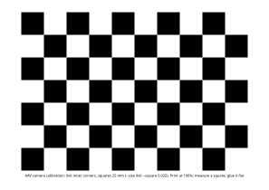

# Camera calibration: at the car, 15 minutes a camera (24 October)

The ribbon cameras have no calibration yet (Q22). Without one there's no undistortion, no
`CameraInfo` for `camera_obstacles`, and the stop-sign watcher guesses the lens. This page
is the procedure, ready for the car day. It uses ROS's stock calibrator,
[`camera_calibration`](https://docs.ros.org/en/jazzy/p/camera_calibration/).

!!! tip "The short version"
    1. Print `docs/img/checkerboard-9x6-25mm-a4.svg` at 100%, glue it flat.
    2. `pixi run calibrate-camera front_left --host 192.168.1.108`
    3. Move the board until the bars are green; **CALIBRATE**, then **SAVE**; close.
    4. Commit the two files it names. Then `front_right` the same way.

## The picture

```text
 camera Pi                     your Mac (or the Orin with its screen)
 ─────────                     ──────────────────────────────────────
 MediaMTX ──RTSP H.264──►  camera_stream (no detector, no undistortion)
 :8554/front_left                │ /sensors/camera/front_left/image_raw
                                 ▼   (a private ROS domain: this computer only)
                           camera_calibration's window  ◄── you move the board
                                 │ SAVE
                                 ▼
                           src/sensors/aav_camera_stream/config/calibrations/front_left.yaml
                           config/cameras.yaml:  calibration: <that file>
```

## What you need

| What | Note |
|---|---|
| The board | 9 x 6 inner corners (10 x 7 squares), 25 mm squares: 250 x 175 mm, A4 or Letter landscape |
| Something flat | foam board or stiff card: a bent board gives a wrong lens |
| The car's network | the camera Pi streaming (`pi/README.md`) |
| A Mac with this repo | `pixi run build` done. The tool installs `pixi install -e calib` (ROS's calibrator, about 1 GB) the first time: do it at home, the car has no internet |
| 15 minutes a camera | two cameras: `front_left`, `front_right` |

## 1. Print the board



| Step | Do |
|---|---|
| 1 | Print `docs/img/checkerboard-9x6-25mm-a4.svg` at **100% ("actual size")**, not "fit to page" |
| 2 | Glue it flat, with no bubbles |
| 3 | Measure 5 squares with a ruler, divide by 5: say 24.8 mm. Use it as `--square 0.0248` |
| Bigger | `pixi run calibrate-camera board --square 0.035 --paper a3`: easier to see from 2-3 m |

## 2. Run it

```bash
pixi run calibrate-camera front_left --host 192.168.1.108 --square 0.025
```

| Option | Default | Note |
|---|---|---|
| `--host` | `192.168.1.108` | the camera Pi (CAM1-PI) |
| `--port` | `8554` | MediaMTX's RTSP port |
| `--square` | `0.025` | m: what you measured |

## 3. Move the board

The window shows four bars. Each turns green when you have covered enough of it.

| Bar | Means | Do |
|---|---|---|
| X | left to right | the board at the picture's left edge, the middle, the right edge |
| Y | top to bottom | the same, top and bottom |
| Size | near and far | close (it fills the picture) and far (2-3 m) |
| Skew | tilted | tilt it about 30°: left, right, up, down |

- **Hold still** for a moment at each place: a blurry board isn't used.
- **The corners of the picture matter most**: the lens bends most there.
- 40 or more samples is good; the terminal prints each one.

## 4. CALIBRATE, SAVE, close

| Button | What happens |
|---|---|
| **CALIBRATE** | lights up once the bars are green. It takes up to a minute. The picture then shows straightened lines |
| Check | hold the board in view: `lin.` (the straightness error) should be under 1 px |
| **SAVE** | writes `/tmp/calibrationdata.tar.gz` |
| Close the window | the tool files the result and says so |
| ~~COMMIT~~ | not used: `camera_stream` has no `set_camera_info` |

Then commit the two files:

```bash
git add src/sensors/aav_camera_stream/config/calibrations/front_left.yaml \
        src/sensors/aav_camera_stream/config/cameras.yaml
```

A result saved earlier can be filed by hand:
`pixi run calibrate-camera install front_left /tmp/calibrationdata.tar.gz`.

## 5. What it changes

| Who | Then |
|---|---|
| `camera_stream_front_left` (its next start) | undistorts every picture; publishes `/sensors/camera/front_left/camera_info` |
| `stop_sign_watcher` | takes the camera's focal length from it: stops 4.7 m before a sign ([perception](perception.md#how-far-the-boxs-height-and-the-lens-24-oct)) |
| `camera_obstacles` | can put the camera's boxes on the road for Nav2 |
| `car.launch.py` | stops warning "no calibration" for that camera |

Check it: a real stop sign 4.7 m in front of the camera (tape measure). The watcher's log
says each camera's focal length, and it should lock at 4.5-5 m.

## The rules

| Rule | Why |
|---|---|
| Calibrate the stream's own picture (1280x720) | the tool refuses a file of another shape: a crop moves the centre |
| Fixed focus, as `pi/mediamtx.yml` sets it | a lens that refocuses changes its calibration |
| Again after a camera is moved in its mount? | no: the calibration is the lens only. Its position is `vehicle.yaml` |
| Again after a camera is swapped | yes |

## Where things are

| Part | File |
|---|---|
| The tool | `tools/calibrate_camera.py` (`pixi run calibrate-camera`) |
| Its logic, no ROS | `aav_camera_stream/calibration.py`: the board, the command, filing the result (6 tests) |
| ROS's calibrator | the `calib` environment in `pixi.toml` (`camera_calibration` 5.0.13) |
| A fix for it | `tools/camera_calibration_cv5.py`: below |

!!! note "Why `camera_calibration_cv5.py`"
    `camera_calibration` 5.0.13 expects OpenCV 4's corner array (N x 1 x 2). RoboStack
    builds Jazzy with OpenCV 5, which gives N x 2, and the calibrator stopped at the
    first board it saw. The wrapper puts the old shape back, then runs the calibrator's
    own `main()`, unchanged.

## Tried without the car (24 Oct)

| Test | Result |
|---|---|
| A made-up board, moving, through ffmpeg (OpenH264) and a local MediaMTX, into `pixi run calibrate-camera` | the window opened (off screen); **29 samples** in 50 s |
| camera_calibration's own offline calibration of 40 made-up views, lens 950 px | it found **948 px** |
| Its saved file through `calibrate-camera install` | filed; `cameras.yaml` pointed to it; the node's reader loaded it |
| The CALIBRATE and SAVE buttons, a real camera | [[untested]]: they need a person and the car |
