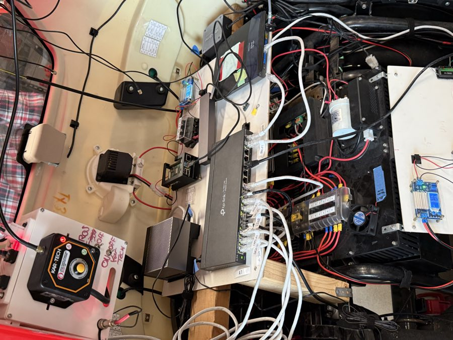
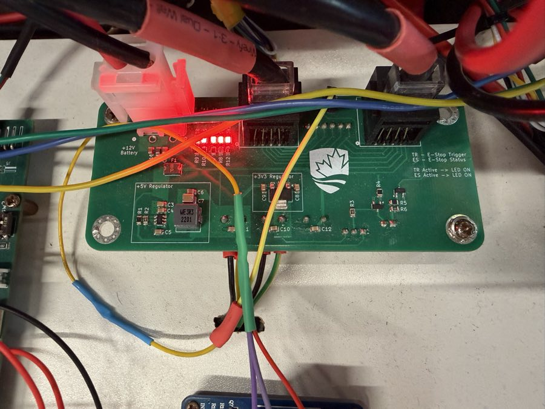
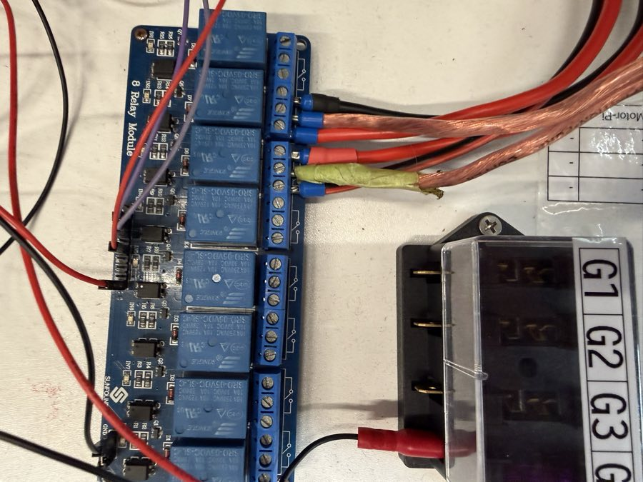
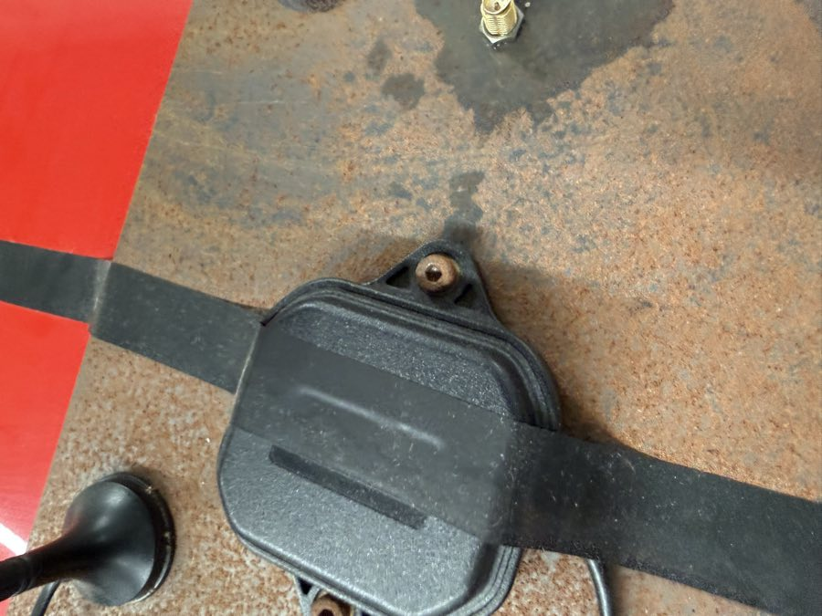
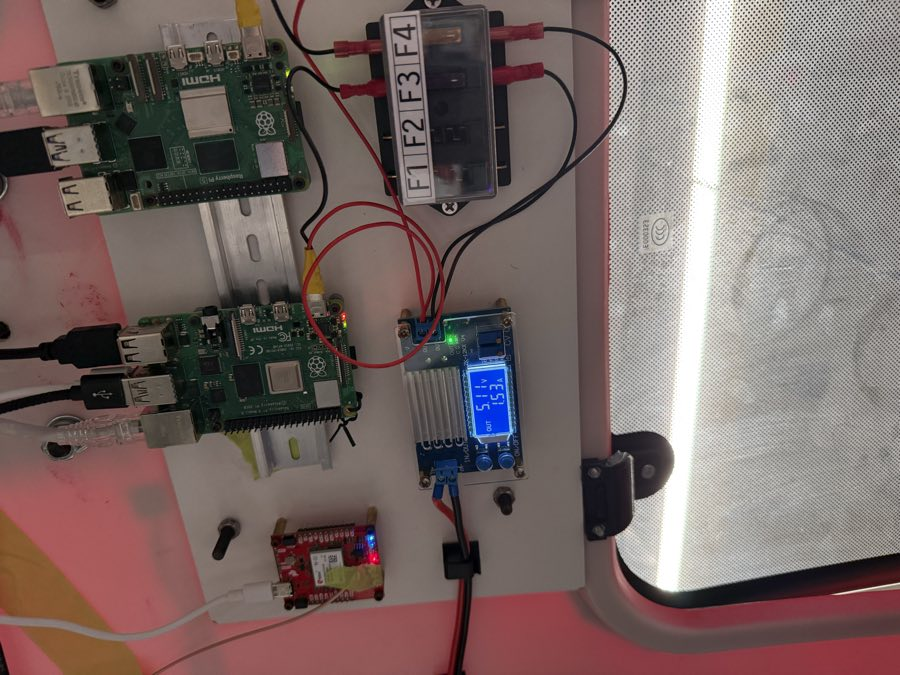
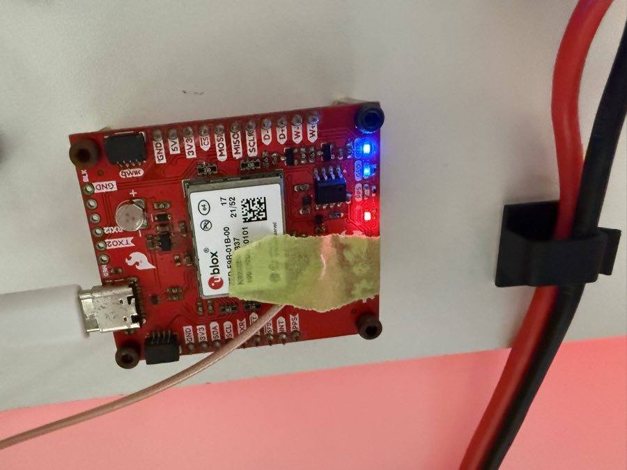
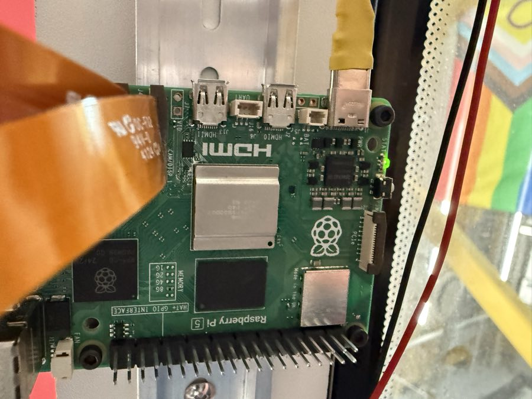
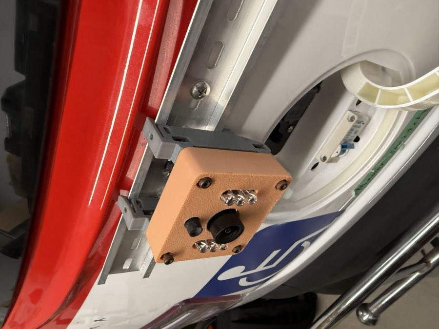

# The car in photos (14 October)

Ben took 32 photos of the car on 14 October. This page lists what they show, and what
to check at the audit on Friday 16 Oct. The full set is not in git (62 MB). It is in
`images/` on Ben's Mac.

!!! warning "Read from photos only"
    Nothing here has been logged into or measured yet. Friday's audit confirms it.

## The equipment bay (behind the seat)

| What | Seen | Notes |
|---|---|---|
| Jetson AGX Orin #1 | grey finned box, left of the switch | the main computer |
| TP-Link TL-SG116E, 16 ports | ports labelled | see the next table |
| Linksys EA3500 router | right of the switch | the car's WiFi. A note is taped to it: don't photograph it close up |
| Kar-Tech wireless e-stop receiver | top left, "ROS ON/OFF" written beside it | the human layer: overrides everything |
| A Pi in a black case | beside the fuse block H1-H4 | which Pi? (ES-Pi or QNX-Pi?) |
| Battery box, fuse panel, fan | under the shelf | |
| Motor controller | silver finned box, under the keyboard | its maximum current decides the battery shunt (KEFC sheet) |
| A red mushroom e-stop | on the left frame tube | |

### The switch's port labels

| Label | In the KEFC plan? |
|---|---|
| JETSON | yes: Orin #1 |
| DASH-UI | yes |
| CAM1-PI, CAM2-PI | yes: the two front cameras |
| LIDAR | yes |
| RTK-PI | yes: "RIG-Pi + GPS" in the PDF (the same Pi?) |
| ROUTER | yes |
| **ES-PI** | **no**: an e-stop Pi? |
| **QNX-PI** | **no**: the 2025-26 QNX layer (`Real-Time-OS`), replaced by twist_mux and the spine |

## The control board (the "Motor-Pi" board)

| Part | Seen |
|---|---|
| Raspberry Pi 4 (Motor-Pi) | plugged in on the left |
| ESP32 MicroMod (SparkFun, red) | in the MicroMod slot |
| 2 × Pololu Jrk G2 | top: steering. Below: braking. Each has power and error LEDs |
| **CAN connector** | a white 2-pin plug labelled **CANH / CANL**, beside chips U3 and U7 |
| Throttle DAC | two blue trim pots, "addr dac", a "Throttle enable" jumper |
| e-stop trig, e-stop headers | along the bottom edge |

The CAN plug is on the board. Friday: is the transceiver (U7) fitted, and does it work?

A second board: 5 V and 3.3 V regulators, two RJ45 jacks, and LEDs for **TR** (e-stop
trigger) and **ES** (e-stop status). Beside it, an 8-relay module and fuse block G1-G4.

## The roof

| What | Notes |
|---|---|
| **A 3D lidar** on a printed tripod | **our code has no lidar at all yet.** Its model? (Q22) |
| GNSS antenna (black puck) | taped down on a steel plate |
| 3 stick antennas | the router's WiFi? |
| A gold SMA bulkhead | its cable goes inside: to the GPS? |
| A suction-cup mount | empty |

## The ceiling panel: the GPS and two Pis

| What | Notes |
|---|---|
| SparkFun ZED-F9R board | USB-C to a Pi. Its antenna lead is a thin u.FL cable, held by tape: the reason for the new board with a screw-on connector |
| 2 Raspberry Pis (a Pi 5 and a Pi 4?) | one is the RTK-Pi |
| A 12 V → 5 V converter | showed 5.11 V, 1.55 A |
| Fuse block F1-F4 | |

## The cameras

Pi 5s on DIN rail at the top of the windscreen, each with a ribbon cable to its camera.

A camera in an orange printed housing with IR LEDs, on a DIN rail at the back. The PDF
lists the rear camera as new: is this one connected?

## The dash

| What | Notes |
|---|---|
| Innoview portable screen | showing an Ubuntu desktop: the raylib HUD's screen? |
| A small touchscreen, left | the Dash-UI? |
| A joystick, a keyboard labelled AAV-1 | |

A 12 V → 5 V converter on the dash's fuse block E1-E4 showed **5.08 V at 3.48 A**. A Pi 5
wants 5 A for full USB power. Friday: what does it feed, and what is its rating?

## For Friday's audit

| # | Check | Why |
|---|---|---|
| 1 | Log in to each Pi and the Orin: `hostname`, OS, ROS version, what runs at boot | the inventory |
| 2 | RTK-Pi: is the ZED-F9R on `/dev/ttyACM*`? Does `ros2 topic hz /sensors/gps/fix` give anything? | "Is there GPS data?" |
| 3 | The lidar: its model, its IP, which Pi or Orin reads it | no driver in our code yet |
| 4 | ES-Pi and QNX-Pi: what do they run? Are they in the driving path? | not in the KEFC picture |
| 5 | The control board: is U7 fitted? The steering and brake actuators' wire counts | the KEFC "to confirm" list |
| 6 | The rear camera: connected to which Pi? | Cam3 is in the KEFC request |
| 7 | The 5 V converters: rating, and what each one feeds | the dash one is at 3.5 A |
