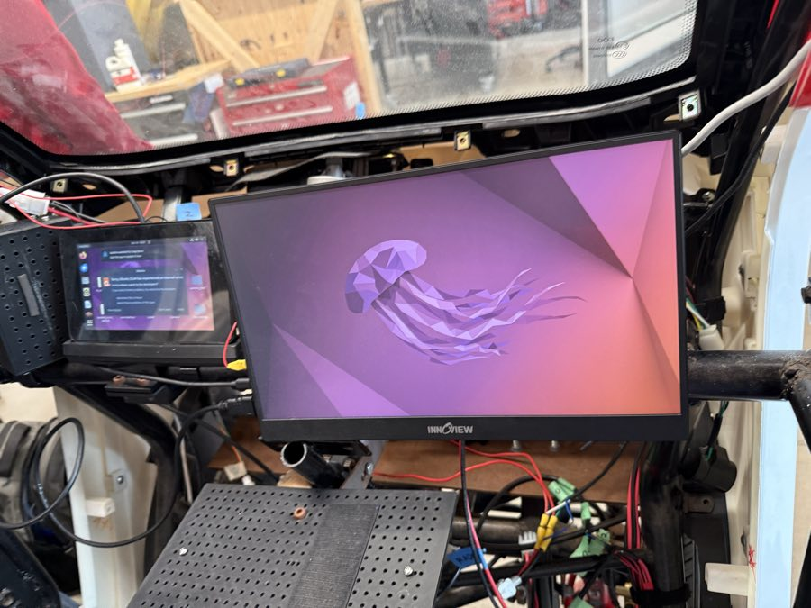

# The car's two screens

Power on the car → the **HUD** fills the small screen, the **map** fills the big one.
Both start by themselves at login, and come back 5 s after a crash.

!!! warning "Built, not yet on the car"
    Everything below is ready in the repo (15 Oct) and [[untested]] on the car. Friday's
    audit tells us which computer drives the screens and what it calls them.



| Screen | Size | Shows | Program | Its unit |
|---|---|---|---|---|
| Small touchscreen, left | ~7" | the instrument cluster: speed, mode, gear, e-stop button, camera, GPS | `hud` | `aav-hud.service` |
| Innoview monitor, right | ~15" | the map: Nav2's map over Ottawa's streets, place search | `map` | `aav-map.service` |

Both are in `src/hud/aav_hud_raylib` ([HUD](hud.md)).

## How it starts

```text
 power on → desktop login → graphical-session.target ─┬─► aav-hud.service ─► car_screen.sh hud ─► hud --fullscreen --monitor <HUD's>
   (auto-login: a system        (or the autostart     └─► aav-map.service ─► car_screen.sh map ─► map --fullscreen --monitor <map's>
    setting, below)              entry, see below)              ▲
                                                     ~/.config/aav/screens.env: which monitor, ROS domain, map files
```

| Part | Where in git | Installed to | Does |
|---|---|---|---|
| `aav-hud.service`, `aav-map.service` | `tools/screens/` | `~/.config/systemd/user/` | systemd **user** units: start with the desktop, restart 5 s after any exit, log to the journal |
| `aav-screens.desktop` | `tools/screens/` | `~/.config/autostart/` | for desktops that don't start `graphical-session.target`: shares `DISPLAY` with systemd, starts both |
| `screens.env` | `tools/screens/` (template) | `~/.config/aav/screens.env` | the settings (below). Kept when you install again |
| `car_screen.sh` | `tools/` | stays in `~/aav-jazzy/aav/tools/` | reads the settings, checks them, runs `ros2 launch aav_hud_raylib hud.launch.py fullscreen:=true monitor:=...` |
| `car_screens_install.sh` | `tools/` | stays there | copies, enables, removes |

## The settings: `~/.config/aav/screens.env`

| Key | Example | Means |
|---|---|---|
| `AAV_HUD_MONITOR` | `HDMI-2` | the HUD's monitor: its name exactly, or its number (`0` = the first). Empty: the HUD doesn't start |
| `AAV_MAP_MONITOR` | `HDMI-1` | the map's monitor, the same way |
| `AAV_ROS_DOMAIN_ID` | `42` | our ROS network: the car's stack is on 42, never 0 or 10 (the 2025-26 team's) |
| `AAV_STREET_MAP` | `/home/aavui/aav-jazzy/aav/maps/streets/ottawa.pmtiles` | the street map, a full path. Empty: `config/map.yaml`'s |
| `AAV_PLACES` | `/home/aavui/aav-jazzy/aav/maps/places/ottawa.db` | the place search's database, a full path |

- One `KEY=value` a line. Nothing is expanded: no `~`, no `$HOME`.
- A wrong or empty setting stops that screen with exit code 78, and the journal says what's
  wrong. systemd doesn't retry that one: fix the file, then restart it.
- Not `--local`: on the car the screens must see the car's ROS graph.

## Which monitor: names, not guesses

```bash
~/aav-jazzy/aav.sh tools/car_screen.sh --list      # what the HUD sees
```

```text
number  name                      size         at
0       "HDMI-1"                  1920x1080    0,0
1       "HDMI-2"                  800x480      1920,0
```

| Rule | Why |
|---|---|
| A name must match exactly | `HDMI-1` is never "close enough" to `HDMI-2` |
| A missing monitor is an error that lists the ones there | a map on the HUD's screen is worse than no map |
| Two monitors with one name: use the number | some systems name a monitor by its model |
| `--monitor` works by hand too | `pixi run hud fullscreen:=true monitor:=HDMI-2`, or `hud --demo --monitor 1` |

- On X11, the names are the same as `xrandr --listmonitors` shows.
- On a **Wayland** desktop (Ubuntu 22.04's default on some Pis), our windows run through
  XWayland, and the names may read `XWAYLAND0`, `XWAYLAND1`. Use `--list` and the
  numbers, or log in to "Ubuntu on Xorg". The audit finds out which (W10).
- raylib draws through GLFW on X11. A computer with no desktop at all (plain KMS/DRM)
  would need raylib built for DRM, with one screen only: not planned.

## Install (on the car computer with the screens)

```bash
bash /media/$USER/<stick>/car-kit/car_install.sh --screens --dry-run   # look first
bash /media/$USER/<stick>/car-kit/car_install.sh --screens             # builds the HUD, then installs
```

Already installed? Just the screens: `bash ~/aav-jazzy/aav/tools/car_screens_install.sh [--dry-run]`.

| Step | Do |
|---|---|
| 1 | `~/aav-jazzy/aav.sh tools/car_screen.sh --list`: note both names |
| 2 | write them in `~/.config/aav/screens.env` |
| 3 | `~/aav-jazzy/aav.sh tools/car_screen.sh hud --print` (and `map`): checks, runs nothing |
| 4 | `systemctl --user restart aav-hud aav-map` |
| 5 | reboot: both come back on their own |

- It needs no sudo. The units run as the user who logs in to the desktop.
- **Boot to the desktop with no password** (auto-login) is a system setting, and needs an
  admin: on Ubuntu, Settings → Users → Automatic Login (or `/etc/gdm3/custom.conf`). Ask
  the team first: the 2025-26 setup may already do it.
- The kit copies the map's two files (`maps/`) when they were downloaded on the Mac
  before `pixi run car-kit`.

## Day to day

| Want | Run |
|---|---|
| Their logs, live | `journalctl --user -u aav-hud -u aav-map -f` |
| Are they running? | `systemctl --user status aav-hud aav-map` |
| Stop them until the next boot | `systemctl --user stop aav-hud aav-map` |
| Never start them | `bash ~/aav-jazzy/aav/tools/car_screens_install.sh uninstall` (keeps `screens.env`) |
| Try one by hand | `~/aav-jazzy/aav.sh ros2 launch aav_hud_raylib map.launch.py fullscreen:=true monitor:=HDMI-1` |

> **No HUD, no Nav2.** The HUD sends a [heartbeat](hud.md#the-heartbeat). On the car,
> the sensor watchdog stops Nav2 and the AI slot while it's missing: stopping `aav-hud`
> holds them too. A session with no HUD screen: `car.launch.py watch_hud:=false`, written
> on the test card.
>
> **Latched (24 Oct).** Once the HUD has run 5 s, a crash, freeze or stop holds Nav2
> even after systemd restarts it: the screen says **AUTO STOP, HUD LOST**. A person
> checks the screen, then `pixi run watchdog-clear`.

## The 2025-26 way, for comparison

Their UI Pi started three scripts from systemd system services (`hud/scripts/*_bootup.sh`):
Flask, `flutter run` (a debug build) and OSRM in Docker, all from `/home/aavui/Desktop`.
Ours: two user units, no sudo, no Docker, release builds, a restart on a crash, and the
monitors named in one file. Theirs stay as they are until the team agrees to switch (A8).

## What was tested

| What | Result |
|---|---|
| `hud-core` `screen`: names, numbers, exact match, missing, two with one name, the listing | [[works]] `cargo test` |
| `--monitor`, `--list-monitors` options in `hud` and `map` | [[works]] `cargo test` |
| The units and the autostart entry: sections, keys, ExecStart, restart rules | [[works]] a parser test (`tools/tests/test_car_screens.py`); no `systemd-analyze` on a Mac |
| `car_screen.sh`: the settings, bad ones → 78, the command it runs | [[works]] `--print`, in the same test |
| `car_screens_install.sh --dry-run`, `car_install.sh --screens --dry-run` | [[works]] on a Mac: shows the plan, refuses (not Linux), writes nothing |
| `shellcheck`, `bash -n` | [[works]] |
| A window on a chosen monitor | [[untested]]: no window could open from the session that built it (plain `--demo` failed the same way) |
| systemd starting them at login, on the car | [[untested]]: after the audit |
