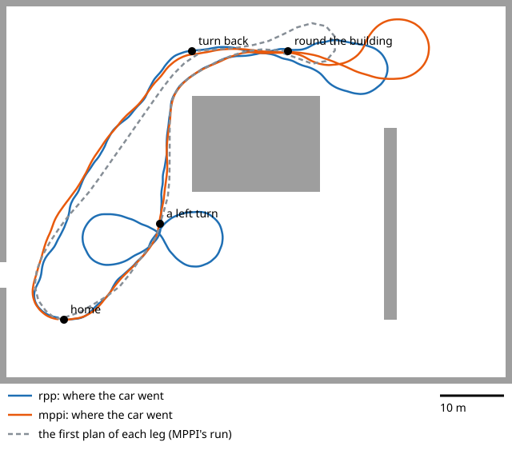
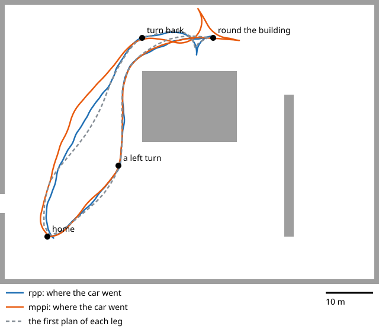
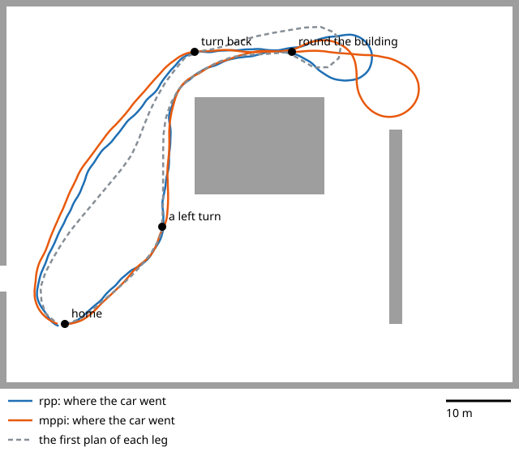
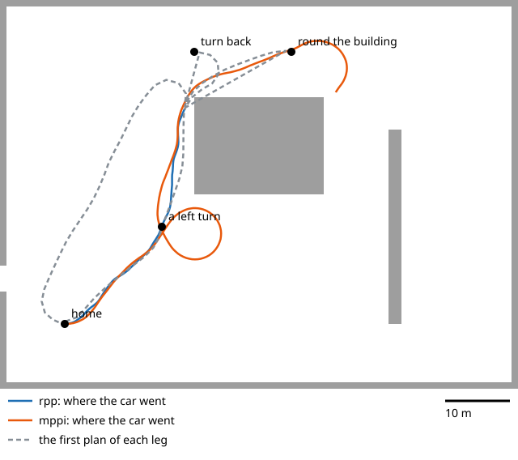
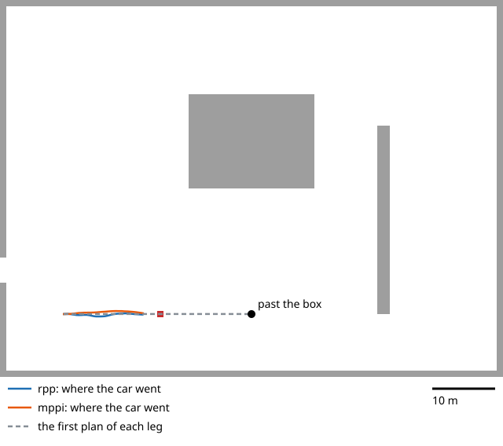

# Path followers: Regulated Pure Pursuit and MPPI

Nav2's planner draws a path; a **controller** turns it into a speed and a turn, 20 times a
second. We have two, and a script that compares them on the same drives in Gazebo.

> **The short version**
> - **MPPI** is the default (since 22 Oct): it tries 2000 possible futures every cycle through a model of the car, and picks the best blend. It turns to a goal's heading; it costs more computer.
> - **Regulated Pure Pursuit (RPP)** is the other choice: it chases a point 2-4 m ahead on the path. Simple and light, but it aims only at a point, so it often arrives at a goal facing the wrong way.
> - **Switch:** `controller:=rpp` on `sim.launch.py` or `navigation.launch.py`.
> - **Compare:** `pixi run controller-compare` (about 25 min, headless, on this computer only; `--legs 1` for a quick check).
> - **Results, night of 22 Oct (Gazebo's lot, four runs):** after five fixes (below), MPPI reached the first goal in 29-30 s in every run; Pure Pursuit looped there in two of three. In the best run both reached all 4 goals. MPPI uses twice the CPU (20% of a Mac core).

## What each one does

| | Regulated Pure Pursuit | MPPI |
|---|---|---|
| Idea | aim at a point ahead on the path; steer the arc that reaches it | imagine 2000 futures 2.8 s long, score each, blend the best |
| Knows the car's shape | no: only its turning radius, through the planner | yes: the Ackermann turning radius and the outline (footprint) |
| An obstacle on the path | slows, then stops before it | may steer around it, if there's room |
| Settings to tune | a few (lookahead, speeds) | many (noise, temperature, eight scoring rules) |
| Computer | light | heavy: one of the reasons for a second Orin |
| Paper | Macenski et al., 2023 | Williams et al., 2017 |

Both read the same costmap and send the same message to the same velocity smoother,
collision monitor, twist_mux and ego. Everything after the controller is the same.

## Switch between them

```bash
pixi run sim world:=test_lot controller:=mppi      # Gazebo, MPPI following the path
ros2 launch aav_navigation navigation.launch.py controller:=mppi
```

`controller:=` takes `rpp` (the default) or `mppi`. The launch file copies the `MPPI` block
of `nav2.yaml` under the name the behaviour trees ask for, `FollowPath`, and sets its
turning radius, its reverse speed and its top speed from `vehicle.yaml`
(`aav_description/vehicle.py`, `nav2_tuned`).

## Compare them

```bash
pixi run controller-compare                    # both controllers, both tours
pixi run controller-compare --tours obstacle   # only the box in the lane
pixi run controller-compare --controllers mppi --speed 2
```

For each tour and controller the script starts Gazebo's test lot with no windows, on a ROS
domain of its own (this computer only), sends the same goals, and records where the car
really was (Gazebo's ground truth). Forward only, as on the car. The results go to
`log/controller-compare/<time>/`:

| File | What |
|---|---|
| `results.md` | a table per goal: one column per controller |
| `lot.svg`, `obstacle.svg` | where each controller took the car, on the map |
| `results.json` | the numbers, and each drive's track |
| `sim-<tour>-<controller>.log` | everything the simulator said |

| Tour | Goals |
|---|---|
| `lot` | a left turn; round the building; a turn back in the 14 m lane; home |
| `obstacle` | 30 m east, with a 1 m box in the lane at 15.5 m. The planner's map has no box in it, so only the controller and the collision monitor can deal with it |

What the numbers mean (`tools/drive_metrics.py`):

| Number | Means |
|---|---|
| Time | from the goal sent to Nav2's answer |
| Controller asked to move after | the controller's first speed command over 0.05 m/s |
| Car moving after | the car 0.1 m from where it started |
| Off the path | from the planner's newest path (it replans every second) |
| Off the first route | from the first path: shows a car that wanders off |
| End: off the goal | where the car stopped, against the goal |
| Steering work | how fast the steering command changes (RMS): lower is smoother |
| Stops, reversals | stand-stills of 1 s or more; changes of direction |
| Closest to the box | the car's outline to the box's |
| Controller CPU | `controller_server`'s share of one core |

## After the fixes, night of 22 October

Five changes, each found from a run that failed (all in `nav2.yaml` or `vehicle.py`, with
the reason beside each):

| What went wrong | Fix |
|---|---|
| MPPI reached the goal, then drove a full circle to face the right way | MPPI turns to the goal's heading from 2.5 m out (`GoalAngleCritic`), not 0.5 m |
| The planner's path passed the building's corner 0.86 m away; the collision monitor's box stopped the car | the planner's costmap inflates 3.0 m, gently: paths keep to the middle of a lane |
| The plan ended in a full-lock turn; both controllers cut it and missed | the planner plans turns 1.25 x wider than full lock (`vehicle.PLAN_TURN_MARGIN`) |
| The car looped at goals it had reached: the EKF put it 0.6 m off (GPS noise 0.5 m), over the 0.5 m tolerance | goals count within 1.0 m: as good as GPS without RTK. Tighten with RTK |
| Pure Pursuit arrives facing the wrong way (it aims only at a point) | MPPI is the default |



Four lot runs after them (the EKF recorded too). The Fast DDS stalls (see "Found on the
way") spoiled one:

| Run | Regulated Pure Pursuit | MPPI |
|---|---|---|
| c (01:58) | 3 of 4 goals; first goal 29 s | 3 of 4; first goal 29 s |
| d (02:10) | stopped by a stall at the first goal | 1 of 4: stalls |
| e (02:20) | **4 of 4**, but looped at the first goal (81 m for 21) | **4 of 4** |
| f (02:45) | 0 of 4: looped at the first goal, stopped facing the building | 2 of 4: its U-turn went round the building, stopped facing it |

Still open:

| | |
|---|---|
| **Stuck facing a wall** | after a loop or a wide turn the collision monitor stops the car facing a wall, and forward only it can't get out. A person has to. These were real near misses, not false stops, so the fix is a way out: reversing (Nav2's back-up). **On for the car since 22 Oct**, where the lidar watches behind it |
| **The U-turn, forward only** | in the 14 m lane, MPPI went wide or round the building in 3 of 4 runs; Pure Pursuit managed it in 2. With reversing it works (below) |
| ~~The box in the lane~~ | done, 03:40: the planner now sees the radar and lidar. Both controllers drove round the box, 2.6 m (Pure Pursuit) and 3.8 m (MPPI) clear, and reached the goal ([Costmaps](costmaps.md)) |

## With reversing: three-point turns, 22 October, 04:35

`--reversing` lets Nav2 back up, as it may in Gazebo, on the bench, and since 22 Oct on
the car, where the lidar watches behind it ([Reversing](learn-nav2.md#reversing)). At first MPPI never reversed. Three settings stopped it:

| What went wrong | Fix (only when reversing) |
|---|---|
| MPPI never backed up, though the plan did (runs h, k) | no `PreferForwardCritic`: the planner already decides where to reverse (`reverse_penalty`) |
| It ignored which way the path pointed | `PathAngleCritic` mode 2 (follow the path's own direction); a cusp counts within 0.5 m and 0.6 rad |
| Nav2 cancelled the turn 10 times as "stuck": rocking back and forth moves less than 0.5 m | `PoseProgressChecker` (always on): turning 0.5 rad counts as moving too |

Run n, the whole lot tour, both controllers: **all 8 goals reached**.

| Turn back (14 m lane) | Pure Pursuit | MPPI |
|---|---|---|
| Time | 74 s | 71 s |
| Driven | 22.9 m | 34.9 m |
| Reversals | 10, with 4 stops: it dithers at each cusp | 2: one clean three-point turn, but wide |



Run q (05:10), the same with ego's new jerk limit: **all 8 goals again**. MPPI's first goal
cost it a back-up (72 s, was 30): it drove past the goal (the EKF was right then, within
0.4 m and 10°), and while it backed up the EKF's heading swung to 57° off.

That swing is not a reversing bug. A probe in Gazebo (22 Oct) drove 15 s each way: the
wheel speed keeps its sign and the turn rates match the truth backwards too, and the
global EKF's heading wandered up to ±25° at 0.5 m/s **in both directions**. Over all
tonight's runs it is worse in reverse (median 11° off, against 4° forward at the same
speed) because reversing comes slowly, just after a stop: where GPS tells the heading
least. The fix is a heading source (PLAN M9).

Run r (06:04), after the global EKF's heading was fixed (yaw noise 0.01,
[Learn: localization](learn-localization.md)): **all 8 goals**, and the EKF's worst
heading per leg 7-16° (runs n and q: 14-76°). MPPI's tour: 29, 53, 71 and 65 s, no
detours; its way home took 65 s (was 94-102). The picture above is this run.

Forward only (run o, 04:46, same settings): the first two goals for both, but the U-turn
failed for both again, as in run j: each swung wide and stopped facing the east wall.

Forward only **after the EKF fix**, two runs:

| Run | Pure Pursuit | MPPI |
|---|---|---|
| s (06:16) | 4 of 4; the U-turn as a tight loop (45 m) | 4 of 4; the U-turn as a wide loop (67 m) |
| t (06:26) | 4 of 4, but two loops at the first goal (104 m for 21) | 2 of 4: its U-turn loop ran into the north wall, stopped facing it |

The EKF's heading was good in both (worst 12°), so it was not the only cause. Forward
only, a U-turn in a 14 m lane is still about a coin toss; backing up makes it reliable.



Still to do: MPPI drives on east a few metres before it backs up, where the plan backs
up at once. The car may reverse since 22 Oct (Ben), where the lidar watches behind it.

## Results, 22 October, first runs

Gazebo's test lot on Ben's Mac (M4 Max), headless, 1 m/s, forward only, with MPPI's
settings from "Making MPPI drive" below. One run each: read small differences as noise.



| Goal | Regulated Pure Pursuit | MPPI |
|---|---|---|
| A left turn (15, 15), 21 m | ✅ 28 s, drove 21.5 m, 0.32 m from the goal | ✅ 58 s, drove **47.5 m**: it reached the point, then drove a full circle to face north |
| Round the building (35, 42) | ❌ stopped at the building's north-west corner: the collision monitor saw the wall in its 1 m stop box | ✅ 45 s, 0.57 m from the goal: it kept further from the corner |
| Turn back in the 14 m lane (20, 42, facing west) | ❌ still stuck at the corner (forward only, no way out) | ❌ drove 16 m east and round; stopped by the collision monitor near the building |
| Home (0, 0) | ❌ still stuck | ❌ the sensor watchdog stopped Nav2: the IMU and wheel speed silent for 0.5-0.8 s (see "Found on the way") |



| The box in the lane | Regulated Pure Pursuit | MPPI |
|---|---|---|
| What happened | drove at it; stopped 0.36 m before it | drove at it; stopped 0.25 m before it |
| Who stopped it | the collision monitor | the collision monitor |
| Steered round? | no: it follows the path | no: its path goes through the box, and its path rules outweigh its cost rule |

| On average | Regulated Pure Pursuit | MPPI |
|---|---|---|
| Off the path (mean) | 0.12-0.18 m | 0.13-0.16 m |
| Steering work (lower is smoother) | 0.39-0.54 rad/s | 0.14-0.41 rad/s: smoother |
| `controller_server` CPU | 10-11% of a core | 21-32% of a core: twice to three times |

What it means:

| | |
|---|---|
| **Default** | Regulated Pure Pursuit stays the default: quicker, cheaper, and no loops at goals |
| **MPPI next** | stop the loops: drop or soften `GoalAngleCritic`, or widen its angle threshold, so it accepts the heading it arrives with (the goal checker allows 0.5 rad anyway) |
| **Both** | the corner problem: the planner's paths pass walls closer than the collision monitor allows (PLAN.md M8) |
| **Both** | steering round the box needs the obstacle in the planner's map (PLAN.md M5) |

## Making MPPI drive

With the settings first written for it (Nav2's examples for a small robot), MPPI in Gazebo
sat still for 13 s, then crept at 0.2 m/s and drifted metres off a straight path. Found on
22 October, one cause at a time, by printing each layer's command twice a second:

| What we saw | Why | Change |
|---|---|---|
| Its speed flipped between forward and back for 12 s | the simulator let Nav2 reverse (`reversing:=true` by default), and MPPI dithered around zero | the comparison runs forward only, as the car does |
| Nav2 warned "Inconsistent configuration in collision checking" | MPPI checked a circle; the costmaps use the car's 2 x 1 m outline | `CostCritic.consider_footprint: true` |
| Fast samples all swerved | it tried turn rates of ±0.4 rad/s, but the car turns at most 0.35 rad/s at 1 m/s (full lock): fast samples left the path, slow ones won | `wz_std` 0.4 → 0.1 |
| Speed built up by only 0.015 m/s each second | its samples' speed changes were clipped by the 1 m/s² limit (0.05 m/s per step up, but 0.1 down), so its futures drifted slower | `ax_max` 1.0 → 3.0 for its planning only (ego and the smoother still hold the car to 1 m/s²); `ax_min` stays at ego's -2.0 |
| Still slow to commit | small speed samples, a soft blend | `vx_std` 0.2 → 0.4, `temperature` 0.3 → 0.15 |

After the changes: moving within 0.5 s, about 0.95 m/s, within about 0.5 m of a straight
path. The settings and their reasons are in `nav2.yaml`, above the `MPPI` block.

## Found on the way

- **The global EKF's heading jumps at walking pace.** GPS gives only a position; the
  filter reads each fix's error (0.5 m in Gazebo) partly as a heading error, and the slower
  the car the bigger it reads it: ±20° at 0.2 m/s. Nav2 places its path with that pose, so
  the path swings round the car. Regulated Pure Pursuit, aiming 2-4 m ahead, barely
  notices; a slow MPPI did. It is probably also why a "straight" 10 m drive turned 38° on
  21 October. Lowering the filter's heading noise helped but didn't cure it: a heading
  source (two GPS antennas, or the F9R's own fused heading) is the real fix. Open, for
  localization (proposal T6.3).
- **Late data: it was the messaging, not the Mac.** Several runs were stopped by the
  sensor watchdog: the IMU, the wheels and both EKFs silent for 0.5-2 s at once, with the
  Mac 77% idle. Splitting Gazebo's adapter into one node per sensor (as on the car) didn't
  stop it. A bare publisher and subscriber beside Gazebo showed why: the publisher always
  on time, its messages up to 0.48 s late through Fast DDS, never over 0.05 s through
  Cyclone DDS. `AAV_RMW=cyclone` uses Cyclone ([Your Mac](mac.md)).
- **The global EKF is up to 0.7 m off** in Gazebo (0.5 m GPS noise), its heading up to
  25°. In the slow stretches of the night's drives its heading stayed under 6°: the ±20°
  above was a car creeping for many seconds. The comparison now reports both per leg.

## Limits of this comparison

| | |
|---|---|
| One run each | the numbers vary from run to run: read differences under about 20% as noise |
| Gazebo on a Mac | CPU numbers are the Mac's, not the Orin's |
| The car's numbers are guesses | the same guesses for both controllers (`vehicle.yaml`) |
| 1 m/s | the car's limit this year; `--speed` goes up to 5 in the simulator |
