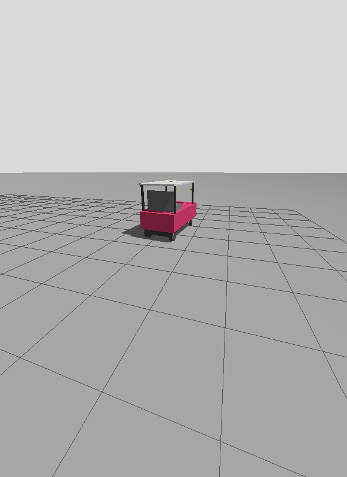

# Your first day

New to the team? Start here. In about an hour you'll have ROS on your laptop, drive a
turtle that steers like the car, see every node and topic in rqt_graph, drive the
simulated car in Gazebo, and watch Nav2 plan a path through a costmap. Each step says what
you should see.

## What you need

| | |
|---|---|
| A laptop | a Mac (macOS 14 or newer) or a 64-bit Linux laptop |
| Disk space | about 10 GB |
| Time | about an hour, most of it the first download |
| Admin rights | not needed |
| The code | access to `zander1976/aav` on GitHub (ask Ben), and an SSH key on your GitHub account |

## 1. Install everything (once, about 20 minutes)

```bash
xcode-select --install                        # Mac only: Apple's git and compiler
curl -fsSL https://pixi.sh/install.sh | sh    # Pixi; then open a new terminal
git clone git@github.com:zander1976/aav.git ~/aav   # the code
cd ~/aav
pixi install                                  # ROS 2 Jazzy, about 7 GB
pixi run build                                # our packages, about 20 s
pixi run test                                 # every test
```

**You should see** at the end of the tests: `77 tests, 0 errors, 0 failures`. Then your
laptop is set up. If not, see [When something doesn't work](#when-something-doesnt-work).

!!! note "What did that install?"
  Pixi put ROS 2 Jazzy, Gazebo, Nav2, Python, Rust and the compilers inside the `.pixi`
  folder of the repo. Nothing else on your laptop changed, except one line in your shell
  settings so that the `pixi` command is found.

## 2. Drive the turtle (10 minutes)

| Terminal 1 | Terminal 2 |
|---|---|
| `pixi run turtle` | `pixi run keyboard` |

**You should see:** a blue window with a turtle. Click into terminal 2 and hold `i`: the
turtle drives forward. `u` and `o` curve left and right. Let go, and it stops within about
half a second.

The turtle steers like the car: it can't turn on the spot. Your key press took the same
path a real drive takes:

| # | Step | Topic |
|---|---|---|
| 1 | The keyboard proposes a speed and a turn rate | `/drivers/keyboard/cmd_vel` |
| 2 | `twist_mux` picks the highest-priority driver | `/control/cmd_vel` |
| 3 | `ego` turns it into a speed and a steering angle the car can do | `/ego/actuator_cmd` |
| 4 | `turtlesim_adapter` moves the turtle | `/turtle1/cmd_vel` |

## 3. See the graph (5 minutes)

Leave the turtle running. In terminal 3:

```bash
pixi run graph      # rqt_graph
```

**You should see** boxes (nodes) joined by arrows (topics). To make it readable:
- pick **Nodes/Topics (active)** in the drop-down at the top left;
- tick **Hide: Debug** and **Hide: tf**;
- click the refresh button after you start or stop something.

Follow the chain from section 2: `teleop_twist_keyboard` → `/drivers/keyboard/cmd_vel` →
`twist_mux` → `/control/cmd_vel` → `ego` → `/ego/actuator_cmd` → `output_mux` →
`/control/turtle/actuator_cmd` → `turtlesim_adapter`.

Then check the graph against the team's contract:

```bash
pixi run check turtle
```

**You should see** `0 failed` at the end. The contract is `docs/interfaces.yaml`: every
topic, its type, and who publishes and reads it.

## 4. Gazebo: the simulated car (15 minutes)

Stop the turtle first (Ctrl-C in each terminal).

```bash
pixi run sim      # the same on Linux and on a Mac
```

**You should see:**
- **Gazebo:** the car, red and white, on a grey ground plane. The camera follows it.
- **RViz:** the car model, the map, and the costmaps around the car.



On a Mac, Gazebo's window runs as a separate program, and `pixi run sim` starts it for you.
If you close it, `pixi run gz-window` opens it again.

Drive it with `pixi run keyboard --sim` in another terminal. Then run
`pixi run check sim`: it should say `0 failed`.

## 5. A Nav2 goal through a costmap (10 minutes)

In RViz:
1. Click **2D Goal Pose** in the toolbar.
2. Click on the map about 8 m ahead of the car, and drag to set the direction.

**You should see** a planned path appear, and the car drive along it and stop at the goal.
Any keyboard or joystick input overrides Nav2 at once.

The costmaps are the grids that Nav2 plans through:
- **local**: 20 m × 20 m around the car;
- **global**: the whole map.

For walls to plan around, start Gazebo with the test lot instead:
`pixi run sim world:=test_lot`. [Costmaps](costmaps.md) explains how to draw your own.

!!! note "The same goal from a terminal"
  `pixi run tools/ros.sh ros2 action send_goal /navigate_to_pose nav2_msgs/action/NavigateToPose "{pose: {header: {frame_id: map}, pose: {position: {x: 8.0, y: 0.0}, orientation: {w: 1.0}}}}"`

## What's been tested

| Step | Linux | Mac |
|---|---|---|
| 1. Install, build, test | [[works]] | [[works]] 10 Oct, on an Apple Silicon Mac |
| 2. Turtle, and driving it the keyboard's way | [[works]] | [[works]] (the real keys are [[untested]]) |
| 3. rqt_graph, and the graph check | [[works]] | [[works]] the check. The window opened; a person still has to look at it |
| 4. Gazebo without its window | [[works]] | [[works]] |
| 4. Gazebo's window | [[untested]] (no screen on oirp-spss) | [[works]] 10 Oct: the car drives in it, and the camera follows |
| 4. RViz | [[untested]] (no screen on oirp-spss) | [[untested]] it opens; nobody has looked at it yet |
| 5. A Nav2 goal | [[works]] | [[works]] from a terminal: 8 m in 13 s |

## Where next

| You want to | Read |
|---|---|
| Know what to work on | [Starting points](team.md) |
| Understand the whole stack | [How it fits](how-it-fits.md), then [Infrastructure](infrastructure.md) |
| Know what each package does | [Packages](packages.md) |
| Write a driver | [Build a driver](howto-driver.md) |
| Draw a map or tune a costmap | [Costmaps](costmaps.md) |
| Look up a command | [Run it](run.md) |

## When something doesn't work

| Symptom | Try |
|---|---|
| `pixi: command not found` | open a new terminal, or run `~/.pixi/bin/pixi` |
| "Not built yet" | `pixi run build` |
| A test fails | run `pixi run test` again. If it still fails, paste the last 20 lines into the team chat or into Claude |
| The turtle doesn't move | click into the keyboard terminal and hold the key; see [when nothing moves](simulation.md#when-nothing-moves) |
| The Gazebo window stays empty, or the car never appears | `export GZ_IP=127.0.0.1` in every terminal, then start again |
| macOS asks whether `python3` or `rviz2` may accept connections | click Allow |
| Two laptops see each other's robots | give each its own `ROS_DOMAIN_ID` (any number 0–101) |
