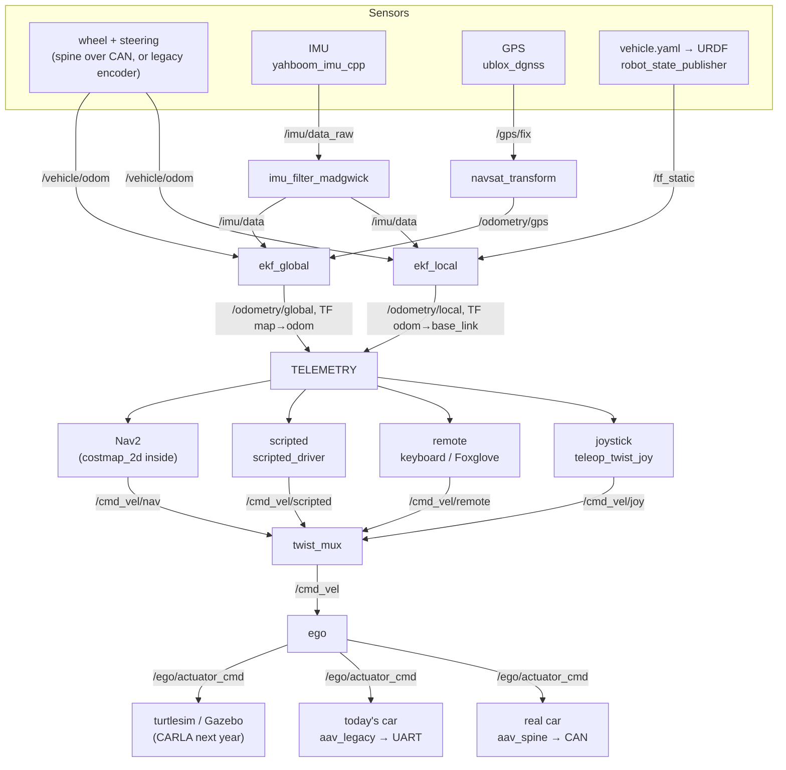

# How the stack works, and how to look inside it

This guide is for someone new to ROS 2. It explains:
- what each part of the system does and how the parts talk;
- which tools show you what's happening.

To run things, see [simulation.md](simulation.md) (no car needed) and the car section
at the end. The full list of every topic, service and action is
[interfaces.md](interfaces.md).

## The picture

The team's architecture diagram, as it exists in the code. Read it top to bottom:
sensors become telemetry, drivers become one command, and ego moves the car.



The code differs from the diagram in two small ways. Both are deliberate:
- **`/odometry/local`, not `/odometry/filtered`.** With two EKFs, robot_localization's own
  dual-EKF example names the outputs `/odometry/local` and `/odometry/global`.
- **`/cmd_vel` is TwistStamped, not Twist.** Jazzy's twist_mux defaults to stamped
  messages, and a stamp lets ego spot a computer with a wrong clock. Nav2 and
  teleop_twist_joy are configured to match. This is still a "Proposed" decision in the
  design doc.

## ROS 2 in our terms

| Concept | What it is | In this stack | See it |
|---|---|---|---|
| **Node** | One running program with a name. Many can share a process. | `ego`, `twist_mux`, `ekf_local`, `spine_bridge` | `ros2 node list`, `ros2 node info /ego` |
| **Topic** | A named stream of messages. Publishers send and subscribers receive, with no handshake. Like a bus, or an ISR filling a queue nobody has to drain. | `/cmd_vel`, `/imu/data`, `/vehicle/odom` | `ros2 topic list`, `ros2 topic echo /cmd_vel`, `ros2 topic hz /imu/data` |
| **Message type** | The struct on a topic, defined in a `.msg` file | `geometry_msgs/msg/TwistStamped`, our `aav_interfaces/msg/VehicleStatus` | `ros2 interface show aav_interfaces/msg/VehicleStatus` |
| **Service** | Request → one reply, for quick questions and commands | `/spine/arm`, `/fromLL`, `/ekf_global/set_pose` | `ros2 service list`, `ros2 service call /spine/arm std_srvs/srv/SetBool "{data: true}"` |
| **Action** | A long job you start: a goal, feedback while it runs, a result at the end, and you can cancel it | `/scripted_drive`, `/navigate_to_pose`, `/follow_gps_waypoints` | `ros2 action list`, `ros2 action send_goal ... --feedback` |
| **Parameter** | A node's settings, loaded from YAML at start. Some can change live. | `config/*.yaml` in each package | `ros2 param list /ego`, `ros2 param get /ego max_speed` |
| **Launch file** | A Python script that starts a set of nodes with their parameters and renames | `aav_bringup/launch/turtle.launch.py` | `ros2 launch aav_bringup turtle.launch.py --show-args` |
| **Package** | The unit ROS builds and installs, like a Cargo crate. `package.xml` is like `Cargo.toml`. | `aav_ego` (Python), `yahboom_imu_cpp` (C++), `aav_mux` (config only) | `ros2 pkg list`, `ros2 pkg prefix aav_ego` |
| **Workspace / colcon** | A folder of packages that `colcon build` builds together, like `cargo build --workspace` across languages | this repository | `colcon build`, `colcon list` |
| **TF / frames** | Every coordinate frame (`map`, `odom`, `base_link`, `imu_link`, …) and how they are placed relative to each other, over time | `map → odom → base_link → sensors` | `ros2 run tf2_ros tf2_echo map base_link`, `ros2 run rqt_tf_tree rqt_tf_tree` |
| **QoS** | Delivery rules per topic: reliable or best-effort, and whether late joiners get the last message. Mismatched QoS means no connection, without an error. | GPS is best-effort; `/map` is "latched" (transient local) | `ros2 topic info /gps/fix -v` |
| **Domain ID** | Machines with the same `ROS_DOMAIN_ID` on the same network see each other automatically. No master, no IP addresses to configure. | every computer on the car | `echo $ROS_DOMAIN_ID` |
| **Sim time** | In Gazebo and replay, nodes take time from `/clock` instead of the wall clock (`use_sim_time:=true`). | `sim.launch.py`, `replay.launch.py` | `ros2 param get /ego use_sim_time` |
| **Bag** | A recording of topics, to replay later | `tools/record.sh` | `ros2 bag info <bag>` |

Which one to use:
- **Topics** for anything that streams: sensors, commands, state.
- **Services** for a quick question or switch: arm the spine, convert latitude/longitude
  to map coordinates.
- **Actions** for anything that takes seconds and should report progress or be
  cancellable: a scripted drive, a Nav2 goal.

## The layers, top to bottom

### Sensors (`src/sensors/`): publish raw data in their own frame

| Sensor | Package (node) | Publishes | Status |
|---|---|---|---|
| IMU (Yahboom 10-axis, USB) | `yahboom_imu_cpp` (`imu_node`, C++, from 2025-26) | `/imu/data_raw` (gyro + accel), `/imu/mag` | working driver, reused |
| | `imu_filter_madgwick` (stock) | `/imu/data` (+ relative orientation) | config in `aav_sensors` |
| GPS (u-blox over USB) | `ublox_dgnss` + `ublox_nav_sat_fix_hp` (stock) | `/gps/fix` | config only; receiver model unconfirmed (Q18) |
| Wheel speed | today: `aav_legacy` (`encoder_udp`); later: the spine (`aav_spine`) | `/vehicle/odom` (speed and yaw rate) | today's encoder works; the spine is being built |
| Radar (TI IWR6843AOP) | `ti_ros2_driver` (from 2025-26) | `/radar/points` | works; not used until perception |
| Battery (Victron) | `battery_monitor` (from 2024-25) | `/battery_status` | reused, off by default |
| The car itself | `aav_description` (`robot_state_publisher`) | `/tf_static`: where each sensor sits | measurements are guesses ([car_measurements.md](car_measurements.md)) |

`aav_sensors/launch/sensors.launch.py` starts the drivers. Run it on the computer each
device is plugged into.

### Localization (`src/localization/aav_localization`): where is the car?

Two `robot_localization` EKFs fuse the sensors:
- **`ekf_local`** fuses wheel speed and the IMU's yaw rate into `/odometry/local` and the
  TF `odom → base_link`. It's smooth and never jumps, but it slowly drifts. Nav2's
  controller and the scripted driver use it.
- **`ekf_global`** fuses the same inputs plus GPS into `/odometry/global` and the TF
  `map → odom`. It stays near the truth but can jump when a fix arrives. Nav2's planner
  uses it.
- **`navsat_transform`** converts each GPS latitude/longitude into map-frame x/y
  (`/odometry/gps`), relative to the datum in `navsat.yaml`. It also serves `/fromLL`
  and `/toLL`.

There is no magnetometer heading yet, so the starting heading comes from the launch
arguments `start_x`, `start_y` and `start_yaw`. Park on a marked spot facing a known
direction.

Without GPS (`gps:=false`), only `ekf_local` runs, and a fixed `map → odom` stands in.

### TELEMETRY: not a node, just what everyone reads

TELEMETRY is these topics:
- `/tf` and `/tf_static`;
- `/odometry/local` and `/odometry/global`;
- `/gps/filtered`;
- `/vehicle/status`;
- the costmaps.

The drivers, the HUD, Foxglove and RViz read them. Nothing on the command path writes
back into them.

### Drivers (`src/drivers/`): each one proposes a velocity

Every driver publishes a `TwistStamped` (forward speed v in m/s, turn rate w in rad/s)
on its own `/cmd_vel/<name>` topic. None of them knows what car it is driving.

| Driver | Package | Topic | Priority |
|---|---|---|---|
| Joystick: the safety driver | `aav_teleop` (stock `joy` + `teleop_twist_joy`, plus `joy_teleop` for the e-stop button) | `/cmd_vel/joy` | 100 |
| Remote: keyboard, Foxglove, later the HUD | stock `teleop_twist_keyboard` (run by hand) | `/cmd_vel/remote` | 90 |
| Scripted: speed up, hold, slow down | `aav_scripted` (`scripted_driver`, ours) | `/cmd_vel/scripted` | 50 |
| Replay of a recorded drive | `tools/replay_commands.sh` | `/cmd_vel/replay` | 40 |
| Nav2 (`nav_premade` in the diagram) | `aav_navigation` (stock Nav2, car settings) | `/cmd_vel/nav` | 20 |
| AI | later | `/cmd_vel/ai` | 10 |

Nav2 holds `costmap_2d` inside it (the local and global costmaps,
[costmaps.md](costmaps.md)). Its planner (SmacPlannerHybrid) and controller (Regulated
Pure Pursuit) only ask for turns this car can make.

### The mux (`src/mux/aav_mux`): pick one

`twist_mux` passes on the highest-priority driver that has sent something in the last
0.5 s. `/estop` true is a lock that blocks everything until someone publishes false. The
output is `/cmd_vel`.

### ego (`src/ego/aav_ego`): the virtual car

ego turns the one chosen `/cmd_vel` into `/ego/actuator_cmd`
(`AckermannDriveStamped`: speed in m/s and steering angle in rad, positive left), 50
times a second. On the way it:
- **Converts with the bicycle model:** steering = atan(wheelbase × w / v). With v near 0
  there is no answer: a car can't turn on the spot, so ego holds the wheels where they
  are.
- **Applies the car's limits:** top speed (1.0 m/s to start), acceleration, steering
  angle and steering rate (`config/ego.yaml`).
- **Stops when commands stop:** if nothing arrives for 0.3 s, it brakes to a stop at
  `max_deceleration`.

All the car-specific maths lives in ego, so every driver can stay simple.

### Backends (`src/backends/`): exactly one plays the car

| Backend | Package | What it does |
|---|---|---|
| The real car, CAN spine | `aav_spine` (`spine_bridge` + stock `ros2_socketcan`) | Packs `/ego/actuator_cmd` into CAN frames (`firmware/can/aav.dbc`), and unpacks feedback into `/vehicle/odom`, `/vehicle/status` and steering joint angles. Arm with `/spine/arm`. |
| Today's car (2025-26 hardware) | `aav_legacy` (`legacy_uart_bridge`, `encoder_udp`) | Sends 13-byte UART frames to the existing ESP32 firmware, and turns the Pico encoder's UDP counts into `/vehicle/odom`. Interim, until the spine exists. Read [firmware.md](firmware.md) first: that firmware has no command timeout. |
| turtlesim | `aav_turtlesim` | Drives the turtle with the bicycle model. The fastest whole-loop test. |
| Gazebo Harmonic | `aav_gazebo` | A simulated car with an IMU and GPS, behind the same topics as the real car |
| CARLA | `aav_carla` | A stub. Next year ([simulation.md](simulation.md)). |

### Firmware (`firmware/`): below ROS

ROS stops at the CAN bus. The spine microcontroller owns the pins, the I2C actuator
drivers, the RC receiver, the hardware e-stop and the watchdog. The only interface is the
CAN frame map in `firmware/can/aav.dbc`. See [firmware.md](firmware.md).

## Safety layers

From the person outward, each one works even if everything after it fails:

1. **Joystick deadman** (priority 100). Holding it with the sticks centred stops the car,
   whatever else is driving.
2. **`/estop`**: the mux lock, plus the car backends (`spine_bridge`,
   `legacy_uart_bridge`) brake at once.
3. **ego's command timeout** (0.3 s).
4. **`spine_bridge`** stops sending `DRIVE_CMD` when ego goes quiet.
5. **The spine's watchdog**: with no valid frame for 200 ms, it cuts the throttle, brakes
   and holds the steering. It needs a fresh arm before the computer can drive again.
6. **The RC transmitter's override switch** and **the hardware e-stop**, both handled in
   firmware.

The legacy path (today's ESP32 firmware) has no layer 5:
- `legacy_uart_bridge` sends brake frames when ego goes quiet.
- The firmware itself has no timeout, so if the bridge or its computer dies, the last
  throttle stays on.

Test it with the wheels off the ground and the e-stop in hand.

## Tools for looking inside

**The `ros2` command** (in any sourced terminal):

```bash
ros2 node list                      # what's running
ros2 node info /ego                 # its topics, services, actions, parameters
ros2 topic list -t                  # every topic with its type
ros2 topic echo /ego/actuator_cmd   # watch messages
ros2 topic hz /imu/data             # how often
ros2 topic info /gps/fix -v         # who publishes and subscribes, with QoS
ros2 topic pub --once /estop std_msgs/msg/Bool "{data: true}"
ros2 service call /spine/arm std_srvs/srv/SetBool "{data: true}"
ros2 action send_goal /scripted_drive aav_interfaces/action/ScriptedDrive "{...}" --feedback
ros2 param dump /ekf_local          # every setting a node is really using
ros2 interface show nav2_msgs/action/NavigateToPose
ros2 doctor --report                # network and setup problems
```

**rqt**, small GUI tools (run `rqt`, or each one on its own):

| Tool | Shows |
|---|---|
| `rqt_graph` | nodes and topics as a diagram: the live version of the picture above |
| `rqt_tf_tree` | the frame tree, and who publishes each link |
| `rqt_console` | every node's log messages, filterable |
| `rqt_plot` | a number over time, e.g. `/vehicle/odom/twist/twist/linear/x` |
| `rqt_topic`, `rqt_service_caller`, `rqt_reconfigure` | browse topics, call services, change parameters live |

**RViz**, the 3D view. `aav_bringup/rviz/drive.rviz` shows:
- the map and both costmaps;
- the planned path and the footprint;
- the car model and its frames;
- the global EKF and GPS positions.

Its **2D Goal Pose** button sends a Nav2 goal. `sim.launch.py` opens it.

**Foxglove** does most of what RViz and rqt do, in a desktop or browser app, and works
well over WiFi. `car.launch.py` starts `foxglove_bridge`; connect to
`ws://<computer>:8765`.

**The contract check.** With the stack running, run:

```bash
tools/check_graph.py --profile turtle   # or sim, car
```

It compares the live graph with `docs/interfaces.yaml`. It flags any topic that should be
running but isn't, has the wrong type, or isn't in the contract.

## The profiles

| Command | Runs | Use it for |
|---|---|---|
| `ros2 launch aav_bringup turtle.launch.py` | turtlesim as the car, mux, ego, scripted driver, `ekf_local` | learning the command path on any laptop |
| `ros2 launch aav_bringup sim.launch.py` | Gazebo as the car, plus the whole stack | localization, Nav2, phases 1–3 |
| `ros2 launch aav_bringup replay.launch.py` | the IMU filter, the EKFs and optionally Nav2, on a bag | tuning against real drives |
| `ros2 launch aav_bringup car.launch.py machine:=<name>` | the parts listed in `config/machines/<name>.yaml` | the car |

## On the car

The design puts everything on the Orin. During the transition, the Motor Pi still talks
to today's ESP32. The machine files in `src/aav_bringup/config/machines/` say what runs
where:

| Machine file | Runs |
|---|---|
| `orin.yaml` | description, mux, ego, scripted, the IMU and GPS drivers, localization, Nav2, the legacy encoder listener, Foxglove |
| `motor_pi.yaml` | `legacy_uart_bridge` only: it's the computer wired to the ESP32's UART |
| `laptop.yaml` | the joystick (the safety driver's laptop) |
| `all.yaml` | everything on one computer, for the bench |

Every machine needs:
- the same `ROS_DOMAIN_ID`;
- clocks in sync (chrony);
- the workspace built.

Then on each one run `ros2 launch aav_bringup car.launch.py machine:=<its file>`.
Networking details are in [platforms.md](platforms.md).

**Phase 0** (a hardware test with the joystick):
- the wheels off the ground;
- the e-stop in reach;
- `ego.yaml`'s speed limit low.

Things to check first:
- Steering sign: positive must turn left.
- Throttle direction.
- That the car stops when you release the deadman, and when the bridge is killed. The
  legacy firmware fails this one; see above.
