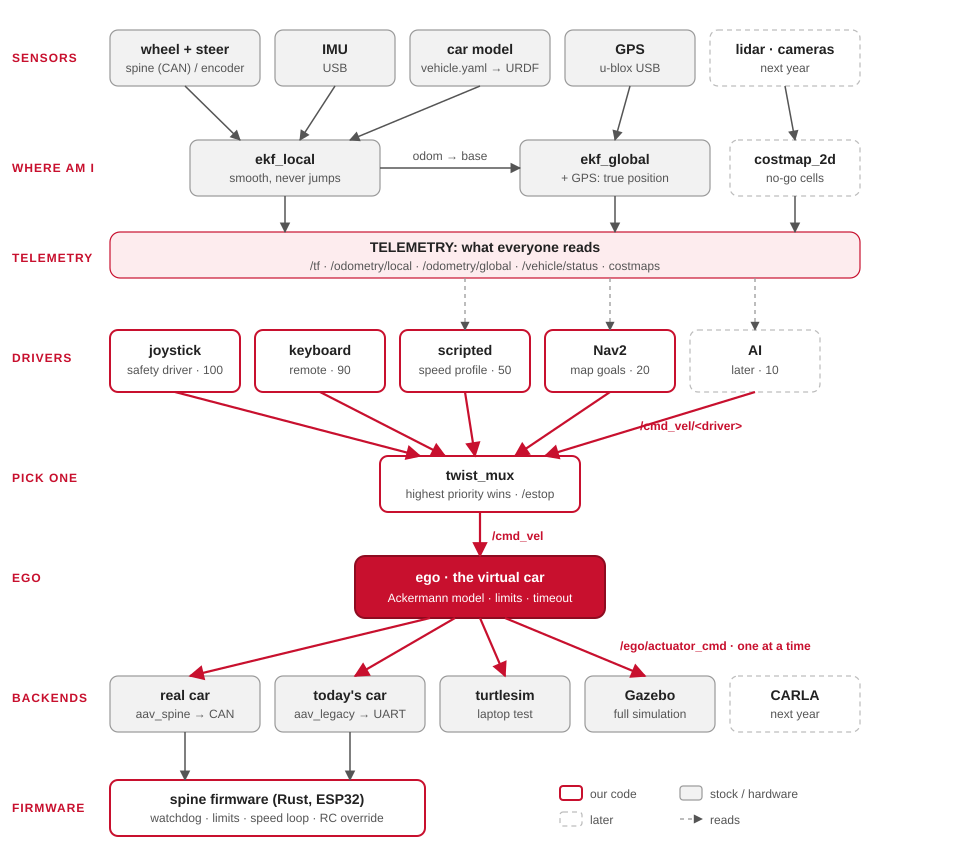
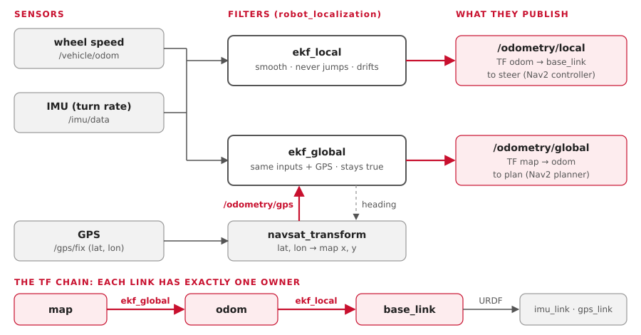
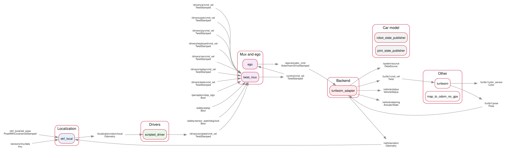
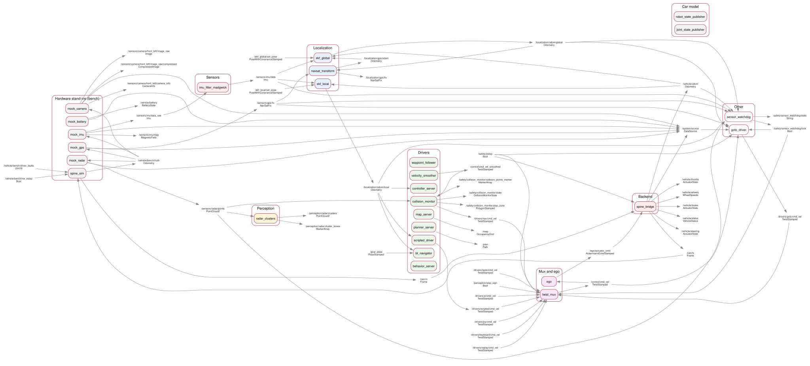
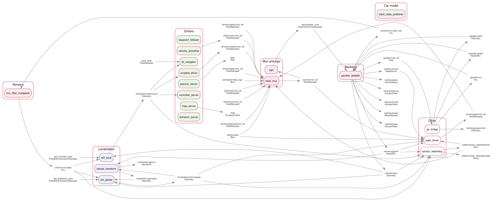

# How it fits together

Everything flows one way: sensors, then "where am I", then drivers, the mux, ego, and one
backend. The layers only talk through ROS topics, so any box can be swapped without
touching the others.

## The picture

## 1. Sensors: raw data

| Sensor | Driver | Publishes |
|---|---|---|
| Wheel speed | today `encoder_udp` (in `aav_legacy`); later the spine | `/vehicle/odom` |
| IMU (Yahboom, USB) | `aav_imu_yahboom` (Rust), then the stock `imu_filter_madgwick` | `/sensors/imu/data_raw`, then `/sensors/imu/data` |
| GPS (u-blox, USB) | the stock `ublox_gps`; or `nmea_navsat_driver`, or `ublox_dgnss` on the car | `/sensors/gps/fix` |
| The car's shape | the stock `robot_state_publisher`, from `vehicle.yaml` | `/tf_static`: where each sensor sits |
| Lidar, cameras | next year | |

Each driver publishes a standard message in its own frame. Another IMU or GPS can replace
it without changing anything downstream.

## 2. Where am I: two filters

- **`ekf_local`** fuses the wheels and the IMU. It's smooth and never jumps, but it drifts
  slowly, like counting your steps. Use it to steer.
- **`ekf_global`** fuses the same inputs **plus GPS**. It stays near the truth, but can
  hop a little when a GPS fix arrives. Use it to plan.
- **`navsat_transform`** turns GPS latitude and longitude into map x and y for
  `ekf_global`.

!!! note "Does the global EKF read the local one?"
  In effect, yes. `ekf_global` publishes only the correction `map → odom`, worked out on
  top of `ekf_local`'s `odom → base_link`. Chained together, they give the car's true
  position, and the local estimate stays smooth.

## 3. Drivers propose, the mux picks

Every driver publishes a `TwistStamped` (speed in m/s, turn rate in rad/s) on its own
topic. None of them knows what kind of vehicle it's driving.

| Driver | Topic | Priority |
|---|---|---|
| Joystick: the safety driver | `/drivers/joy/cmd_vel` | 100 |
| Keyboard, or another remote | `/drivers/keyboard/cmd_vel` | 90 |
| Actuator tests: measure the car (stages 3-4) | `/drivers/tests/cmd_vel` | 60 |
| Scripted: speed up, hold, slow down | `/drivers/scripted/cmd_vel` | 50 |
| Replay of a recorded drive | `/drivers/replay/cmd_vel` | 40 |
| Nav2: drive to a point on the map | `/drivers/nav/cmd_vel` | 20 |
| AI | `/drivers/ai/cmd_vel` | 10, later |

`twist_mux` passes on the highest priority that has spoken in the last 0.5 s, as
`/control/cmd_vel`. Publishing `true` on `/safety/estop` blocks every driver until someone publishes
`false`.

Teleop is just another driver. The keyboard's commands take the same path as Nav2's:
mux, ego, then the turtle or the car.

## 4. ego: the virtual car

ego is the only node that knows the car is a car. Fifty times a second it turns `/control/cmd_vel`
into `/ego/actuator_cmd`: an `AckermannDriveStamped` with a speed and a steering angle
(positive is left).

| Step | What it does |
|---|---|
| Bicycle model | steering angle = atan(wheelbase × turn rate ÷ speed). A car can't turn on the spot, so at zero speed ego holds the wheels where they are. |
| Limits | 1.0 m/s top speed to start; acceleration; steering ±0.5 rad; steering rate |
| Timeout | no command for 0.3 s: brake to a stop |

## 5. One car model, everywhere

The car's numbers live in one file, `src/aav_description/config/vehicle.yaml`. The launch
files hand them to every part that needs them.

| Part | Uses |
|---|---|
| ego | the wheelbase and steering limit, for the bicycle model |
| URDF (`robot_state_publisher`) | where each sensor sits |
| Nav2 | the footprint, and the tightest turn: wheelbase ÷ tan(max steer) = 2.86 m |
| `turtlesim_adapter`, `gazebo_adapter` | the wheelbase, so the turtle and the simulated car turn like the car |
| `aav_spine`, `aav_legacy` | the wheelbase, track and wheel size |

Most of the numbers are still guesses: see [Car numbers](car_measurements.md).

## 6. Backends: one plays the car

| Backend | Package | Does |
|---|---|---|
| The real car | `aav_spine` | `/ego/actuator_cmd` into CAN frames, for the spine firmware |
| Today's car | `aav_legacy` | into UART frames, for the 2025-26 ESP32 firmware |
| turtlesim | `aav_turtlesim` | the stock turtlesim, steered with the bicycle model |
| Gazebo | `aav_gazebo` | a simulated car with an IMU and GPS, on the real car's topics |
| CARLA | `aav_carla` | adapter ready, untested: needs the NVIDIA computer ([CARLA](carla.md)) |

Each backend reports the car's speed back on `/vehicle/odom`. That closes the loop into
the EKFs.

## 7. Safety layers

From the person outward. Each layer works even if everything after it fails.

| # | Layer | Stops the car when |
|---|---|---|
| 1 | Joystick deadman (priority 100) | held with the sticks centred |
| 2 | `/safety/estop` | it's true: the mux blocks every driver, and the car backends brake |
| 3 | ego's timeout | no command arrives for 0.3 s |
| 4 | `spine_bridge` | ego is quiet for 0.1 s: it stops sending drive frames |
| 5 | The spine's watchdog | no valid frame for 100 ms: throttle off, brake on |
| 6 | RC override switch, hardware e-stop, driver faults | always: handled in the firmware |

Two more, for the automatic drivers only (Nav2 and the AI slot; never a person or a test):

| Layer | Stops Nav2 when |
|---|---|
| collision_monitor | radar or lidar points in the stop zone just ahead; or the radar or lidar goes quiet for 1 s |
| The sensor watchdog (`aav_safety`) | the wheels, the IMU, the GPS or an EKF go quiet, send NaN or freeze; the GPS jumps; the wheels disagree with the IMU or the GPS; the HUD's screen freezes or dies (its [heartbeat](hud.md#the-heartbeat), on the car); the watchdog itself goes quiet (fail-safe: twist_mux's lock times out). A twist_mux lock, shown on the HUD and the map window ([simulation](simulation.md#sensor-failures-on-purpose)) |

!!! warning "Today's car has no layer 5"
  The 2025-26 ESP32 firmware has no timeout. If the bridge dies, the last throttle stays
  on. Keep the wheels off the ground and the e-stop in hand: see [Firmware](firmware.md).

## 8. The real graph, three ways

The same layers, as they really run: `pixi run graph-picture` saved each one from a live
profile on Ben's Mac (20 Oct). Read them left to right. The middle stays the same in all
three; only the left edge (where the data comes from) and the right edge (who plays the
car) change.

| Profile | Nodes, topics | Look for |
|---|---|---|
| `pixi run turtle` | 9, 23 | the whole command path on one line: `scripted_driver` → `twist_mux` → `ego` → `turtlesim_adapter`, and `/vehicle/odom` back into `ekf_local` |
| `pixi run bench` | 27, 50 | the stand-ins on the left (`mock_*`, `spine_sim`); `/vehicle/bench/truth` feeding every mock; `spine_bridge` and `spine_sim` talking over `/can/tx`, `/can/rx` |
| `pixi run sim` (empty world) | 19, 38 | no mocks: `gz_bridge` brings in `/gazebo/imu` and `/gazebo/navsat`, and `gazebo_imu` and `gazebo_gps` turn them into `/sensors/...` |

### The turtle

### Bench mode

### Gazebo

The PNGs beside them (`docs/img/graph-*.png`) are for slides. To see it live: start a
profile, then `pixi run graph`.
