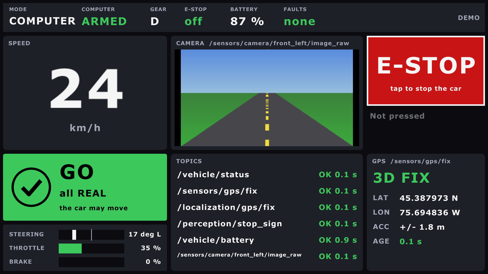
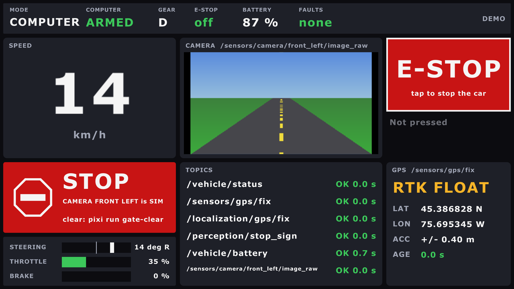
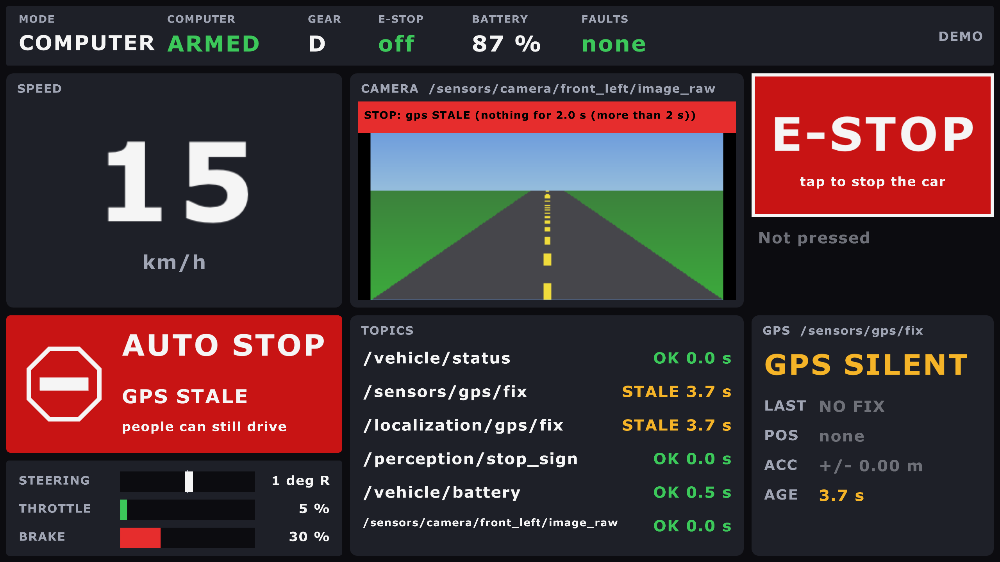

# The HUD (in-car screen)

Two raylib programs in one package, `ros/hud/aav_hud`, each also its own ROS node:

| Program | Node | Screen | Shows |
|---|---|---|---|
| [The HUD](#the-hud-in-rust-raylib) | `hud` | the small ~7" touchscreen | speed, GO / STOP, the e-stop button, the camera, the topics |
| [The map window](#the-map-window-big-screen) | `map` | the big ~15" monitor | Nav2's map over Ottawa's streets, the plan, place search |

**Decided 11 October (Ben):** the HUD is Rust, raylib and rclrs. Its first screen runs
since 15 October. It replaced the 2025-26 team's Flutter app (Q29), which is now
[archived](#the-flutter-app-2025-26-archived).

**Two screens (Ben, 15 Oct):** a small ~7" touchscreen is the instrument cluster (the
HUD), and a big ~15" monitor shows the map: [the map window](#the-map-window-big-screen),
a second program. Each opens full screen on its own monitor at boot:
[The two screens](car-screens.md).

## The HUD in Rust (raylib)

`ros/hud/aav_hud`: one window, which is also the ROS node `hud`.


| Panel | Shows |
|---|---|
| Top strip | mode, armed, gear (D/R/P), e-stop on/off, battery, faults |
| Speed | km/h, big. Grey with "OLD" when `/vehicle/status` stops |
| GO / STOP (24 Oct) | may the car move? A colour, an icon, a word, the one main reason: [below](#may-the-car-move-the-go-stop-panel) |
| Controls | steering (left of centre = left), throttle, brake: one row each |
| Camera | the picture (rgb8, bgr8, rgba8, bgra8, mono8); a STOP SIGN banner over it; a big orange **SIMULATED** / **BENCH** / **REPLAY** band along its bottom when `/system/source` says any data isn't the real car's; the sensor watchdog's banner (15 Oct): red **STOP: gps STALE (...)** while it holds Nav2, amber for a warning, red **SENSOR WATCHDOG SILENT** if it stops talking (twist_mux then holds Nav2 for its silence) ([simulation](simulation.md#sensor-failures-on-purpose)) |
| E-STOP | the button: `/safety/estop` true 5 times, 0.1 s apart. Never false. Says whether anything heard it |
| (nothing on screen) | the heartbeat, `/hud/heartbeat`: below |
| Topics | every topic it listens to: OK, STALE (quiet for 1 s) or NEVER, and how long ago; a REAL / SIM / BENCH / REPLAY tag where `/system/source` names it |
| GPS | is there GPS data? NO GPS DATA, GPS SILENT, or the fix: NO FIX, 2D, 3D, DGPS, RTK FLOAT, RTK FIXED. Then lat, lon, accuracy, age |

### May the car move? (the GO / STOP panel)

For the safety drivers (Ben, 24 Oct: "fix the hud?"). Under the speed, the whole panel in
one colour:



| STOP: a simulated camera on the car's network (latched) | AUTO STOP: the GPS went quiet |
|---|---|
|  |  |

Taken with `pixi run hud-demo --screenshot FILE --screenshot-after 50` (STOP) and `37.5`
(AUTO STOP): the demo goes round GO, WAIT, AUTO STOP and STOP every minute.


```text
 +-------------------------------+   +-------------------------------+
 |  (tick)   GO                  |   |  (stop    STOP                |
 |           all REAL            |   |   sign)   GPS is SIM          |
 |           the car may move    |   |           clear: pixi run     |
 +-------------------------------+   |           gate-clear          |
        green                        +-------------------------------+
                                            red
```

| Colour and icon | Word | Means |
|---|---|---|
| green, a tick | **GO** | the gate is open; nothing holds the drivers |
| amber, a pause sign | **WAIT** | the gate is shut for now; it opens by itself |
| red, a stop sign | **STOP** | nothing reaches the car (people's commands too), until fixed or cleared |
| red, a stop sign | **AUTO STOP** | Nav2 and the AI slot are held; people can still drive |
| grey, a question mark | **NO GATE** | no output mux heard: nothing reaches the car |

The one main reason, the first that applies:

| # | Who says no | Reason on screen | Small line |
|---|---|---|---|
| 1 | the car's e-stop (`/vehicle/status`) | E-STOP ON | clear: pixi run estop-clear |
| 2 | the output mux, latched ([sources and targets](sources-and-targets.md)) | GPS is SIM, 2 sources: IMU, sensor mux wants SIM... | clear: pixi run gate-clear |
| 3 | the output mux, silent 2 s | gate silent | nothing reaches the car |
| 4 | the sensor watchdog, silent | watchdog silent | people can still drive |
| 5 | the sensor watchdog's lock: its first input that stops | GPS STALE, HUD LOST, WHEELS DISAGREE... | people can still drive; latched ones: clear: pixi run watchdog-clear |
| 6 | the output mux, waiting | settling, sensor mux quiet, unsure: GPS... | opens by itself |
| 7 | nothing heard from the output mux | no output mux heard | nothing reaches the car |
| - | none of these | all REAL (or all SIM, in a simulator) | the car may move |

- The logic: `hud-core` `gate` (no ROS), with tests. It reads the two one-line states,
  `/safety/output_mux/state` and `/safety/sensor_watchdog/state`. A line it doesn't
  know shows as it is, never as GO.
- The camera's red watchdog banner stays: it has every input's detail.
- `--demo` walks through GO, WAIT, AUTO STOP (the GPS silent) and STOP (a SIM camera).

### Run it

```bash
pixi run hud-demo                  # pretend data: no ROS, no car, any Mac
pixi run build && pixi run hud     # the real node (ros2 launch aav_hud hud.launch.py)
pixi run hud fullscreen:=true      # full screen; F11 switches too
pixi run hud fullscreen:=true monitor:=HDMI-2   # on that monitor, by name or number
```

Without Pixi: `cargo run -p hud-app --no-default-features -- --demo`, in
`ros/hud/aav_hud`. The first build compiles raylib (cmake, about a minute).

### How it's built

| Part | What it does |
|---|---|
| `crates/hud-core` | the logic, no ROS, no raylib: state, GPS kinds, OK/STALE/NEVER, the e-stop burst. `cargo test -p hud-core` (in `tools/test.sh`) |
| `crates/hud-app` | the window (raylib, main thread) and the node (rclrs, its own thread, news over a channel). `--demo` swaps the node for pretend data |
| `config/hud.yaml` | every topic name, the only place they're written. Rename one there, or `--ros-args -p gps_topic:=/x` |

- The GPS panel reads `/sensors/gps/fix`, the receiver itself, not `/localization/gps/fix`: it answers
  "does the GPS work?". navsat_transform marks every `/localization/gps/fix` message as RTK.
- NavSatFix can't tell RTK float from fixed. The HUD calls it fixed at 5 cm or better.
- Not in `car.launch.py`: on the car it starts at login by itself
  ([The two screens](car-screens.md)). On Linux without X11's headers, colcon skips it
  with a warning.
- `--monitor NAME|N` picks the monitor (its name exactly, or its number);
  `--list-monitors` prints them. A missing monitor is an error, never a guess.

### The heartbeat

The safety drivers rely on this screen, so the sensor watchdog must know it's alive
(23 Oct, PLAN T9.8).

```text
 window draws a frame --> count + 1
 every 10 ms, the e-stop's timer (ROS thread):
     0.1 s since the last beat, and the count rose?  --> /hud/heartbeat = count (10 Hz)
 sensor_watchdog, input hud:  quiet 1 s, or the count stuck 1 s  --> STOP: Nav2 and the AI slot
```

| What fails | What happens |
|---|---|
| The window freezes | the count stops rising: no more beats |
| The ROS thread freezes | the timer stops: no beats, and no e-stop either. The watchdog stops Nav2 |
| The program dies | no beats. systemd restarts it in 5 s; Nav2 stays held (**latched**, below) |
| The HUD never started | the watchdog says `hud NEVER`: Nav2 never drives |

**Latched (Ben, 24 Oct: a HUD that keeps crashing holds Nav2 until a person clears it):**

```text
 first beat ──► 5 s grace ──────────────► running
   one dropout in the grace: forgiven      any dropout: hud LOST, latched
   (held only while it lasts)              (held even once it beats again)

 a person checks the screen ──► pixi run watchdog-clear ──► Nav2 may drive
```

| Case | What happens |
|---|---|
| A slow first frame, within 5 s of the first beat | held while it lasts, then drives by itself (once) |
| A crash, a freeze or a closed window after that | `hud LOST`: held, even once systemd restarts it |
| A HUD that keeps crashing while it starts | the second dropout latches |
| `pixi run watchdog-clear` | Nav2 drives again, if the HUD beats; the grace starts again |
| The watchdog itself stalled (a busy computer) | not the HUD's fault: nothing latches |

The rule is `latch: true` on the `hud` input (`sensor_watchdog.yaml`, `latch_grace: 5.0`),
in `aav_safety` `watchdog.py`, with tests. The HUD shows it: **AUTO STOP, HUD LOST**.

| Profile | Watched? |
|---|---|
| Car | yes: `car.launch.py watch_hud:=true`, the default. `watch_hud:=false` for a session with no HUD screen |
| Gazebo | with `hud:=true` (the window), or `watch_hud:=true` (something else beats) |
| Bench, turtle, CARLA | no: no HUD window there |

- People, the joystick and the e-stop are never held by it: only Nav2 and the AI slot.
- The e-stop button doesn't depend on it. It's the same timer, so a beat also proves the
  e-stop's sender runs.
- The logic: `hud-core` `heartbeat` (no ROS). The watchdog's side: `kind: heartbeat` in
  `aav_safety`'s `sensor_watchdog.yaml`.

### Tested (15 October, a Mac)

| What | Result |
|---|---|
| `--demo`, in a window and full screen | draws; screenshots checked |
| The node, with `ros2 topic pub` and `image_publisher` (private domain) | speed, faults, RTK FIXED, 2D FIX, STOP SIGN and the camera picture shown |
| Next to bench mode (`bench.launch.py nav:=false`, private domain) | every bench topic OK: status, GPS 3D fix, battery 100 %, the bench camera. `/perception/stop_sign` NEVER (perception is off there) |
| One press, through the real node, to another node (`cargo test`) | exactly 5 trues, no false, each "sent to 1 node" |
| Ctrl-C to `ros2 launch` | the window closes, "finished cleanly" |
| A click on the window's button | not tested: macOS blocks clicks from scripts  |
| The sensor watchdog's banner (15 Oct) | its logic: `cargo test` (hud-core `watchdog`, `state`), shared with the map window. Not seen on screen yet |
| The SIMULATED / BENCH / REPLAY banner (15 Oct) | its logic: `cargo test` (hud-core `origin`, and the message's numbers in hud-app). Not seen on screen yet: the window couldn't open from that session |
| The heartbeat, through the real node (23 Oct, `cargo test`) | none before the first frame; 15-21 beats in 2 s of drawing, each count higher; none once drawing stops, and the e-stop's 5 trues still go out |
| The heartbeat, the real window and the watchdog (23 Oct, private domain) | 9.3 beats a second; `hud NEVER` before it opened, `OK` while it ran; frozen (SIGSTOP) or closed: `hud STALE` and the lock on within about 1 s; thawed: `OK` again |
| The heartbeat in Gazebo (23 Oct, `sim-check --faults`, `hud stop`, twice) | the check beats in the window's place; when it stops, Nav2's car stands still 2.5 s later |
| The GO / STOP panel's logic (24 Oct, `cargo test`, hud-core `gate`, `state`) | every state and reason above; the output mux's lines as its own tests have them, and one from the live output mux next to the turtle (latched by a node announcing a REAL GPS: "GPS is REAL"; cleared by the service) |
| The output mux's line through the real node (24 Oct, `cargo test`, hud-app) | published by another node, it reaches the screen |
| The GO / STOP panel on screen (24 Oct) | ✅ seen: Ben ran `pixi run hud-demo --screenshot docs/img/hud-gate.png` (GO, green, "all REAL"; the picture above). STOP and AUTO STOP seen too (24 Oct, the pictures above) |
| The HUD latch (24 Oct, `aav_safety` tests) | a start-up dropout forgiven; any later one latched until cleared; a crash loop latches the second time; a stalled watchdog latches nothing |
| The HUD latch in Gazebo (24 Oct, `sim-check --faults`, `hud stop`) | stood still 2.4 s after the beats stopped: "hud LOST"; beating again, still held 5 s later; cleared, Nav2 drove again. 25 of 25 faults pass |

### What it shows with each backend

The HUD reads topics, so it works next to anything that publishes them. Start the backend,
then `pixi run hud` in another terminal (the same `ROS_DOMAIN_ID`).
With Gazebo, one command does both: `pixi run sim world:=test_lot hud:=true`.

| HUD panel | Turtle (`pixi run turtle`) | Gazebo (`pixi run sim world:=road`) | Bench (`pixi run bench`) | Car |
|---|---|---|---|---|
| Speed, steering, mode, armed | ✅ from the turtle's motion (15 Oct) | ✅ 50 Hz, from Gazebo's wheels | ✅ | the backend's `/vehicle/status` |
| GPS panel | NEVER: no GPS | ✅ 3D fix, about 5 Hz | ✅ | the ZED-F9R, once it runs |
| Camera | NEVER: no camera | ✅ road world, about 9 Hz | ✅ the drawn road | the camera Pis |
| Stop sign | NEVER | with `perception:=true` (`pixi run -e ml sim ...`) | with `--perception` | YOLO |
| Battery | NEVER | NEVER: not simulated | ✅ | the battery monitor |
| Orange banner (`/system/source`, 15 Oct) | SIMULATED | SIMULATED | BENCH | none: `spine_bridge` and `legacy_uart_bridge` say REAL |

Checked on 15 Oct by listening to each topic while the backend drove a scripted goal
(the window itself couldn't open from that session). NEVER on a panel is the honest answer:
nothing publishes that topic there.

## The map window (big screen)

`ros/hud/aav_hud`, binary `map`: its own window, which is also the ROS node `map`.
Step 1 (15 October): what Nav2 already knows, drawn north up. Step 2 (15 October): an
offline street map of Ottawa under it ([below](#the-street-map-under-it)). Step 3
(15 October): [search for a place](#search-for-a-place-and-drive-there) and send it to
Nav2.


| On screen | From |
|---|---|
| The map: free light, occupied dark, unknown grey; grid lines every round number of metres | `/map` (latched) |
| The car: its outline to scale (`vehicle.yaml`), with an arrow; grey when its position is old | `/localization/odom/global` (map frame) |
| The plan: a blue line | `/plan` |
| The goal: a green dot | the plan's last point; RViz's `/goal_pose` until Nav2 plans for it |
| TRIP | NO GOAL, DRIVING, ARRIVED (within 1 m), WAITING FOR A PLAN, NO NEW PLAN (Nav2 stopped replanning: cancelled or failed), NO POSITION |
| DISTANCE LEFT | along the plan, from the point nearest the car |
| TIME LEFT, SPEED | distance / speed; km/h from the odometry |
| TOPICS | each topic: OK, STALE or NEVER |
| Orange band | SIMULATED / BENCH / REPLAY, as on the HUD (`/system/source`) |
| Watchdog banner (15 Oct) | across the bottom of the map: the sensor watchdog's verdict, as on the HUD: red **STOP: ...** while it holds Nav2, or **SENSOR WATCHDOG SILENT**; amber for a warning (`/safety/sensor_watchdog/state`) |
| Scale bar, N | bottom left; north is always up |

### Keys

| Key | Does |
|---|---|
| / | search for a place ([below](#search-for-a-place-and-drive-there)) |
| F | follow the car (the start: 60 m across) / the whole map (`--whole-map` starts there) |
| S | the street map on / off |
| mouse wheel, + and - | zoom |
| drag | move the map (a free view; F goes back to the car) |
| F11 | full screen |

### Run it

```bash
pixi run map-demo                          # pretend data: no ROS, no car
pixi run build && pixi run map             # the real node (ros2 launch aav_hud map.launch.py)
pixi run sim world:=test_lot map:=true     # Gazebo, Nav2 and the map window together
pixi run map fullscreen:=true monitor:=HDMI-1   # full screen on that monitor
```

### How it's built

| Part | What it does |
|---|---|
| `crates/map-core` | the maths, no ROS, no raylib: map to screen and back, zoom, the grid's pixels, the nearest point and the distance left, the trip's status. `cargo test -p map-core` (in `tools/test.sh`) |
| `crates/map-app` | the window and the node, built like the HUD's. `--demo`, `--screenshot FILE`, `--vehicle FILE` |
| `config/map.yaml` | every topic name, the limits: `stale_after`, `plan_stale_after` (3 s), `arrive_within` (1 m), and `street_map`, the street map's file |

- The distance comes from `/plan` and the car, not from Nav2's action feedback: simpler,
  and it works for a goal sent from anywhere.
- The car's size: `vehicle.yaml`, built in, and the installed one at launch (`--vehicle`).

### Tested (15 October, a Mac)

| What | Result |
|---|---|
| `cargo test` (map-core 33, map-app 6: the grid message, the demo, the options) | all pass |
| `--demo`, with `--screenshot` | the picture above |
| Gazebo, `world:=test_lot sim_speed:=3`, headless, private domain, two Nav2 goals | the lot, the car, the plan and the goal; SIMULATED; DRIVING, the distance and the time left counting down; both goals SUCCEEDED |
| ARRIVED on screen | only in `--demo` and the unit tests: each live window closed (screenshot) before the car got there |
| The watchdog banner (15 Oct) | its logic: `cargo test` (map-core `state`, hud-core `watchdog`), and `cargo clippy`. Not seen on screen: the window couldn't open from that session |
| Clicks, the wheel, dragging | not tested: macOS blocks input from scripts |


- `/plan` isn't latched: a window opened after Nav2 finished shows NO GOAL until the
  next goal.
- Near the goal, Nav2 may plan a loop to arrive facing the right way; the distance left
  follows the loop.

### The street map under it

OpenStreetMap's streets, water, parks and buildings, drawn under Nav2's map, so the car
and its path sit on real streets. It works with no internet: the map is a file.


| Get it, once | |
|---|---|
| `pixi run get-street-map` | 40 MB into `maps/streets/ottawa.pmtiles` (git ignores `maps/`) |
| What it is | Ottawa, lon -76.0 to -75.4, lat 45.2 to 45.55, zoom 0 to 15: vector tiles |
| From | [Protomaps](https://docs.protomaps.com/basemaps/downloads)' world basemap, build 20260811 (OpenStreetMap of 11 Aug 2026) |
| How | go-pmtiles' `pmtiles extract`: only the tiles in the box, never the 139 GB file |
| Checked | the tool and the file, each against a pinned SHA-256 |
| Newer streets | `STREET_MAP_BUILD=latest pixi run get-street-map` (delete the old file first; no checksum then) |

No file: the window still runs, and says **No street map: pixi run get-street-map**.

#### Licence and credit

| Part | Licence | Asks for |
|---|---|---|
| The map data | OpenStreetMap, [ODbL](https://www.openstreetmap.org/copyright) | "© OpenStreetMap contributors" wherever it's shown |
| The tiles (Protomaps basemap) | data ODbL, code BSD-3-Clause | nothing more; we credit "Protomaps" too |
| go-pmtiles (the download tool) | BSD-3-Clause | |
| mvt-reader, earcut, flate2 (Rust) | MIT, MIT or Apache-2.0 | |

The window writes **© OpenStreetMap contributors · Protomaps** bottom right whenever the
streets show. Don't remove it.

#### Why this way

| Choice | Instead of | Why |
|---|---|---|
| A Protomaps extract (vector) | downloading tile.openstreetmap.org's pictures | their [tile policy](https://operations.osmfoundation.org/policies/tiles/) forbids bulk and offline downloads |
| Vector tiles, drawn by us | ready-made pictures | our own dark colours, sharp at any zoom, 40 MB for the whole city |
| Our own PMTiles reader (150 lines) | the `pmtiles` crate | it reads only through tokio (async); `pmtiles2` brings brotli and zstd |
| The datum from `navsat.yaml` | a second copy in `map.yaml` | one place: the window uses what navsat_transform uses (`--navsat`, from the launch file) |

#### Where the streets go

navsat_transform puts map (0, 0) at its datum (`aav_localization/config/navsat.yaml`), x
east, y north. map-core's `earth` does the same sums: UTM in the datum's zone, less the
datum, turned by the meridian convergence (-0.495 degrees at Carleton).

| Check (15 Oct) | Result |
|---|---|
| UTM against GeographicLib (`GeoConvert`) | within 1 mm (unit test) |
| Carleton (45.3835, -75.6974) on the map | ours (-109.607, -277.746) m; navsat_transform's `/fromLL` in the sim (-109.607, -277.746) |
| Parliament Hill (4 km north) | ours (-93.875, 3944.025) m; `/fromLL` the same to 1 mm |
| Without the convergence turn | 34 m off at Parliament Hill: why it's there |

The sim's datum is the placeholder near Carleton, so in Gazebo the test lot sits on
campus streets that aren't really there: the streets only match the world on the car.

#### How it draws

| Part | Where |
|---|---|
| Lat/lon to map metres and back | `map-core/src/earth.rs` |
| Which tiles, which zoom | `map-core/src/tiles.rs` |
| Reading the file | `map-core/src/pmtiles.rs` |
| One tile to triangles and lines | `map-core/src/streets.rs` (mvt-reader, earcut) |
| What to keep, load, forget | `map-core/src/tilecache.rs` (160 tiles; a parent tile stands in while one loads) |
| The loader thread, the colours, the names | `map-app/src/streets.rs` (rlgl: one batch per colour) |

- Order: streets, then Nav2's map see-through (unknown clear, free a faint blue,
  occupied near-white), then the plan, the goal and the car.
- Roads by class: paths and service roads dim, residential grey, major roads (Bronson,
  Colonel By) brighter and wider, highways (the 417) amber. Zoomed in, roads are their
  real width.
- Street names from about 1.5 km across the window, along the street.
- `--zoom 0.12` starts zoomed out (about 10 km across); the wheel goes out to 50 m a
  pixel.


#### Tested (15 October, a Mac)

| What | Result |
|---|---|
| `cargo test` (map-core 54, map-app 8) | all pass; two tests read the real file when it's there |
| `--demo`, near and far | the pictures above |
| Gazebo, `test_lot`, headless, private domain, a Nav2 goal | the lot over the campus streets, the plan and the car; the goal SUCCEEDED |
| S, the wheel, dragging | not tested: macOS blocks input from scripts |
| On the car with a real GPS | untested |


### Search for a place, and drive there

Type a name or an address, pick a result, and send it to Nav2 as the goal. Two presses
(DRIVE HERE, then CONFIRM), so a stray tap never moves the car.


| Key | Does |
|---|---|
| `/` or a click on the box | open the search box (a tap or click also opens the [on-screen keyboard](#the-on-screen-keyboard-touchscreen)) |
| letters, Backspace | type (the map's own keys, F S + -, are letters while typing) |
| Up, Down, Enter, or a click | pick a result: the map centres on it, with a magenta pin |
| Enter, or a click | **DRIVE HERE**, then **CONFIRM: send goal** |
| Esc | back one step: CONFIRM to the place, the place to the list, the list closed |

#### The on-screen keyboard (touchscreen)

The car's screen has no keyboard. **Tap the search box**: a keyboard opens along the
bottom. A mouse click counts as a tap, so it works the same on a Mac.


| Key | Does |
|---|---|
| letters, digits, `' - . &` | type (lower case: the search ignores case) |
| é è à ç ê ô | the accents in Ottawa's French names |
| Space | a space |
| Back | remove the last letter (a whole letter, even é) |
| Clear | empty the box |
| Enter | pick the top result (the map centres on it, then DRIVE HERE) |
| Close | hide the keyboard; the results stay, tap one |

| | |
|---|---|
| Key size | 84 px at 1600 x 900, grows with the window, never under 60 px |
| Results | only the rows that fit above the keyboard |
| A real keyboard | works as before; `/` opens the box without the on-screen keyboard |
| Code | `map-core/src/keyboard.rs` (the keys, which one a tap hit: unit-tested), `map-app/src/ui.rs` (drawing) |
| Screenshot | `--keyboard` opens it at the start |


| | |
|---|---|
| Message | `geometry_msgs/PoseStamped` on `/goal_pose` (`goal_topic` in `config/map.yaml`), as RViz's "2D Goal Pose": `bt_navigator` starts a navigate_to_pose |
| Frame | Nav2's map frame (`map`), from the place's lat/lon by the same sums as navsat_transform (`earth.rs`) |
| Facing | from the car toward the place |
| Refused | outside Nav2's `/map` (**Outside Nav2's map: 3.8 km away**, from its edge), no `/map` yet, or no car position |
| `--demo` | no Nav2: the goal shows, and the pretend car stops |


On the car, Nav2's map is only the test site, so most of Ottawa is "outside" until a
bigger map (or Nav2's GPS waypoints over a road map) exists. That's the right answer, not
a bug.

#### How the search works

| | |
|---|---|
| File | `maps/places/ottawa.db` (`places` in `config/map.yaml`, or `--places FILE`): `pixi run get-places` |
| Opened | read-only |
| Matches | a name that starts with the words (any case), an address ("580 rideau"), then names with the words inside |
| Left out | street lamps, benches, crossings, footways, service roads, link roads... (a deny-list, `NOT_DESTINATIONS` in `places.rs`: over 300 types, so a new one should show up) |
| Ranked | exact name, then starts with, then a word starts with, then inside; nearest first in each; a street's many pieces count once |
| Shows | at most 8 |
| Speed (a Mac, release build) | 0.3 to 19 ms on the real file |
| Credit | "© OpenStreetMap contributors" under the results and the place (ODbL) |
| Code | `map-core/src/places.rs` (search), `destination.rs` (the steps, the goal check), `map-app/src/search.rs` (keys, sending) |
| Library | `rusqlite` with SQLite built in (MIT; SQLite is public domain) |

Try a search from a terminal: `cargo run --release -p map-core --example search -- tim hortons`
(in `ros/hud/aav_hud`, with `PLACES=` the file's path).

#### For tests and screenshots

| Option | Does |
|---|---|
| `--search TEXT` | starts with TEXT typed |
| `--pick N` | with `--search`: picks result N |
| `--keyboard` | opens the box with the on-screen keyboard showing |
| `--send-goal TEXT` | once `/map` and the car are known: sends the first result inside Nav2's map, and says so on the terminal |

#### Tested (15 October, a Mac)

| What | Result |
|---|---|
| `cargo test` (map-core 74 with the real file, map-app 11) | all pass |
| Gazebo `test_lot`, headless, private domain: `--send-goal "university drive"` | sent x 59.27, y 11.90 m; `bt_navigator`: "Begin navigating from current location (0.06, 0.09) to (59.27, 11.90)"; then "Goal succeeded" |
| The same, `--send-goal "carleton university"` | nothing sent: every result "Outside Nav2's map" (109 m to 700 m away) |
| Typing, clicks, Up/Down, DRIVE HERE and CONFIRM by hand | not tested: macOS blocks input from scripts. The steps are unit-tested in `destination.rs` |
| On the car's touchscreen | untested: the on-screen keyboard (16 Oct) is ready; taps by hand not tried yet |
| The on-screen keyboard (16 Oct) | `cargo test` (map-core `keyboard`: key at a point, scaling, editing, Back on é); `--demo --keyboard` screenshot above. Taps by hand: not tested (macOS blocks input from scripts) |


The sim's datum is the placeholder near Carleton, so in Gazebo "University Drive" lands
inside the test lot. On the car, the datum is the real test site.

## The Flutter app (2025-26): archived

| | |
|---|---|
| What it was | the 2025-26 team's touchscreen app (Flutter) and its back end, `hud_server` (a ROS node with Flask), ported to our topics on 10-11 Oct |
| Where it is now | `archive/2026-27-flutter-hud/`: the app, the back end and their scripts. Nothing builds, tests or starts it |
| Why | Q29: the raylib HUD replaced it (Ben, 15 Oct); archived on 25 Oct (Ben) |
| What stayed | its place database, `ottawa.db`: the map window's search reads it (below) |

GPS routes it used to send now come from `street_router` and the language tools
([Routes](routes.md)).

## The place database

The map window's [place search](#search-for-a-place-and-drive-there) reads `ottawa.db`:
51 MB of SQLite, 606,628 named places around Ottawa. It's too big for git, so a task
downloads it:

```bash
pixi run get-places      # into maps/places/ottawa.db
```

| | |
|---|---|
| From | the 2025-26 team's public repo, `AAV-2025-2026/User-Interface`, at `ea5adc3`: the last commit that changed it |
| Checked | by its SHA-256, so a changed file is refused |
| Data | from OpenStreetMap: © OpenStreetMap contributors, under the ODbL. The map window shows that credit |

**Foxglove** works as the operator's screen too: `foxglove_bridge`, on port 8765, shows
speed, the map, paths and costmaps ([Watch from a laptop](foxglove.md)).
