# The HUD (in-car screen)

The 2025-26 team built a touchscreen app for the car. Its back end, `aav_hud`, is ported
to our topics (10 October). The app now matches it (11 October): an e-stop button, the
car's status, and the camera from the back end.

**Decided 11 October (Ben):** the HUD becomes one Rust program, raylib and rclrs, that is
also its ROS node. Its first screen runs since 15 October:
[the HUD in Rust](#the-hud-in-rust-raylib). The Flutter app stays until the new one
matches it. Still open (Q29): which screen, and GPS destinations this year.

**Two screens (Ben, 15 Oct):** a small ~7" touchscreen is the instrument cluster (the
HUD), and a big ~15" monitor shows the map: [the map window](#the-map-window-big-screen),
a second program. Each opens full screen on its own monitor at boot:
[The two screens](car-screens.md).

## The HUD in Rust (raylib)

`src/hud/aav_hud_raylib`: one window, which is also the ROS node `hud`.

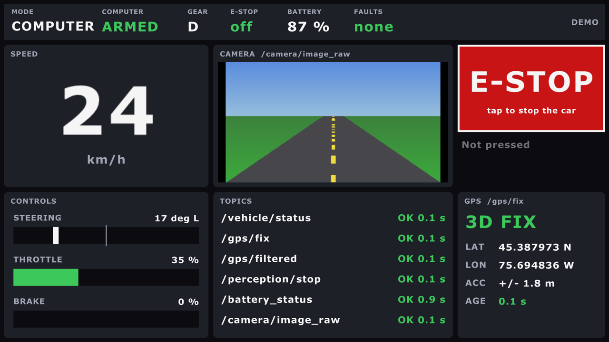

| Panel | Shows |
|---|---|
| Top strip | mode, armed, gear (D/R/P), e-stop on/off, battery, faults |
| Speed | km/h, big. Grey with "OLD" when `/vehicle/status` stops |
| Controls | steering (left of centre = left), throttle, brake |
| Camera | the picture (rgb8, bgr8, rgba8, bgra8, mono8); a STOP SIGN banner over it; a big orange **SIMULATED** / **BENCH** / **REPLAY** band along its bottom when `/system/source` says any data isn't the real car's; the sensor watchdog's banner (15 Oct): red **STOP: gps STALE (...)** while it holds Nav2, amber for a warning, red **SENSOR WATCHDOG SILENT** if it stops talking (twist_mux then holds Nav2 for its silence) ([simulation](simulation.md#sensor-failures-on-purpose)) |
| E-STOP | the button: `/safety/estop` true 5 times, 0.1 s apart. Never false. Says whether anything heard it |
| (nothing on screen) | the heartbeat, `/hud/heartbeat`: below |
| Topics | every topic it listens to: OK, STALE (quiet for 1 s) or NEVER, and how long ago; a REAL / SIM / BENCH / REPLAY tag where `/system/source` names it |
| GPS | is there GPS data? NO GPS DATA, GPS SILENT, or the fix: NO FIX, 2D, 3D, DGPS, RTK FLOAT, RTK FIXED. Then lat, lon, accuracy, age |

### Run it

```bash
pixi run hud-demo                  # pretend data: no ROS, no car, any Mac
pixi run build && pixi run hud     # the real node (ros2 launch aav_hud_raylib hud.launch.py)
pixi run hud fullscreen:=true      # full screen; F11 switches too
pixi run hud fullscreen:=true monitor:=HDMI-2   # on that monitor, by name or number
```

Without Pixi: `cargo run -p hud-app --no-default-features -- --demo`, in
`src/hud/aav_hud_raylib`. The first build compiles raylib (cmake, about a minute).

### How it's built

| Part | What it does |
|---|---|
| `crates/hud-core` | the logic, no ROS, no raylib: state, GPS kinds, OK/STALE/NEVER, the e-stop burst. `cargo test -p hud-core` (in `tools/test.sh`) |
| `crates/hud-app` | the window (raylib, main thread) and the node (rclrs, its own thread, news over a channel). `--demo` swaps the node for pretend data |
| `config/hud.yaml` | every topic name, the only place they're written. Rename one there, or `--ros-args -p gps_topic:=/x` |

- The GPS panel reads `/sensors/gps/fix`, the receiver itself, not `/localization/gps/fix`: it answers
  "does the GPS work?". navsat_transform marks every `/localization/gps/fix` message as RTK.
- NavSatFix can't tell RTK float from fixed. The HUD calls it fixed at 5 cm or better.
- Not in `car.launch.py`: on the car it starts at login by itself
  ([The two screens](car-screens.md)). On Linux without X11's headers, colcon skips it
  with a warning.
- `--monitor NAME|N` picks the monitor (its name exactly, or its number);
  `--list-monitors` prints them. A missing monitor is an error, never a guess.

### The heartbeat

The safety drivers rely on this screen, so the sensor watchdog must know it's alive
(23 Oct, PLAN T9.8).

```text
 window draws a frame --> count + 1
 every 10 ms, the e-stop's timer (ROS thread):
     0.1 s since the last beat, and the count rose?  --> /hud/heartbeat = count (10 Hz)
 sensor_watchdog, input hud:  quiet 1 s, or the count stuck 1 s  --> STOP: Nav2 and the AI slot
```

| What fails | What happens |
|---|---|
| The window freezes | the count stops rising: no more beats |
| The ROS thread freezes | the timer stops: no beats, and no e-stop either. The watchdog stops Nav2 |
| The program dies | no beats. systemd restarts it in 5 s; the lock opens once it beats again |
| The HUD never started | the watchdog says `hud NEVER`: Nav2 never drives |

| Profile | Watched? |
|---|---|
| Car | yes: `car.launch.py watch_hud:=true`, the default. `watch_hud:=false` for a session with no HUD screen |
| Gazebo | with `hud:=true` (the window), or `watch_hud:=true` (something else beats) |
| Bench, turtle, CARLA | no: no HUD window there |

- People, the joystick and the e-stop are never held by it: only Nav2 and the AI slot.
- The e-stop button doesn't depend on it. It's the same timer, so a beat also proves the
  e-stop's sender runs.
- The logic: `hud-core` `heartbeat` (no ROS). The watchdog's side: `kind: heartbeat` in
  `aav_safety`'s `sensor_watchdog.yaml`.

### Tested (15 October, a Mac)

| What | Result |
|---|---|
| `--demo`, in a window and full screen | draws; screenshots checked |
| The node, with `ros2 topic pub` and `image_publisher` (private domain) | speed, faults, RTK FIXED, 2D FIX, STOP SIGN and the camera picture shown |
| Next to bench mode (`bench.launch.py nav:=false`, private domain) | every bench topic OK: status, GPS 3D fix, battery 100 %, the bench camera. `/perception/stop_sign` NEVER (perception is off there) |
| One press, through the real node, to another node (`cargo test`) | exactly 5 trues, no false, each "sent to 1 node" |
| Ctrl-C to `ros2 launch` | the window closes, "finished cleanly" |
| A click on the window's button | not tested: macOS blocks clicks from scripts  |
| The sensor watchdog's banner (15 Oct) | its logic: `cargo test` (hud-core `watchdog`, `state`), shared with the map window. Not seen on screen yet |
| The SIMULATED / BENCH / REPLAY banner (15 Oct) | its logic: `cargo test` (hud-core `origin`, and the message's numbers in hud-app). Not seen on screen yet: the window couldn't open from that session |
| The heartbeat, through the real node (23 Oct, `cargo test`) | none before the first frame; 15-21 beats in 2 s of drawing, each count higher; none once drawing stops, and the e-stop's 5 trues still go out |
| The heartbeat, the real window and the watchdog (23 Oct, private domain) | 9.3 beats a second; `hud NEVER` before it opened, `OK` while it ran; frozen (SIGSTOP) or closed: `hud STALE` and the lock on within about 1 s; thawed: `OK` again |
| The heartbeat in Gazebo (23 Oct, `sim-check --faults`, `hud stop`, twice) | the check beats in the window's place; when it stops, Nav2's car stands still 2.5 s later |

### What it shows with each backend

The HUD reads topics, so it works next to anything that publishes them. Start the backend,
then `pixi run hud` in another terminal (the same `ROS_DOMAIN_ID`).
With Gazebo, one command does both: `pixi run sim world:=test_lot hud:=true`.

| HUD panel | Turtle (`pixi run turtle`) | Gazebo (`pixi run sim world:=road`) | Bench (`pixi run bench`) | Car |
|---|---|---|---|---|
| Speed, steering, mode, armed | ✅ from the turtle's motion (15 Oct) | ✅ 50 Hz, from Gazebo's wheels | ✅ | the backend's `/vehicle/status` |
| GPS panel | NEVER: no GPS | ✅ 3D fix, about 5 Hz | ✅ | the ZED-F9R, once it runs |
| Camera | NEVER: no camera | ✅ road world, about 9 Hz | ✅ the drawn road | the camera Pis |
| Stop sign | NEVER | with `perception:=true` (`pixi run -e ml sim ...`) | with `--perception` | YOLO |
| Battery | NEVER | NEVER: not simulated | ✅ | the battery monitor |
| Orange banner (`/system/source`, 15 Oct) | SIMULATED | SIMULATED | BENCH | none: `spine_bridge` and `legacy_uart_bridge` say REAL |

Checked on 15 Oct by listening to each topic while the backend drove a scripted goal
(the window itself couldn't open from that session). NEVER on a panel is the honest answer:
nothing publishes that topic there.

## The map window (big screen)

`src/hud/aav_hud_raylib`, binary `map`: its own window, which is also the ROS node `map`.
Step 1 (15 October): what Nav2 already knows, drawn north up. Step 2 (15 October): an
offline street map of Ottawa under it ([below](#the-street-map-under-it)). Step 3
(15 October): [search for a place](#search-for-a-place-and-drive-there) and send it to
Nav2.

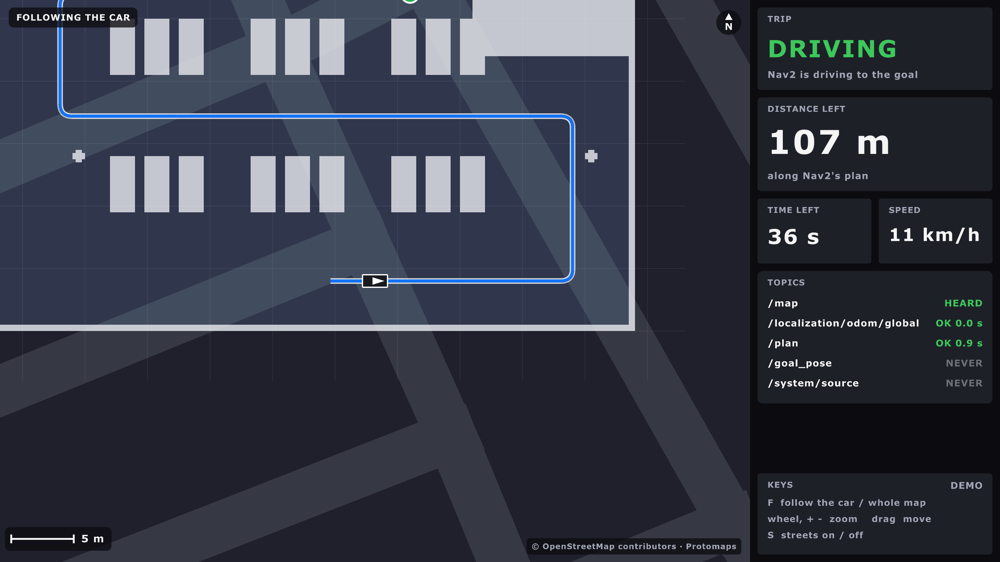

| On screen | From |
|---|---|
| The map: free light, occupied dark, unknown grey; grid lines every round number of metres | `/map` (latched) |
| The car: its outline to scale (`vehicle.yaml`), with an arrow; grey when its position is old | `/localization/odom/global` (map frame) |
| The plan: a blue line | `/plan` |
| The goal: a green dot | the plan's last point; RViz's `/goal_pose` until Nav2 plans for it |
| TRIP | NO GOAL, DRIVING, ARRIVED (within 1 m), WAITING FOR A PLAN, NO NEW PLAN (Nav2 stopped replanning: cancelled or failed), NO POSITION |
| DISTANCE LEFT | along the plan, from the point nearest the car |
| TIME LEFT, SPEED | distance / speed; km/h from the odometry |
| TOPICS | each topic: OK, STALE or NEVER |
| Orange band | SIMULATED / BENCH / REPLAY, as on the HUD (`/system/source`) |
| Watchdog banner (15 Oct) | across the bottom of the map: the sensor watchdog's verdict, as on the HUD: red **STOP: ...** while it holds Nav2, or **SENSOR WATCHDOG SILENT**; amber for a warning (`/safety/sensor_watchdog/state`) |
| Scale bar, N | bottom left; north is always up |

### Keys

| Key | Does |
|---|---|
| / | search for a place ([below](#search-for-a-place-and-drive-there)) |
| F | follow the car (the start: 60 m across) / the whole map (`--whole-map` starts there) |
| S | the street map on / off |
| mouse wheel, + and - | zoom |
| drag | move the map (a free view; F goes back to the car) |
| F11 | full screen |

### Run it

```bash
pixi run map-demo                          # pretend data: no ROS, no car
pixi run build && pixi run map             # the real node (ros2 launch aav_hud_raylib map.launch.py)
pixi run sim world:=test_lot map:=true     # Gazebo, Nav2 and the map window together
pixi run map fullscreen:=true monitor:=HDMI-1   # full screen on that monitor
```

### How it's built

| Part | What it does |
|---|---|
| `crates/map-core` | the maths, no ROS, no raylib: map to screen and back, zoom, the grid's pixels, the nearest point and the distance left, the trip's status. `cargo test -p map-core` (in `tools/test.sh`) |
| `crates/map-app` | the window and the node, built like the HUD's. `--demo`, `--screenshot FILE`, `--vehicle FILE` |
| `config/map.yaml` | every topic name, the limits: `stale_after`, `plan_stale_after` (3 s), `arrive_within` (1 m), and `street_map`, the street map's file |

- The distance comes from `/plan` and the car, not from Nav2's action feedback: simpler,
  and it works for a goal sent from anywhere.
- The car's size: `vehicle.yaml`, built in, and the installed one at launch (`--vehicle`).

### Tested (15 October, a Mac)

| What | Result |
|---|---|
| `cargo test` (map-core 33, map-app 6: the grid message, the demo, the options) | all pass |
| `--demo`, with `--screenshot` | the picture above |
| Gazebo, `world:=test_lot sim_speed:=3`, headless, private domain, two Nav2 goals | the lot, the car, the plan and the goal; SIMULATED; DRIVING, the distance and the time left counting down; both goals SUCCEEDED |
| ARRIVED on screen | only in `--demo` and the unit tests: each live window closed (screenshot) before the car got there |
| The watchdog banner (15 Oct) | its logic: `cargo test` (map-core `state`, hud-core `watchdog`), and `cargo clippy`. Not seen on screen: the window couldn't open from that session |
| Clicks, the wheel, dragging | not tested: macOS blocks input from scripts |

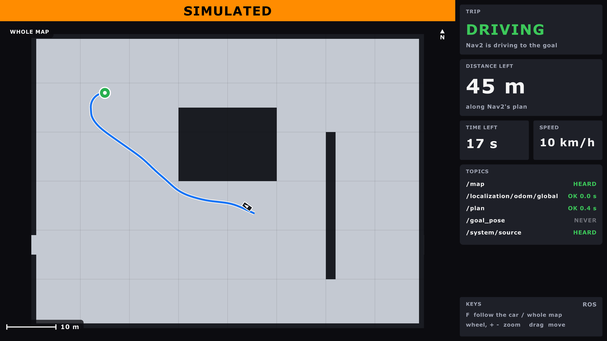

- `/plan` isn't latched: a window opened after Nav2 finished shows NO GOAL until the
  next goal.
- Near the goal, Nav2 may plan a loop to arrive facing the right way; the distance left
  follows the loop.

### The street map under it

OpenStreetMap's streets, water, parks and buildings, drawn under Nav2's map, so the car
and its path sit on real streets. It works with no internet: the map is a file.

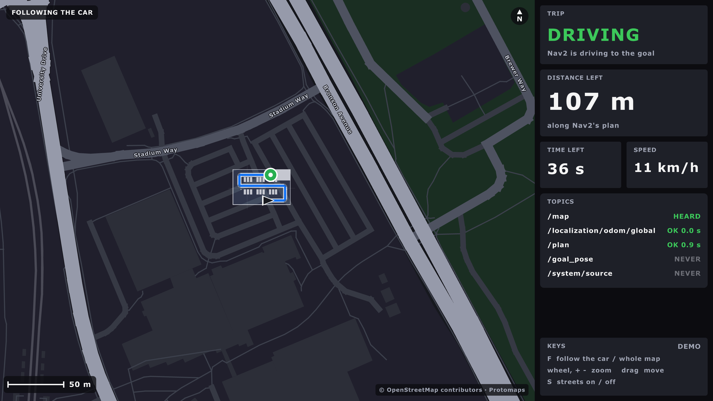

| Get it, once | |
|---|---|
| `pixi run get-street-map` | 40 MB into `maps/streets/ottawa.pmtiles` (git ignores `maps/`) |
| What it is | Ottawa, lon -76.0 to -75.4, lat 45.2 to 45.55, zoom 0 to 15: vector tiles |
| From | [Protomaps](https://docs.protomaps.com/basemaps/downloads)' world basemap, build 20260811 (OpenStreetMap of 11 Aug 2026) |
| How | go-pmtiles' `pmtiles extract`: only the tiles in the box, never the 139 GB file |
| Checked | the tool and the file, each against a pinned SHA-256 |
| Newer streets | `STREET_MAP_BUILD=latest pixi run get-street-map` (delete the old file first; no checksum then) |

No file: the window still runs, and says **No street map: pixi run get-street-map**.

#### Licence and credit

| Part | Licence | Asks for |
|---|---|---|
| The map data | OpenStreetMap, [ODbL](https://www.openstreetmap.org/copyright) | "© OpenStreetMap contributors" wherever it's shown |
| The tiles (Protomaps basemap) | data ODbL, code BSD-3-Clause | nothing more; we credit "Protomaps" too |
| go-pmtiles (the download tool) | BSD-3-Clause | |
| mvt-reader, earcut, flate2 (Rust) | MIT, MIT or Apache-2.0 | |

The window writes **© OpenStreetMap contributors · Protomaps** bottom right whenever the
streets show. Don't remove it.

#### Why this way

| Choice | Instead of | Why |
|---|---|---|
| A Protomaps extract (vector) | downloading tile.openstreetmap.org's pictures | their [tile policy](https://operations.osmfoundation.org/policies/tiles/) forbids bulk and offline downloads |
| Vector tiles, drawn by us | ready-made pictures | our own dark colours, sharp at any zoom, 40 MB for the whole city |
| Our own PMTiles reader (150 lines) | the `pmtiles` crate | it reads only through tokio (async); `pmtiles2` brings brotli and zstd |
| The datum from `navsat.yaml` | a second copy in `map.yaml` | one place: the window uses what navsat_transform uses (`--navsat`, from the launch file) |

#### Where the streets go

navsat_transform puts map (0, 0) at its datum (`aav_localization/config/navsat.yaml`), x
east, y north. map-core's `earth` does the same sums: UTM in the datum's zone, less the
datum, turned by the meridian convergence (-0.495 degrees at Carleton).

| Check (15 Oct) | Result |
|---|---|
| UTM against GeographicLib (`GeoConvert`) | within 1 mm (unit test) |
| Carleton (45.3835, -75.6974) on the map | ours (-109.607, -277.746) m; navsat_transform's `/fromLL` in the sim (-109.607, -277.746) |
| Parliament Hill (4 km north) | ours (-93.875, 3944.025) m; `/fromLL` the same to 1 mm |
| Without the convergence turn | 34 m off at Parliament Hill: why it's there |

The sim's datum is the placeholder near Carleton, so in Gazebo the test lot sits on
campus streets that aren't really there: the streets only match the world on the car.

#### How it draws

| Part | Where |
|---|---|
| Lat/lon to map metres and back | `map-core/src/earth.rs` |
| Which tiles, which zoom | `map-core/src/tiles.rs` |
| Reading the file | `map-core/src/pmtiles.rs` |
| One tile to triangles and lines | `map-core/src/streets.rs` (mvt-reader, earcut) |
| What to keep, load, forget | `map-core/src/tilecache.rs` (160 tiles; a parent tile stands in while one loads) |
| The loader thread, the colours, the names | `map-app/src/streets.rs` (rlgl: one batch per colour) |

- Order: streets, then Nav2's map see-through (unknown clear, free a faint blue,
  occupied near-white), then the plan, the goal and the car.
- Roads by class: paths and service roads dim, residential grey, major roads (Bronson,
  Colonel By) brighter and wider, highways (the 417) amber. Zoomed in, roads are their
  real width.
- Street names from about 1.5 km across the window, along the street.
- `--zoom 0.12` starts zoomed out (about 10 km across); the wheel goes out to 50 m a
  pixel.

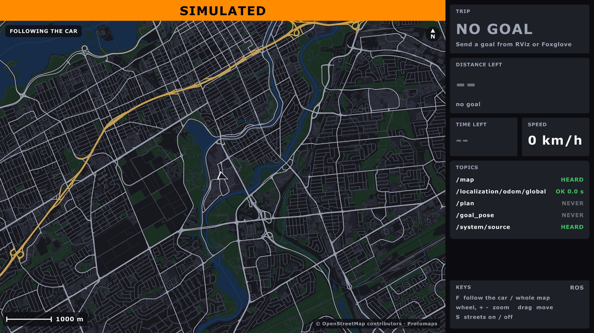

#### Tested (15 October, a Mac)

| What | Result |
|---|---|
| `cargo test` (map-core 54, map-app 8) | all pass; two tests read the real file when it's there |
| `--demo`, near and far | the pictures above |
| Gazebo, `test_lot`, headless, private domain, a Nav2 goal | the lot over the campus streets, the plan and the car; the goal SUCCEEDED |
| S, the wheel, dragging | not tested: macOS blocks input from scripts |
| On the car with a real GPS | untested |

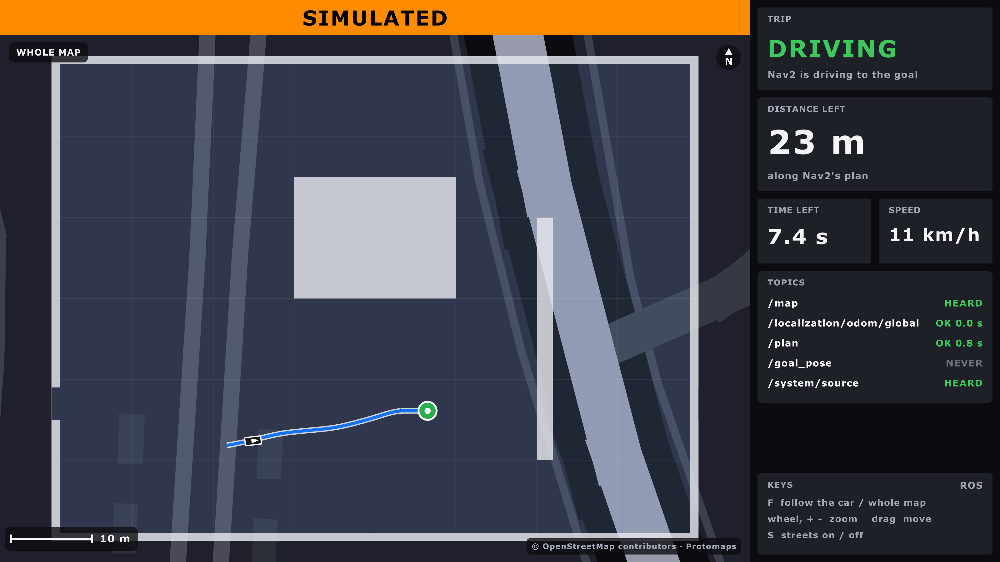

### Search for a place, and drive there

Type a name or an address, pick a result, and send it to Nav2 as the goal. Two presses
(DRIVE HERE, then CONFIRM), so a stray tap never moves the car.

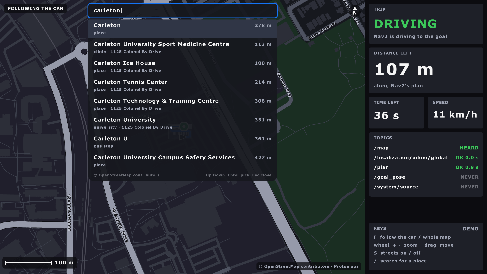

| Key | Does |
|---|---|
| `/` or a click on the box | open the search box (a tap or click also opens the [on-screen keyboard](#the-on-screen-keyboard-touchscreen)) |
| letters, Backspace | type (the map's own keys, F S + -, are letters while typing) |
| Up, Down, Enter, or a click | pick a result: the map centres on it, with a magenta pin |
| Enter, or a click | **DRIVE HERE**, then **CONFIRM: send goal** |
| Esc | back one step: CONFIRM to the place, the place to the list, the list closed |

#### The on-screen keyboard (touchscreen)

The car's screen has no keyboard. **Tap the search box**: a keyboard opens along the
bottom. A mouse click counts as a tap, so it works the same on a Mac.

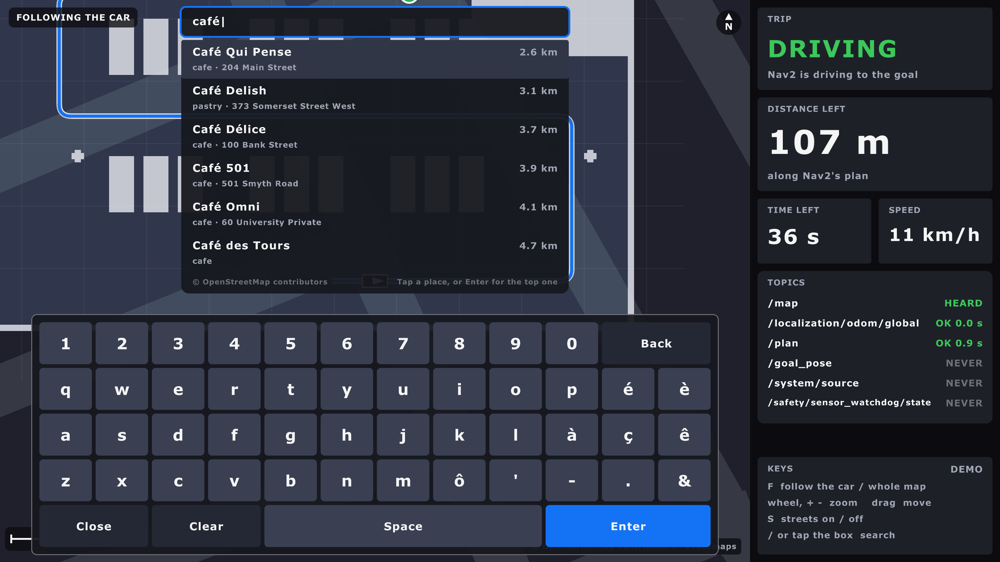

| Key | Does |
|---|---|
| letters, digits, `' - . &` | type (lower case: the search ignores case) |
| é è à ç ê ô | the accents in Ottawa's French names |
| Space | a space |
| Back | remove the last letter (a whole letter, even é) |
| Clear | empty the box |
| Enter | pick the top result (the map centres on it, then DRIVE HERE) |
| Close | hide the keyboard; the results stay, tap one |

| | |
|---|---|
| Key size | 84 px at 1600 x 900, grows with the window, never under 60 px |
| Results | only the rows that fit above the keyboard |
| A real keyboard | works as before; `/` opens the box without the on-screen keyboard |
| Code | `map-core/src/keyboard.rs` (the keys, which one a tap hit: unit-tested), `map-app/src/ui.rs` (drawing) |
| Screenshot | `--keyboard` opens it at the start |


| | |
|---|---|
| Message | `geometry_msgs/PoseStamped` on `/goal_pose` (`goal_topic` in `config/map.yaml`), as RViz's "2D Goal Pose": `bt_navigator` starts a navigate_to_pose |
| Frame | Nav2's map frame (`map`), from the place's lat/lon by the same sums as navsat_transform (`earth.rs`) |
| Facing | from the car toward the place |
| Refused | outside Nav2's `/map` (**Outside Nav2's map: 3.8 km away**, from its edge), no `/map` yet, or no car position |
| `--demo` | no Nav2: the goal shows, and the pretend car stops |

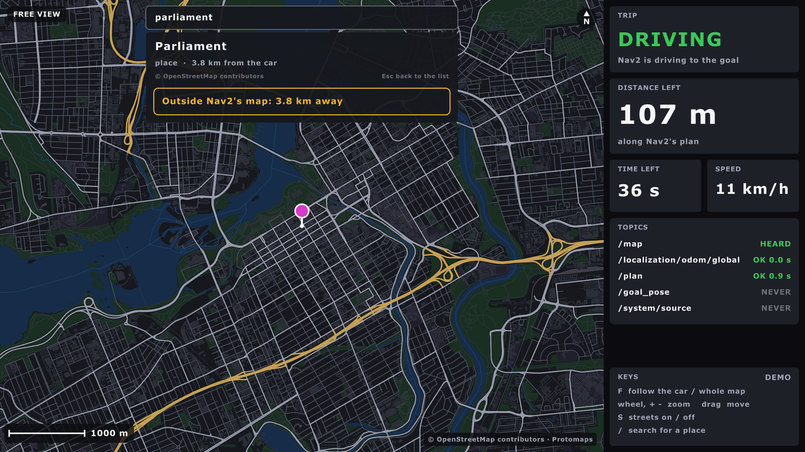

On the car, Nav2's map is only the test site, so most of Ottawa is "outside" until a
bigger map (or Nav2's GPS waypoints over a road map) exists. That's the right answer, not
a bug.

#### How the search works

| | |
|---|---|
| File | `maps/places/ottawa.db` (`places` in `config/map.yaml`, or `--places FILE`): `pixi run get-hud-map` |
| Opened | read-only |
| Matches | a name that starts with the words (any case), an address ("580 rideau"), then names with the words inside |
| Left out | street lamps, benches, crossings, footways, service roads, link roads... (a deny-list, `NOT_DESTINATIONS` in `places.rs`: over 300 types, so a new one should show up) |
| Ranked | exact name, then starts with, then a word starts with, then inside; nearest first in each; a street's many pieces count once |
| Shows | at most 8 |
| Speed (a Mac, release build) | 0.3 to 19 ms on the real file |
| Credit | "© OpenStreetMap contributors" under the results and the place (ODbL) |
| Code | `map-core/src/places.rs` (search), `destination.rs` (the steps, the goal check), `map-app/src/search.rs` (keys, sending) |
| Library | `rusqlite` with SQLite built in (MIT; SQLite is public domain) |

Try a search from a terminal: `cargo run --release -p map-core --example search -- tim hortons`
(in `src/hud/aav_hud_raylib`, with `PLACES=` the file's path).

#### For tests and screenshots

| Option | Does |
|---|---|
| `--search TEXT` | starts with TEXT typed |
| `--pick N` | with `--search`: picks result N |
| `--keyboard` | opens the box with the on-screen keyboard showing |
| `--send-goal TEXT` | once `/map` and the car are known: sends the first result inside Nav2's map, and says so on the terminal |

#### Tested (15 October, a Mac)

| What | Result |
|---|---|
| `cargo test` (map-core 74 with the real file, map-app 11) | all pass |
| Gazebo `test_lot`, headless, private domain: `--send-goal "university drive"` | sent x 59.27, y 11.90 m; `bt_navigator`: "Begin navigating from current location (0.06, 0.09) to (59.27, 11.90)"; then "Goal succeeded" |
| The same, `--send-goal "carleton university"` | nothing sent: every result "Outside Nav2's map" (109 m to 700 m away) |
| Typing, clicks, Up/Down, DRIVE HERE and CONFIRM by hand | not tested: macOS blocks input from scripts. The steps are unit-tested in `destination.rs` |
| On the car's touchscreen | untested: the on-screen keyboard (16 Oct) is ready; taps by hand not tried yet |
| The on-screen keyboard (16 Oct) | `cargo test` (map-core `keyboard`: key at a point, scaling, editing, Back on é); `--demo --keyboard` screenshot above. Taps by hand: not tested (macOS blocks input from scripts) |

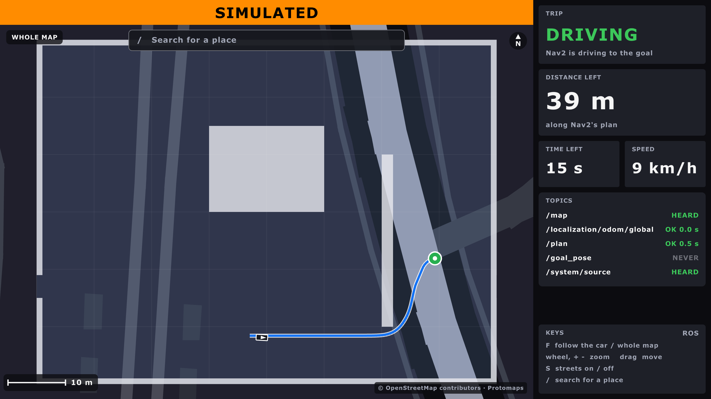

The sim's datum is the placeholder near Carleton, so in Gazebo "University Drive" lands
inside the test lot. On the car, the datum is the real test site.

## The Flutter app (2025-26): what it is

**Decided (Ben, 15 Oct): the raylib HUD replaces it** (Q29). What it looked like, drawn
from its own code by a Flutter widget test with pretend data (15 Oct). The map tiles are
blank: they came from a tile server on the car's Pi.

| Dashboard | Map |
|---|---|
| 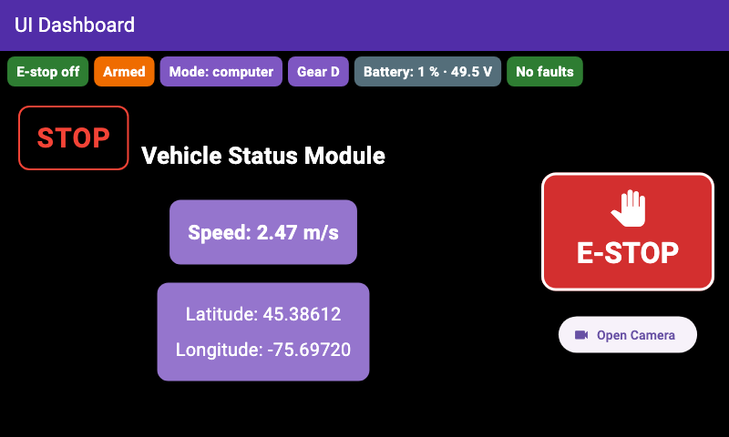 | 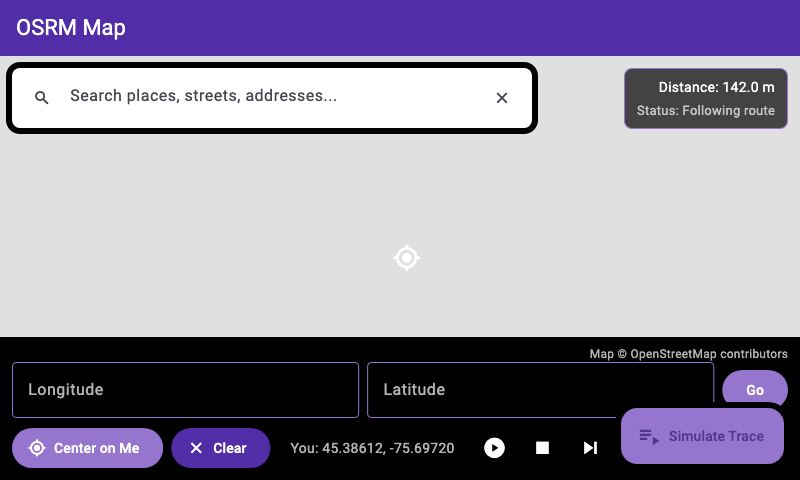 |


Three programs that run together on the UI Raspberry Pi (Ubuntu 22.04 in 2025-26, two
800x480 screens):

| Part | Where | What it does |
|---|---|---|
| Front end | `hud/flutter_pi/` (Flutter/Dart) | Screens: home (e-stop button, status strip, speed, stop-sign alert), map with destination search, camera page. Talks to the back end over Socket.IO and HTTP. |
| Back end | `src/hud/aav_hud/` (ROS 2 Python node + Flask) | `hud_server`: reads the car's topics and pushes them to the app (port 5000); sends a locked route to Nav2; publishes the e-stop button's `/safety/estop`. |
| Routing | OSRM in Docker (`hud/scripts/osrm_bootup.sh`) | Offline road routing for Ontario on port 5001. The map data file (`ontario-*.osrm`) was on the Pi, not in git. |

The map page also needs a tile server on port 8080 (`/styles/basic-preview/`). It isn't
in git either.

## What the back end reads and sends

| Name | Type | Use |
|---|---|---|
| `/vehicle/status` | `aav_interfaces/msg/VehicleStatus` | reads: speed, mode, armed, e-stop, gear, faults |
| `/localization/gps/fix` | `sensor_msgs/msg/NavSatFix` | reads: the car on the map (`gps_topic:=/sensors/gps/fix` for the raw fix) |
| `/perception/stop_sign` | `std_msgs/msg/Bool` | reads: the stop-sign alert |
| `/vehicle/battery` | `sensor_msgs/msg/BatteryState` | reads: volts, charge, amps |
| `/sensors/camera/front_left/image_raw` | `sensor_msgs/msg/Image` | reads, only while someone watches the camera page |
| `/safety/estop` | `std_msgs/msg/Bool` | publishes: only true, when the e-stop button is pressed |
| `/follow_gps_waypoints` | `nav2_msgs/action/FollowGPSWaypoints` | sends the locked route as GPS waypoints, and shows Nav2's progress |

## The e-stop button

This is the software e-stop. The car's red e-stop button is separate: nothing here
touches it.

- Big and red, on the home screen. One tap sends `POST /estop`.
- The back end publishes `/safety/estop` true at once, then 4 more times, 0.1 s apart.
- Reliable, depth 10: what spine_bridge and legacy_uart_bridge subscribe with. twist_mux
  takes it too.
- The press also cancels the HUD's route, so clearing the e-stop doesn't restart the trip.
- The HUD never clears it. Clearing stays a person's deliberate act, from a laptop:
  `pixi run estop-clear`, or Foxglove.
- No answer, or nothing subscribes to `/safety/estop`: the app shows a red message, "E-STOP
  FAILED ... Press the car's red e-stop button."

## Socket.IO events and web routes

| Event | Carries |
|---|---|
| `speed` | `speed`: m/s from `/vehicle/status`, negative in reverse |
| `position` | `latitude`, `longitude` |
| `stop_sign` | `detected`, `message`; sent when it changes |
| `nav_state` | `distance`, `status`, the waypoint number and a message |
| `vehicle_status` | mode, armed, e-stop, gear, steering, throttle, brake, faults |
| `battery` | `voltage` (V), `percentage` (0-100), `current` (A); null when not measured |

The app's names are in `lib/components/sockets/hud_events.dart`, the back end's in
`events.py`. A test checks that the two lists match.

| Route | Does |
|---|---|
| `POST /receive` | takes the app's route, and starts the Nav2 goal. 400 for a bad route, 503 when Nav2 isn't running |
| `POST /cancel` | cancels the goal: the map page's Unlock and Clear. 409 when no route is followed |
| `POST /estop` | publishes `/safety/estop` true. It can't clear it. 503 when nothing subscribes |
| `GET /camera/latest.png` | the newest camera picture: the camera page. 503 when none is newer than 2 s |
| `GET /camera/stream` | the same, as a stream of pictures: open it in a browser |
| `GET /` | the latest copy of every event, as JSON |

## What changed in the app (11 October)

| Change | Where |
|---|---|
| An e-stop button, and a red message when it fails | home screen |
| A strip: e-stop, armed, mode, gear, battery, faults. Empty when the back end is lost | home screen, top |
| Unlock and Clear cancel the route (`POST /cancel`) | map page |
| Lock Route sends at once: the two 3 s debug delays are gone | map page |
| The camera page shows `/camera/latest.png`, 5 a second, and says "Not live" when it stops | camera page |
| The events' real names, in the app and the back end together | both |
| "© OpenStreetMap contributors" under the map and the search results | map page |
| Socket.IO over WebSocket only. With polling first, it never connected | all screens |
| No WebRTC package. No package was added | `pubspec.yaml` |

Every changed file is listed in `hud/flutter_pi/PROVENANCE.md`.

## Get Flutter

conda-forge has no Flutter, so Pixi can't install it. A task downloads it instead:

```bash
pixi run get-flutter      # Flutter 3.35.7 into vendor/flutter/ (about 4.3 GB)
pixi run get-hud-map      # the place database (below)
```

| | |
|---|---|
| Version | 3.35.7 (Dart 3.9.2), the last 3.35. `pubspec.lock` needs Flutter 3.35+ and Dart 3.9+; 3.38 and newer pin other package versions, so they would rewrite it |
| Computers | macOS (Apple silicon, Intel) and Linux x64. Flutter publishes no SDK archive for Linux arm64 (the Pis, the Orin) |
| Checked | by the SHA-256 in Flutter's releases JSON (pinned in `tools/get_flutter.sh`), and by its git commit |
| Analytics | off, without changing your own settings |
| Kept in `vendor/flutter` | the pub cache, Flutter's settings, the analyzer's state |
| Still outside the repo | `~/.flutter` (an empty file); on a Mac, `~/Library/Caches/flutter_engine/` (empty folders) |

`pixi run flutter <args>` runs any Flutter command in `hud/flutter_pi`, with the same
settings.

## Test the app

```bash
pixi run hud-test         # flutter pub get, analyze and test: offline
pixi run test             # everything; includes hud-test when vendor/flutter exists
```

- 19 tests: the e-stop request, the status strip, the camera page, Clear, the events.
- Then the app's own client code against the back end's real web server, with a fake
  car behind it (`tools/hud_fake_backend.py`, no ROS). It must connect, get the car's
  status and a picture, and see the e-stop it presses.
- `flutter analyze`: no errors, no warnings, 7 infos, all in the 2025-26 map page.
- Without Flutter, `pixi run test` prints "skipped" for the app.
- The back end has 98 tests of its own; `pixi run test` runs them too.

## Run it

```bash
pixi run bench hud:=true hud_port:=5123      # the back end, with the bench car
ros2 launch aav_hud hud.launch.py            # the back end alone, next to a profile
```

- It listens on 127.0.0.1 only, by default: a locked route moves the car, so only the
  HUD's own computer can send one. `hud_host:=0.0.0.0` opens it to the network.
- On a Mac, AirPlay holds port 5000: use another, as above.
- The app talks Socket.IO over WebSocket, so the back end needs `simple-websocket`.
  Pixi has it. Ubuntu 24.04's apt has no `python3-simple-websocket`.
- The app finds the back end at `http://127.0.0.1:5000`. Another address is set when
  the app is built or run: `--dart-define=HUD_BACKEND=http://127.0.0.1:5123`.
- The app's own client code against the bench's back end (it presses the e-stop):

  ```bash
  pixi run flutter test test_bench --dart-define=HUD_BACKEND=http://127.0.0.1:5123
  ```

- The app itself, on Linux x64 with GTK: `tools/flutter.sh run -d linux`, outside Pixi
  (Pixi's compilers don't see the system's GTK). Untested.
- On a Mac: not yet. The app has only a Linux runner. `flutter create --platforms=macos`
  makes one, but `window_manager` 0.5.1 brings `screen_retriever_macos` 0.2.0, which
  needs CocoaPods (it has no Swift package). CocoaPods isn't on conda-forge. Tried on
  11 October in a copy: the build stopped there.

## On the bench (11 October)

`pixi run bench hud:=true hud_port:=5123` on a Mac, on a private ROS domain. The
scripted driver held 0.90 m/s, then the e-stop was pressed:

| Pressed by | Answer | Spine says e-stop | Car below 0.05 m/s | 3 s later |
|---|---|---|---|---|
| `POST /estop`, as the app sends it | 200, in 8 ms | after 0.12 s | after 0.24 s | 0.0 m/s |
| the app's own client code (`test_bench`) | 200 | after 0.05 s | after 0.28 s | 0.0 m/s |

- Times count from the request (first row), or from the first `/safety/estop` message (second).
- `/safety/estop` true came 5 times in 0.36 s, and never false. The spine disarmed; clearing
  the e-stop and arming again, from the "laptop", worked.
- The app's client saw `vehicle_status` say "e-stop on" 41 ms after its press.
- `pixi run check bench`: 0 failed. `/safety/estop`: published by `hud_server`, subscribed by
  `spine_bridge` and `twist_mux`.
- `/camera/latest.png`: a 640x360 picture (11 kB), from the second fetch on. The first
  answers 503: it starts the camera subscription.
- The battery: 99.7 %, 50.9 V, current null (mock_battery doesn't give one).
- The first run found that the app couldn't connect at all (Socket.IO's polling): fixed,
  and now tested by `pixi run hud-test`.

## The place database

The map window's [place search](#search-for-a-place-and-drive-there) and the Flutter
app's destination search read `ottawa.db`: 51 MB of SQLite, 606,628 named places around
Ottawa. It's too big for git, so a task downloads it:

```bash
pixi run get-hud-map      # into maps/places/, linked into hud/flutter_pi/assets/databases/
```

| | |
|---|---|
| From | the 2025-26 team's public repo, `AAV-2025-2026/User-Interface`, at `ea5adc3`: the last commit that changed it |
| Checked | by its SHA-256, so a changed file is refused |
| Data | from OpenStreetMap: © OpenStreetMap contributors, under the ODbL. The app shows that credit |

Keep the Flutter app or not: Q29. Meanwhile, **Foxglove** works as the operator's screen:
`foxglove_bridge`, on port 8765, shows speed, the map, paths and costmaps.

## Before running it on the car

- The Firebase service-account keys and the GitHub token in the 2025-26 User-Interface
  repository are public. They were not copied here; revoke them (design doc Q34).
- `hud/scripts/flask_bootup.sh` still sources the old `/home/aavui` workspace.
- The Pi is Linux arm64: Flutter has no SDK archive for it. Build there from Flutter's
  git repository at tag 3.35.7, or build elsewhere. Untested.
- Waypoints must be inside Nav2's map, and Nav2 slows down at each one.
