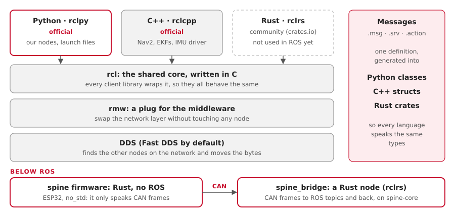

# Python, C++ and Rust

Our ROS nodes are Python, and the firmware and hardware drivers are Rust. The C++ we
inherited is now Rust (Ben, 10 and 15 Oct): none of our ROS code is C++. Only today's
ESP32 firmware still is, and the hardware lead's wheel-sensor Arduino (Ben, 23 Oct). ROS 2 lets each program pick its own language, because
programs only meet through messages.

## How languages fit into ROS 2

- Every node is its own program, so a Python node and a C++ node talk without knowing it.
- Each `.msg` file is generated into Python, C++ and Rust, so every language sees the
  same types.
- The client libraries all wrap one C core, `rcl`, so they behave the same.

## What we use, and where

| Code | Language | Why |
|---|---|---|
| Our ROS nodes: ego, drivers, bridges, adapters | Python | Glue that runs 50 times a second or less. Quick to write and read. The same file runs on any computer, with no cross-compiling. |
| Launch files | Python | That's how ROS 2 launch works |
| Stock packages: Nav2, the EKFs, twist_mux | C++ | Not ours: we only configure them |
| The IMU driver, `aav_imu_yahboom` | Rust (`rclrs`) | Ben's rewrite of the 2025-26 C++ driver, which it replaced on 11 Oct |
| The radar clustering, `aav_radar_clusters` | Rust (`rclrs`) | A rewrite of the 2025-26 C++ node, which it replaced on 15 Oct |
| The CAN bridge, `aav_spine_bridge` | Rust (`rclrs`) | A port of `aav_spine`'s Python node (T1.8), on the firmware's own CAN code. The default since 23 Oct; the Python one stays until the Rust one has run on the car |
| The spine firmware, `firmware/spine` | Rust, `no_std` | Memory-safe, and its logic is tested on a laptop |
| The in-car HUD and the map window (raylib), in `ros/hud` | Rust (`rclrs`, raylib) | One program that is also its ROS node (Ben, 11 Oct) |
| Bench mode's spine, `aav_spine_sim` | Rust (`rclrs`) | Runs `spine-core` itself on the CAN frames |
| Today's ESP32 firmware | C++ (Arduino, PlatformIO) | Inherited. Its Rust version (`boards/esp32-umod`) replaces it once flashed and proven |
| The wheel sensors' Arduino | C++ (Arduino) | The hardware lead's board: it sends CAN 0x200/0x201 (the exception in CLAUDE.md) |
| The wheel encoder and status display Pico 2s | Rust, Embassy | Rewrites of the 2025-26 C++, 15 Oct; not yet flashed |

## Is C++ too risky?

Memory bugs and crashes are a fair worry with C++. In this stack:
- The C++ we run is almost all stock packages that thousands of robots use. We wrote none
  of it.
- Our own code is Python and Rust, and both are memory-safe. The inherited C++ is now
  Rust; only today's ESP32 firmware is still C++, until its Rust version replaces it (and the
  hardware lead's Arduino).
- Each node is a separate process. A crash takes down one node, not the whole system.
- Safety never rests on one program: ego's timeout and the spine's watchdog stop the car
  if a node dies.

## What if everything were Rust?

| You'd get | You'd give up |
|---|---|
| Memory safety and speed in every node | Official support: `rclpy` and `rclcpp` are official; `rclrs` is a community project |
| One language from the firmware up | Examples: most ROS answers and tutorials are Python or C++ |
| Cargo, and its tooling | Simple builds: colcon needs a cargo plugin, and builds get slower |
| | Nothing in Nav2 or robot_localization: they stay C++, and we'd still only configure them |
| | Launch files: they stay Python |
| | An easy hand-over: the 2027-28 team has to know Rust |

Where Rust stands in October 2026:
- **Message crates ship with Jazzy.** Our Pixi install already has them, for example
  `share/sensor_msgs/rust/`.
- **`rclrs`**, the library for writing nodes, comes from crates.io and is still 0.x.
- **It works here.** `examples/rust-listener` (`rclrs` 0.8, `ros-env` 0.3) built in 18
  seconds with plain `cargo build`, and printed ego's commands live from the turtle run.
  It runs on a Mac too ([Status](status.md)).

## Rust on the Pi and the ESP32

| Target | Rust there | A ROS node? |
|---|---|---|
| Orin, Raspberry Pi (Linux, ARM) | `aarch64-unknown-linux-gnu` | Yes, with `rclrs` |
| ESP32 (bare metal) | `no_std` with `esp-hal` | No: today it talks UART to `legacy_uart_bridge` on the Motor Pi (`actuators:=uart`, the default); CAN to `spine_bridge` with `actuators:=can`. No micro-ROS for now: we think again once we see the hardware (Ben, 11 Oct) |
| Raspberry Pi Pico 2 | `no_std`, `thumbv8m.main-none-eabihf` | No, the same as the ESP32 |

## The plan

| When | What |
|---|---|
| Now | Python for ROS nodes; Rust for the firmware (`spine-core`: 84 tests) and a few nodes |
| Done | one `rclrs` node, built with Cargo in the Pixi environment: `pixi run rust-listener` |
| Later | port a node where Rust pays off, such as ego, once the car drives |
