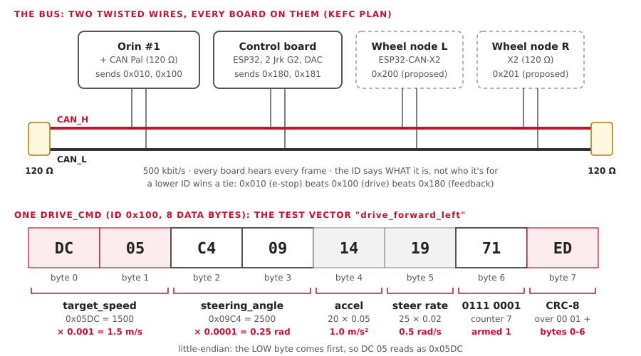

# CAN from zero

CAN is the wire that cars use for small, urgent messages: "steer to 0.25 rad", "I'm
going 1.4 m/s". Today the Orin's CAN bus carries the front wheel speeds. The KEFC plan
also puts our steering, brake and throttle on it. This page starts at the two wires and
ends with one of our frames, decoded byte by byte.

**You'll learn:**
- what a CAN bus is, and why it has a 120 Ω resistor at each end;
- what a frame is: ID, length, data, and who wins when two talk at once;
- our six frames (`aav.dbc` v0.2.0);
- why every frame of ours carries a counter and a CRC;
- the bench tools: a CANable, `candump`, `cansend`, `ip link`, `ros2_socketcan`.

!!! note "Status"
    The CAN code is written and tested against a simulator. **No real CAN bus has carried
    our frames yet.** The first look at the car's bus is car day, session 7
    ([Car day](car-day.md)); the wiring is in the [CAN plan](can-plan.md).

## The picture



## 1. Two wires, one bus

| Idea | In plain words |
|---|---|
| **Bus** | one pair of wires that every board clips onto. No hub, no switch |
| **Differential pair** | two wires, CAN_H and CAN_L, twisted together. The board reads the **difference** between them |
| **Why the difference** | noise from the motor hits both wires the same way. The difference doesn't change, so the noise cancels |
| **Dominant bit (0)** | the wires are pulled apart: CAN_H about 3.5 V, CAN_L about 1.5 V |
| **Recessive bit (1)** | the wires rest together, both about 2.5 V |

### The 120 Ω resistors

A signal running down a wire bounces back off an open end, like a wave in a bath. A
120 Ω resistor at **each end** soaks it up.

| You measure between CAN_H and CAN_L (power off) | It means |
|---|---|
| about **60 Ω** | right: two 120 Ω in parallel |
| about 120 Ω | one resistor is missing |
| about 40 Ω | one too many: three resistors |

On our car: one at each end of the bus, and none on the boards in the middle. Where
the ends are is the hardware lead's to say (car day, question H7).

## 2. A frame

A CAN message is a **frame**. Classic CAN (what we use) looks like this:

| Part | Size | What it is |
|---|---|---|
| ID | 11 bits | **what** the message is (0x000 to 0x7FF). Not who it's for |
| DLC | 4 bits | how many data bytes follow: 0 to 8 |
| Data | 0 to 8 bytes | the message itself |
| CRC-15 | 15 bits | the hardware's own check for wire noise |
| ACK | 1 bit | any other board says "I heard that" |

### No addresses

- Every board hears **every** frame.
- Each board keeps the IDs it cares about, and ignores the rest.
- So a new board (a logger, a laptop) can listen without anyone changing anything.

### Who talks first: arbitration

Two boards may start at the same moment. They both send their ID, bit by bit, and
listen:
- a 0 (dominant) beats a 1 (recessive) on the wire;
- a board that sent a 1 but hears a 0 stops and tries again later;
- so the **lowest ID always wins**, and nothing is lost.

That's why our **e-stop is 0x010**: it beats the drive command (0x100) and the
feedback (0x180) every time.

### Speed: 500 kbit/s

| | Value |
|---|---|
| Our bit rate | **500 kbit/s** (`aav.dbc`, and the `ip link` command below) |
| One bit | 2 µs |
| One 8-byte frame | about 110-135 bits, so about 0.25 ms |
| Our frames per second (v0.2.0) | 50 + 50 + 10 + 10 + 100 + 100 = **320** |
| Bus load | about **8 %**: plenty of room |

Every board on the bus must use the same bit rate, or nobody hears anybody.

### When things go wrong

The CAN chips count their own errors (bad CRC, no ACK, a garbled bit):

| State | When | The board |
|---|---|---|
| Error active | few errors | works normally |
| Error passive | 128+ errors counted | still talks, more quietly |
| **Bus off** | 256+ errors sent | **leaves the bus** until it is reset |

A board with a broken wire takes itself off, rather than jamming everyone else.

## 3. The DBC file: the dictionary

A **DBC file** says what each ID means and where each value sits in the bytes. Ours is
`firmware/can/aav.dbc`. Tools like SavvyCAN or `cantools` read it and decode frames for you.

One line of it:

```text
SG_ target_speed : 0|16@1- (0.001,0) [-32.768|32.767] "m/s" SPINE
```

| Piece | Means |
|---|---|
| 0&#124;16 | starts at bit 0, 16 bits long |
| `@1` | little-endian (Intel): the low byte comes first |
| `-` | signed: it can be negative (reverse) |
| `(0.001,0)` | value = raw × 0.001 + 0 |
| [-32.768&#124;32.767] | the smallest and largest value |
| `"m/s"` | the unit |
| `SPINE` | the board that reads it |

## 4. Our frames: v0.2.0

`aav.dbc` v0.2.0 (15 Oct, from the [KEFC plan](can-plan.md)):

| ID | Name | From → to | Rate | Bytes | Carries |
|---|---|---|---|---|---|
| 0x010 | `ESTOP_CMD` | Orin → spine | 10 Hz, and at once on change | 2 | stop now (1) or not (0) |
| 0x100 | `DRIVE_CMD` | Orin → spine | 50 Hz | 8 | target speed, steering angle, two limits, armed |
| 0x180 | `VEHICLE_FEEDBACK` | spine → Orin | 50 Hz | 8 | measured speed and steering, wheel ticks |
| 0x181 | `VEHICLE_STATUS` | spine → Orin | 10 Hz | 8 | mode, armed, e-stop, throttle %, brake %, fault bits |
| 0x200 | `WHEEL_SPEED_L` | left front wheel sensor → Orin | 100 Hz | 8 | wheel speed (m/s), pulse count, direction known |
| 0x201 | `WHEEL_SPEED_R` | right front wheel sensor → Orin | 100 Hz | 8 | the same, for the right front wheel |

| Board | Is |
|---|---|
| "The spine" | the board that drives the actuators: the **ESP32 control board** already on the car. With today's wiring it isn't on the bus: the Motor Pi reaches it over UART |
| The wheel sensors | the hardware lead's **Arduino** (Arduino C++), counting a Hall sensor on the front brake-rotor holes. One board may send both frames |

One Hall sensor can't tell direction, so `direction_known` = 0, and the Orin takes the sign
from the drive direction.

## 5. One frame, byte by byte

The test vector `drive_forward_left` in `firmware/can/test_vectors.json`:

```text
ID 0x100   data  DC 05 C4 09 14 19 71 ED
```

| Bytes | Raw | Rule (from the DBC) | Value |
|---|---|---|---|
| 0-1: `DC 05` | low byte first: 0x05DC = 1500 | × 0.001 | `target_speed` = **1.5 m/s** |
| 2-3: `C4 09` | 0x09C4 = 2500 | × 0.0001 | `steering_angle` = **0.25 rad** (left) |
| 4: `14` | 20 | × 0.05 | `accel_limit` = **1.0 m/s²** |
| 5: `19` | 25 | × 0.02 | `steer_rate_limit` = **0.5 rad/s** |
| 6: `71` | 0111 0001 in binary | bit 48 = the lowest bit; bits 52-55 = the top four | `armed` = **1**, `counter` = **7** |
| 7: `ED` | | CRC-8 over `00 01 DC 05 C4 09 14 19 71` | `checksum` = 0xED, correct |

A negative number uses two's complement. `drive_reverse_right` starts `12 FD`: 0xFD12 is
-750, so -0.75 m/s.

!!! note "Check it yourself"
    The decode above was checked with our own codec. See **Try it** below: the same
    one-line command prints every value.

## 6. Why a counter and a CRC of our own

CAN already has a CRC-15. So why add our own?

| Check | Catches |
|---|---|
| CAN's CRC-15 (in the chip) | noise on the wire |
| **Our CRC-8** (last byte) | a frame **built wrong** by software, or sent with the **wrong ID**: the ID is part of what it checks |
| **Our 4-bit counter** | a **frozen sender**: an Orin that crashed but keeps repeating the same frame |

What the spine does (`spine-core`, `spine.rs`):

| It sees | It does |
|---|---|
| a bad CRC or wrong length | throws the frame away; sets the fault bit `BAD_CHECKSUM` |
| the same counter twice | treats it as **not fresh**; sets `BAD_COUNTER` |
| no fresh `DRIVE_CMD` for 100 ms | its watchdog trips: **throttle off, brake on, steering held** |

The CRC is CRC-8/SAE-J1850 (poly 0x1D, start 0xFF, end XOR 0xFF), the one cars use.

## 7. Timeouts: the car stops when the talking stops

```text
ego goes quiet ──0.1 s──► spine_bridge stops sending DRIVE_CMD
                          ──0.1 s──► the spine's watchdog: brake
```

| Layer | Timeout | File |
|---|---|---|
| `spine_bridge` | 0.1 s without a command (`/control/car/actuator_cmd`) | `ros/can_bridge/aav_spine/config/spine.yaml` |
| The spine's watchdog | **100 ms** (the KEFC PDF's number) | `spine-core/src/spine.rs` (`cmd_timeout_ms`) |

So the car brakes at most 0.2 s after ego goes quiet.

The spine also refuses to drive until it is **armed**: `armed = 0`, then `armed = 1`. A
reboot never restarts the car by itself ([Firmware](firmware.md)).

## 8. From ROS to the wire

```text
/ego/actuator_cmd ─► output_mux ─► spine_bridge ─► /can/tx ─► socket_can_sender ─► can0 ─► the bus
the bus ─► can0 ─► socket_can_receiver ─► /can/rx ─► spine_bridge ─► /vehicle/odom, /vehicle/status
```

| Piece | What it is |
|---|---|
| **SocketCAN** | Linux's own CAN support: a CAN adapter shows up as a network device, `can0` |
| **`ros2_socketcan`** | the stock ROS package: CAN frames ⇄ `can_msgs/Frame` on `/can/tx` and `/can/rx` |
| **`spine_bridge`** | ours: packs and unpacks frames. The default is Rust (`aav_spine_bridge`, with `spine-core`'s codec); `bridge:=python` runs `aav_spine`'s, with `can_codec.py` |
| **On the bench** | no real bus: `aav_spine_sim` reads `/can/tx` and answers on `/can/rx` |

SocketCAN is **Linux only**: on a Mac, use the bench, or a Linux machine.

## 9. The bench tools

| Tool | What it does |
|---|---|
| **CANable** (or any candleLight adapter) | a USB stick with a CAN plug. Linux sees it as `can0`. Has its own 120 Ω jumper |
| `ip link` | brings `can0` up at a bit rate |
| `candump` | prints every frame on the bus |
| `cansend` | sends one frame you type |
| `vcan0` | a pretend bus inside Linux: no hardware needed |

`candump` and `cansend` come in `can-utils` (`sudo apt install can-utils` on Ubuntu).
They are not in Pixi.

!!! warning "Never cansend a DRIVE_CMD to the car"
    A hand-typed `0x100` with `armed = 1` can move the car. On the real bus, only listen.
    Practise sending on `vcan0`.

## Try it

**Anywhere (Mac or Linux), no ROS:** decode the test vector with our codec.

```bash
PYTHONPATH=ros/can_bridge/aav_spine python3 -c "from aav_spine.can_codec import unpack; print(unpack(0x100, bytes.fromhex('dc05c409141971ed')))"
```

It prints:

```text
{'target_speed': 1.5, 'steering_angle': 0.25, 'accel_limit': 1.0, 'steer_rate_limit': 0.5, 'armed': 1, 'counter': 7}
```

Change the last `d` to `e`: it raises `FrameError: DRIVE_CMD: bad checksum`.

**The bench (Mac or Linux):** watch our frames as ROS messages.

| Step | Run |
|---|---|
| 1 | `pixi run bench` |
| 2 | `pixi run tools/ros.sh ros2 topic hz /can/tx` (about 60 Hz: 50 drive + 10 e-stop) |
| 3 | `pixi run tools/ros.sh ros2 topic echo --once /can/rx` |

**Linux, a pretend bus** (not yet tried by the team; needs `sudo`):

```bash
sudo modprobe vcan
sudo ip link add dev vcan0 type vcan
sudo ip link set vcan0 up
candump vcan0                    # terminal 1: listen
cansend vcan0 010#31BE           # terminal 2: the test vector estop_on
```

`candump` shows `vcan0  010   [2]  31 BE`.

**Linux, a CANable on a real bus:**

```bash
sudo ip link set can0 up type can bitrate 500000
candump can0
ip -details -statistics link show can0    # error state, error counts
```

## Where this lives in the code

| What | Where |
|---|---|
| The frame dictionary | `firmware/can/aav.dbc` |
| The test frames both sides must match | `firmware/can/test_vectors.json`, from `gen_test_vectors.py` |
| Python codec | `ros/can_bridge/aav_spine/aav_spine/can_codec.py` |
| ROS bridge | `ros/can_bridge/aav_spine_bridge` (Rust, the default); `ros/can_bridge/aav_spine/aav_spine/spine_bridge.py` (Python); `config/spine.yaml` |
| Launch with `ros2_socketcan` | `ros/can_bridge/aav_spine/launch/spine.launch.py` (`interface:=can0`) |
| Rust codec, watchdog, counter check | `firmware/spine/crates/spine-core/src/protocol.rs`, `watchdog.rs`, `spine.rs` |
| The bench's pretend spine | `ros/sim/aav_spine_sim` |
| The KEFC plan vs our DBC | [CAN plan](can-plan.md) |
