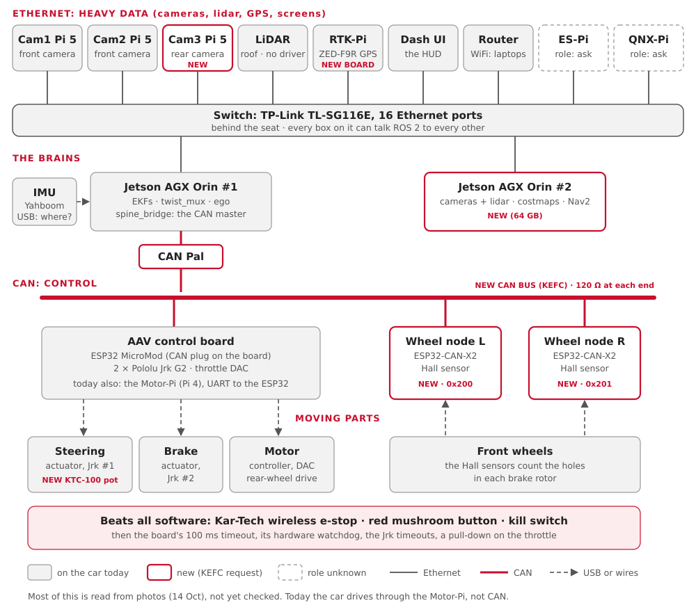
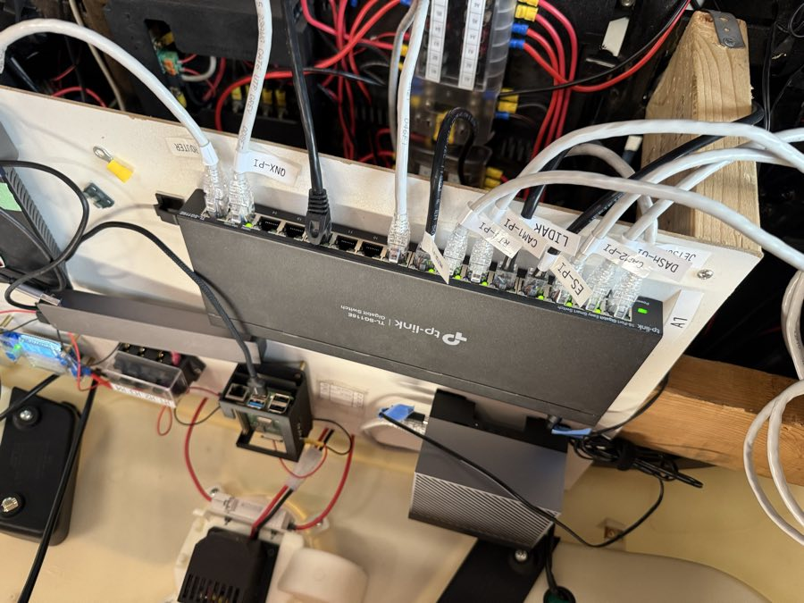
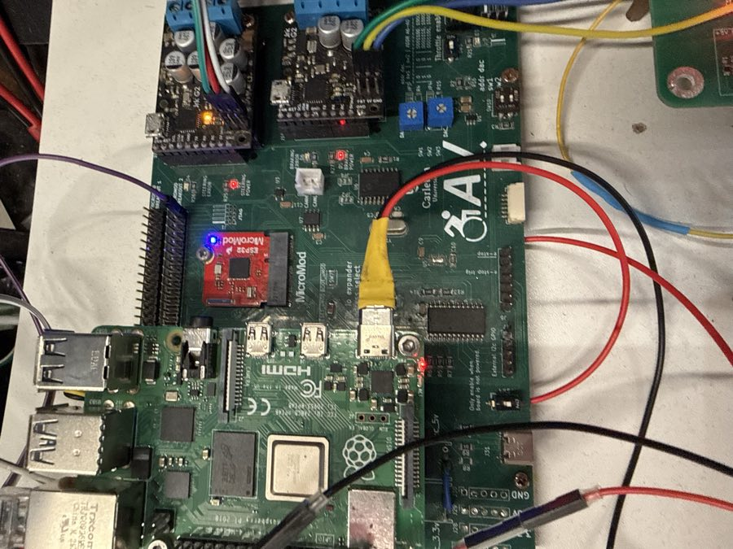
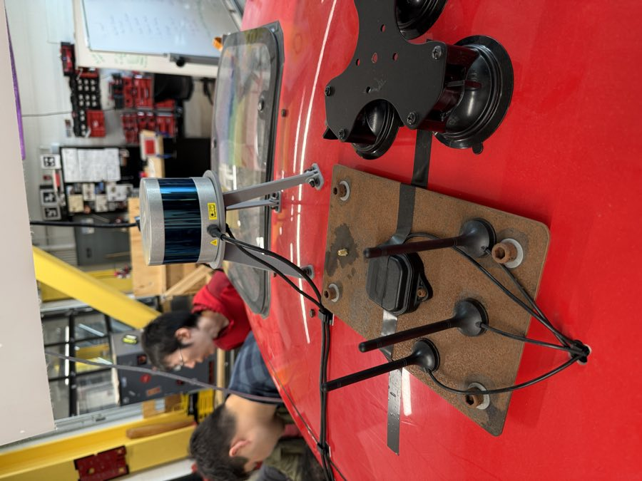

# The car, box by box

Every computer, board, sensor and motor on the car: what it does, and which wire it
talks on. Today, and after the KEFC changes.

**You'll learn:**
- the four kinds of wire on the car: Ethernet, CAN, USB and UART;
- what each box does, in one line;
- what changes when the KEFC request is built.

!!! warning "Mostly from photos"
    Much of this page comes from Ben's photos of 14 October ([Car photos](car-photos.md)).
    A box marked *photos* is "from the photos, not yet checked". The audits of 16 and
    21 October checked some ([16 Oct](history/audit-2026-10-16-car.md),
    [21 Oct](history/audit-2026-10-21-car.md)); what's still open is in
    [Audit questions](audit-questions.md).

!!! note "None of our code has run on the car yet"
    The car still runs the 2025-26 team's code, on ROS 2 Humble. Our code (Jazzy) runs in
    the turtle, Gazebo and [bench mode](bench.md) only.

## The picture



Read it top to bottom:

| Layer | What travels there |
|---|---|
| Ethernet | heavy data: camera pictures, lidar points, GPS, the screens |
| The brains | two Jetson Orins: one drives, one sees and plans |
| CAN | small, urgent messages: today the wheel speeds; with the CAN spine, steer, brake, speed too |
| Moving parts | the actuators and the motor, wired to the control board |
| Safety | the buttons that stop the car whatever the software does |

## The four kinds of wire

| Wire | What it is | Good for | On the car |
|---|---|---|---|
| **Ethernet** | the network cable a laptop uses | lots of data, many computers | the switch behind the seat |
| **CAN** | two twisted wires, built for cars | short messages that must arrive on time | new: the Orin and the wheel sensors' Arduino; the control board too with the CAN spine |
| **USB** | the plug on any computer | one device into one computer | the IMU; the GPS board into its Pi |
| **UART** | a simple serial line between two chips | one board talking to one board | today: the Motor-Pi to the ESP32 |

The [Glossary](glossary.md) explains each word.

## The computers

| Box | Does | Wire | Today | After KEFC |
|---|---|---|---|---|
| Jetson AGX Orin #1 | the main computer: in our plan, the EKFs, twist_mux, ego | Ethernet | runs the 2025-26 code, on Humble | keeps control; becomes the CAN master |
| Jetson AGX Orin #2 (64 GB) | cameras, lidar, costmaps, Nav2 planning | Ethernet | not there | **new** |
| Motor-Pi (Raspberry Pi 4) | turns ego's commands into UART frames for the ESP32 | Ethernet, UART | drives the car | kept until CAN is proven, then retired |
| Cam1-Pi (Pi 5) | both front cameras, at the windscreen, on its two ribbon ports; MediaMTX streams them to the Orin ([Camera pipeline](camera-pipeline.md)) | Ethernet | there | the same |
| QNX-Pi's camera | the rear camera | Ethernet | doesn't work today: no rear camera for now | **new** (Cam3) |
| RTK-Pi (Pi, on the ceiling panel) | reads the GPS board over USB (*photos*) | Ethernet, USB | there | the same, with RTK corrections |
| Dash-UI | the in-car screen, the [HUD](hud.md) (*photos*) | Ethernet | there | the same |
| ES-Pi | unknown: an e-stop Pi? (*photos*: a port label only) | Ethernet | ? | not in the KEFC picture |
| QNX-Pi | probably the 2025-26 QNX layer, now replaced by twist_mux (*photos*: a port label only) | Ethernet | ? | not in the KEFC picture |

## The network boxes

| Box | Does | Seen |
|---|---|---|
| TP-Link TL-SG116E switch, 16 ports | joins every Ethernet box | photos: its ports are labelled |
| Linksys EA3500 router | the car's WiFi, so laptops can join | photos |
| CAN Pal | a CAN transceiver on Orin #1's 40-pin header | **new** (KEFC) |



## The boards

| Box | Does | Wire | Today | After KEFC |
|---|---|---|---|---|
| AAV control board | carries the ESP32, two Jrk G2s and the throttle DAC | UART today, CAN after | runs the 2025-26 firmware | becomes the CAN node that steers, brakes and drives |
| ESP32 MicroMod | the microcontroller on that board | | 2025-26 C++ firmware, **no command timeout** | Rust firmware (`esp32-umod`): brakes after 100 ms of silence, on the UART link or CAN. Built and proven in QEMU, not yet flashed |
| Wheel encoder (Pico 2 + W5500) | counts wheel spokes, sends them over UDP to the Motor-Pi | Ethernet | the 2025-26 one: off in our machine files since 23 Oct | replaced |
| Wheel sensors' Arduino (the hardware lead's) | reads the wheel sensors; wheel speed on CAN, straight to the Orin | CAN (0x200 L, 0x201 R) | today (23 Oct) | the same, or the KEFC wheel nodes (Hall sensors, ESP32-CAN-X2, 100 Hz: Proposed) |
| ZED-F9R GPS board (SparkFun) | GPS position, to a Pi over USB-C | USB | fitted; its antenna lead is held by tape (*photos*) | a new board, same chip, screw-on antenna, RTK |



The board already has a white CAN plug, labelled CANH / CANL (*photos*). Is its
transceiver chip (U7) fitted? Still to check ([Audit questions](audit-questions.md)).

## The sensors

| Sensor | Measures | Wire | In our code |
|---|---|---|---|
| IMU (Yahboom) | turn rate and acceleration | USB, to which computer? | `aav_imu_yahboom` |
| GPS (u-blox ZED-F9R) | latitude and longitude | USB to the RTK-Pi | `ublox_gps` (the default) |
| Wheel speed | how fast the wheels turn | CAN, straight to the Orin, from the hardware lead's Arduino (23 Oct; was UDP to the Motor-Pi) | `spine_bridge role:=sensors` (was `encoder_udp`) |
| Lidar, on the roof: Velodyne VLP-16 | 3D points around the car | Ethernet (UDP to the Jetson) | the stock `velodyne` driver (`aav_sensors lidar:=true`); untested with the real lidar |
| Cameras | pictures | two ribbon cables into one Pi 5, then H.264 over Ethernet | MediaMTX on the Pi → `aav_camera_stream` on the Orin, RF-DETR inside each stream |
| TI radar | points ahead of the car | USB | `aav_radar_ti`; not seen in the photos |
| Battery monitor (Victron) | battery voltage and charge | USB (VE.Direct cable) | `aav_battery_victron` |
| Steering position (KTC-100 pot) | where the front wheels point | wire, into the steering Jrk | **new**: the board reads it from the Jrk |



## The moving parts

| Part | Does | Driven by |
|---|---|---|
| Steering actuator | turns the front wheels | Jrk G2 #1 (I2C address 0x05) |
| Brake actuator | presses the brake | Jrk G2 #2 (I2C 0x04) |
| Throttle DAC | a voltage that sets the motor's power | the ESP32 (I2C 0x0C) |
| Motor controller | powers the rear-wheel-drive motor (*photos*: silver finned box) | the DAC's voltage |
| Pololu Jrk G2 | a small motor driver with feedback: "go to position X" | the ESP32, over I2C |

## Power and safety

| Part | Does | Seen |
|---|---|---|
| Kar-Tech wireless e-stop | a remote stop; beats all software | photos: "ROS ON/OFF" written beside it |
| Red mushroom e-stop button | stops the car on its own wiring | photos: on the left frame tube |
| Kill switch | cuts the drive | KEFC request |
| RC transmitter and receiver (FlySky) | a person can take over by radio | firmware: iBUS on the ESP32 |
| E-stop board (TR, ES lights), 8 relays | the e-stop's trigger and status | photos |
| Battery box, fuse blocks, 12 V → 5 V converters | power for everything | photos: one converter at 3.5 A (is it enough for a Pi 5?) |

## Today vs after the KEFC changes

| | Today | After KEFC |
|---|---|---|
| Command path | Orin → Ethernet → Motor-Pi → UART → ESP32 (`actuators:=uart`, the default) | the same for now; the CAN spine (Orin #1 → CAN → ESP32) with `actuators:=can` |
| If the computer freezes | **the last throttle stays on**: the C++ firmware has no timeout | the Rust firmware brakes after 100 ms (proven in QEMU, not yet flashed) |
| Wheel speed | the hardware lead's Arduino → CAN → the Orin (since 23 Oct) | the same, or two wheel nodes → CAN, 100 Hz |
| Steering position | not measured | KTC-100 pot through the Jrk |
| GPS | ZED-F9R, taped antenna lead | new board, screw-on antenna, RTK |
| Perception and Nav2 | on Orin #1 (in our plan) | on Orin #2 |

The rollout, from the KEFC request: write the DBC first; test on the bench with a CANable
and `candump`; keep the Motor-Pi path until CAN is proven; **never run both at once**.
Details: [CAN plan](can-plan.md).

## Try it

```bash
pixi run bench        # the car's software, with stand-ins for every box above
pixi run bench-check  # start it and check the whole graph (2 min)
pixi run view         # the car's 3D model and its sensor frames, in RViz
```

On the car's network, once it runs Jazzy: `pixi run doctor` says whether your laptop can
see the car.

## Where this lives in the code

| What | Where |
|---|---|
| Which program runs on which computer | `ros/bringup/aav_bringup/config/machines/` (`orin`, `motor_pi`, `laptop`, `all`) |
| Where each sensor sits on the car | `ros/bringup/aav_description/config/vehicle.yaml` |
| Today's car | `ros/can_bridge/aav_legacy`, `firmware/legacy/` |
| The CAN car | `ros/can_bridge/aav_spine`, `firmware/can/aav.dbc`, `firmware/spine/` |
| The sensor drivers | `ros/sources/` |

Next: [A command's journey](learn-journey.md) follows one joystick push through these
boxes.
