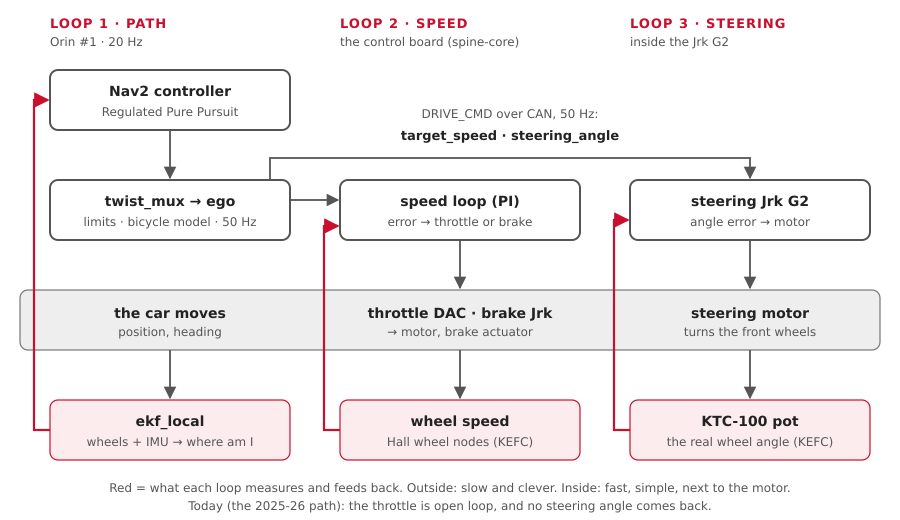

# Control from zero

"Control" is how a wish ("go 1.5 m/s, turn gently left") becomes motors doing the right
thing, even on a hill or with a flat-ish tyre. This page explains feedback loops, then
shows each loop on our car and the limits and timeouts around them.

**You'll learn:**
- open loop vs closed loop;
- PID, by feel, with our speed loop's real numbers;
- where each loop closes on our car;
- the Ackermann and bicycle models, and what ego does with them;
- rate limits, timeouts and safe states.

## 1. Open loop vs closed loop

| | Open loop | Closed loop |
|---|---|---|
| Idea | send a command and hope | measure, compare with the target, correct |
| Like | a toaster: 2 minutes, whatever the bread | a thermostat: heat until it's 21 °C |
| Needs a sensor? | no | yes |
| On a hill | slows down, and nobody notices | sees the speed drop, adds throttle |
| Our car **today** (2025-26 path) | throttle = speed ÷ 3.0 m/s (`legacy.yaml`); no steering angle comes back | - |
| Our car **after KEFC** | - | speed from the wheel nodes; steering angle from the KTC-100 pot |

## 2. PID, by feel

The **error** is target minus measured. A PID controller adds three pushes:

| Term | Pushes in proportion to | Like | Fixes |
|---|---|---|---|
| **P** (proportional) | the error now | pressing harder the slower you are | most of the error |
| **I** (integral) | the error added up over time | "I've been slow for a while, press more" | the last bit: hills, wind, friction |
| **D** (derivative) | how fast the error changes | easing off as you get close | overshoot. **We don't use it** |

Too much P: it wobbles. Too much I: it overshoots and swings. **Anti-windup**: cap the
I term, so it can't grow huge while the car is stuck.

### Our speed loop (PI), in numbers

`firmware/spine/crates/spine-core/src/speed_loop.rs`. Starting values, to tune on the car:

| Setting | Value | Means |
|---|---|---|
| `kp` | 0.3 | 30 % throttle per 1 m/s too slow |
| `ki` | 0.1 | +10 % throttle per second of being 1 m/s too slow |
| `integral_limit` | 0.3 | the I term never gives more than 30 % (anti-windup) |
| `coast_band` | 0.2 m/s | up to this much too fast: just less throttle, no brake |
| `brake_gain` | 0.5 | 50 % brake per 1 m/s too fast, beyond the coast band |
| `hold_brake` | 0.3 | 30 % brake when stopped, so the car can't roll |

**Example: target 1.5 m/s, measured 1.0 m/s.**

| | Sum | Throttle |
|---|---|---|
| P | 0.3 × 0.5 | 15 % |
| I, after 1 s of that | 0.1 × 0.5 × 1 s | + 5 % |
| Total | | **20 %**, and rising until the speed is right |

**Example: target 1.0 m/s, measured 1.5 m/s (downhill).** 0.5 m/s too fast, minus the
0.2 coast band = 0.3. Brake = 0.5 × 0.3 = **15 %**. Throttle and brake are never on together.

## 3. Where each loop closes on our car



| Loop | Measures | Moves | Runs on | Rate |
|---|---|---|---|---|
| **Path** | where the car is (`ekf_local`) vs the plan | speed and turn rate | Orin #1: Nav2's MPPI | 20 Hz |
| **Speed** | wheel speed (KEFC: Hall wheel nodes) | throttle DAC, brake Jrk | the control board: `spine-core` | every board tick (10 ms in the Pico 2 program) |
| **Steering angle** | the KTC-100 pot | the steering motor | inside the steering Jrk G2 | the Jrk's own loop |
| Brake position | the actuator's own feedback, if it has one | the brake motor | inside the brake Jrk G2 | to confirm (KEFC list) |
| Plan | the costmap and the goal | a new path | Orin: Nav2's planner | 1 Hz |

**The rule:** the inner loops are fast and simple, and sit next to the motor. If the
Orin hiccups for 50 ms, the board keeps the speed steady.

## 4. Ackermann and the bicycle model

### Ackermann steering

When a car turns, the **inner** front wheel must turn more than the outer one: both
wheels circle the same centre, on the line of the rear axle.

```text
                    inner wheel (sharper)
         ┌──┐  ╱
  rear   │  │ ╱      outer wheel (gentler)
  axle ──┼──┼──────────────────────●  turning centre, R metres away
         └──┘
```

At a 5 m turn, with our wheelbase 1.57 m and track 0.77 m:

| Wheel | Angle |
|---|---|
| Inner (left, turning left) | 0.328 rad (18.8°) |
| Outer (right) | 0.284 rad (16.3°) |
| **The bicycle model's one wheel** | **0.304 rad** (17.4°): in between |

### The bicycle model

Merge the two front wheels into **one virtual wheel** in the middle. Then:

```text
turn rate  ω = v × tan(δ) ÷ L        steering  δ = atan(L × ω ÷ v)
```

v = speed, δ = steering angle, L = wheelbase (1.57 m, `vehicle.yaml`).

| Number | Value |
|---|---|
| Steering limit | ±0.50 rad (a guess: `vehicle.yaml`, TODO measure) |
| Tightest turn | L ÷ tan(0.50) = **2.87 m** radius |

The linkage on the car makes the two real wheels follow Ackermann by itself. Our
software only ever sends **one** angle: the virtual wheel's.

### What ego does

`ego` turns every driver's (speed, turn rate) into (speed, steering angle), 50 times a
second. `src/ego/aav_ego/aav_ego/ackermann.py`:

| Step | Detail |
|---|---|
| 1. Bicycle model | δ = atan(1.57 × ω ÷ v), clamped to ±0.5 rad |
| 2. Keep the curve | it works out δ **before** capping the speed, so a slower car still follows the same curve |
| 3. Can't turn on the spot | below 0.05 m/s it holds the wheels where they are |
| 4. Limits | speed, acceleration, steering rate (next section) |
| 5. Reverse | changes direction only through a stop |

**Example:** Nav2 asks for 2.0 m/s and 0.4 rad/s (a 5 m circle). δ = atan(1.57 × 0.4 ÷
2.0) = **0.304 rad**. ego caps the speed at 1.0 m/s but keeps 0.304 rad: still a 5 m circle,
just slower.

## 5. Rate limits: no sudden moves

Each layer has its own limits. Lower layers are a little looser, so they never lag
behind a stop that a higher layer asked for.

| Limit | ego (`ego.yaml`) | Nav2 velocity smoother | The spine (`spine.rs`) |
|---|---|---|---|
| Top speed | **1.0 m/s** | 1.0 m/s | 3.0 m/s |
| Reverse | 0.5 m/s (`vehicle.yaml`: one number for all three) | 0.5 m/s, with `reversing:=true`; else 0 | 0.5 m/s, RC too |
| Speeding up | 1.0 m/s² | 1.0 m/s² | 1.5 m/s² |
| Slowing down | 2.0 m/s² | 2.0 m/s² | 2.5 m/s² |
| Jerk, speeding up | 2.0 m/s³ (`max_jerk`): the push builds over 0.5 s, and eases off before the set speed | - | - |
| Jerk, slowing down | none: a stop starts at once | - | - |
| Steering rate | 0.6 rad/s | - | 0.6 rad/s |

What those mean at 1.0 m/s:

| | Takes |
|---|---|
| 0 → 1.0 m/s | 1.5 s: 0.5 s building up, 0.5 s at 1.0 m/s², 0.5 s easing off |
| Stop from 1.0 m/s, at 2.0 m/s² | 0.5 s and **0.25 m** |
| Full left (+0.5) → full right (−0.5) | 1.7 s |

## 6. Timeouts: silence means stop

| Layer | Waits | Then |
|---|---|---|
| `twist_mux` | 0.5 s per driver | ignores that driver; the next one takes over |
| `ego` | 0.3 s with no `/control/cmd_vel` | slows to a stop at 2.0 m/s² |
| `spine_bridge` | 0.1 s with no `/ego/actuator_cmd` | stops sending `DRIVE_CMD` |
| The spine's watchdog | 200 ms with no fresh `DRIVE_CMD` (KEFC: 100 ms) | throttle off, brake on |
| `collision_monitor` | 1.0 s with no radar | stops Nav2's commands |

!!! warning "Today's car has no board timeout"
    On the 2025-26 path the ESP32 firmware never times out: if commands stop, the last
    throttle stays on. Wheels off the ground, RC switch in reach ([Firmware](firmware.md)).

## 7. Safe states

When something goes wrong, what should each actuator do?

| Actuator | On a stop by the spine | Decided? |
|---|---|---|
| Throttle | 0 | yes |
| Brake | full (`stop_brake` 1.0) | yes |
| Steering | **hold** where it is (`ESTOP_STEERING`) | Proposed: the 2025-26 firmware centred it |
| Brake while nobody drives | **off** (`IDLE_BRAKE` 0.0) | Proposed: on a slope the car could roll |
| RC gear switch on "brake" | speed zero: brake to a stop, then hold | Proposed |
| Brake with no power | unknown | on the KEFC "to confirm" list |

The **red e-stop button** stops the car through its own wiring, whatever the software
does. The spine only listens to it ([Firmware](firmware.md)).

## Try it

| You want to | Run |
|---|---|
| Watch the bicycle model, with no car | `pixi run turtle`, then `pixi run keyboard` in a second terminal |
| See ego's output | `pixi run tools/ros.sh ros2 topic echo /ego/actuator_cmd` |
| See its limits | `pixi run tools/ros.sh ros2 param dump /ego` |
| The speed loop, with throttle and brake | `pixi run bench`, then `pixi run tools/ros.sh ros2 topic echo /vehicle/status` |
| Stop everything | `pixi run estop`, then `pixi run estop-clear` |
| The speed loop's own tests | `cd firmware/spine && pixi run cargo test -p spine-core speed_loop` |
| ego's maths tests | `cd src/ego/aav_ego && pixi run python3 -m pytest -q test/test_ackermann.py` |

## Where this lives in the code

| What | Where |
|---|---|
| The bicycle model and ego's limits | `src/ego/aav_ego/aav_ego/ackermann.py`, `config/ego.yaml` |
| The speed loop (PI) | `firmware/spine/crates/spine-core/src/speed_loop.rs` |
| Spine limits, watchdog, safe-state choices | `firmware/spine/crates/spine-core/src/spine.rs`, `watchdog.rs`, `limits.rs` |
| Today's open-loop throttle | `src/backends/aav_legacy/config/legacy.yaml` (`full_throttle_speed`) |
| Nav2's controller and smoother | `src/drivers/aav_navigation/config/nav2.yaml` |
| Driver timeouts and priorities | `src/mux/aav_mux/config/twist_mux.yaml` |
| Wheelbase, track, steering limit | `src/aav_description/config/vehicle.yaml` |
| The safety layers, in one table | [How it fits](how-it-fits.md) |
