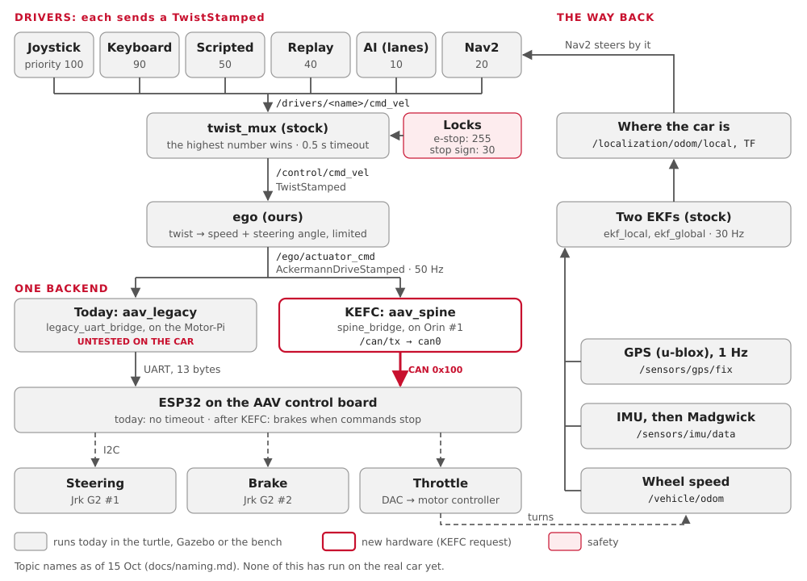

# A command's journey

Follow one joystick push from your hand to the wheels, then a Nav2 goal, then the
sensor data on its way back.

**You'll learn:**
- every hop a command takes: which program, which topic, how often;
- what can go wrong at each hop, and how to watch it;
- how the car's sensors close the loop.

Words you may not know (topic, node, twist, Ackermann, CAN) are in the
[Glossary](glossary.md). The boxes themselves are in [The car, box by box](learn-car.md).

!!! note "Not on the car yet"
    Every hop below runs in the turtle, Gazebo or [bench mode](bench.md). None of it has
    run on the real car yet: the car still runs the 2025-26 code, on Humble.

## The whole trip in one picture



Two ideas make it simple:

| Idea | Means |
|---|---|
| Every driver speaks the same language | a speed (m/s) and a turn rate (rad/s): a `TwistStamped` |
| Only ego knows it's a car | ego turns the twist into a speed and a steering angle: an `AckermannDriveStamped` |

## 1. The joystick push

You hold the trigger (the deadman) and push the stick forward.

| # | Who | Topic | Message | Rate | What can go wrong | Watch it |
|---|---|---|---|---|---|---|
| 1 | `joy_node` (stock `joy`) reads the USB joystick | `/drivers/joy/joy` | `sensor_msgs/Joy` | 20 Hz while held | wrong axis or button numbers (still a TODO for the team's joystick) | `ros2 topic echo /drivers/joy/joy` |
| 2 | `teleop_twist_joy_node` (stock) | `/drivers/joy/cmd_vel` | `geometry_msgs/TwistStamped` | 20 Hz, only while the trigger is held | trigger not held: nothing is sent | `ros2 topic echo /drivers/joy/cmd_vel` |
| 3 | `twist_mux` (stock) picks one driver | `/control/cmd_vel` | `TwistStamped` | as fast as the winner sends | a higher driver is talking; `/safety/estop` is true | `ros2 topic echo /control/cmd_vel` |
| 4 | `ego` (ours) | `/ego/actuator_cmd` | `ackermann_msgs/AckermannDriveStamped` | 50 Hz, always | no `/control/cmd_vel` for 0.3 s: ego slows to a stop | `ros2 topic hz /ego/actuator_cmd` |

How twist_mux picks:

| Driver | Topic | Priority |
|---|---|---|
| joystick | `/drivers/joy/cmd_vel` | 100 (the highest) |
| keyboard | `/drivers/keyboard/cmd_vel` | 90 |
| scripted test | `/drivers/scripted/cmd_vel` | 50 |
| replay | `/drivers/replay/cmd_vel` | 40 |
| Nav2 | `/drivers/nav/cmd_vel` | 20 |
| AI (lane keeping) | `/drivers/ai/cmd_vel` | 10 |
| **lock:** `/safety/estop` true | blocks everyone below 255 | 255 |
| **lock:** `/perception/stop_sign` true | blocks Nav2 and AI | 30 |

A driver counts while its last message is under 0.5 s old. Let go of the trigger and,
0.5 s later, twist_mux hands control to the next driver.

What ego does:

| Step | Rule |
|---|---|
| Steering angle | atan(wheelbase × turn rate ÷ speed): the bicycle model |
| Speed limits | 1.0 m/s forward, 0.5 m/s reverse (to start) |
| Speed changes | at most 1.0 m/s² faster, 2.0 m/s² slower |
| Steering limits | ±0.5 rad, changing at most 0.6 rad/s |
| At zero speed | it holds the wheels where they are: a twist with no speed has no curve |

## 2. Today: to the wheels through the Motor-Pi

Today's car would drive through the 2025-26 hardware, with our `aav_legacy` backend.
[[untested]] on the car.

| # | Who | Topic or wire | Message | Rate | What can go wrong | Watch it |
|---|---|---|---|---|---|---|
| 5 | ROS 2 over Ethernet, Orin → Motor-Pi | `/ego/actuator_cmd` | the same | 50 Hz | a different `ROS_DOMAIN_ID`; the network | on the Pi: `ros2 topic hz /ego/actuator_cmd` |
| 6 | `legacy_uart_bridge` on the Motor-Pi | UART `/dev/ttyAMA0`, 115200 baud | 13 bytes: steering, speed, accel, checksum | 50 Hz | stale for 0.3 s, or `/safety/estop` true: it sends brake frames | the node's log |
| 7 | the ESP32 (2025-26 firmware) | I2C | Jrk targets, a DAC value | each frame | **no timeout**: if frames stop, the last throttle stays on | nothing comes back |
| 8 | Jrk G2 #1, Jrk G2 #2, the DAC | wires | steering, brake, throttle voltage | | the throttle is open loop: no speed feedback | watch the car, wheels off the ground |

!!! warning "Today's weak spot"
    If the Motor-Pi or its bridge dies, the ESP32 keeps the last throttle. Keep the wheels
    off the ground and the e-stop in hand: see [Firmware](firmware.md).

## 3. After the KEFC changes: CAN

The `aav_spine` backend replaces the Motor-Pi. It works on the bench, against a pretend
board (`spine_sim`). It has never driven the car, and the ESP32's CAN firmware isn't
written yet.

| # | Who | Topic or wire | Message | Rate | What can go wrong | Watch it |
|---|---|---|---|---|---|---|
| 5 | `spine_bridge` on Orin #1 | `/can/tx` | `can_msgs/Frame`: `DRIVE_CMD` 0x100 (speed, steering) | 50 Hz, only while ego is fresh | not armed: the board ignores it (`/spine/arm`) | `ros2 topic echo /can/tx` |
| 6 | `socket_can_sender` (stock `ros2_socketcan`) | `can0`, 500 kbit/s | a CAN frame, with a counter and a CRC | 50 Hz | `can0` not up; a missing 120 Ω end | `candump can0` (Linux, can-utils) |
| 7 | the control board's ESP32 | I2C | its own speed loop, into Jrk targets and the DAC | about 100 Hz | no good frame for 100 ms: it brakes | `VEHICLE_STATUS` 0x181 on the bus |
| 8 | Jrk G2s, DAC | wires | steering (read back from the KTC-100 pot), brake, throttle | | a driver fault: it brakes and sets a fault bit | `ros2 topic echo /vehicle/status` |

The frames are defined in `firmware/can/aav.dbc` ([Firmware](firmware.md)). The KEFC plan
changes a few: [CAN plan](can-plan.md) (Proposed).

## 4. A Nav2 goal

Nav2 is just another driver, at priority 20. Its command joins the same path at hop 3.

| # | Who | Topic | Message | Rate | What can go wrong | Watch it |
|---|---|---|---|---|---|---|
| 1 | You, in RViz: "2D Goal Pose" | `/goal_pose` | `geometry_msgs/PoseStamped` | once | the goal is off the map | `ros2 topic echo /goal_pose` |
| 2 | `bt_navigator` starts the action | `/navigate_to_pose` | `NavigateToPose` action | once | | `ros2 action list` |
| 3 | `planner_server` (SmacPlannerHybrid: paths a car can drive) | `/plan` | `nav_msgs/Path` | when asked | no path fits the turning circle | RViz shows the path |
| 4 | `controller_server` (Regulated Pure Pursuit) | `cmd_vel_nav` | `TwistStamped` | 20 Hz | no TF `map → odom → base_link` | `ros2 topic hz /cmd_vel_nav` |
| 5 | `velocity_smoother` | `/drivers/nav/cmd_vel`, or `/control/cmd_vel_smoothed` where the radar runs | `TwistStamped` | 20 Hz | | `ros2 topic echo /drivers/nav/cmd_vel` |
| 6 | `collision_monitor` (only where the radar runs) | `/drivers/nav/cmd_vel` | `TwistStamped` | 20 Hz | a radar point in the 1 m stop zone, or a silent radar: it sends zero | `ros2 topic echo /safety/collision_monitor/state` |
| 7 | `twist_mux`, then ego and the backend | as in sections 1 to 3 | | | the joystick, the keyboard or a stop sign outranks Nav2 | `ros2 topic echo /control/cmd_vel` |

The HUD can send a route too: `hud_server` calls the action `/follow_gps_waypoints` with
GPS points.

## 5. The way back: sensors to "where am I"

The car tells the software what it really did. This closes the loop.

| # | From | Topic | Message | Rate | Read by |
|---|---|---|---|---|---|
| 1 | Wheel speed: today `encoder_udp`; later `spine_bridge` | `/vehicle/odom` | `nav_msgs/Odometry` (speed only) | 10 Hz today; 50 Hz with the spine | both EKFs |
| 2 | IMU: `imu_node` (Yahboom) | `/sensors/imu/data_raw` | `sensor_msgs/Imu` | as the device sends | `imu_filter_madgwick` |
| 3 | `imu_filter_madgwick` | `/sensors/imu/data` | `sensor_msgs/Imu`, with an orientation | the same | both EKFs |
| 4 | GPS: `ublox_gps` | `/sensors/gps/fix` | `sensor_msgs/NavSatFix` | 1 Hz | `navsat_transform` |
| 5 | `navsat_transform` | `/localization/gps/odom` | `Odometry`, in map x and y | with each fix | `ekf_global` |
| 6 | `ekf_local` | `/localization/odom/local`, TF `odom → base_link` | `Odometry` | 30 Hz | Nav2's controller, the scripted driver |
| 7 | `ekf_global` | `/localization/odom/global`, TF `map → odom` | `Odometry` | 30 Hz | `navsat_transform`, Nav2's planner (through TF) |
| 8 | `navsat_transform` | `/localization/gps/fix` | `NavSatFix` | 30 Hz | the HUD's map |
| 9 | the backend (spine, Gazebo) | `/vehicle/status` | `aav_interfaces/VehicleStatus` | 10 Hz | the HUD |


| What can go wrong | What you see | Watch it |
|---|---|---|
| No wheel speed | `ekf_local` drifts, then stops moving | `ros2 topic hz /vehicle/odom` |
| No IMU | the car's heading never turns | `ros2 topic hz /sensors/imu/data` |
| No GPS fix | `ekf_global` drifts with `ekf_local` | `ros2 topic echo /sensors/gps/fix` (status −1 = no fix) |
| Today's car | no `/vehicle/status`: the legacy backend doesn't send it | `ros2 topic info /vehicle/status` |

Why the two EKFs don't talk on a topic: [Topic areas](naming.md#why-the-two-ekfs-dont-talk).

## Try it

The turtle runs the same command path, on one computer:

```bash
pixi run turtle              # terminal 1: a turtle that steers like the car
pixi run keyboard --local    # terminal 2: hold i to drive
pixi run graph               # terminal 3: rqt_graph, the whole path as a picture
```

Then watch each hop in another terminal. `tools/ros.sh --local` keeps it on this
computer, like the turtle:

```bash
pixi run tools/ros.sh --local ros2 topic echo /drivers/keyboard/cmd_vel
pixi run tools/ros.sh --local ros2 topic echo /control/cmd_vel
pixi run tools/ros.sh --local ros2 topic hz /ego/actuator_cmd
```

For the CAN path, run `pixi run bench`, then
`pixi run tools/ros.sh --local ros2 topic echo /can/tx`. `pixi run estop` and
`pixi run estop-clear` try the e-stop. `pixi run check turtle` compares the running graph
with `docs/interfaces.yaml`.

## Where this lives in the code

| Hop | Where |
|---|---|
| Joystick | `src/drivers/aav_teleop/config/` |
| Keyboard | `tools/keyboard.sh` |
| twist_mux priorities | `src/mux/aav_mux/config/twist_mux.yaml` |
| ego | `src/ego/aav_ego/` (the maths: `ackermann.py`; the limits: `config/`) |
| Today's backend | `src/backends/aav_legacy/` (`legacy_uart_bridge.py`, `encoder_udp.py`) |
| The CAN backend | `src/backends/aav_spine/` (`spine_bridge.py`, `can_codec.py`) |
| The CAN frames | `firmware/can/aav.dbc` |
| The board's logic | `firmware/spine/crates/spine-core` |
| Nav2 | `src/drivers/aav_navigation/` |
| The EKFs | `src/localization/aav_localization/config/` |
| Every topic | `docs/interfaces.yaml`, shown as [Topics](interfaces.md) |
