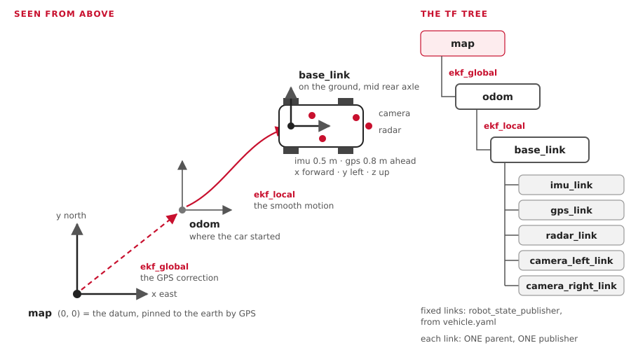

# Localization from zero

"Localization" means: **where is the car, which way is it facing, and how fast is it
going?** No one sensor answers that well. This page shows how our car mixes several
weak answers into one good one.

**You'll learn:**
- odometry, and why it drifts;
- what an IMU measures;
- fusion, and the idea behind a Kalman filter, with one tiny example in numbers;
- robot_localization, the stock package we use;
- the frames `map`, `odom` and `base_link` (REP-105), and TF;
- exactly what our two EKFs read, from their config files;
- how to look at all of it on your own computer.

[Maps and position](../READ-ME-MAPS-AND-POSITION.md) has the big picture of the two EKFs
and the map. This page explains **why** it works.

## 1. Odometry: counting your steps

**Odometry** = working out where you are from how you've moved.

```text
start ──► 1.0 m/s for 2 s, turning 0.1 rad/s ──► "I'm about 2 m ahead, a bit to the left"
```

| Our odometry source | Measures | Topic |
|---|---|---|
| Wheel speed (today: the Pico 2 encoder; KEFC: Hall sensors on two wheels) | forward speed | `/vehicle/odom` |
| The steering angle (KEFC: the KTC-100 pot, through the Jrk) | turn rate = speed × tan(angle) ÷ wheelbase | `/vehicle/odom` |
| The IMU's gyro | turn rate | `/sensors/imu/data` |

### Why it drifts

Every small error is **added up** forever.

| Error | After 100 m |
|---|---|
| Wheel size off by 1 % (ours is a guess: 0.30 m) | 1 m too far or too short |
| Heading off by 1° | **1.7 m** to the side |
| Heading off by 5° | 8.7 m to the side |

Heading errors hurt most. That's why GPS is needed to stay true over a long drive.

## 2. The IMU

An **IMU** (inertial measurement unit) is a chip that feels motion.

| Part | Measures | Good | Bad |
|---|---|---|---|
| Gyro | turn rate (rad/s), on 3 axes | fast and smooth | a small bias: the heading creeps |
| Accelerometer | acceleration (m/s²), with gravity | shows tilt | noisy; twice-integrated it's useless for position |
| Magnetometer | the earth's magnetic field | an absolute heading | fooled by the motor and steel. **Not used by us yet** |

Ours: a Yahboom 10-axis IMU on USB. `imu_filter_madgwick` turns its raw data into a
relative orientation. The EKFs use only its **yaw rate**: how fast the car turns.

## 3. Fusion: two weak answers make one good one

| Source | Strong at | Weak at |
|---|---|---|
| Wheels + IMU | smooth, fast (50+ Hz), short-term | drift over long distances |
| GPS | never drifts | noisy, slow (1-5 Hz), can jump |

**Fusion** keeps the best of each: smooth from the wheels and IMU, true from GPS.

## 4. The Kalman filter, in one tiny example

A Kalman filter keeps two things for every number it tracks:
1. a **best guess**;
2. **how unsure** it is (the variance: the error squared).

It repeats two steps.

| Step | What happens | Uncertainty |
|---|---|---|
| **Predict** | move the guess with the odometry | grows |
| **Update** | a measurement arrives: move the guess toward it | shrinks |

### One dimension, in numbers

The car drives along a straight road. Position in metres.

**Before:** the wheels say **10.0 m**. After a long drive, they're unsure: variance
**4** (about ±2 m).

**A GPS fix arrives:** it says **12.0 m**, variance **1** (about ±1 m).

| Step | Sum | Result |
|---|---|---|
| How much to trust GPS: the **gain** K | 4 ÷ (4 + 1) | **0.8** |
| New guess | 10.0 + 0.8 × (12.0 − 10.0) | **11.6 m** |
| New variance | (1 − 0.8) × 4 | **0.8** (about ±0.9 m) |

- The answer sits **closer to GPS**, because GPS was less unsure.
- The new variance (0.8) is **smaller than either** (4 or 1). Two answers beat one.
- Then the car drives on: predict adds the movement, and the variance grows again
  until the next fix.

An **EKF** (extended Kalman filter) does the same with many numbers at once (x, y,
heading, speeds...), and handles turning, where the maths isn't a straight line.

## 5. robot_localization: the stock EKF

We don't write our own filter. `robot_localization` (version 3.8.3, Jazzy) gives us:

| Node | Job |
|---|---|
| `ekf_node` | the filter. We run it **twice**: `ekf_local` and `ekf_global` |
| `navsat_transform_node` | GPS degrees → map metres ([Learn: GPS](learn-gps.md)) |

Each input has a list of 15 true/false values: which parts of the message to use.

```text
x, y, z,   roll, pitch, yaw,   vx, vy, vz,   vroll, vpitch, vyaw,   ax, ay, az
```

## 6. Frames: map, odom, base_link (REP-105)



| Frame | Is | Moves? | Set by |
|---|---|---|---|
| `map` | pinned to the earth at the datum. x east, y north | never | - |
| `odom` | where the car started today | can **hop** a little when GPS corrects it | `ekf_global` publishes `map → odom` |
| `base_link` | the car: on the ground, under the middle of the rear axle. x forward, y left | smoothly | `ekf_local` publishes `odom → base_link` |
| `imu_link`, `gps_link`, `radar_link`, `camera_*_link` | each sensor | fixed to the car | `robot_state_publisher`, from `vehicle.yaml` |

REP-105 is the ROS rule for these names. REP-103 sets the units and directions:
metres, radians, x forward, y left, z up.

### TF: the frame tree

**TF** is ROS's service for "where is frame A, seen from frame B, at time t?"

| Idea | Means |
|---|---|
| A tree | each frame has **one** parent. `map → odom → base_link → gps_link` |
| One publisher per link | two nodes publishing `odom → base_link` would fight. That's why `imu_filter_madgwick` has `publish_tf: false` |
| `/tf` | links that move (the EKFs), many times a second |
| `/tf_static` | links that never move (sensor mounts), sent once |
| Chaining | ask for `map → gps_link`; TF multiplies the links in between |

## 7. Our two EKFs: their real inputs

From `src/localization/aav_localization/config/`. Both run at 30 Hz, in 2D
(`two_d_mode: true`: no height, roll or pitch).

| Input | What it gives | `ekf_local` uses | `ekf_global` uses |
|---|---|---|---|
| `/vehicle/odom` (the backend) | wheel speed, turn rate | vx, vy, vyaw | vx, vy, vyaw |
| `/sensors/imu/data` | the gyro | vyaw | vyaw |
| `/localization/gps/odom` (navsat_transform) | GPS as map x, y | - | **x, y** |

| | `ekf_local` | `ekf_global` |
|---|---|---|
| `world_frame` | `odom` | `map` |
| Publishes | `/localization/odom/local` | `/localization/odom/global` |
| TF | `odom → base_link` | `map → odom` |
| Used by | Nav2's controller and local costmap | Nav2's planner and global costmap; navsat_transform |
| Starts at | (0, 0), sure of it | `start_x`, `start_y`, `start_yaw` from the launch file; unsure (yaw ±18°) |

Three choices worth knowing:

| Choice | Why |
|---|---|
| **vy = 0 is fused** | a car can't slide sideways. Telling the filter so keeps it honest |
| **Yaw rate only, never yaw** | no magnetometer, so the IMU's heading is only relative. The start heading comes from `start_yaw`; GPS corrects it once the car moves |
| **Each backend sets its own covariance** | the spine works out the turn rate from the measured steering. Today's encoder can't, so it sends a huge covariance (1e3), and the EKF ignores that part |

With `gps:=false`, `ekf_global` doesn't run, and a fixed `map → odom` (zero) stands in.

### How well it works

| Where | Result |
|---|---|
| Gazebo | both EKFs within 0.2 m, parked |
| Bench | 0.03-0.3 m from the truth |
| The car | never run yet |

## Try it

| You want to see | Run |
|---|---|
| Start Gazebo, with both EKFs | `pixi run sim` |
| The frame tree, and who publishes each link | `pixi run tools/ros.sh ros2 run rqt_tf_tree rqt_tf_tree` |
| The car on the map, live | `pixi run tools/ros.sh ros2 run tf2_ros tf2_echo map base_link` |
| The GPS correction alone | `pixi run tools/ros.sh ros2 run tf2_ros tf2_echo map odom` |
| The local estimate | `pixi run tools/ros.sh ros2 topic echo --once /localization/odom/local` |
| Every setting the filter really uses | `pixi run tools/ros.sh ros2 param dump /ekf_global` |
| Drive, then watch the numbers change | `pixi run keyboard --sim` |

Drive in a circle with the keyboard, and watch `tf2_echo map odom`: it stays small.
That's the GPS soaking up the drift.

## Where this lives in the code

| What | Where |
|---|---|
| The EKFs' settings | `src/localization/aav_localization/config/ekf_local.yaml`, `ekf_global.yaml` |
| GPS to metres | `src/localization/aav_localization/config/navsat.yaml` |
| How they start, and topic names | `src/localization/aav_localization/launch/localization.launch.py` |
| The IMU filter | `src/sensors/aav_sensors/config/imu_filter.yaml` |
| Sensor positions on the car | `src/aav_description/config/vehicle.yaml` |
| Wheel speed into `/vehicle/odom` | `aav_spine/spine_bridge.py`, `aav_legacy` `encoder_udp.py`, `aav_gazebo/gazebo_adapter.py` |
| Why the EKFs meet in TF, not on a topic | [Topic areas](naming.md) |
| Frames in the contract | `docs/interfaces.yaml`, `frames:` |
