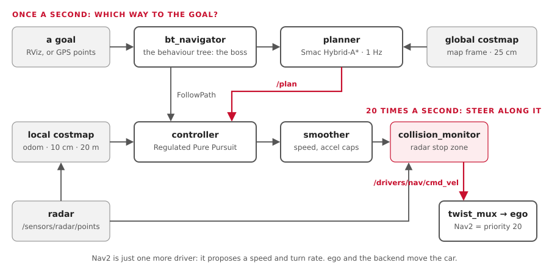

# Nav2 from zero

**Nav2** is ROS's stock navigation system: give it a goal, and it plans a path and
steers along it. On our car it is **just one more driver**: it proposes a speed and a
turn rate, like the joystick does.

**You'll learn:**
- the parts: goal, planner, controller, costmaps, behaviour tree;
- how Smac Hybrid-A* plans paths a car can really drive;
- how Regulated Pure Pursuit steers, with one example in numbers;
- what happens when things go wrong: recovery and `collision_monitor`;
- how GPS waypoints become Nav2 goals;
- our settings, and where they live.

Costmaps have their own page: [Costmaps](costmaps.md). The big picture of maps and
GPS is in [Maps and position](../READ-ME-MAPS-AND-POSITION.md).

## The picture



| Part | Job | Ours |
|---|---|---|
| **Goal** | where to go: a pose in the `map` frame | RViz's 2D Goal Pose, an action call, or GPS waypoints from the HUD |
| **bt_navigator** | the boss: runs a behaviour tree that calls the others | `behavior_trees/navigate_to_pose_car.xml` |
| **Planner** | finds a path from here to the goal | Smac Hybrid-A*, on the global costmap |
| **Controller** | steers along that path | MPPI (or Regulated Pure Pursuit: `controller:=rpp`), on the local costmap, 20 Hz ([path followers](controllers.md)) |
| **Velocity smoother** | caps speed and acceleration | 1.0 m/s, 1.0 m/s² up, 2.0 m/s² down |
| **collision_monitor** | last-moment stop for radar points ahead | only where the radar runs |
| **Out** | `/drivers/nav/cmd_vel` → `twist_mux` (priority 20) → ego | |

Nav2 never talks to the wheels. ego turns its turn rate into a steering angle ([Learn:
control](learn-control.md)).

## 1. The planner: Smac Hybrid-A*

**A\*** searches a grid for the cheapest way from A to B. A plain grid search gives
paths with sharp corners: fine for a robot that spins on the spot, not for a car.

**Hybrid-A\*** searches in (x, y, **heading**), and only uses moves a car can make:

| Move | |
|---|---|
| straight on | |
| left, at the tightest turn | radius **2.87 m** (from `vehicle.yaml`) |
| right, at the tightest turn | the same |

So every path it returns is one our car can follow.

| Setting (`nav2.yaml`) | Ours | Means |
|---|---|---|
| `motion_model_for_search` | `DUBIN` | forward only. `REEDS_SHEPP` (forward and back) with `reversing:=true` ([Reversing](#reversing)) |
| `minimum_turning_radius` | 3.59 m | set by the launch file: wheelbase ÷ tan(max steer) = 2.87 m, × 1.25, so the controller has steering to spare |
| `angle_quantization_bins` | 72 | headings in 5° steps |
| `max_planning_time` | 5.0 s | give up after this |
| `tolerance` | 0.5 m | a goal inside an obstacle: plan to within 0.5 m |
| `smooth_path` | true | smooth the corners afterwards |

## 2. The controller: Regulated Pure Pursuit

Since 22 Oct the default is MPPI, which tries 2000 futures through a model of the car
([path followers](controllers.md)). Pure pursuit is still the easiest way in, and
`controller:=rpp` brings it back.

**Pure pursuit** is how you steer a bike: look at a point on the path a little ahead (the
**carrot**), and turn so you'd arc through it.

```text
            carrot ●   (on the path, the lookahead distance ahead)
                  ╱
                 ╱  arc through it
           car ▲
```

The arc's curvature = 2 × (how far the carrot is to the side) ÷ (lookahead)².

**Example:** the carrot is 2.0 m ahead and 0.4 m to the left.

| Step | Sum | Result |
|---|---|---|
| Curvature | 2 × 0.4 ÷ 2.0² | 0.2 per m (a 5 m circle) |
| Turn rate at 1.0 m/s | 1.0 × 0.2 | 0.2 rad/s → `/drivers/nav/cmd_vel` |
| ego's steering angle | atan(1.57 × 0.2 ÷ 1.0) | **0.304 rad** |

**Regulated** means it also slows down when it should:

| Slows down | Our setting |
|---|---|
| in turns tighter than 3.0 m radius | down to 0.25 m/s |
| near the goal | from 1.0 m out |
| if a collision is less than 1.0 s ahead | `use_collision_detection: true` |

| Setting | Ours | Why |
|---|---|---|
| `desired_linear_vel` | 1.0 m/s | start slow; ego caps it too |
| Lookahead | speed × 1.5 s, kept between 1.5 and 4.0 m | short weaves, long cuts corners. About the wheelbase or more |
| `use_rotate_to_heading` | **false** | a car can't spin on the spot |
| `allow_reversing` | false | true with `reversing:=true`: it follows a path backwards ([Reversing](#reversing)) |

**Done** when within 1.0 m and 0.75 rad (43°) of the goal: no tighter than GPS without RTK
can tell (22 Oct; tighter, the car looped to fix misses it couldn't see). **Stuck** if it moves less than
0.5 m in 10 s.

## 3. Costmaps, in one line each

| | Global | Local |
|---|---|---|
| Used by | the planner | the controller |
| Frame | `map` | `odom` |
| Size, cells | the map file's size, 25 cm | 20 m × 20 m around the car, 10 cm |
| Sees obstacles from | the map file only | the map, the radar, the cameras (when on) |

Inflation is 2.0 m: wide enough that a path for the car's centre keeps its corners
clear. Everything else: [Costmaps](costmaps.md).

## 4. The behaviour tree: the boss

A **behaviour tree** (BT) is a flowchart that runs over and over. Ours is Nav2's
standard tree, changed for a car.

```text
Navigate (up to 6 tries)
 ├─ every 1 s: plan a path  ── fails? clear the global costmap, try again
 ├─ follow the path         ── fails? clear the local costmap, try again
 └─ still failing? take turns: clear both costmaps, or wait 5 s
```

| Changed for a car | Why |
|---|---|
| **No Spin** | a car can't turn on the spot |
| **No BackUp** on the car | nothing senses what's behind the car. With `reversing:=true` (Gazebo, the bench), the `*_car_reversing.xml` trees back up 1 m at 0.25 m/s after the wait |
| Server timeouts 1 s, not Nav2's 20 ms | a busy computer failed whole goals (the bench, 11 Oct) |

## Reversing

One switch, `reversing:=`, on `navigation.launch.py`. Nothing senses what is behind the
car (the radar faces forward), so it is **off on the car** and on in Gazebo and on the bench.

| | `reversing:=false` (the car) | `reversing:=true` (Gazebo, the bench) |
|---|---|---|
| Planner (`motion_model_for_search`) | `DUBIN`: forward only | `REEDS_SHEPP`: forward and back; a reverse metre costs 2x (`reverse_penalty`) |
| Controller (`allow_reversing`) | false | true: follows the backward parts |
| MPPI's `vx_min` | 0 | -0.5 m/s |
| Velocity smoother's lowest speed | 0 | -0.5 m/s |
| Behaviour trees | `*_car.xml`: no BackUp | `*_car_reversing.xml`: BackUp 1 m at 0.25 m/s |

The 0.5 m/s is `max_reverse_speed` in `vehicle.yaml`: the one reverse speed for the whole car.
ego and the spine (`MAX_REVERSE_SPEED` in `spine-core`, also for the RC transmitter) cap
reversing at the same number, whoever drives.

| Where it is set | How |
|---|---|
| `vehicle.yaml` | `max_reverse_speed: 0.50` |
| `aav_description/vehicle.py` | `nav2_rewrites(v, reversing)` (planner, controller, MPPI) and `nav2_tuned(...)` (the smoother's list, written into a copy of `nav2.yaml`) |
| `car.launch.py`, `sim.launch.py`, `bench.launch.py` | `reversing:=` false, true, true |
| Tests | `test_vehicle.py` (the values, and that each rewrite lands on a real key); `test_behavior_trees.py` (the two trees differ only by BackUp, inside the reverse speed) |

People can always reverse (joystick, keyboard, RC): this switch is Nav2's only.

## 5. collision_monitor: the last word

It sits between the smoother and `twist_mux`, and reads the **radar's own points**, not
the costmap. So it still stops the car if the planner, the controller or the costmap goes wrong.

| Setting | Ours |
|---|---|
| Stop zone | a box from the front bumper to 1 m ahead, 0.2 m wider than the car each side |
| Points needed | 3 (one stray radar point mustn't stop the car) |
| Radar silent for | 1.0 s → stop |
| Guards | **only Nav2**. The joystick and keyboard reach `twist_mux` without it |

It runs only with `radar:=true`: on the bench, on the car with its radar, and in Gazebo's
road world (`pixi run sim world:=road`), whose car has a radar stand-in.

## 6. GPS waypoints

```text
HUD route (lat/lon points) ─► follow_gps_waypoints ─► /fromLL: each to map x, y ─► one goal after another
```

- `waypoint_follower` serves `/follow_gps_waypoints` (`nav2_msgs/action/FollowGPSWaypoints`).
- It turns each point into map x, y with navsat_transform's `/fromLL`
  ([Learn: GPS](learn-gps.md)).
- Nav2 doesn't know where the road is. It plans across its costmap between points.
  Staying in the lane is the lane keeper's job.

## How well it works

| Where | Result |
|---|---|
| Gazebo | reaches 8 m and 9.5 m goals |
| Bench | drives 40 m past a stop sign; stops for a box in the road |
| The car | never run yet |
| The HUD's GPS route → Nav2 | written; never run with the real OSRM server |

## Try it

| You want to | Run |
|---|---|
| Start Gazebo with Nav2 and RViz | `pixi run sim` |
| Send a goal by clicking | in RViz: **2D Goal Pose**, then click and drag on the map |
| Send a goal by command, 8 m ahead | `pixi run tools/ros.sh ros2 action send_goal /navigate_to_pose nav2_msgs/action/NavigateToPose "{pose: {header: {frame_id: map}, pose: {position: {x: 8.0, y: 0.0}, orientation: {w: 1.0}}}}"` |
| Send one GPS waypoint (about 8 m east, 11 m north) | `pixi run tools/ros.sh ros2 action send_goal /follow_gps_waypoints nav2_msgs/action/FollowGPSWaypoints "{gps_poses: [{position: {latitude: 45.3861, longitude: -75.6959}, orientation: {w: 1.0}}]}"` |
| See the plan | `pixi run tools/ros.sh ros2 topic echo --once /plan` |
| See Nav2's command | `pixi run tools/ros.sh ros2 topic echo /drivers/nav/cmd_vel` |
| Watch collision_monitor stop the car | `pixi run bench`, then `pixi run bench-check` |

## Where this lives in the code

| What | Where |
|---|---|
| Every Nav2 setting | `src/drivers/aav_navigation/config/nav2.yaml` |
| Which servers start; radar and camera switches | `src/drivers/aav_navigation/launch/navigation.launch.py` |
| The car's behaviour trees | `src/drivers/aav_navigation/behavior_trees/` |
| Maps | `src/drivers/aav_navigation/maps/` (`empty`, `example_lot`) |
| Footprint, turning radius, stop zone from the car's size | `src/aav_description/aav_description/vehicle.py` |
| Nav2's place among the drivers | `src/mux/aav_mux/config/twist_mux.yaml` |
| Costmaps in detail; draw a map | [Costmaps](costmaps.md) |
