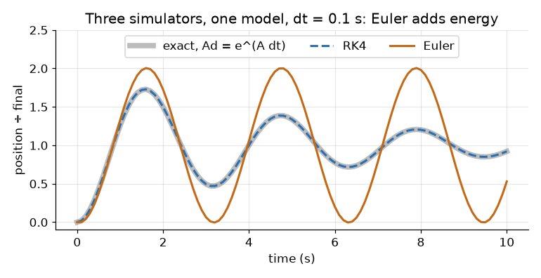
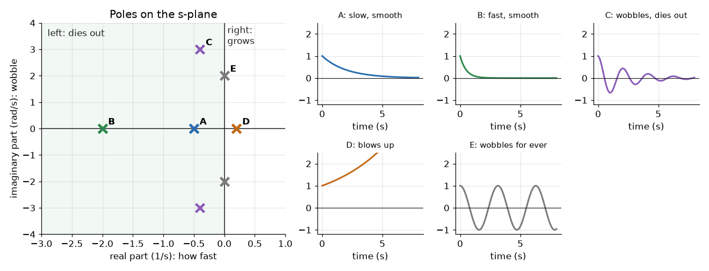
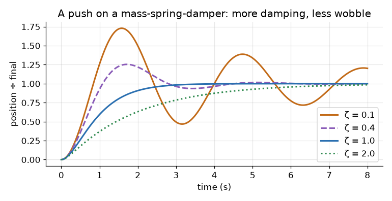
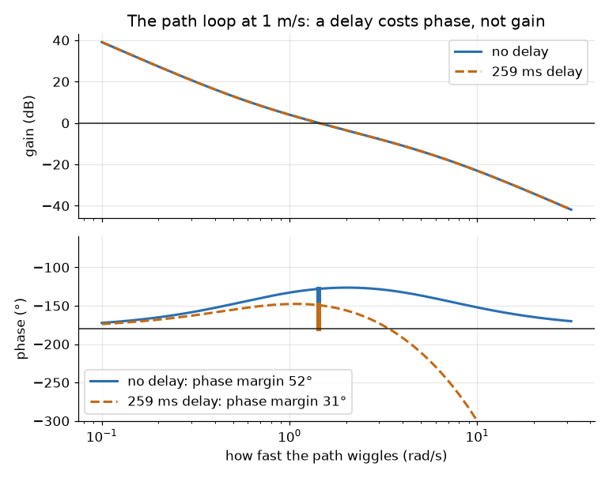
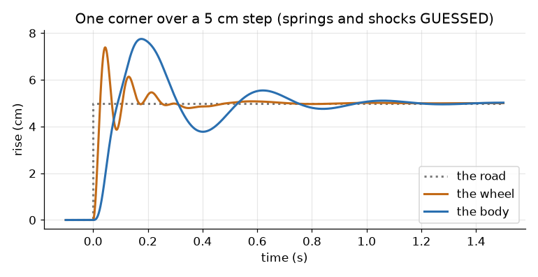
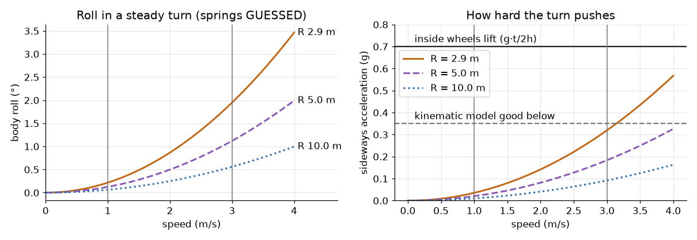

# State space: from a drawing to a car simulator

Ben, 25 Oct: "walk me through the whole process again ... What does all of this mean in
terms of a car that we are going to drive?" This page is the SYSC 3600 refresher, one
step at a time, with our car in every step. Our own numbers live in
[The car as a linear model](vehicle-model.md); this page explains where they come from.

!!! note "The short version"
    - **The process:** draw the parts → write Newton → pick the states → matrices A, B,
      C, D → step them forward in time (a simulator) → or Laplace them (transfer
      functions, poles, Bode).
    - **Poles = the roots of G(s)'s bottom line = the eigenvalues of A.** Same numbers,
      three names. Where they sit says how the car behaves.
    - **Phase** is "how late". A delay adds lateness without changing size; too late, and
      the car weaves.
    - **Shocks and roll:** at our 1 m/s they barely matter (0.2° of roll). At 3 m/s on
      full lock: 2° of roll and 46 % of the weight moves to the outside wheels. Not a
      control problem; worth knowing for the lidar.
    - **Run it:** `pixi run state-space-demo` prints every number here and draws every
      figure.

## The process, on one picture

```text
  1 WHY       2 DRAW          3 NEWTON              4 STATES             5 SIMULATE
 question ─► free-body ─► m x'' + c x' + k x = F ─► x' = A x + B u ─► x[k+1] = Ad x[k] + Bd u
                                                         │
                                                         ▼ Laplace
                       6 TRANSFER FUNCTION  G(s) = C (sI − A)⁻¹ B + D
                                                         │
                         ┌───────────────────────────────┼───────────────────────┐
                         ▼                               ▼                       ▼
                  7 POLES: where it         8 BODE: how it follows     9 THE CAR: settling,
                  sits on the s-plane         a wiggle; margins          overshoot, delay
```

## 1. Why bother: what we actually get

A model is the car on paper. Ask it a question before the car can get hurt.

| Question about the car | Tool that answers it | Our answer today |
|---|---|---|
| How long until it reaches the set speed? | step response (section 5) | about 13 s with the spine's PI |
| Will it pass the set speed? | the poles' damping ζ (7) | by 15 % on a sudden step |
| Can we tune the PI without driving? | pole placement (7, [vehicle-model](vehicle-model.md#tuning-the-spines-speed-loop-by-pole-placement)) | yes: pick ζ and ωn, solve for kp, ki |
| How much camera and network delay is safe? | phase margin (8) | 0.55 s more than today's, at 1 m/s |
| Does Gazebo behave like the car? | the same step in both, against the model | Gazebo steers 0.11 s late |
| Is 3 m/s safe on the path? | margins at each speed (8) | worst-case delay: 27°, under the 30° rule |
| Does body roll matter? | a roll model (10) | not for control; 2° at 3 m/s, full lock |
| What goes in the report? | all of it: equations, poles, plots | this page and [vehicle-model](vehicle-model.md) |

## 2. Draw the model: free-body diagrams

Draw each part as masses, springs and dampers, with every force on it.

### The textbook one: a mass, a spring, a damper (a shock)

```text
        ┌─────┐  ──► x (up from rest)
  F ──► │  m  │
        └──┬──┘
       ┌───┴───┐
     k ⌇      ┤├ c        spring pushes back: −k x
       └───┬───┘           shock pushes back: −c x'
       ▀▀▀▀▀▀▀▀▀ ground
```

This is one corner of a car: the body (m) on its spring (k) and shock absorber (c).

### The car's speed

```text
               drag: −d·m·v
          ◄──────────┐
        ┌────────────┴──┐
        │   the car, m  │ ──► v
        └──┬────────┬───┘
           ○        ○  ──► motor force: m·a_max·u_a   (u_a = throttle 0..1)
```

### The steering

```text
 command ─► Jrk G2 ─► motor (turns at up to 0.8 rad/s) ─► linkage (a lag, 0.1 s) ─► wheel angle δ
```

No mass to draw here: we model it by what it does (two lags), not by its parts.

## 3. Write the differential equations

Newton: the sum of forces = mass × acceleration. One equation per part.

| Part | Equation |
|---|---|
| mass-spring-damper | `m x'' = F − k x − c x'` |
| the throttle | `τt u_a' = u − u_a` |
| the car's speed | `v' = a_max u_a − d v` |
| the steering (one lag) | `τs δ' = δcmd − δ` |
| the path (the bicycle) | `y' = v sin θ`,  `θ' = v tan δ / L` |

## 4. Pick the states, write the matrices

**A state is an energy store**: a position (a spring's energy) and a velocity (a mass's
energy). Know the states now and the inputs from now on, and you know the future.

The form is always the same:

```text
x' = A x + B u        how the states change
y  = C x + D u        what you measure
```

### The mass-spring-damper, step by step

| Step | What |
|---|---|
| 1. States | x₁ = x (position), x₂ = x' (velocity) |
| 2. First row | x₁' = x₂ (by definition) |
| 3. Second row | x₂' = x'' = (F − k x₁ − c x₂)/m (Newton) |
| 4. Read off A, B | the numbers in front of x₁, x₂ and F |

```text
 [x₁']   [  0     1  ] [x₁]   [ 0  ]
 [x₂'] = [ −k/m  −c/m] [x₂] + [1/m ] F         y = [1 0] x
```

### The car's speed: two states, then three with the PI

```text
x = [v, u_a]       A = [ −d    a_max ]    B = [  0   ]
                       [  0   −1/τt  ]        [ 1/τt ]
```

The spine's PI adds one more state: the integral of the error, z' = v_set − v. Put
u = kp(v_set − v) + ki z into the equations, and the closed loop is still x' = Ax + Bu:

```text
x = [v, u_a, z]    A = [  −d       a_max     0    ]    B = [   0   ]    u = v_set
                       [ −kp/τt   −1/τt    ki/τt ]        [ kp/τt ]
                       [  −1        0        0    ]        [   1   ]
```

### The bicycle: nonlinear, so linearise

The path model has sin and tan in it: x' = f(x, u), not A x + B u.

```text
x = [y, θ, δ]     f(x, u) = [ v sin θ,   v tan δ / L,   (δcmd − δ)/τs ]
```

**Linearise:** pick an operating point, and keep the first slope of f there. The slopes
are the Jacobian:

```text
A = ∂f/∂x,   B = ∂f/∂u     at the operating point
```

**"About driving straight"** means the operating point y = θ = δ = 0: then sin θ ≈ θ and
tan δ ≈ δ, and

```text
     [ 0   v    0     ]        [  0   ]
A =  [ 0   0   v/L    ]    B = [  0   ]        at 1 m/s: A = [[0, 1, 0], [0, 0, 0.637], [0, 0, −6.15]]
     [ 0   0  −1/τs   ]        [ 1/τs ]
```

Good while the angles stay small (a lane change, gentle curves). The demo gets the same
A from finite differences, and the tests check it.

## 5. Simulate: step the state forward

**A simulator is a loop:** from the state now, work out x', take a small step dt, repeat.

| Method | One step | Error | Note |
|---|---|---|---|
| **Euler** | `x[k+1] = x[k] + dt (A x[k] + B u)` | ∝ dt | simplest; drifts |
| **RK4** | four slopes in the step, averaged | ∝ dt⁴ | what most simulators use for f(x, u) |
| **Exact** | `x[k+1] = Ad x[k] + Bd u`,  `Ad = e^(A dt)` | none, if u is held | linear models only |



**Why Euler wobbles for ever here:** each method maps a pole p to a number per step.
Exact: e^(p dt). Euler: 1 + p dt. For p = −0.2 ± 2j and dt = 0.1, |1 + p dt| = 1.000:
Euler's version never dies out, though the real one does (|e^(p dt)| = 0.980). Smaller dt
fixes it: 10 times smaller dt, 10 times less error.

| dt | Euler's worst error | RK4's |
|---|---|---|
| 0.1 s | 0.21 | 0.00001 |
| 0.01 s | 0.0097 | 10⁻⁹ |

The exact form is the matrix version of SYSC 3600's convolution: the response is
e^(At) x(0) plus the input convolved with e^(At) B. The spine runs its PI every 10 ms,
the path controller every 50 ms: the same Ad, Bd ([vehicle-model, section
5](vehicle-model.md#5-discrete-time-as-the-computers-run-it)).

### Gazebo is the same idea, with more states

| | Our model | Gazebo |
|---|---|---|
| Bodies | none: just v, δ, the errors | 7 rigid bodies: the chassis, 4 wheels, 2 steering links |
| States | 2 to 4 | each body's position, angle and their speeds: 12 numbers each, held together by joints |
| Forces | linear lags and drag | contacts, friction, the motors' torques |
| Step | 10 or 50 ms | 1 ms (`max_step_size` in our worlds) |
| Suspension | none | **none either**: the wheels are fixed to the body |

Same loop: state now, forces, step. So Gazebo's car can't roll on springs: if roll ever
matters, Gazebo won't show it.

## 6. Transfer functions

**Laplace turns a derivative into s.** With zero starting values, x' → s X(s), so
differential equations become algebra.

```text
x' = A x + B u   →   s X = A X + B U   →   X = (sI − A)⁻¹ B U

G(s) = Y(s)/U(s) = C (sI − A)⁻¹ B + D
```

**The transfer function is the output over the input, in s.** It holds the same
information as A, B, C, D (for what you can see from the input and output).

### The mass-spring-damper, worked

```text
sI − A = [ s      −1    ]       det(sI − A) = s² + (c/m) s + k/m
         [ k/m   s + c/m]

G(s) = [1 0] (sI − A)⁻¹ [0; 1/m] = 1 / (m s² + c s + k)
```

### The two shapes you'll see everywhere

| Shape | G(s) | Step response | Ours |
|---|---|---|---|
| first order | K / (τs + 1) | 63 % by τ, done by 4τ, no overshoot | the car alone: K = 15 m/s, τ = 10 s |
| second order | ωn² / (s² + 2ζωn s + ωn²) | rises, may overshoot, settles | the steering: ωn 12.6 rad/s, ζ 1.03 |

### Block diagrams and closing the loop

```text
 r ─►(+)─ e ─► C(s) ─► G(s) ─┬─► y          series: multiply.  C·G
      ▲ −                     │
      └───────────────────────┘             closed loop: T(s) = C G / (1 + C G)
```

For the speed loop, C(s) = kp + ki/s (the spine's PI) and G(s) = the throttle and the
car. The closed loop's bottom line, 1 + C G = 0, is the **characteristic equation**: its
roots are the poles of the loop.

## 7. Poles

Ben's half-memory: "the poles were the transfer functions or something". Close: **the
poles are the roots of the transfer function's denominator**. And they are the same
numbers as **the eigenvalues of A**:

```text
G(s) = C (sI − A)⁻¹ B + D,   and (sI − A)⁻¹ = adj(sI − A) / det(sI − A)

so G's bottom line is det(sI − A), and det(sI − A) = 0 is exactly what eigenvalues solve.
```

The demo checks all three ways agree: eig(A), the roots of G's denominator, and by hand.

### What a pole's place means



| Where | Means | Car |
|---|---|---|
| left half (Re < 0) | dies out: stable | every one of our closed loops |
| right half (Re > 0) | grows: unstable | a loop with too much delay |
| on the imaginary axis | wobbles for ever | the edge |
| far left | fast | the throttle (−9.5): 30 times faster than the car |
| near the origin | slow | the speed loop (−0.28): seconds |
| imaginary part | wobble, rad/s | the pair at −0.28 ± 0.28j: a little overshoot |
| at 0 exactly | an integrator: holds what it's given | the bicycle's heading and side error |

A pair −σ ± jωd gives ωn = √(σ² + ωd²) and ζ = σ/ωn. Then the textbook numbers:

| Number | Formula |
|---|---|
| overshoot | e^(−ζπ/√(1−ζ²)) |
| settling (2 %) | ≈ 4/(ζωn) = 4/σ |
| ζ < 1, = 1, > 1 | wobbles, just doesn't, sluggish |



**Our car's poles:**

| Loop | Poles | Means |
|---|---|---|
| speed, with the spine's PI | −0.28 ± 0.28j, −9.5 | ζ 0.71: settles in 13 s, 15 % overshoot (the PI's zero adds some) |
| steering | −10 (the linkage) and −16 (the motor): ζ 1.03 | no overshoot; done in 0.5 s |
| the path, alone | 0, 0, −6.15 | two integrators: nothing pulls the car back |
| the path, with pure pursuit, 1 m/s | −0.76 ± 0.78j, −4.6 | ζ 0.70: a 1 m offset is gone in 5.7 s |

The step responses: [vehicle-model's figure](img/vehicle-model-steps.png). The poles on
one map: [vehicle-model's pole map](img/vehicle-model-poles.png).

**Placing poles** is tuning on paper: choose where they go, then solve for the gains
(`place_speed_gains` in [vehicle-model](vehicle-model.md#tuning-the-spines-speed-loop-by-pole-placement)).

## 8. Frequency response and phase

**A Bode plot answers: if the input wiggles at ω, how big and how late is the output?**

In car terms: drive a slalom, steering left-right faster and faster.

| Wiggle | What the car does | On the Bode plot |
|---|---|---|
| slow | follows fully, on time | gain high, phase small |
| faster | follows less, and later | gain falls, phase lags |
| very fast | hardly moves; far behind | gain tiny, phase −180° or worse |

**Phase** is the lateness, as an angle of one wiggle: 90° late = a quarter-wiggle behind.

### Why a delay is special

A delay e^(−sT) has gain 1 at every frequency (it changes nothing's size), but phase
−ωT: the faster the wiggle, the more of it the delay eats.



The two gain lines lie on top of each other. The phase line drops.

### Margins: how much worse before it wobbles

Break the loop and look at C·G alone (the open loop):

| Margin | Read it | Means |
|---|---|---|
| **phase margin** | at the frequency where the gain is 1 (0 dB): how far the phase is above −180° | extra lateness it can take |
| **gain margin** | at the frequency where the phase is −180°: how far the gain is under 1 | how much harder it could steer |
| **delay it can take** | phase margin ÷ crossover frequency | seconds |

Rule of thumb: ζ ≈ phase margin / 100. 45° → about 20 % overshoot; under 30°, it swings.

**Ours, the path loop** ([vehicle-model, section 4](vehicle-model.md#the-margins-bode)):

| | 1 m/s | 3 m/s |
|---|---|---|
| no delay | 52° | 50° |
| typical, 84 ms | 45° | 43° |
| worst, 259 ms | 31° | **27°**: below 30° |
| Gazebo (+0.11 s steering) | 37° | 34° |
| extra delay it could still take | 0.55 s | 0.46 s |

## 9. What it means for the car we drive

| The number | Our car | What you'd see from the seat |
|---|---|---|
| **settling time**, speed | 13 s (2 %) | ask for 1 m/s: near it in 3 s, exactly on it after 13 |
| **overshoot**, speed | 15 % on a step | asks 1.0, briefly does 1.15. The spine's ramp hides most of it |
| **damping**, path | ζ 0.70 | 1 m off the lane line: back in 5.7 s (5.7 m at 1 m/s), swings 4.5 cm past |
| **phase margin**, path | 45° at 1 m/s | room for 0.55 s more camera, network or Orin delay before it weaves |
| **gain margin**, path | 18.5 dB | pure pursuit could steer 8 times harder before it oscillates |
| **crossover** | 1.4 rad/s | it follows path wiggles slower than one every 4.4 s |
| **a pole at 0** | the bicycle alone | no controller, no recovery: it drifts |

### 1 m/s against 3 m/s

| | 1 m/s (ego's cap today) | 3 m/s (the spine's cap) |
|---|---|---|
| 1 m offset gone in | 5.7 s, 5.7 m | 5.0 s, **15 m** |
| phase margin, worst delays | 31° | **27°**: it would swing past the path |
| roll on full lock | 0.2° | 2.0° |
| weight to the outside wheels, full lock | 5 % | 46 % |

**So:** keep 1 m/s until the Orin's real delays are measured; before 3 m/s, cut the
worst-case delay or lengthen the lookahead.

## 10. Shocks and roll



### The quarter-car: one corner, 2 masses, 4 states

```text
        ┌─────────┐ z_s   the body's share (m_s ≈ 33 kg)
        └────┬────┘
        k_s ⌇ ┤├ c_s      spring and shock
        ┌────┴────┐ z_u   the wheel (m_u ≈ 12 kg)
        └────┬────┘
         k_t ⌇            the tyre, as a stiff spring
      ▀▀▀▀▀▀▀▀▀▀▀▀▀ z_r   the road
```

```text
x = [z_s, z_s', z_u, z_u']
m_s z_s'' = −k_s (z_s − z_u) − c_s (z_s' − z_u') − m_s g
m_u z_u'' =  k_s (z_s − z_u) + c_s (z_s' − z_u') − k_t (z_u − z_r) − m_u g
```

| Result (springs GUESSED) | Value |
|---|---|
| the body bounces at | 2.4 Hz, ζ 0.25 |
| the wheel hops at | 11.8 Hz |
| sag when parked: m_s g / k_s | 4.1 cm (the test checks the model gives this) |

**For the car:** bumps spaced 1.25 m apart, at 3 m/s, hit the body's 2.4 Hz: the worst
ride. It shakes the cameras, not the steering.

### Roll in a turn

A turn of radius R at speed v pushes sideways with a_y = v²/R (= v²κ). The body leans on
its springs:

```text
I φ'' + c φ' + (K_φ − m_s g h') φ = m_s h' a_y          (a second-order system again)

steady:  φ = m_s h' a_y / (K_φ − m_s g h')
         K_φ = k_s · track²     (four springs: the roll stiffness)
         h'  = CG height − roll-centre height
weight that moves to the outside wheels:  ΔF = m a_y h / track
the inside wheels lift when:              a_y > g · track / (2h)
```



| Number | Value | Source |
|---|---|---|
| mass | 181 kg | `vehicle.yaml` (Ben's estimate) |
| track | 0.77 m | `vehicle.yaml` (TODO confirm) |
| CG height h | 0.55 m | `vehicle.yaml`: **GUESS** |
| tightest turn | 2.87 m | wheelbase / tan(0.5 rad) |
| spring rate, per corner | 8000 N/m | **GUESS** (demo) |
| roll centre height | 0.20 m | **GUESS** (demo) |
| shocks' damping | ζ 0.3 | **GUESS** (demo) |

| v | R | a_y | Roll | Weight moved out (of one side's) |
|---|---|---|---|---|
| 1 m/s | 2.87 m (full lock) | 0.04 g | 0.22° | 45 N (5 %) |
| 1 m/s | 5 m | 0.02 g | 0.12° | 26 N (3 %) |
| 2 m/s | 2.87 m | 0.14 g | 0.87° | 180 N (20 %) |
| 3 m/s | 2.87 m | 0.32 g | 1.95° | 405 N (46 %) |
| 3 m/s | 5 m | 0.18 g | 1.12° | 233 N (26 %) |
| 3 m/s | 10 m | 0.09 g | 0.56° | 116 N (13 %) |

Rollover limit: g·0.77/(2·0.55) = **0.70 g**, the same as the tyres' grip guess (0.7 g).
Our worst case, 3 m/s on full lock, is 0.32 g: under half of it. (The share of weight
that moves out is a_y ÷ that limit: at the limit, the inside wheels carry nothing.)

### Does it matter? The verdict

| Effect | At 1 m/s | At 3 m/s, full lock | Matters? |
|---|---|---|---|
| roll, for steering | 0.2° | 2° | **no**: the path loop never sees it |
| rollover | 5 % of the limit | 46 % | **no**, with margin; check again for a higher CG (a roof load) |
| load on the inside wheels | −5 % | −46 % | **a little**: less grip inside; an open differential spins that wheel sooner |
| lidar tilt (1.8 m up) | 0.2° | 2°: on the outside of the turn the beams point 2° lower, 0.7 m at 20 m | **it would**, but ego's 2 m/s² limit holds the roll to 1.33°, under the 1.46° where the road shows within 12 m: safe to 4 m/s ([Costmaps](costmaps.md#body-roll-and-the-lidar-todo-52e)) |
| cameras (1.55 m up) | 5 mm sideways | 5 cm sideways | small; lane geometry may need the IMU's roll |
| bumps | the body at 2.4 Hz | the same | ride and camera shake, not control |

**When it would matter:** faster (roll grows with v²), tighter turns, a higher CG, softer
springs, or anything that needs the sensors level. Careful with the IMU's roll: in a turn
its accelerometer feels the sideways push as tilt (2 m/s² reads as 11.5°, against 1.3° of
real roll), so take out speed × turn rate before levelling anything with it.

### Kinematic or dynamic bicycle?

The **kinematic** bicycle (ours) assumes the tyres go where they point. The **dynamic**
bicycle lets them slip: each axle pushes sideways C·α (cornering stiffness × slip angle).
States [v_y, r]: sideways speed and yaw rate.

| Speed | The tyres' poles (GUESSED grip) | The steering's pole | Kinematic OK? |
|---|---|---|---|
| 1 m/s | −79, −115 | −6.2 | yes: tyres 13× faster |
| 3 m/s | −26, −38 | −6.2 | yes: 4× faster |
| 10 m/s | −8, −12 | −6.2 | **no**: tyres as slow as the steering |

The tyres' poles move toward the origin as speed rises (about 1/v). Rule of thumb
(Polack et al., IEEE IV 2017): the kinematic model holds below about **0.5 μg** of
sideways acceleration: 0.35 g for us. Our worst case (0.32 g) is just inside. MPPI and
ego use the kinematic one; that's right for us.

## 11. Beyond: where state space goes next

| Tool | What it does | For our car |
|---|---|---|
| **LQR** | choose weights (how much you hate error vs steering effort) instead of poles; `scipy.linalg.solve_continuous_are` gives K for u = −K x | the same A, B as pure pursuit's; a better K, 60° phase margin guaranteed (before delays) |
| **Observers** | estimate the states you can't measure, from the ones you can: x̂' = A x̂ + B u + L(y − C x̂) | the heading error from the camera's lane lines |
| **Kalman filter** | an observer whose L is chosen from how noisy each sensor is | robot_localization's EKF: x' = f(x, u) + noise, linearised by its Jacobian every step ([Learn: localization](learn-localization.md)) |
| **System identification** | measure the input and output, fit A, B (or τ, K) | the car day's [actuator tests](actuator-tests.md) fit `drag`, `throttle_lag`, `steer_lag`; `pixi run vehicle-model --set ...` |

## 12. Cheat sheet

| Symbol | Means |
|---|---|
| x, u, y | states, inputs, outputs |
| A, B, C, D | how states change; what inputs push; what we measure; straight-through |
| s | Laplace's d/dt |
| τ | a time constant: 63 % of the way |
| ωn, ζ | natural frequency (rad/s), damping (1 = just no overshoot) |
| T | a delay |
| φ, a_y, h, t | roll angle, sideways acceleration, CG height, track |

| # | Formula | Use |
|---|---|---|
| 1 | `x' = A x + B u`,  `y = C x + D u` | the model |
| 2 | `A = ∂f/∂x`, `B = ∂f/∂u` at the operating point | linearise |
| 3 | Euler `x += dt (A x + B u)`; exact `Ad = e^(A dt)` | simulate |
| 4 | `G(s) = C (sI − A)⁻¹ B + D` | transfer function |
| 5 | poles: `det(sI − A) = 0` = eig(A) | stability, speed, wobble |
| 6 | `K/(τs + 1)`: 63 % at τ, settled at 4τ | first order |
| 7 | `ωn²/(s² + 2ζωn s + ωn²)`; OS = `e^(−ζπ/√(1−ζ²))`; settles ≈ `4/(ζωn)` | second order |
| 8 | `T = C G / (1 + C G)` | closing a loop |
| 9 | delay: gain 1, phase `−ωT`; safe delay = PM / ωc | margins |
| 10 | `a_y = v²/R`; `φ = m h' a_y / (K_φ − m g h')`; rollover at `g t / 2h` | roll |

## Run it

```bash
pixi run state-space-demo                 # every number on this page, and the figures
pixi run state-space-demo --no-figures    # the numbers only
pixi run vehicle-model                    # our car's full model: margins, delays, Gazebo
```

| File | What |
|---|---|
| `tools/state_space_demo.py` | the teaching simulator: A, B, C, D; Euler, RK4, exact; poles; quarter-car; roll |
| `tools/tests/test_state_space_demo.py` | 16 tests: poles = eigenvalues = the TF's roots; Euler converges; the textbook step; sag = m g / k; roll by hand |
| `docs/img/learn-ss-*.png` | the figures |
| `src/ego/aav_ego/aav_ego/vehicle_model.py` | our car's model ([The car as a linear model](vehicle-model.md)) |
