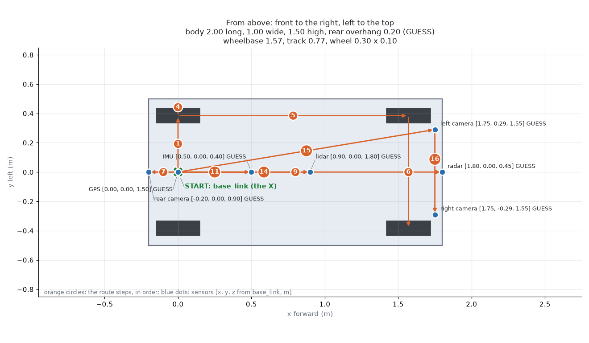
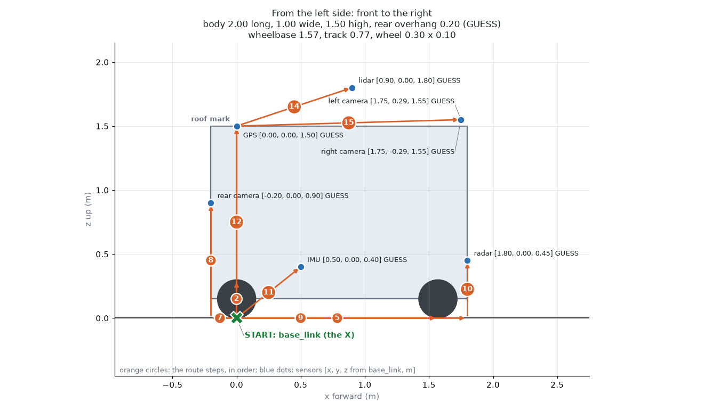
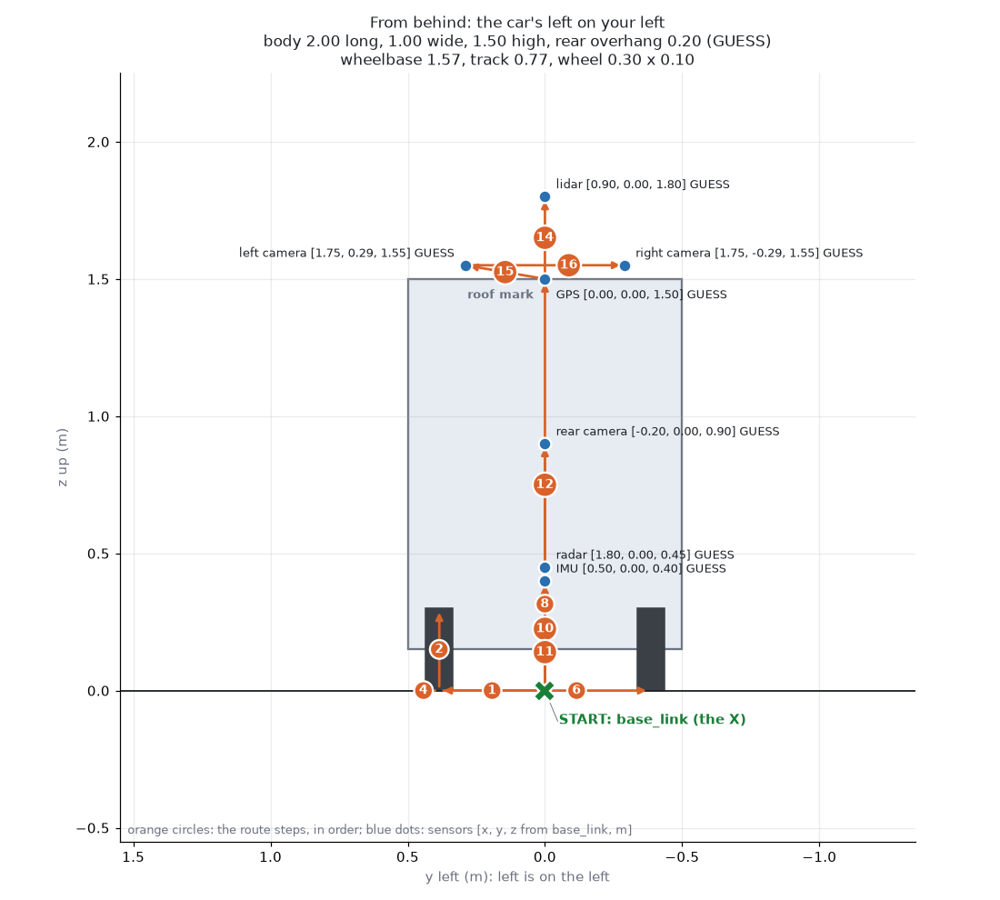

# Measuring the car: the sheet for the team

Written 15 October 2026. **Hand this to whoever measures the car.** Fill in the
"Measured" column, photograph the filled sheet, and send it back. The numbers go into
`ros/bringup/aav_description/config/vehicle.yaml`, the one place the software reads them from.
Every number there today is a guess.

> **The short version**
> - **Everything is measured from one spot: on the floor, under the middle of the rear axle.** We call it the **zero point**.
> - **Forward = +x. Left = +y. Up = +z.** Right of the centre line is a **minus** number.
> - **Write centimetres** (to the nearest 1 cm), and **degrees** for angles. We convert them.
> - Two people, a tape measure, chalk or masking tape, a plumb line (a string with a weight), a phone with a level app.
> - **Follow [the measuring map](#the-measuring-map)**: 16 steps round the car, each from a mark you already have.

## The measuring map

Ben's idea (29 Oct): start at the zero point, then measure **each new spot from one you
already have**. Out to the left rear tyre, forward to the front tyre, up to the roof,
then along the roof to each sensor. Nobody measures the roof from the floor.

The pictures show **today's guesses** from `vehicle.yaml` (marked GUESS). The orange
circles are the steps, in order. The blue dots are the sensors.







### How to use it

| # | Do |
|---|---|
| 1 | Mark the zero point first: [section 1](#1-the-zero-point) |
| 2 | Walk the steps below **in order**. Each starts at its "From" mark |
| 3 | For a 3-number step, measure **forward, left, up** from the "From" mark. Back, right or down: write a minus |
| 4 | Write each reading in the "Measured" box of its **Sheet** row (sections 3 and 5) |
| 5 | Feet and inches are fine (`5 ft 2 in`, `5' 2"`), and so are cm. Say which |

### The route

The steps, with today's guesses (the script writes this table: don't edit it by hand).

<!-- measure-map:start (pixi run measure-map writes this table) -->

| Step | From | To | Tape: direction and today's guess | Hint | Sheet | Gives (vehicle.yaml) | Today |
|---|---|---|---|---|---|---|---|
| 1 | X | rear-left wheel | left 0.39 m | along the rear axle line; the yaml takes 2 x this | M2 | `vehicle.track` | 0.77 GUESS |
| 2 | rear-left wheel | rear-left tyre top | up 0.30 m | the car's weight on the tyre | M3 | `vehicle.wheel_diameter` | 0.30 GUESS |
| 3 | rear-left wheel | rear-left wheel (tread) | across: 0.10 m | across the tread: a size, not a move | M3b | `vehicle.wheel_width` | 0.10 GUESS |
| 4 | rear-left wheel | left side | left 0.11 m | tyre centre out to the body; the yaml takes 2 x (track/2 + this) | M4c | `vehicle.body.width` | 1.00 GUESS |
| 5 | rear-left wheel | front-left wheel | forward 1.57 m | hub to hub, same side | M1 | `vehicle.wheelbase` | 1.57 GUESS |
| 6 | front-left wheel | front-right wheel | right 0.77 m | the front track: a check on step 1, should be 2 x step 1 | M2b | `check: vehicle.track` | 0.77 GUESS |
| 7 | X | rear bumper | back 0.20 m | along the x line, backwards | M4b | `vehicle.body.rear_overhang` | 0.20 GUESS |
| 8 | rear bumper | rear camera | forward 0.00, left 0.00, up 0.90 m | plumb line from the lens | S6 | `sensors.camera_rear_link.xyz` | [-0.20, 0.00, 0.90] GUESS |
| 9 | rear bumper | front bumper | forward 2.00 m | bumper to bumper | M4 | `vehicle.body.length` | 2.00 GUESS |
| 10 | front bumper | radar | forward 0.00, left 0.00, up 0.45 m | plumb line from the radar face | S3 | `sensors.radar_link.xyz` | [1.80, 0.00, 0.45] GUESS |
| 11 | X | IMU | forward 0.50, left 0.00, up 0.40 m | plumb line from the board | S2 | `sensors.imu_link.xyz` | [0.50, 0.00, 0.40] GUESS |
| 12 | X | roof | up 1.50 m | the roof is flat? if not, also note its highest point | M4d | `vehicle.body.height` | 1.50 GUESS |
| 13 | roof | GPS | forward 0.00, left 0.00, up 0.00 m | on the roof, from the roof mark | S1 | `sensors.gps_link.xyz` | [0.00, 0.00, 1.50] GUESS |
| 14 | roof | lidar | forward 0.90, left 0.00, up 0.30 m | on the roof, from the roof mark | S7 | `sensors.lidar_link.xyz` | [0.90, 0.00, 1.80] GUESS |
| 15 | roof | left camera | forward 1.75, left 0.29, up 0.05 m | on the roof, from the roof mark | S4 | `sensors.camera_left_link.xyz` | [1.75, 0.29, 1.55] GUESS |
| 16 | left camera | right camera | forward 0.00, right 0.58, up 0.00 m | lens to lens (about the stereo baseline) | S5 | `sensors.camera_right_link.xyz` | [1.75, -0.29, 1.55] GUESS |

<!-- measure-map:end -->

Not on the route (not a tape job):

| vehicle.yaml | Where it's measured |
|---|---|
| `max_steering_angle` | [M5](#4-steering): the two wheel angles at full lock |
| `mass`, `centre_of_mass` | [M7, M7b](#6-weight): the scales |
| `encoder_counts_per_rev` | count the spokes on the encoder wheel |
| `tyre_grip`, `actuators` | the driving tests ([tests](tests.md) 3.10-3.12, 4.1-4.5) |
| each sensor's `rpy` | [section 5](#5-where-each-sensor-is): pointing, tilt, lean |
| `max_reverse_speed` | a choice, not a measurement |

### Readings into vehicle.yaml

The yaml wants every spot **from the zero point**. The script adds the steps up for you.

| # | Do |
|---|---|
| 1 | `pixi run measure-map --blank > readings.yaml`: a file with one line per step |
| 2 | Type the readings in, in any unit (`units: ft` makes plain numbers feet) |
| 3 | `pixi run measure-map --readings readings.yaml`: it prints the yaml's numbers, in metres |
| 4 | Copy them into `vehicle.yaml`, delete each `TODO`, then `pixi run measure-map` to redraw the map |

Example: step 1 reads `1 ft 3 in` left (0.381 m), so `track` = 2 × 0.381 = **0.762 m**.
Step 14 reads forward `2 ft 11 in`, up `1 ft` from the roof mark at 1.50 m, so the lidar
is at x = 0.889, z = 1.50 + 0.305 = **1.805 m**.

## 1. The zero point

**Not the differential itself:** it may sit off-centre, and it's above the floor. The zero
point is **on the floor**, exactly halfway between the two rear wheels, straight under the
rear axle's line.

```text
 SIDE VIEW                                        TOP VIEW  (front is up)

                                                        front
                                                  ┌──────────────┐
     ┌──────────────────────┐                     │  ○        ○  │ front wheels
     │                      │                     │              │
  ───○──────────────────────○─── axle height      │      +x ▲    │
     │                      │                     │         │    │
  ═══●══════════════════════════ floor            │  +y ◄───●    │
     ▲                                            │  ○  zero  ○  │ rear wheels
   zero point: on the floor,                      └──────────────┘
   under the rear axle                                   rear
```

**How to mark it:**

| # | Do |
|---|---|
| 1 | Park on **flat, level** ground. Wheels **straight**. Tyres at their normal pressure |
| 2 | On each rear wheel, find the **centre of the hub** (the middle of the wheel) |
| 3 | Hang the plumb line from each hub centre, and mark where it touches the floor: two marks |
| 4 | Stretch a string between the two marks. Its **middle** is the zero point. Mark it with an **X** of tape |
| 5 | From the X, lay a string straight forward, along the car's centre line, to under the front axle. This is the **x line** |

Measure every x along the x line, every y square to it, and every z straight up from the floor.

## 2. Directions and signs

| Direction | Positive (+) | Negative (−) | Example |
|---|---|---|---|
| **x** | forward of the zero point | behind it | the front bumper: about +180 cm; the rear bumper: about −20 cm |
| **y** | to the **left** (seen sitting in the car) | to the right | the left camera: +29 cm; the right camera: −29 cm |
| **z** | up from the **floor** | (nothing is below the floor) | the roof: about +150 cm |

**Angles** of a sensor, in degrees:

| Angle | Means | How to measure |
|---|---|---|
| **Pointing** (yaw) | which way it looks, seen from above. 0 = straight forward, +90 = left, 180 = straight back | by eye, or a protractor on the floor |
| **Tilt** (pitch) | **+ = tilted down** towards the ground, − = tilted up | a phone level app held on the sensor's flat face |
| **Lean** (roll) | + = leaning to the right | the same app, the other way |

## 3. The car itself

The route steps for these rows: [the measuring map](#the-measuring-map).

| # | What | From → to | Guess today | **Measured** (cm) |
|---|---|---|---|---|
| M1 | **Wheelbase** | rear hub centre → front hub centre, same side. Do both sides | 157 | L: ____ R: ____ |
| M2 | **Track, rear** | left rear tyre centre → right rear tyre centre | 77 | |
| M2b | **Track, front** | the same, at the front | 77 | |
| M3 | **Wheel diameter** | the floor → the top of the tyre, with the car's weight on it | 30 | |
| M3b | Tyre width | across the tread | 10 | |
| M4 | **Length** | rear bumper → front bumper | 200 | |
| M4b | **Rear overhang** | the zero point → the rear bumper (write it as a plain number) | 20 | |
| M4c | **Width** | widest point, side to side (mirrors in, if they fold) | 100 | |
| M4d | **Height** | the floor → the highest point of the roof, **not** counting the lidar | 150 | |
| M4e | Ground clearance | the floor → the lowest point under the car | (none) | |

## 4. Steering

| # | What | How | Guess today | **Measured** |
|---|---|---|---|---|
| M5 | **Full lock left**: each front wheel's angle | turn fully left; measure each front wheel's angle from straight. A protractor on the floor against the tyre, or the phone app on the wheel's face | inside 32°, outside 26° | inside: ____° outside: ____° |
| M5b | **Full lock right** | the same, fully right | inside 32°, outside 26° | inside: ____° outside: ____° |
| M5c | **Turning circle** | at full lock, push or drive one slow full circle; measure the circle the **outside front tyre** draws, across | (none) | left: ____ cm right: ____ cm |
| M5d | Steering wheel turns, lock to lock | count the turns | (none) | ____ turns |

!!! note "Two wheel angles, one number"
    `max_steering_angle` in `vehicle.yaml` is neither wheel: it's the **middle** of the
    front axle (the bicycle model, which ego and Nav2 use). The inside wheel turns
    further, the outside one less. To get it from M5's two angles (in radians):
    `vehicle.centre_angle(v, inside, outside)` in `aav_description/vehicle.py`.
    Use the smaller of left and right. Gazebo's own number is worked out from it.

## 5. Where each sensor is

The route steps for these rows (from the roof mark, the bumpers or the X): [the measuring map](#the-measuring-map).

For each sensor, measure **its centre**: for a camera, the **middle of the lens**; for the
GPS, the **middle of the antenna puck** (not the receiver box); for the lidar, the **middle
of its window** (the band that spins or glows).

| # | Sensor | Measure its | Guess today x / y / z (cm) | **x** | **y** | **z** | **Pointing / tilt / lean** (°) |
|---|---|---|---|---|---|---|---|
| S1 | **GPS antenna** | puck centre | 0 / 0 / 150 | | | | (not needed). Ben, 23 Oct: it is **over the rear axle** already: check x is about 0, and measure its height ([why it matters](learn-gps.md#mount-the-antenna-over-the-rear-axle)) |
| S2 | **IMU** | board centre | 50 / 0 / 40 | | | | see below |
| S3 | **Radar** (TI mmWave, on the grill) | the middle of its flat front face | 180 / 0 / 45 | | | | 0 / __ / __ |
| S4 | **Front left camera** | lens centre | 175 / +29 / 155 | | | | 0 / __ / __ |
| S5 | **Front right camera** | lens centre | 175 / −29 / 155 | | | | 0 / __ / __ |
| S6 | **Rear camera** (orange housing) | lens centre | −20 / 0 / 90 | | | | 180 / __ / __ |
| S7 | **Lidar** (roof tripod) | the middle of its window | 90 / 0 / 180 | | | | __ / __ / __ |
| S8 | Wheel-speed sensors | the front left and front right wheels (Hall sensors on the brake rotors) | (front, both) | | | | |
| S8b | Brake rotor holes | count the holes on each front rotor | (none) | L: ____ R: ____ | | | |

**The IMU's direction matters most.** Find the arrows printed on its board (usually X and
Y). Write which way each points:

| IMU arrow | Points to (forward / back / left / right / up / down) |
|---|---|
| X | |
| Y | |
| Is the board upside down? | yes / no |

## 6. Weight

| # | How | Measured (kg or lb: say which) |
|---|---|---|
| M7 | 4 bathroom scales, one under each wheel, on the flat. Or one scale, a wheel at a time, the other three on blocks of the same height | FL: ____ FR: ____ RL: ____ RR: ____ total: ____ |
| M7b | **The rear lifted:** put both rear wheels on blocks of the same height (20-30 cm, chocked, someone holding the car), the front wheels still on their scales. Weigh the two front wheels again, and measure the blocks' height | FL: ____ FR: ____ block height: ____ cm |
| M7c | Nobody aboard for M7 and M7b; nothing loose in the car. Write down anything that's usually aboard but wasn't (a battery out, a laptop) | |

Ben's estimate is about 400 lb (181 kg). The four corners show where the weight sits
along the car (the **centre of mass**); M7b shows how high it sits. Ego uses both: a
heavy load slows speeding up and braking, and a high centre of mass on the car's narrow
track (77 cm) lowers the speed at which it could tip in a turn. The maths:
`vehicle.centre_of_mass()` in `aav_description/vehicle.py` (docs/car_measurements.md).

## 7. Tips

| Tip | Why |
|---|---|
| **Measure twice**, by two different people | catches misreads |
| **Photograph the tape** at each measurement | we can check later |
| Keep the tape **level** for x and y, and **plumb** for z | a sloped tape reads long |
| Use the **x line** string for every x | so all x are along the car's centre line |
| Write "?" rather than guess | a guess looks like a measurement |
| Note anything odd: a sensor loose, bent or taped | it can move between drives |

## 8. Hand back

| ☐ | Do |
|---|---|
| ☐ | Fill in every "Measured" box, or write "?" |
| ☐ | Photograph the sheet, and the IMU's arrows |
| ☐ | Send it to Ben. The numbers go into `vehicle.yaml`, then `pixi run test` and a look in RViz (`pixi run view`) to check the model matches the photos |

Programmer's detail (what reads each number, the maths): [docs/car_measurements.md](car_measurements.md).
