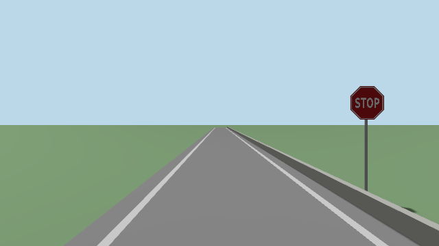
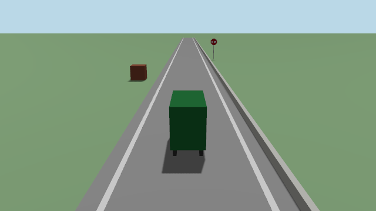

# Our simulator's cameras

Ben, 7 Nov: replace Gazebo with our own Rust simulator, every sensor. This page is the
**cameras** part: `ros/sim/aav_sim_cameras`. The rest of the simulator (world, car, lidar,
IMU, GPS, wheels, clock) is built beside it. The plan:
[our own simulator](designs/2026-11-05_own-simulator.md).



## In one line

Bevy draws the world from each camera on the car, with no window, and the pictures go out on
**Gazebo's camera topics**: same size, lens, rate, encoding and frame.

## The cameras

| Camera | Topics | Frame | Where it sits |
|---|---|---|---|
| front left | `/sensors/camera/front_left/image_raw`, `camera_info` | `camera_left_link` | `vehicle.yaml` |
| front right | `/sensors/camera/front_right/...` | `camera_right_link` | `vehicle.yaml` |
| rear | `/sensors/camera/rear/...` | `camera_rear_link` | `vehicle.yaml` |
| chase | `/vehicle/sim/chase_camera/image_raw` | `base_link` | 7 m behind, 3.5 m up |

| Setting | Value | Same as Gazebo? |
|---|---|---|
| Picture | 640 x 360, `rgb8` | yes |
| Lens | focal 343 px, centre (320, 180), no distortion | yes: K, P, R, D all match |
| Rate | 10 Hz, on whole tenths of sim time | yes |
| QoS | reliable, keep last 10 | yes |
| Stamp | the time of the car pose it was drawn from | yes |



## Run it

| Command | Does |
|---|---|
| `pixi run sim-cameras` | the test world for 10 s, then the timing table. No ROS |
| `pixi run sim-cameras --save /tmp/pics` | also keeps each camera's first picture |
| `pixi run sim-cameras --from 18 --speed 0` | the car parked 7 m from the stop sign |
| `pixi run sim-cameras --bench 300` | as fast as it can: the most pictures a second |
| `pixi run sim-cameras --ros` | publishes the topics, a scripted drive, wall-clock stamps |
| `pixi run sim-cameras --ros --pose truth` | draws where `/vehicle/sim/truth` says, with its stamps |

`--ros` needs `pixi run build` first, and stays on this computer (`tools/ros.sh --local`).

## How the core plugs it in

```text
 core simulator ─── /vehicle/sim/truth (50 Hz) ───► sim_cameras ───► the camera topics
                    or, in Rust: Cameras::tick(car pose, sim time)
```

Two ways, both ready:

| Way | When |
|---|---|
| **Its own program**, reading `/vehicle/sim/truth` | the default: a slow picture can't delay the IMU |
| **In Rust**, `camera_core::Cameras` with `sim_cameras::BevyRenderer` | if the core wants pictures in its own loop |

The shared types live in `camera-core`, which has no Bevy and no ROS:

| Type | What it is |
|---|---|
| `SimWorld` | the sky, the light, and a list of `Shape`s in the map frame; the car's body |
| `Shape` | a name, a `Geometry` (plane, box, cylinder, octagon), a pose, a `Look` (colour, picture) |
| `Rig`, `CameraSpec` | each camera: lens, rate, topic, frame, mount |
| `CameraRenderer` | the trait: `set_world(&SimWorld)` and `render(car, stamp, cameras)` |
| `Cameras` | the rig, a timer per camera, and a renderer: `tick(car, now)` draws the ones due |

**For the merge:** the core turns its world into a `SimWorld` (SDF's boxes, planes and
cylinders map one to one; colours are SDF's, linear) and publishes `/vehicle/sim/truth`.
Its `/system/source` announcer lists the cameras, as `gazebo_adapter` does.

## Tests

| Test | What it proves | Where |
|---|---|---|
| projection | a point 10 m ahead lands on (320, 180); 1 m left and 0.5 m up, 34.3 and 17.15 px off | `camera-core`, every `tools/test.sh` |
| camera_info | K, P, R, D as Gazebo's bridge sends them | `camera-core` |
| rate | one sim minute at 50 Hz gives each camera exactly 600 pictures, on the tenths | `camera-core` |
| picture colours | sky, road, grass, kerb, box, stop sign, post: each where the lens says, its colour | `tests/render.rs`, needs a GPU |
| picture edges | the stop sign's edges in the picture within 1 px of the lens's | `tests/render.rs` |

## Measured (7 Nov, Ben's M4 Max)

Other agents were using the same computer (load 10 to 40), so the slow tail is partly theirs.

| Run | Result |
|---|---|
| Bevy ready, shaders warmed | 0.2 to 0.5 s |
| Four cameras at 10 Hz, `--ros`, 25 s | 10.03 Hz each, 251 pictures, out 16 ms after due (median), 60 ms worst, none late |
| `--pose truth`, a 50 Hz truth on sim time | 10.00 Hz on sim time, every stamp on a tenth, 15 ms median, 26 ms worst |
| `ros2 topic hz` | 10.000 Hz, min 0.097 s, max 0.103 s |
| `--bench`, four cameras, a quiet minute | 57 rounds a second (227 pictures/s), 17.5 ms a round |
| No ROS, 30 s, heavy load | 9.92 Hz; median 19 ms; 25 of 298 late (worst 196 ms) |

So four cameras at the car's 15 Hz (60 pictures a second) should fit when the computer is quiet: not yet run at 15 Hz.

## What it is not, yet

| Missing | Why it matters |
|---|---|
| Gazebo's worlds (`road.sdf`, `test_lot.sdf`, campus) | only the test world draws; the core's world reader feeds it at the merge |
| A computer with no GPU (CI, oirp-spss) | Bevy needs Vulkan or Metal: the picture tests can't run there. Only `camera-core` runs in CI |
| A side-by-side with Gazebo's pictures | the looks match by eye (`docs/img/sim-cameras.png`); not measured |
| The detector on these pictures | the stop sign carries Gazebo's own picture; not yet run through RF-DETR |
| Faults (freeze, stop) | `gazebo_camera` does them for Gazebo; the simulator's fault switch should cover these |
| The JPEG topics | Gazebo has none either: `chase_jpeg` and `preview_jpeg` still make them |
| Lifelike pictures | a non-goal: Gazebo's aren't either |
