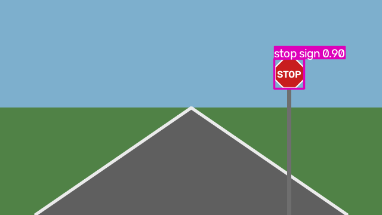
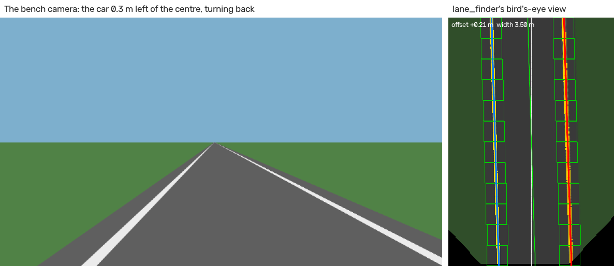

# Perception: cameras, RF-DETR and YOLO, stop signs, lanes and radar

What the car sees, and what it does about it. All of it runs on the bench today. On the
car, it waits for the cameras (Q22) and the Orin's move to JetPack 7.2 (Q24).

## The chain

```
camera ─► yolo_detector ─► /perception/detections ─► stop_sign_watcher ─► /perception/stop_sign
                                                                    (a lock on twist_mux)
lane finder (missing) ─► /perception/lane/geometry ─► control_interface ─► /drivers/ai/cmd_vel ─► twist_mux
radar ─► /sensors/radar/points ─► radar_clusters ─► /perception/radar/clusters, /perception/radar/cluster_boxes
```



| In the picture | What it is |
|---|---|
| The road, the sky and the sign | a drawing, not a photo: the bench's pretend camera (`mock_camera`) draws them from where the model car is. The sign grows as the car gets closer |
| The pink box | the real YOLO model (the stock one) found the sign: "stop sign", 0.90 = 90% sure. (Saved before RF-DETR became the default, 20 Oct; it draws a red box) |
| When | `pixi run -e ml bench-check --perception` saved it the moment the car stopped, about 5 m before the sign |

## The packages

| Package | From | Does | State |
|---|---|---|---|
| `aav_yolo` | 2024-25 `camera_ros2_ws` (`yolo_ros2`) | the detector (RF-DETR or YOLO): camera images in, `vision_msgs` detections out; and the stop-sign watcher | [[works]] on the bench, with either stock model |
| `aav_radar_clusters` | ours (Rust): a rewrite of the 2025-26 `Nav_Radar` C++ node | DBSCAN groups the radar's points into objects, with a box round each | [[works]] on the bench and in Gazebo |
| `aav_lane_geometry` | 2025-26 `Lane_Detection_ROS2` | lane keeping's steering half, as a driver on `/drivers/ai/cmd_vel` | [[works]] on a pretend lane. The line finder is [[missing]] |
| `aav_sensors` `cameras.launch.py` | 2024-25 `cameras` (the calibrations) | `usb_cam` with `left.ini` and `right.ini` | [[untested]] Linux only; the camera models are Q22 |

## Stop signs

The watcher turns the detector's boxes into a lock on twist_mux.

| State | When | The lock |
|---|---|---|
| Clear | no stop sign close enough | off |
| Stopping | a stop sign's box is 72 px tall or more, with a score of 0.5 or more | on, for 4 s: about 1 s to stop, then a 3 s wait |
| Passing | after the 4 s | off, and signs are ignored for 10 s, so the car can drive past this one |

- **The lock** has priority 30. It holds Nav2 (20) and the AI slot (10), and never a
  person (joystick 100, keyboard 90) or a test script (60, 50, 40).
- **It only stops the car.** It can't make it move.
- **It never expires on silence.** If the watcher dies while the lock is on, the car stays
  stopped.
- **On the bench**, Nav2 drove toward the sign at 25 m. The lock came on 4.7 m before it,
  the car stopped, waited, and went on to its goal 40 m away.
- **72 px** suits the bench camera (360 px high): about 3.5 m from the sign. Set
  `min_height_px` again for the real camera.

Last year, a stop sign set off the real e-stop, and the HUD cleared it every half second.
The lock keeps stop signs away from the e-stop.

## Models

### The car's detector: RF-DETR Nano

**RF-DETR Nano is the car's detector** (Ben, 23 Oct: "I thought we were skipping yolo and
using the other one"), in **TensorRT on the Orin** (Ben, 23 Oct). It has been the
detector's default since 20 Oct. YOLO stays one argument away. Both publish the same
`/perception/detections`, with the same labels ("stop sign", "person"...), so the
stop-sign watcher and the rest can't tell which ran.

```bash
pixi run detect                        # RF-DETR Nano (the default)
pixi run detect detector:=yolo         # YOLO11 nano
```

| `detector:=` | Model (empty `model:=`) | Licence | Why |
|---|---|---|---|
| `rfdetr` (default) | `models/rf-detr-nano.pth` | Apache-2.0 (Roboflow) | saw Gazebo's stop sign from 20 m, YOLO from 10 m; more people found ([Model comparison](model-comparison.md)) |
| `yolo` | `models/yolo11n.pt` | AGPL-3.0 (Ultralytics) | smaller (6 MB) |

In a machine file: `detector: {detector: yolo}` under its `detector:` settings.

| Checked with RF-DETR Nano, on Ben's Mac | Result |
|---|---|
| `pixi run -e ml sim-check --perception`, Gazebo, 24 Oct | [[works]] first seen at x = 5.9 m, the sign at 25 m; the lock at 17.9 m (score 0.77, 68 px tall); stopped with the bumper 4.4 m before the sign; goal reached |
| `pixi run -e ml bench-check --perception`, 20 Oct | [[works]] the lock at 20.7 m; stood still; goal reached |

### One model, three formats

Each computer with a GPU runs its own (Ben, 10 Oct). The detector loads any of them; the
machine file names the one to use.

| Format | Runs on | Make it with | Machine file |
|---|---|---|---|
| `rf-detr-nano.pth` | anything, with PyTorch: CUDA, Metal or the CPU | `pixi run get-models` | `laptop.yaml`, `all.yaml` |
| `rf-detr-nano.mlpackage` | Macs, with Core ML | `pixi run -e ml export-coreml`, on a Mac | `laptop.yaml` (one line to uncomment) |
| `rf-detr-nano.engine` | the Orin, with TensorRT | `python3 tools/build_engine.py`, on the Orin itself | `orin.yaml` |

- YOLO has the same three: `yolo11n.pt`, and `export-coreml models/yolo11n.pt` or
  `build_engine.py models/yolo11n.pt` for the other two.
- An exported RF-DETR keeps `rf-detr` in its name. That's how the detector tells it from
  a YOLO export.
- `pixi run get-models` downloads both `.pth` and `.pt` (RF-DETR's is 366 MB: a training
  checkpoint), each checked against its pinned checksum: a model file is a Python pickle,
  so a wrong one could run code.

### How fast, on Ben's Mac

24 Oct, M4 Max, the test stop sign at 640 x 360 (the bench camera's size). Model = one
`detect()`, pre- and post-processing included, the median of 30. Node = the whole
callback: the picture in, boxes drawn, both messages out, at 10 frames a second.

| Model | Found | Model | Node |
|---|---|---|---|
| RF-DETR Nano, Core ML (`.mlpackage`) | stop sign, 0.96 | **10 ms** | 33 ms |
| RF-DETR Nano, PyTorch on Metal (`.pth`) | stop sign, 0.96 | 16 ms | 41 ms |
| YOLO11n, PyTorch on Metal (`.pt`) | stop sign, 0.97 | 8-12 ms (10 and 16 Oct) | 39 ms |

- Core ML in half precision was no faster (12 ms), so the export stays in full precision.
- The Core ML and ONNX (TensorRT's input) exports give PyTorch's box and score to the
  pixel: 0.959.
- Gazebo shared the Mac during these runs: treat them as rough.

### TensorRT, on the Orin

An engine runs only on the GPU and the TensorRT version that built it. So it's built
on the Orin, once it's on JetPack 7.2 (Q24):

1. Install NVIDIA's PyTorch and torchvision for Jetson (not PyPI's), then
   `pip install rfdetr onnx`. Not `rfdetr[tensorrt]`: that brings PyPI's TensorRT, not
   JetPack's. In a venv, make it with `--system-site-packages`, so it sees JetPack's
   TensorRT.
2. Run `python3 tools/build_engine.py` in the repo, with JetPack's `python3`, not
   Pixi's. It checks first, and says what's missing.
3. It does three steps:

   | Step | What | With |
   |---|---|---|
   | 1 | `rf-detr-nano.pth` → `rf-detr-nano.onnx` | rfdetr's own export |
   | 2 | `.onnx` → `rf-detr-nano.engine`, half precision (FP16) | TensorRT's own builder |
   | 3 | the engine on the test stop sign: its score and ms a picture | our detector |

4. `car.launch.py machine:=orin` loads `models/rf-detr-nano.engine`. Until it's built,
   the detector part is skipped, and says how to make it.

- By hand, step 2 is `trtexec --onnx=models/rf-detr-nano.onnx --fp16
  --saveEngine=models/rf-detr-nano.engine`.
- Step 1 runs on any computer with `pip install onnx` (ONNX files are portable): then
  `python3 tools/build_engine.py models/rf-detr-nano.onnx` on the Orin.
- [[untested]] It needs the Orin: on a Mac it only checks, and stops. Step 1 and the
  ONNX file's answers were checked on Ben's Mac.

### Core ML, on a Mac

- `pixi run -e ml export-coreml` makes `models/rf-detr-nano.mlpackage` from the `.pth`
  (8 s), and downloads the `.pth` first if it's missing.
- YOLO's: `pixi run -e ml export-coreml models/yolo11n.pt` (2 s).
- Then `pixi run detect model:=models/rf-detr-nano.mlpackage`. [[works]] stop sign, 0.96.

### In another program

The models don't need ROS. Any Python program can load one, as the detector node does:

```python
from aav_yolo.detectors import load_detector

model = load_detector()          # RF-DETR Nano: once, it takes a few seconds
boxes = model.detect(bgr)        # an OpenCV picture: H x W x 3, BGR
for box in boxes:                # in that picture's pixels
    print(box.label, box.score, box.cx, box.cy, box.width, box.height)
```

| Call | Takes |
|---|---|
| `load_detector(detector='rfdetr', model='', device='auto')` | the node's own parameters; `model` picks the format (`.pth`, `.mlpackage`, `.engine`) |
| `model.detect(bgr, confidence=0.5, labels=None)` | `labels`: only these, such as `'stop sign'` or `['stop sign', 'person']` |

The code: `aav_yolo/detectors.py` (the models), `aav_yolo/detr.py` (RF-DETR's maths for
an exported model, NumPy only), with their tests.

### The 2024-25 team's model

Their own model, `best.pt`, is in no repo: their code loaded it from
`~/Yolo/Capstone/runs/detect/train7/weights/best.pt` on someone's computer. It's
probably on the team's Linux machine with the NVIDIA card (Ben, 10 Oct), which can train
new models too. It is a YOLO model: Ultralytics' models and code are licensed AGPL-3.0.

## Better models to try

The 2024-25 model learned one label from the team's own pictures. Open models trained on
far more pictures may do better:

| Job | Open models |
|---|---|
| Everyday objects, stop signs included | RF-DETR (ours now), YOLO11 and YOLO26 (`detector:=yolo`), RT-DETR |
| Anything named in words, like "traffic cone" | YOLO-World, Grounding DINO, OWLv2 |
| Lane lines and the drivable area | YOLOPv2, TwinLiteNet |
| Distance from one camera | Depth Anything V2 |

- **The fair test:** record the car's cameras once, then run each model on the same
  recording.
- **Several at once:** any number of nodes can read the same camera topic; each
  publishes its own result.
- **Licences:** check each one before it goes on the car.

## Where it runs

| Machine | How | Speed (RF-DETR Nano, a picture) |
|---|---|---|
| A Mac with Apple silicon | `pixi run -e ml`: PyTorch on the GPU through Metal | 16 ms; 41 ms in the node, with the picture drawn and sent |
| The same Mac, Core ML | a `.mlpackage`: Apple's version of TensorRT | 10 ms; 33 ms in the node |
| A Linux PC | `pixi run -e ml`: PyTorch on the CPU (CUDA builds later) | not measured (the CPU of a Mac: 74 ms) |
| The Orin, on JetPack 7.2 | JetPack's CUDA 13.2.1 and TensorRT 10.16.2, not Pixi's: the `.engine` | not yet: `build_engine.py` prints it |

The detector runs as `python3 -m aav_yolo.detector`, so it uses the `python3` of the
environment that starts it: the `ml` environment's PyTorch on a laptop, JetPack's on the
Orin.

### One GPU setting for every computer

`auto`, the default, picks the GPU the computer has. The other values are PyTorch's own
names, passed on as they are.

| `device:=` | On the Orin, or an NVIDIA card | On a Mac |
|---|---|---|
| `auto` (the default) | CUDA | Metal |
| `cuda`, `cuda:N` | CUDA: the first card, or card N | an error: use `auto` or `mps` |
| `mps` | an error: use `auto` or `cuda` | Metal |
| `cpu` | the CPU | the CPU |

- A name PyTorch doesn't know, such as `gpu` or `metal`, is an error too. It lists the
  names above.
- A `.mlpackage` (Core ML) or an `.engine` (TensorRT) ignores the setting: each picks its
  own hardware.
- MLX, Apple's own machine-learning library, isn't needed for YOLO: Metal, through
  PyTorch or Core ML, is the Mac's fast path. MLX could join the `ml` environment later,
  for training or for other models.

### One detector per computer, and WiFi

| Setting | Does |
|---|---|
| `node_name:=yolo_detector_macbook` | the node's name. Each computer with a GPU runs its own detector, under its own name: `car.launch.py` calls it `yolo_detector_<machine>`. All of them publish on `/perception/detections` |
| `compressed:=true` | reads `/sensors/camera/front_left/image_raw/compressed`, the JPEG pictures `usb_cam` already publishes. Raw pictures are too big for WiFi |

From a Mac on the car's network, by hand:
`pixi run detect node_name:=yolo_detector_macbook compressed:=true`.

### The ml environment

A separate Pixi environment, so nobody downloads PyTorch unless they want it: PyTorch
2.13, Ultralytics 8.4, coremltools 9 (Macs only) and NumPy 2.3.

- Ultralytics' Core ML export needs NumPy 2.3.5 or older, so the environment pins it.
- conda-forge's torchvision has no Metal version of one step (NMS), so
  `PYTORCH_ENABLE_MPS_FALLBACK=1` runs that step on the CPU.
- `YOLO_AUTOINSTALL=false`: Ultralytics must never pip-install into the environment.

## Lane keeping

Two nodes, from the camera to the wheels. `lane_finder` (ours) finds the lane;
`control_interface` (the 2025-26 team's) steers by it.

```
/sensors/camera/front_left/image_raw ─► lane_finder ─► /perception/lane/geometry ─► control_interface ─► /drivers/ai/cmd_vel
```



| In the picture | What it is |
|---|---|
| Left | the bench camera: the car 0.3 m left of the lane's centre |
| Right | the bird's-eye view: the road from above, 4 m ahead (bottom) to 16 m (top) |
| Yellow | the paint it found |
| Boxes | the sliding windows: green found paint |
| Blue, red | the left and right lines it fitted |
| Green line, white line | the lane's centre, and the car's own line |

### The finder

Classic OpenCV, no model. A model can replace it later, on the same topic.

| Step | What it does |
|---|---|
| 1. Bird's-eye view | warps the picture into a map of the road seen from above: 4-16 m ahead, 4 m either side, 5 cm a pixel. From the lens (`/sensors/camera/front_left/camera_info`) and the camera's place and tilt (`vehicle.yaml`). It takes the road to be flat |
| 2. Paint | a pixel is paint when it's brighter than the road on both sides |
| 3. Sliding windows | 12 windows climb each line, from where it starts near the car |
| 4. Fit | a curve per line, `y = a x² + b x + c`, in metres, in `base_link` |
| 5. The answer | the car's offset, the lane's width, each line's radius, and how sure it is |

- **Speed:** 0.8 ms a picture on Ben's MacBook Pro (M4 Max), 1.2 ms in the node.
  [[untested]] on the Orin, whose cores are slower: expect a few ms.
- **The code:** `src/perception/aav_lane_finder`. `birds_eye.py` and `lane_lines.py`
  hold the maths, with no ROS, and 21 tests, most on pictures of known lanes: straight,
  off centre, turned, curved, one line, none. `lane_finder.py` is the node.

### What it sends: /perception/lane/geometry

| Field | Means |
|---|---|
| `vehicle_offset_m` | the car from the lane's centre, 3 m ahead (m). + = the car is left of the centre, so it steers right |
| `left_poly_a`, `_b`, `_c`, and the same for `right_` | each line as `y = a x² + b x + c` (m), in `base_link`: x forward, y left |
| `left_curvature_m`, `right_`, `mean_` | the radius (m). 9999 = straight, or not seen |
| `curve_direction` | +1 bends left, -1 right, 0 straight |
| `lane_width_m` | between the lines (m). With one line, the last width seen |
| `left_confidence`, `left_lane_detected`, and the same for `right_` | 0 to 1; a line counts from 0.3 |
| `steering_hint` | a pure-pursuit wheel angle to the centre (rad, + = left). control_interface doesn't use it |

- **One line:** the centre is half a lane beside it.
- **No lines:** nothing detected, so control_interface slows down and stops.
- **Why 3 m ahead:** an offset at the rear axle says nothing about which way the car
  points. On the bench, measured there, the car weaved 0.3 m either side and ran off the
  lane within 20 s. 3 m ahead, it comes back in about 6 s, 2 cm past the centre at most.

### The steering: control_interface

- It steers with a PID on the offset, through five states (keep, change, committed,
  stopping, resuming).
- It publishes on `/drivers/ai/cmd_vel`, the mux's slot for a learned driver. Every other driver
  outranks it.
- It asks for 2 m/s; ego caps it at the car's 1 m/s.

### On the bench

| Command | Does |
|---|---|
| `pixi run bench lane:=true nav:=false start_y:=0.3` | lane keeping on the pretend camera, from 0.3 m left of the centre |
| `pixi run bench lane:=fake` | control_interface on a pretend lane, without the camera |
| `pixi run bench-check --lane` | the same, measured: [[works]] back within 5 cm of the centre in about 6 s, 2 cm past it at most |
| `pixi run bench lane:=true nav:=false bend_radius:=60` | a 60 m bend to the left, from 30 m on: [[works]] within 8 cm of the centre, 4-5 cm inside it round the bend |

More in [Bench mode](bench.md).

### Next

| Item | Waits on |
|---|---|
| The real camera's place, tilt and lens, in `vehicle.yaml` and its calibration | the cameras (Q22) |
| Tune the paint test on real pictures: shadows, worn paint, glare | a recording from the car |
| Time it on the Orin | the reflash (Q24) |
| Hills and bumps: the warp takes the road to be flat | later, with the IMU's pitch |

## Radar clustering

- `radar_clusters` runs DBSCAN on `/sensors/radar/points`. Points within 0.8 m join a cluster,
  and a cluster needs 15 points (5 on the bench).
- It publishes the clustered points, coloured, and a box round each cluster, for RViz.
- It is Rust (`aav_radar_clusters`), since 15 Oct. It gives the 2025-26 C++ node's
  clusters and boxes, bit for bit (94 recorded clouds), with a few fixes: eps is a real
  distance, noise is left out, old boxes are cleared. Its `PROVENANCE.md` lists them.
- The C++ package's other programs (filters, ICP, an OctoMap) were demos, never launched:
  they went with it.
- [[later]] Next: the radar's points into the local costmap (the ObstacleLayer, written and
  switched off) and `collision_monitor`.

## The roof lidar

A Velodyne VLP-16 (the 16 Oct audit: 192.168.1.201, 10 turns a second, sending UDP to the
Jetson only). We write no driver: the stock ROS `velodyne` package (BSD, from RoboStack)
reads it. There is no Rust ROS driver for it; if one appears, it can replace this behind
the same topic.

```
VLP-16 --UDP 2368--> lidar_driver --/sensors/lidar/packets--> lidar_cloud --/sensors/lidar/points-->
    lidar_scan (aav_lidar) --/sensors/lidar/scan--> Nav2's lidar_layer and collision_monitor
```

| Part | Where |
|---|---|
| The two driver nodes | `aav_sensors` `sensors.launch.py lidar:=true` (`lidar_ip`, `lidar_port`) |
| On the car | the `lidar` part of `car.launch.py`: on in `orin.yaml` and `all.yaml`; `lidar:=false` turns it off everywhere |
| Calibration | the VLP-16's factory file, `VLP16db.yaml`, from the package |
| Where it sits | `vehicle.yaml` `lidar_link` (a guess: measure it, Q1-Q9) |

**Without the car:** `tools/fake_vlp16.py` sends real VLP-16 packets of a made-up scene, a
post 6 m ahead and a ring at 15 m:

```bash
python3 tools/fake_vlp16.py &                                   # port 2369, not the lidar's
pixi run bash -c 'tools/ros.sh --local ros2 launch aav_sensors sensors.launch.py \
    imu:=false gps:=false lidar:=true lidar_ip:=127.0.0.1 lidar_port:=2369'
```

Checked 20 Oct on Ben's Mac, with `lidar_scan` too:

| | Expected | Got |
|---|---|---|
| Cloud | `lidar_link`, 16 lasers a turn | 29,184 points, `lidar_link` [[works]] |
| The post | 6 m | 5.80-6.00 m (the 15-degree lasers see it shorter) [[works]] |
| The ring | 15 m | 14.89 m [[works]] |
| Nav2's scan, ahead | 6 m + 0.90 m (where the lidar sits) | 6.75 m: the nearest laser inside the obstacle heights sees 5.85 m [[works]] |
| Rates | 10 Hz | packets, cloud, scan: 9.9-10.0 Hz [[works]] |

**In bench mode:** `pixi run bench lidar:=true` adds `mock_lidar`, the same packets but of
the bench world: its boxes (`obstacle:=true`) and the flat ground, seen from where the
model car really is. The stock driver reads them, and Nav2 and collision_monitor read its
points, as on the car. `pixi run bench-check --lidar` adds a check: a box that only the
lidar sees, which the car must stop for.

| Checked 20 Oct, Ben's Mac | Got |
|---|---|
| Cloud | 12,768 points a turn (the ground's rings and the box), 9.3 Hz [[works]] |
| The box, 15 m ahead | Nav2's scan: 15.0 m from `base_link` [[works]] |
| `mock_lidar`'s own cost | 8% of one core |

**The roof lidar's blind zone.** It sits 1.8 m up, and its lowest laser points 15 degrees
down. So it sees the ground from 6.7 m out, and anything 1 m tall only from 3 m out.

| Height of the thing | The lidar loses it closer than | In the stop zone (0-1 m past the bumper)? |
|---|---|---|
| 1 m (the bench's box, a child) | 3.0 m from the lidar: 2.1 m past the bumper | **not seen at all** |
| 1.5 m (a car, a person) | 1.1 m from the lidar: 0.2 m past the bumper | seen, from 0.2 m on |

Close and low is the radar's job (on the bumper, 0.45 m up), and why collision_monitor
reads both. bench-check's lidar box is therefore 1.5 m tall. Measure the lidar's real
height (`vehicle.yaml` `lidar_link`) at the audit: the numbers move with it.

[[untested]] with the real lidar: next on the car, `pixi run car orin`, and the points in
Lichtblick. `ros2 topic hz` on a Mac shows the cloud at 0.5 Hz: it listens best effort,
and big messages lost that way are lost whole. A reliable subscriber sees 10 Hz.

## On the car

`car.launch.py` starts perception as parts, like the rest of the car. Each machine file
turns them on where they run ([Platforms](platforms.md#on-the-car-what-runs-where)):

| Part | Starts | Where |
|---|---|---|
| `camera` | `usb_cam` → `/sensors/camera/front_left/image_raw` (Linux only) | off everywhere until the cameras are known (Q22) |
| `detector` | RF-DETR Nano, as `yolo_detector_<machine>` → `/perception/detections` | the Orin, in TensorRT (`models/rf-detr-nano.engine`: build it there first). The laptop's reads compressed images |
| `stop_signs` | `stop_sign_watcher` → `/perception/stop_sign` | one per car, next to the mux: the Orin |
| `radar_clusters` | DBSCAN on `/sensors/radar/points` | off until the radar is on the car |
| `camera_obstacles` | the boxes as points on the road → `/perception/camera_obstacles`, for Nav2's costmap | off until the cameras are calibrated (Q22); then next to `navigation`: the Orin |
| `lane` | to do: the lane finder, then lane keeping | the lane finder is being written |

- Every detector publishes on `/perception/detections`, so the watcher hears them all.
- A detector needs PyTorch: JetPack's on the Orin, the `ml` environment on a laptop
  (`pixi run -e ml car laptop`). Without it, or without its model file, the part is
  skipped with a warning, and the rest of the car starts.

- **From a Mac:** a Mac on the car's network can run the detector on the car's cameras.
  Raw images are too big for WiFi, so the cameras should also publish compressed ones.
- **Into the costmap:** `camera_obstacles` (in `aav_yolo`) puts each box where it meets
  the road: its bottom edge, seen through the camera's lens from its height and tilt
  (`vehicle.yaml`, through TF). The local costmap's camera layer marks those points. Off
  until the cameras are calibrated (Q22); then turn the `camera_obstacles` part on in the
  machine file that runs `navigation`, the Orin's. [Costmaps](costmaps.md) has the details.

  | Counts | Never counts |
  |---|---|
  | people, bicycles, cars, motorcycles, buses, trucks, cats, dogs, horses (`config/camera_obstacles.yaml`) | stop signs, even if listed: they lock the mux |

  Each message's camera is its `header.frame_id`, so every detector, on any camera, is
  read the same way.

### Isaac ROS (NVIDIA)

- **Not needed for the detector:** it already uses TensorRT on the Orin, through
  TensorRT's own Python module (`aav_yolo/detectors.py`).
- **Jazzy:** Isaac ROS 4.6 (18 Aug 2026) is the last release for Jazzy, and supports the
  Orin on JetPack 7.2. Isaac ROS 5.0 (21 Sept 2026) moved to ROS 2 Lyrical.
- **Later, maybe:** nvblox (a costmap from cameras), visual SLAM and stereo depth. It runs
  in NVIDIA's Docker containers, not in Pixi, and has no Mac version: it needs CUDA.
  [Releases](https://nvidia-isaac-ros.github.io/releases/index.html)

## Still to do

| Item | Waits on |
|---|---|
| Find `best.pt` and the training pictures: probably on the team's NVIDIA Linux machine | SSH to it: later (Ben, 10 Oct) |
| Back up the Orin: the 2025-26 detector lives only there | before any reflash |
| The line finder | someone: classic OpenCV, or a model |
| The cameras' models and udev names | Q22 |
| `min_height_px` for the real camera | the cameras |
| RF-DETR's TensorRT engine on the Orin: `python3 tools/build_engine.py`, then time it | the reflash (Q24) |
| The radar into the costmap | the ObstacleLayer settings |
