# AAV 0.2: sim-complete, car-ready

What's in release 0.2, by area, with pictures. It carries on from
[What's new](whats-new.md) (22 October to 1 November), which stays as history.

> **The short version**
> - **0.2 = sim-complete, car-ready.** Everything runs in Gazebo and every test passes. **Nothing has moved the real car yet**: that's 0.3.
> - **Screens:** a hardware panel that can find the steering's ends; a cockpit with every driving detail on one screen; new colours everywhere; a little robot hiding in them.
> - **Car day:** in two days. Day A destroys nothing; Day B upgrades, once the backups are proven.
> - **Commands:** 89 → 45. One page lists them all.
> - **New on 2 Nov:** the diffusion planner as a trial (`planner:=diffusion`, off by default), Initial D on every screen, the joystick-alive check.
> - **Ideas kept for 0.3:** the talking model.

**Status words:** *sim* = works in Gazebo; *built* = built and tested, not in a full run;
*planned* = a design, no code.

## 0.2 in one page

| Area | What 0.2 has | Status |
|---|---|---|
| Steering | find the steering actuator's ends and centre: limp or jog, mark, equal limits, a lock-to-lock check that stops on resistance | built |
| Screens | hardware panel (2 pages), cockpit, debug screen, HUD, map; Initial D red and black on every screen (Catppuccin's still a yaml line away); the little robot | sim |
| Car day | Day A and Day B, the people, sign-offs, a setup script with STOPs | written; dry-run only |
| Know the car | the tests that measure the car, in order, with when to stop | written |
| Commands | 45, grouped | done |
| Localization, perception, planning | as in What's new; the lattice is the default planner where the car may reverse | sim |
| Diffusion planner | a trial: a model draws the path, the lattice guards (`planner:=diffusion`, off) | sim |

### When is 0.2 done?

When every box on [the 0.2 checklist](car-day.md#ready-for-car-day-the-02-checklist) is
ticked. Where it stands on 2 November:

| Check | State |
|---|---|
| Every test green (`pixi run test`) | ✅ 1516 tests, 0 failures (2 Nov) |
| The kit ready (`car-day-check`) | ⬜ 11 missing: downloads and the ESP32 tools ([below](#the-checks-run-for-this-page)) |
| The ESP32's emulator check (`esp qemu-check`) | ⬜ the ESP32 tools not installed on this Mac yet |
| `car_setup.sh`'s dry run, every role | ✅ only the two planned refusals |
| The first-move gaps (TODO 74) | 🔧 the joystick-alive check built, passed on the bench (2 Nov), its car test in A9b; ⬜ the throttle cap |
| The people named | ⬜ Ben and the team |
| The hardware lead's answers (H1, C1, `.211`, the router) | ⬜ the hardware lead |

## What came in on 1 and 2 November

| What | Where | Status |
|---|---|---|
| The steering calibration, from the firmware to the screen | [below](#steering-find-the-ends-and-the-centre) | built |
| The cockpit's first screenshot, live from Gazebo | [below](#the-cockpit-the-drive-screen) | sim |
| Debug screen and hardware panel in the new colours | [below](#the-debug-screen) | sim |
| Car day in two days, the people, sign-offs | [below](#car-day-in-two-days) | written |
| `car_setup.sh`: set up one computer | [Car setup](car-setup.md) | dry-run only |
| Know the car: the order of the tests, and when to stop | [Know the car](know-the-car.md) | written |
| 89 commands down to 45 | [below](#the-commands) | done |
| The little robot (a tribute to WALL-E) | [below](#the-little-robot) | built |
| The diffusion planner | [below](#trial-the-diffusion-planner) | sim |
| The road to 0.2, reviewed by three reviewers | [design](designs/2026-11-01_road-to-0.2.md) | done |

## The commands

Less is more: 89 commands became 45. Each group is one command with a word after it.

| Group | Commands |
|---|---|
| Every day | `build`, `test`, `lint`, `docs` |
| Try it without the car | `turtle`, `sim`, `bench`, `demo` (`--debug`), `pick`, `keyboard`, `view`, `carla-car`, `drive-to-point`, `ghost`, `sim-fault` |
| The screens | `hud`, `map`, `debug-hud`, `hw-panel` (each with `--demo`), `rviz`, `graph` |
| Check that it works | `check <profile>`, `bench-check`, `sim-check`, `measure <what>`, `ndt-map` |
| At the car | `car <machine>`, `estop`, `clear <estop, gate, geofence, watchdog>`, `actuator-test`, `calibrate-camera`, `doctor` |
| Before car day | `car-day-check`, `car-day-build`, `car-kit`, `get <what>` |
| Firmware | `pico <board> <step>`, `esp <step>` |
| AI and maps | `detect`, `laptop-bench`, `talk`; `-e mcp mcp`, `-e routes router` |

| Old | New |
|---|---|
| `hud-demo`, `debugdemo` | `hud --demo`, `demo --debug` |
| `estop-clear`, `gate-clear` | `clear estop`, `clear gate` |
| `esp-build`, `spine-flash` | `esp build`, `pico spine flash` |
| `get-models`, `vendor` | `get models`, `get vendor` |
| `controller-compare`, `timing-test` | `measure controllers`, `measure timing` |

Every command, with what it does: README's "Every command". The rare ones run as scripts
(its "Without a task" table).

## The screens

| Screen | Where | For |
|---|---|---|
| **Hardware panel** | a laptop, wired | the hardware at the lowest level: buttons, sensors, the steering's ends |
| **Cockpit** (Lichtblick): the Drive screen | the lab or a laptop | every driving detail on one screen, and which algorithms run |
| **Debug screen** | the lab or a laptop | what the car sees, in 3D |
| **HUD** and **map** | in the car | speed, state, the route |

### The hardware panel

Every sensor from its own node, and very simple buttons. The car moves only while you
**hold** Space. Live against Gazebo:

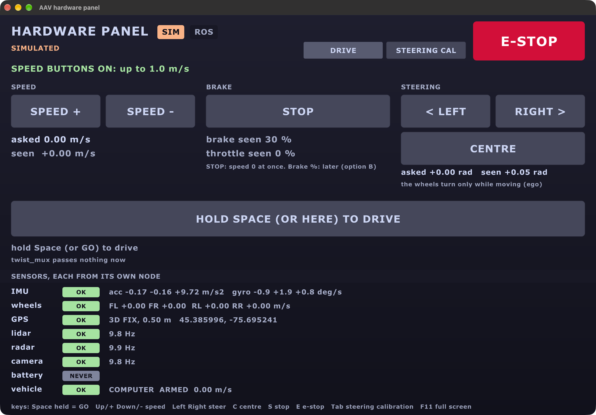

Its second page, **STEERING CAL**, is [below](#steering-find-the-ends-and-the-centre).

### The cockpit: the Drive screen

Every driving detail on one screen (Ben, 3 Nov: "the gazeboo with nav2 selection with
cubes and stuff all as a single screen"): both cameras, the status lights, the street
map, the 3D view with the cubes, the plan and **each localizer**, the speed and steering
plots, and a new **Algorithms** table: which planner, path follower and localizers this
run uses. Live in Gazebo's test lot, 3 Nov:

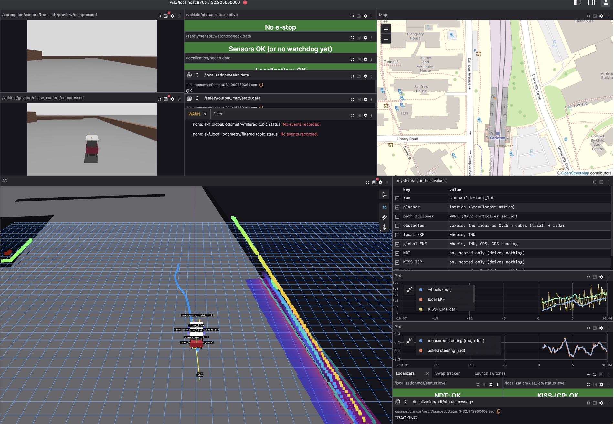

| Panel | New on 3 Nov |
|---|---|
| Algorithms | planner, path follower, obstacles, the EKFs' inputs, NDT, KISS-ICP, AMCL (`/system/algorithms`) |
| 3D | `/map`; NDT's and AMCL's poses; the EKFs' arrows and NDT's scan (scripts: not showing yet) |
| Speed plot | KISS-ICP's speed and the local EKF's beside the wheels' |
| Tabs | Localizers (NDT, KISS-ICP lights) · Swap tracker · Launch switches |

Open it, already connected: [Foxglove](foxglove.md#cockpit).

| Screen | 0.2 | 0.3 |
|---|---|---|
| **Drive** (the cockpit) | driving, Nav2, cubes, localizers, algorithms | absorbs the debug screen |
| **Hardware** (the panel) | sensors, buttons, steering's ends | stays separate |
| **HUD** and **map** | in the car | stay in the car |

### The debug screen

The lidar's cubes in 3D, where each localizer puts the car, Nav2's own cubes and the
localization health checks. Live against Gazebo, in the new colours:

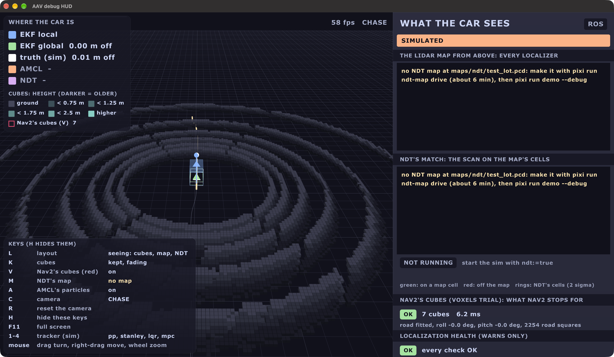

### The screens: new colours

Ben, 1 Nov: "kind of ugly", too many primary colours. Then, 2 Nov: "something nicer
than Catppuccin": **Initial D red and black, on every screen**. Every screen shares one
theme, chosen in its yaml (`theme:`):

| Theme | For |
|---|---|
| `initial_d` (the default) | the car, day or night: black, white, Carleton's red; sharp |
| `mocha` | dark and soft: night |
| `latte` | light: daytime |
| `calm` | Ben's colours from his Carleton work: **waits on Ben** |

| Initial D | Light (Latte) |
|---|---|
| 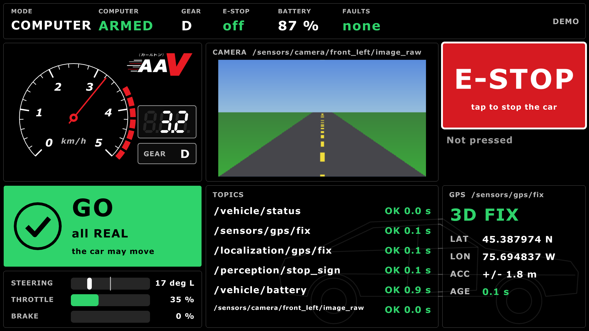 | 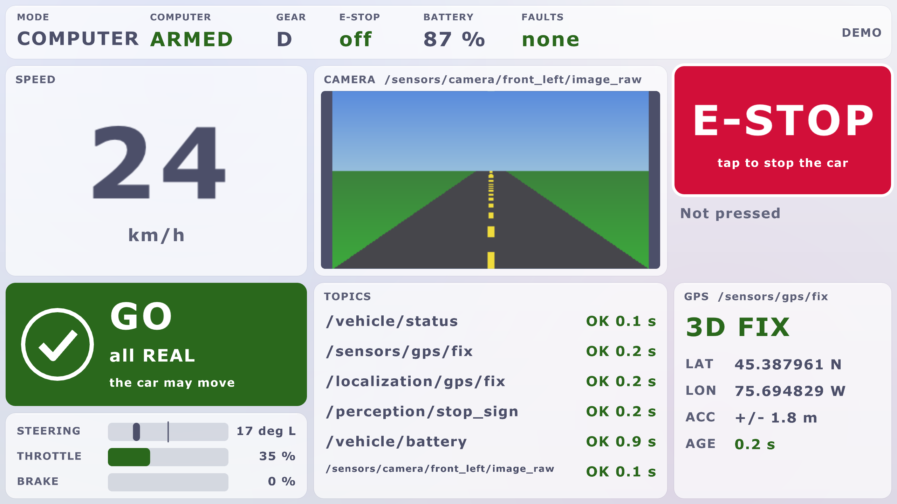 |
| 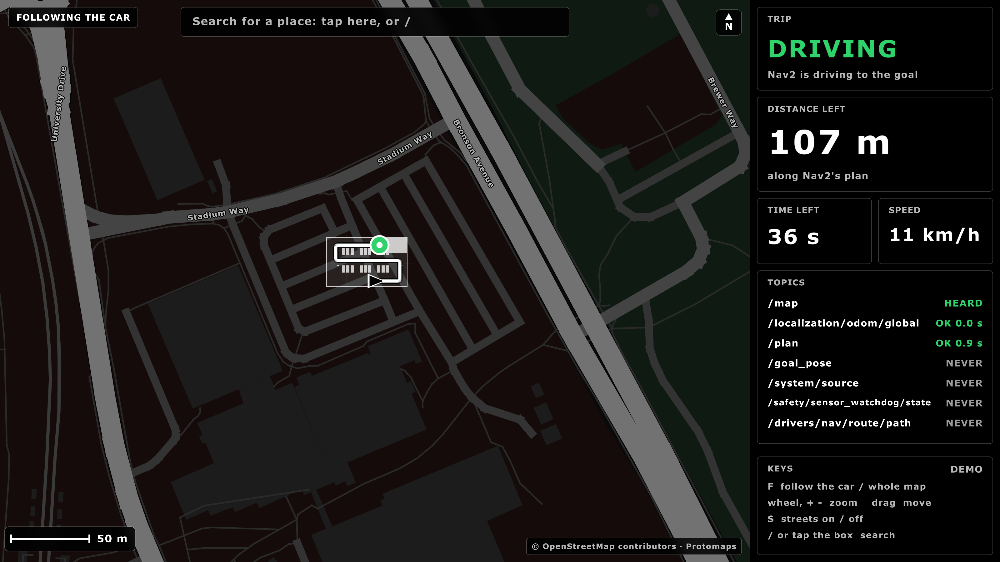 | 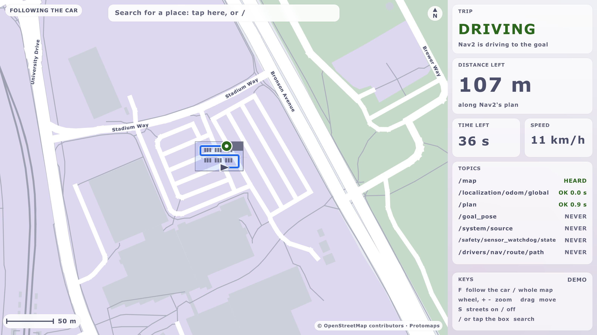 |
| 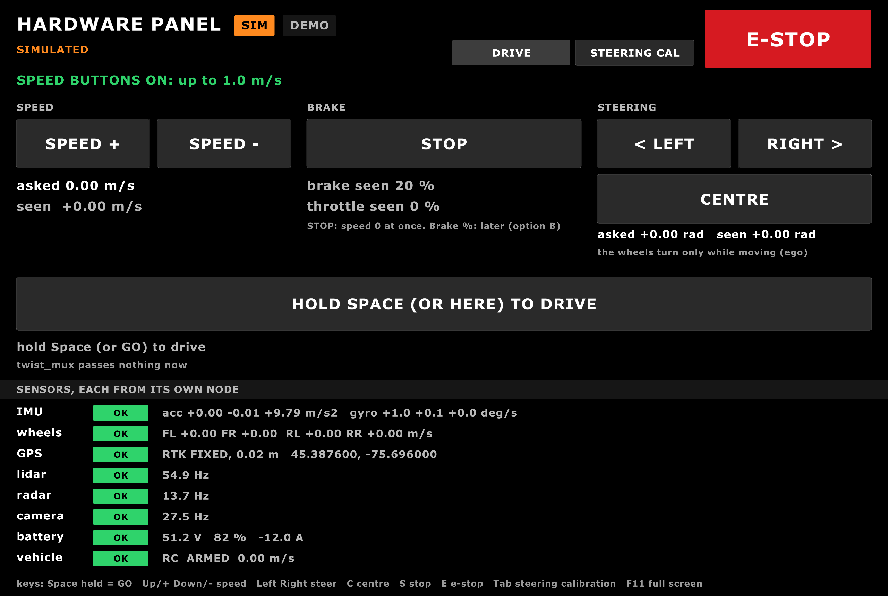 | 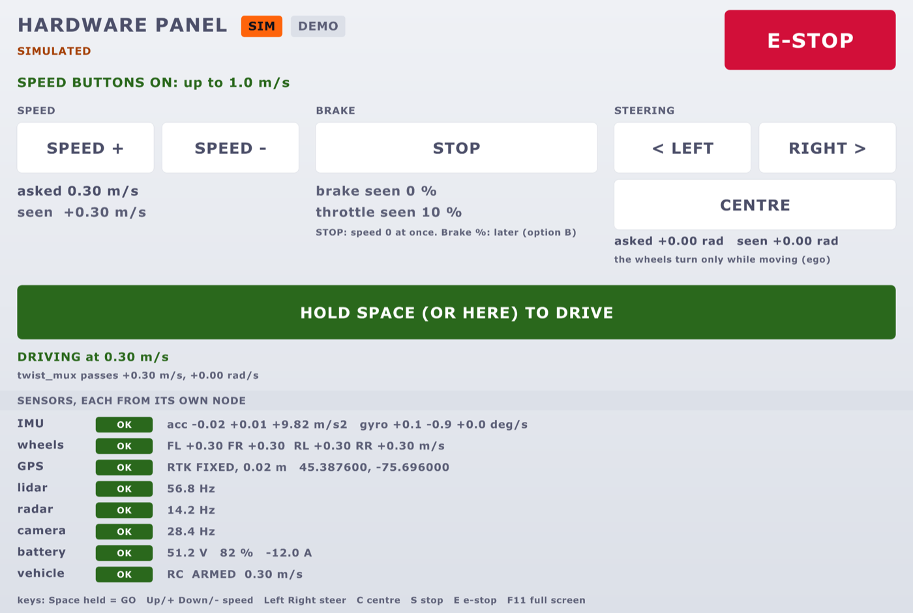 |

Mocha and Latte are Catppuccin's palettes, MIT licence. More:
[Screens](hud.md#themes-the-screens-colours).

### The little robot

A tribute to WALL-E, drawn by us: a boxy robot on treads, with two big round eyes.

| Where | What it does |
|---|---|
| Map window (`car_marker: robot`) | the car is the robot, seen from above; its treads cover the car's true outline |
| Hardware panel, debug screen | after 60 s of quiet, the eyes peek over the bottom edge and blink |
| Hardware panel | it drives across at start-up, and after a lock-to-lock check passes |

| On the map | Peeking |
|---|---|
| 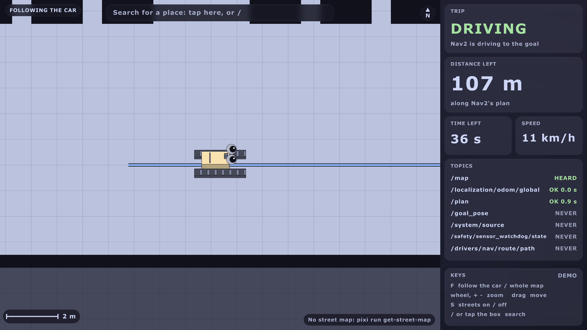 | 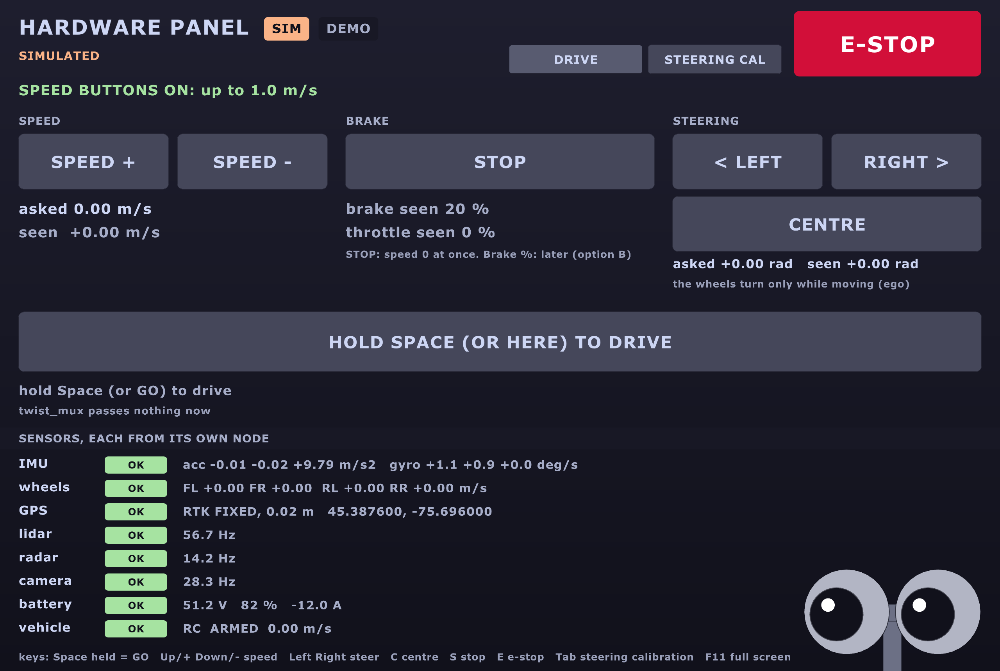 |

It never covers a button or a line of words, and never shows while the car moves or
anything warns. Turn it off with `easter_egg: false`. More:
[Screens](hud.md#the-little-robot-easter-egg).

## Steering: find the ends and the centre

The steering pulls right: its centre is probably off. 0.2 can measure the steering
actuator's two ends and its centre, then set **equal limits** on both sides.

```text
  laptop (hardware panel)  ──►  Orin bridge  ──►  ESP32  ──►  steering actuator
       GO LIMP / STEP          link version 3     limp, or       (Jrk G2 board)
       MARK left/centre/right                     small steps
       ◄── the raw position (counts), 10 times a second ──┘
```

| Step | What you do | What it does |
|---|---|---|
| 1 | **GO LIMP** | the motor lets go; you turn the wheels by hand |
| 2 | or **STEP LEFT / RIGHT** | small steps, inside today's limits |
| 3 | **MARK** left, centre, right | it works out equal limits: the smaller side less 5 % |
| 4 | **LOCK-TO-LOCK CHECK** | slowly centre → left → centre → right → centre; **stops and holds** at any resistance |
| 5 | **SAVE** | writes the numbers to a file; a person copies them in a pull request |

| Passed | Stopped on a stiff spot |
|---|---|
| 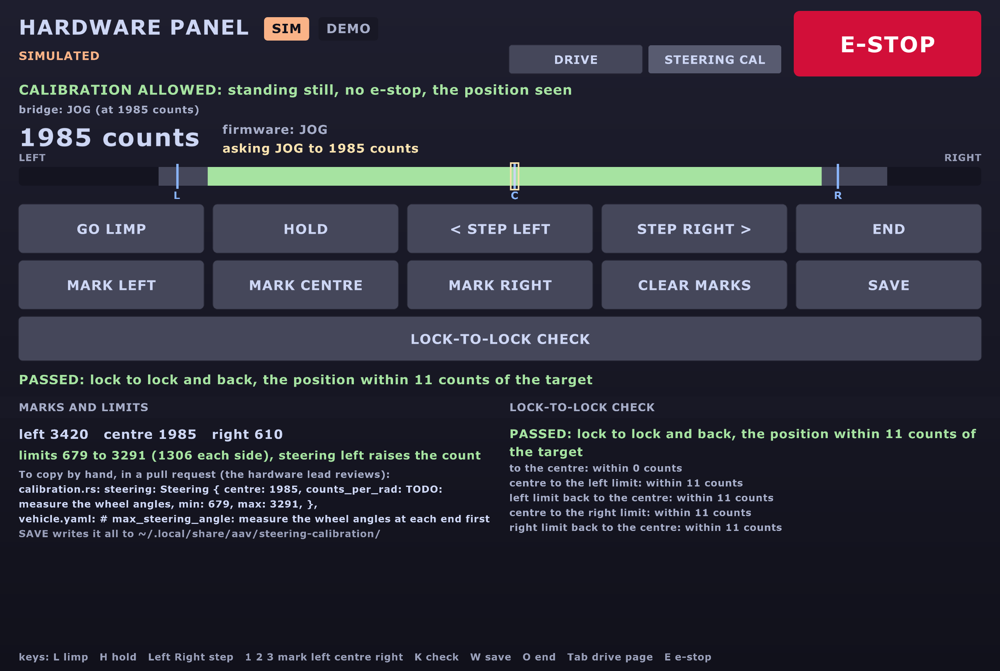 | 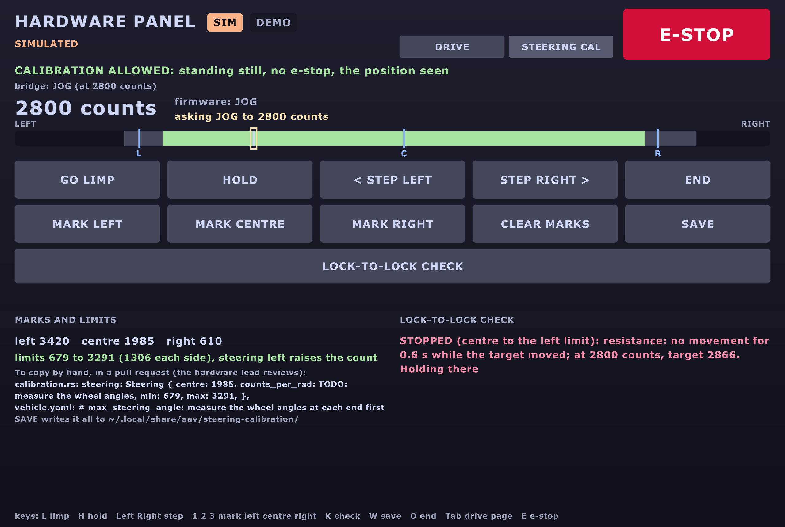 |

**The safety rules,** in the firmware and tested:

| Rule | Why |
|---|---|
| Only while stopped, with the brake on | nothing else may move |
| Throttle held at zero | the same |
| Leaving limp holds where the wheels are | nothing snaps back |
| The Orin's heartbeat lost → calibration ends | a dropped laptop is safe |
| Never writes the firmware or `vehicle.yaml` | a person checks the numbers |

On car day the first way is **Pololu's own program** over USB (Way A): today's C++
firmware can't do this. The panel's page (Way B) comes once the Rust firmware with link
version 3 is on the car. More: [Actuator tests](actuator-tests.md).

## Car day, in two days

Three reviewers read the plan and said: don't destroy the way back before the car has
moved on our code. Ben agreed.

| Day | What | Can you undo it? |
|---|---|---|
| **Day A** | back up every machine (checked); steering ends (Way A); brake on stands; the Rust ESP32 and the joystick on stands; walking pace once a named person signs; the car tests and the map | yes: nothing destroyed |
| **Day B** (later) | the Pis to Ubuntu 24.04; the Orin reflashed to JetPack 7.2; the lab desktop | only from the backups, so a restore is proven first |

Every step you can't undo has a **sign-off line** (who, time). The people:

| Role | Does |
|---|---|
| Hardware lead | decides on the hardware; OKs the ESP32 flash |
| E-stop person | holds the Kar-Tech stop, always |
| Safety driver | in the seat |
| Laptop person | runs the commands |
| Approver | signs the steps you can't undo |

The runbook: [Car day](car-day.md). Setting up one computer: [Car setup](car-setup.md).

### `car_setup.sh`: one computer at a time

| It does | Safe because |
|---|---|
| back up, upgrade, install, start at boot, check | it only prints the steps unless given `--apply` and the role typed in |
| `do-release-upgrade` (Ubuntu 22.04 → 24.04) | only with `--release-upgrade`; never on Pi OS or the Orin |
| STOPs | a pending reboot, the wrong computer, an upgrade too early |

### Know the car

Tests that measure the car, so each drive makes it more exact. Each fixes one number in
`vehicle.yaml`; repeat until the error is small.

| Test | Fixes |
|---|---|
| Drive 10 m straight, tape it | the wheel size (today 0.36 m or 0.42 m: a 17 % speed error) |
| Speed step, 0 → 1 m/s | how fast it speeds up |
| Brake from 1 m/s | stopping distance |
| Coast down | drag |
| A circle at a fixed steering angle | steering gain and centre |
| Lock to lock | the steering limits |

Record every session with the lidar on (`tools/record.sh --lidar`): the same drives build
the lot's NDT map. More: [Know the car](know-the-car.md).

## How the car thinks: the algorithms

The same stack as in What's new. In plain words:

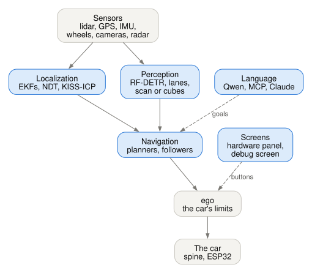

### Where am I? (localization)

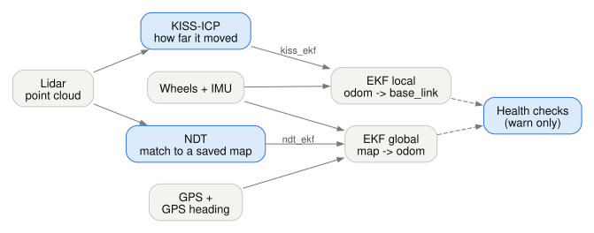

| Part | In plain words | Default? |
|---|---|---|
| **EKF local** | blends the wheels and the IMU: smooth, never jumps, drifts slowly | yes |
| **EKF global** | adds the GPS (and NDT): knows where on the map, may jump a little | yes |
| **NDT** | matches the lidar's points to a saved map of the lot: "I'm here" | trial (`ndt_ekf:=true`) |
| **KISS-ICP** | matches each lidar scan to the last one: "I moved this far" | trial (`kiss_ekf:=true`) |

**Why two EKFs?** They do talk, through TF. The GPS only goes into the global one, so the
car's short-term motion never jumps when a GPS fix lands (ROS's REP-105).

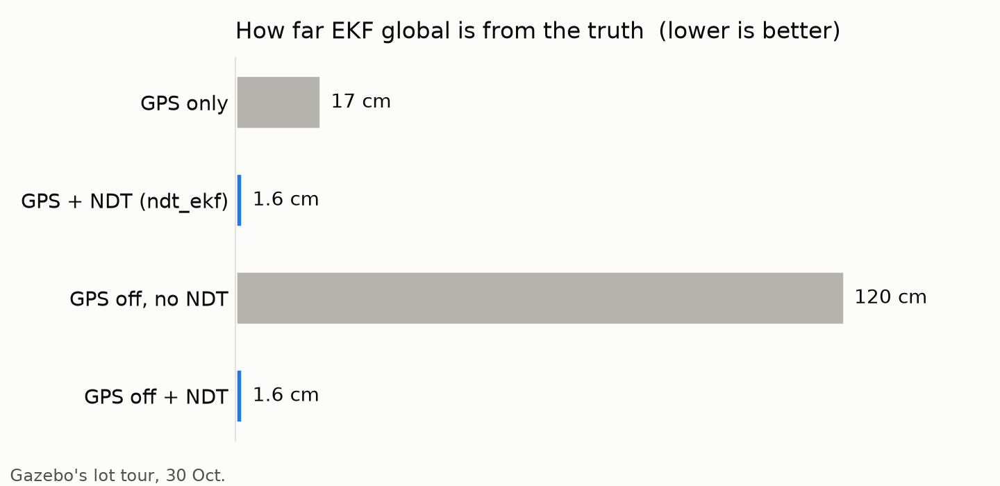

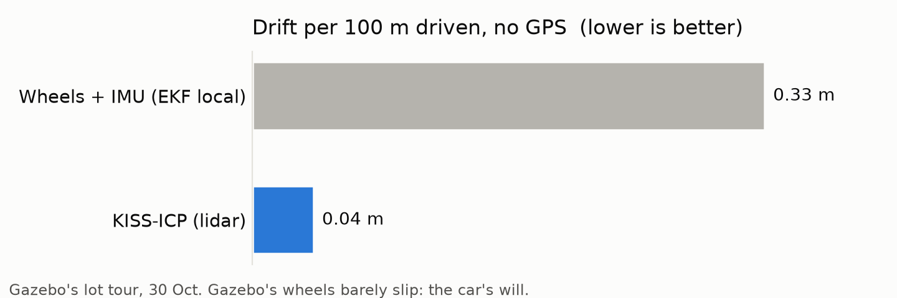

### What's around? (perception)

| Part | In plain words |
|---|---|
| **RF-DETR Nano** | finds objects and stop signs in the camera (Apache-2.0, not YOLO) |
| **OpenCV lanes** | finds the lane lines |
| **Lidar scan or cubes** | turns the lidar's points into a flat scan, or into 3D cubes, for Nav2 |

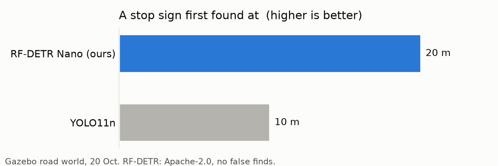

### Getting there: planners and path followers

A **planner** draws the path; a **path follower** steers along it.

| Part | In plain words | Default? |
|---|---|---|
| **State Lattice** | joins short moves the car can really make, forwards and backwards | yes, where it may reverse |
| **Hybrid-A*** | searches forward moves only | yes, forward only |
| **MPPI** | tries hundreds of short futures, keeps the best; reads the costmap | yes |
| **RPP** (Regulated Pure Pursuit) | aims at a point ahead on the path, slows in bends | trial |

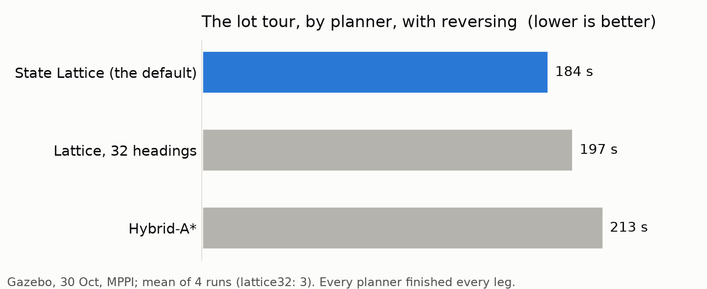

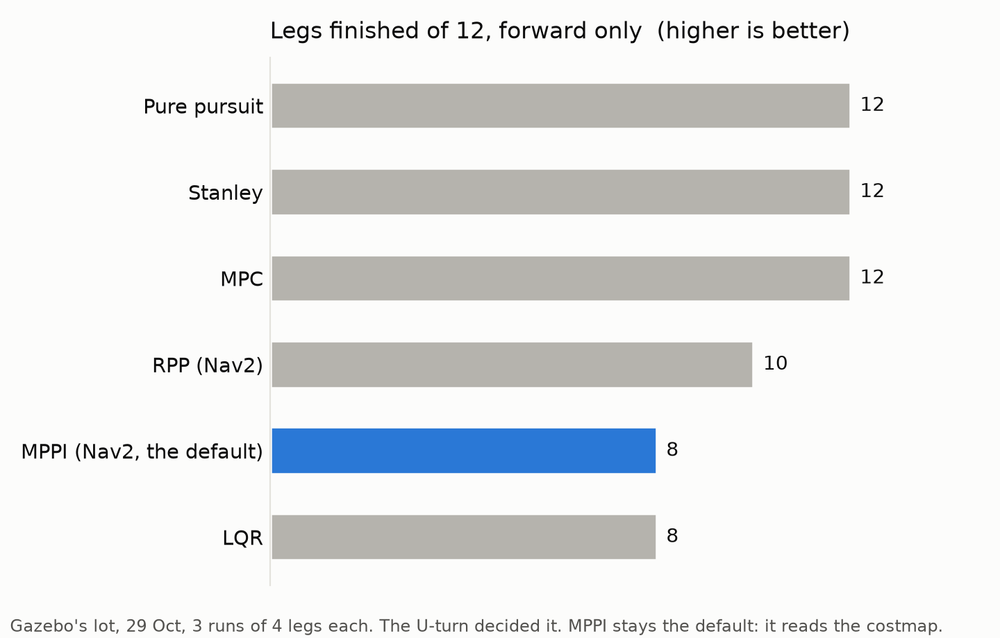

### Trial: the diffusion planner

A small model that turns random noise into a path in a few steps, and offers 16 paths at
once. Ben, 2 Nov: "Put it in 0.2". It's in, as a trial, off by default; the car refuses it.

| Question | As built (2 Nov) |
|---|---|
| Where it plugs in | one more planner, `planner:=diffusion`, beside the lattice |
| What keeps it safe | every path checked (G1-G8: collisions, the car's turns, headings, time); if none pass or it's late, the lattice's path |
| What it learned from | 45,092 lattice and Hybrid-A* paths on 791 maps; 3.9 M weights, 20 min on the Mac |
| What runs it | a Python node; the model in ONNX Runtime (CPU, 75 ms) |
| Gazebo, lot tour, 2 runs | 8 of 8 legs, 178-182 s (lattice 186-188 s); 63 % of plans from the model, 37 % the lattice's |

Not a winner yet: the design asks for 90 % from the model. The U-turn is its weakest leg.
Results: [trials](trials.md#diffusion-2-nov-a-model-draws-the-lattice-guards); the design:
[Diffusion planner](designs/2026-11-02_diffusion-planner.md).

## Kept for 0.3 and later

Every idea is kept (Ben, 1 Nov: "I do like the 23 ideas? lets keep them around").

| Idea | State |
|---|---|
| **Car day itself** (0.3 = it drove) | runbook ready |
| The diffusion planner: 90 % of plans from the model, the U-turn, the Orin | trial in 0.2 |
| The talking model: explains, never drives | idea |
| **The Initial D HUD**: the arcade gauge in Carleton red and black, our own logo | in 0.2: on every screen (2 Nov) |
| The little robot on the in-car HUD | after the Initial D HUD |
| Calm colours | waits on Ben |
| The cockpit's algorithm switch; one screen from the cockpit and the debug screen | in 0.2: the cockpit shows which algorithms run (3 Nov); the switch and the debug screen's views for 0.3 |
| More hardware panel pages: measurements, joystick, the car tests | idea |
| Python speed on the Orin (the cubes to Rust if too slow) | measure on car day |
| Brake and throttle: measure, then set | after the steering |
| Day B: Ubuntu 24.04 on the Pis, JetPack 7.2 on the Orin | after a restore is proven |

The list: [TODO](../TODO.md), "0.3 and later".

## How solid is 0.2?

| | |
|---|---|
| **Solid** | every test green; every profile runs in Gazebo; the screens seen live against it |
| **Untested** | anything on the real car: the steering page, `car_setup.sh --apply`, the boot service, the joystick path |
| **Open** | the joystick-alive check on the real pad (A9b), the throttle cap, the people, the hardware lead's answers |

## The checks run for this page

Run on Ben's Mac, 2 November, for this page:

| Check | Result | What's left |
|---|---|---|
| `pixi run test` | ✅ 1516 tests, 0 failures | nothing |
| `bash tools/car_setup.sh <role>`, all six roles (dry run) | ✅ no STOP except the two planned refusals (`motor_pi` and `localization` won't upgrade yet) | nothing |
| `pixi run car-day-check` | ⬜ 7 OK, **11 missing**, 7 to tick by hand | mostly downloads not yet on this Mac: `get models`, `get mediamtx`, `esp tools`, `esp build`, `esp qemu-tools`, `esp qemu-check`, `car-day-build` (the C++ way back), `docs` (the PDF) |
| `pixi run esp qemu-check` | ⬜ skipped: the ESP32's Rust and QEMU aren't installed here | `pixi run esp tools`, then `esp qemu-tools`, then run it again |

The ESP32 tools install Espressif's Rust on the laptop, so they wait for Ben's OK.
