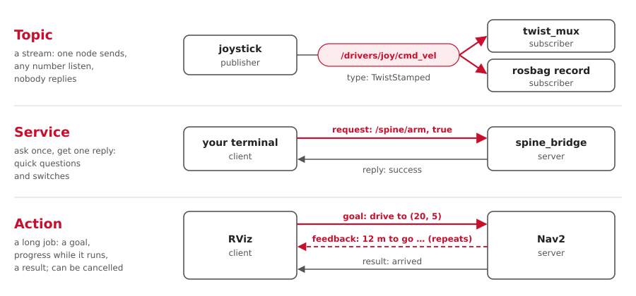

# ROS 2 in ten minutes

ROS 2 is three things: a way for programs to send each other messages, a library of
ready-made programs (Nav2, robot_localization, twist_mux …), and tools to build them and
look inside. We configure the ready-made programs, and write a few of our own.

## The three parts

| Part | What it is | Examples |
|---|---|---|
| Messaging | Programs, called **nodes**, publish typed messages on named **topics**. Any node on the network can listen. Nodes find each other by themselves. | `/cmd_vel`, `/imu/data` |
| Packages | Thousands of open-source nodes, configured with YAML | Nav2, robot_localization, twist_mux, turtlesim |
| Tools | Build, run, inspect, record and visualise | `colcon`, `ros2`, RViz, rqt, `ros2 bag` |

A ROS release is one tested set of all three. Ours is **Jazzy**, supported until May 2029.

## Three ways for nodes to talk



| Kind | Use it for | Ours |
|---|---|---|
| Topic | anything that streams: sensors, commands, state | `/cmd_vel/*`, `/vehicle/odom`, `/tf` |
| Service | a quick question, or a switch | `/spine/arm`, `/fromLL` |
| Action | a job that takes seconds, with progress, and can be cancelled | `/scripted_drive`, `/navigate_to_pose` |

## The other words

| Word | Means | A bit like |
|---|---|---|
| Message type | the struct on a topic, defined in a `.msg` file | a struct every language shares |
| Parameter | a node's settings, loaded from YAML when it starts | command-line flags |
| Launch file | a Python script that starts a set of nodes with their settings | `docker compose` |
| TF | where every frame (`map`, `odom`, `base_link`, `imu_link`) sits, over time | a scene graph |
| QoS | delivery rules per topic. Mismatched rules mean no connection, and no error. | TCP vs UDP |
| Domain ID | computers with the same `ROS_DOMAIN_ID` see each other | a radio channel |
| Bag | a recording of topics, to play back later | a flight recorder |

## Building: packages, colcon, ament

| ROS | What it does | In Cargo terms |
|---|---|---|
| Package | the unit ROS builds; `package.xml` lists its dependencies | a crate and its `Cargo.toml` |
| Workspace | a folder of packages built together. This repository is one. | a Cargo workspace |
| `colcon build` | builds every package in dependency order, in any language | `cargo build --workspace` |
| ament | the build rules underneath: `ament_python` (setuptools) or `ament_cmake` (CMake) | the build backend |
| `source install/setup.bash` | puts our built packages on the path | adding `target/` to `PATH` |
| pixi | installs ROS itself and every dependency, into this folder | `rustup`, for the whole toolchain |

## Stock packages vs our nodes

| | Stock: we configure | Ours: we write |
|---|---|---|
| Examples | Nav2, robot_localization, twist_mux, joy, teleop, turtlesim | ego, `scripted_driver`, `spine_bridge`, the turtlesim and Gazebo adapters |
| We change | YAML files and launch files | Python code |
| Rule | use these first | only for glue that's specific to our car |

## Adding a node, in five steps

1. Pick the layer's folder, for example `src/drivers/`.
2. Make a Python package: `package.xml` for the dependencies, `setup.py` for the entry
   point.
3. Put the logic in a plain module with no ROS imports, and test it. A thin node file
   does the publishing and subscribing.
4. Add its topics to `docs/interfaces.yaml`, and the node to a launch file.
5. Run `pixi run build`, start it, and check it with `pixi run check`.

A complete driver that circles left:

```python
import rclpy
from rclpy.node import Node
from geometry_msgs.msg import TwistStamped

class Circle(Node):
    def __init__(self):
        super().__init__('circle_driver')
        self.pub = self.create_publisher(TwistStamped, '/cmd_vel/scripted', 10)
        self.create_timer(0.1, self.tick)        # ten times a second

    def tick(self):
        msg = TwistStamped()
        msg.header.stamp = self.get_clock().now().to_msg()
        msg.twist.linear.x = 0.5                 # m/s forward
        msg.twist.angular.z = 0.2                # rad/s, left
        self.pub.publish(msg)

rclpy.init()
rclpy.spin(Circle())
```

## Looking inside a running system

| Command | Shows |
|---|---|
| `ros2 node list`, `ros2 node info /ego` | what's running; a node's topics and settings |
| `ros2 topic echo /cmd_vel`, `ros2 topic hz /imu/data` | the messages on a topic; how often they come |
| `ros2 param dump /ekf_local` | every setting a node is really using |
| `pixi run graph` (rqt_graph) | nodes and topics as a live diagram |
| `rqt_tf_tree` | the frame tree, and who publishes each link |
| `pixi run view` (RViz) | the 3D view: the car, the map, costmaps, the path |
| Foxglove | RViz and rqt in one app; good over WiFi (`ws://<computer>:8765`) |
| `pixi run check` | the live graph against our contract, `docs/interfaces.yaml` |
