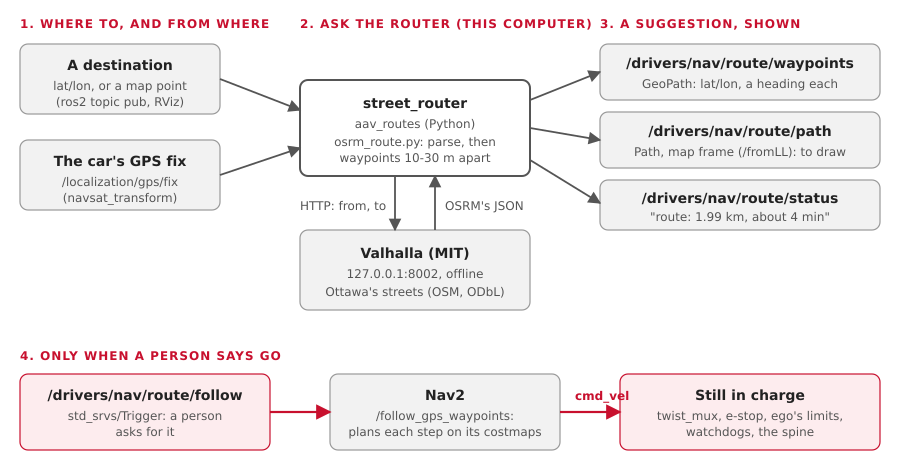

# Street routes (PLAN S8)

Pick a destination, get the way there **along real streets**, and hand it to Nav2 as GPS
waypoints. Built 16 October.

!!! warning "For real streets later: the lot first"
  This is for driving on streets, after the car has proven itself in a lot (PLAN C8, C9).
  A route is only a **suggestion**. Nav2 still plans every step on its own costmaps, and
  twist_mux, the e-stop, ego's limits and timeout, the sensor watchdog and the spine stay
  in charge. Nothing goes to Nav2 until a person asks.

## The picture



| Step | Who | What |
|---|---|---|
| 1 | you | a destination: lat/lon on `/drivers/nav/route/destination`, or a map point on `/drivers/nav/route/goal` |
| 2 | `street_router` | asks the router for the way from the car's newest fix (`/localization/gps/fix`) |
| 3 | Valhalla | answers in OSRM's JSON, offline, from Ottawa's OpenStreetMap |
| 4 | `street_router` | cuts it into waypoints 10-30 m apart; publishes them, a map path, and a status line |
| 5 | you | `/drivers/nav/route/follow`: only now does Nav2 get the route (`/follow_gps_waypoints`) |

## Which router? (the survey)

| Router | Licence | Runs offline on a Mac, Linux, the Jetson? | Graph for Ottawa | Its answer |
|---|---|---|---|---|
| **Valhalla** (picked) | MIT | **yes, all three, no compiling**: the `pyvalhalla` wheel (Mac arm64, Linux x86_64 and aarch64) carries `valhalla_build_tiles` and `valhalla_service`. Not Intel Macs | 59 MB of tiles, built in **5 s** on an M-series Mac | its own JSON, **or OSRM's** (`"format": "osrm"`) |
| OSRM | BSD-2 | Mac: Homebrew. Linux: Docker or build it (C++, Boost). Jetson: build from source | three steps: extract, partition, customize | OSRM's JSON |
| GraphHopper | Apache-2.0 | needs Java 17+ (conda-forge's openjdk is 190 MB) and a 40 MB jar | one import step, at start-up | its own JSON |

**Why Valhalla:** it's the only one that installs through Pixi on every machine we have,
the Jetson too, with nothing to compile. Its graph builds in seconds. It speaks OSRM's
format, so our parser reads OSRM too: switch with `router: osrm` if a team ever runs one.

Checked 16 Oct: the same route from both, Carleton to Lansdowne. Valhalla: **1986.9 m**.
OSRM's public demo server, asked once by hand: **1986.4 m**, the same shape.

## Run it

```bash
pixi run -e routes get-routes    # once: Ottawa (50 MB, BBBike), then the graph
pixi run -e routes router        # the router, on 127.0.0.1:8002 (keep it running)
pixi run build
tools/ros.sh ros2 launch aav_routes street_router.launch.py
```

Ask for a route, then send it:

```bash
tools/ros.sh ros2 topic pub --once /drivers/nav/route/destination \
  geographic_msgs/msg/GeoPointStamped "{position: {latitude: 45.3983, longitude: -75.6838}}"
tools/ros.sh ros2 topic echo --once /drivers/nav/route/status
tools/ros.sh ros2 service call /drivers/nav/route/follow std_srvs/srv/Trigger
```

| Where the data goes | Size | In git? |
|---|---|---|
| `maps/routes/download/Ottawa.osm.pbf` | 49 MB | no (`/maps/` is ignored) |
| `maps/routes/tiles/` | 59 MB | no |
| `maps/routes/valhalla.json` | 10 kB | no: `get-routes` writes it |

`ROUTES_DIR=/elsewhere` puts it all somewhere else; `ROUTES_PBF=file.osm.pbf` uses your
own extract (Geofabrik's Ontario, 1 GB, for a bigger area).

## The parts

| Part | File | Does |
|---|---|---|
| The logic, no ROS | `ros/drivers/aav_routes/aav_routes/osrm_route.py` | the request (Valhalla or OSRM), the answer (GeoJSON or an encoded polyline), the waypoints |
| The node | `aav_routes/street_router.py` | the fix, the destination, the router over HTTP, `/fromLL`, `/toLL`, the follow service |
| Its settings | `config/street_router.yaml` | router URL, spacing, `max_length` |
| The map window | `aav_hud_raylib` (Rust) | draws `/drivers/nav/route/path` in violet, under Nav2's blue plan |
| The tasks | `tools/get_routes.sh`, `tools/router.sh` | download and build; start the router |

The waypoints reuse the HUD's tested route code (`aav_hud/route.py`): bends kept,
headings along the street. Ours adds the gaps Nav2 needs:

| Setting | Default | Why |
|---|---|---|
| `min_spacing` | 10 m | Nav2 slows at each waypoint: not too many |
| `max_spacing` | 30 m | each goal stays near the car, inside Nav2's costmaps |
| `tolerance` | 1 m | a bend may be cut by this much |
| `max_length` | 3000 m | longer routes are refused: the lot first |
| `fix_max_age` | 2 s | no fresh GPS fix, no route |
| `follow_at_once` | false | true sends every route to Nav2 by itself: not on the car |

## Topics

| Name | Type | |
|---|---|---|
| `/drivers/nav/route/destination` | `geographic_msgs/GeoPointStamped` | in: where to go |
| `/drivers/nav/route/goal` | `geometry_msgs/PoseStamped` (map) | in: where to go, as a map point |
| `/drivers/nav/route/waypoints` | `geographic_msgs/GeoPath`, latched | out: the GPS waypoints |
| `/drivers/nav/route/path` | `nav_msgs/Path` (map), latched | out: the route, to draw |
| `/drivers/nav/route/status` | `std_msgs/String`, latched | out: "route: 1.99 km, about 4 min..." or why not |
| `/drivers/nav/route/follow` | `std_srvs/Trigger` (a service) | a person sends the route to Nav2 |

Full contract: [Topics](interfaces.md).

## What was tested (16 October, a Mac)

| What | Result |
|---|---|
| `osrm_route.py` unit tests: 27, on three recorded answers (Valhalla polyline6 and GeoJSON, OSRM's demo) and an error | all pass |
| `street_router` with a fake router, fake `/fromLL` and fake Nav2 (`colcon test`): 4 | all pass; nothing reaches Nav2 before `follow` |
| `get-routes` on this Mac | 49 MB download, graph in 5 s |
| A real route, Carleton (45.3876, -75.6960) to Lansdowne | 1.99 km, 4 min, 76 waypoints |
| Gazebo, headless, `empty` world, private domain: a street 80 m south of the datum | the car drove it and stopped **0.5 m** from the route's end, in 140 s |
| `map-core` test: a street route is shown, never treated as the plan | passes |

!!! note "Gazebo, 16 Oct"
  Valhalla snapped the car (at the datum) to the nearest street, 30 m west: its
  line at x = -29.6 m, and routed 80 m south along it: 3 waypoints. The map path came back
  through the sim's `/fromLL` at (-29.6, -0.3) to (-28.9, -80.2). After `follow`, Nav2
  drove to the street, then down it (x stayed within 1 m of -29), and arrived 0.5 m from
  the end. Gazebo's empty world has no streets drawn: the car drove on open ground.

| Not tested yet | Why |
|---|---|
| The map window drawing the route | the window couldn't open from this session (as for the watchdog banner, [HUD](hud.md)); its logic has a test |
| `/drivers/nav/route/goal` with the real `/toLL` | only the lat/lon destination was driven |
| On the car, on the Jetson, on Linux | not yet; the wheel exists for both |
| OSRM run locally | only its demo server's one recorded answer |

## Things to know

- **Valhalla prints errors while building** about countries ("NOT NULL constraint
  failed... Finland"). Harmless: a city extract has no country boundaries.
- **`driving_side: "left"`** in Valhalla's OSRM answers, even in Ottawa. We don't read it.
- The router's time is for **a normal car** on the speed limit, not ours (1 m/s to start).
- Nav2 drives to each waypoint in turn and slows at each: that's why they're 10-30 m apart.
- The data: © OpenStreetMap contributors, ODbL. BBBike's extract changes every week, so
  `get-routes` checks it against BBBike's own checksum, not a fixed one.
- **No older code copied.** The 2025-26 team's Navigation-LocalPathGenerator read OSRM
  routes too, and followed them itself ([Older code](older-code.md)). Here Nav2 follows,
  so only a small parser was needed: written new, with tests.
- No API keys, no paid service. A public demo server only for a one-off check by hand,
  never as the default.
