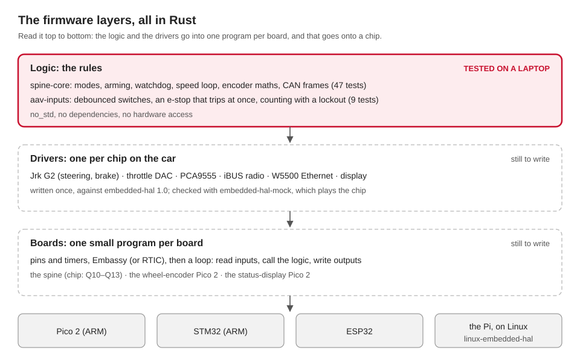

# Rust on the hardware

Ben's direction (10 October 2026): write the firmware and the hardware drivers in Rust,
not C or C++, even where the ROS nodes above stay in Python. The 2025-26 C++ firmware keeps
running today's car until a Rust version replaces each board. This page is the plan, and
what's done so far.

## Why Rust at this level

| Reason | What it means here |
|---|---|
| The same code on the chip and on a laptop | the logic is plain `no_std` Rust, so `cargo test` checks it on any laptop, with no board |
| Mistakes caught when it compiles | no stray pointers, no data races between an interrupt and the main loop |
| One driver for every board | a driver written against `embedded-hal` runs on an ESP32, a Pico, an STM32, and on the Pi under Linux |
| The spine is already Rust | `spine-core`: modes, arming, the watchdog, the speed loop, the CAN frames (54 tests), the drivers for its devices, and a board program for a Pico 2 |

## What runs where

| Hardware | Runs | Rust there |
|---|---|---|
| ESP32, Pico 2 (RP2350), STM32, Arduino | bare metal: no operating system | a HAL for the chip, plus a small framework (below) |
| Raspberry Pi, Jetson Orin | Linux | ordinary Rust programs; drivers reach the pins through `linux-embedded-hal` (or `rppal` on a Pi) |
| Laptops | macOS or Linux | the tests, and the simulated hardware |

Bare metal on a Pi is possible, but it gives up Linux, ROS and the Pi's drivers. The Pi
stays on Linux.

## The layers



| Layer | What it is | Where | Tested by |
|---|---|---|---|
| Logic | the rules: modes, limits, debouncing, the encoder maths; the wheel encoder's packet; the status display's pages | `spine-core`, `aav-inputs`, `wheel-encoder`, `sentinel` | `cargo test` on a laptop |
| Drivers | one per chip on the car: the Jrk G2 motor controllers, the throttle DAC, the PCA9555 expander, the iBUS radio receiver, the MCP2515 CAN controller, the display's LCD | `jrk-g2`, `ad5311`, `pca9555`, `ibus`, `mcp2515`, `hd44780`, written against `embedded-hal` 1.0. Stock ones where they fit: `embassy-net-wiznet` (the W5500), `max7219` (the 8x8 matrix) | `embedded-hal-mock`, or a fake, which plays the chip on a laptop |
| Glue | spine-core's outputs to the devices, the devices to its inputs, in a safe order | `spine-board`, with a `Board` trait for what each chip must provide | `embedded-hal-mock` |
| Boards | one small program per board: pins, timers, the framework, then a loop that calls the glue | `firmware/spine/boards/`: `pico2` (the spine, for the bench), `wheel-encoder-pico2`, `sentinel-pico2` (below) | they build in `pixi run test`; the rest on the bench, then on the car |

`firmware/spine/` is the Cargo workspace for the crates. Each board program in
`firmware/spine/boards/` is a workspace of its own: it builds only for its chip, with that
chip's HAL.

## The framework: the "RTOS" part

| Choice | What it is | Good for |
|---|---|---|
| **Embassy** (used) | an async framework for microcontrollers: tasks, timers, drivers that wait without blocking. The usual choice for new Rust projects in 2026 | every board here; it supports the RP2350, the ESP32 family (with `esp-hal`) and STM32. The Pico 2 program uses it |
| RTIC 2 | interrupt-driven tasks with fixed priorities, for hard real-time | Cortex-M chips (Pico 2, STM32), if a timing need appears that Embassy can't meet |
| FreeRTOS, through ESP-IDF | Espressif's operating system, with Rust's standard library | ESP32 projects that need its WiFi and web stacks |
| A plain loop | read, call the logic, write, repeat | the simplest boards |

## The spine on a Pico 2 (11 Oct)

`firmware/spine/boards/pico2` runs `spine-board` and `spine-core` on a Raspberry Pi Pico 2,
with Embassy 0.10. It talks plain CAN to `spine_bridge` through an MCP2515 module. It is
for the bench: the car's chip is still Q10–Q13. [[untested]] on a real Pico 2.

| Part | How |
|---|---|
| The spine's loop | `SpineBoard::tick` every 10 ms |
| CAN | the MCP2515 on SPI, 500 kbit/s, polled each tick; tried again every second while it doesn't answer |
| Steering, brake, throttle, direction | the two Jrk G2s, the DAC and the PCA9555 on one I2C bus |
| The RC receiver | iBUS on a UART; an interrupt fills a buffer, so no byte is lost while a tick waits on I2C |
| The wheel | two spoke sensors, read every millisecond by a task that interrupts the loop |
| Arming, the 200 ms command watchdog | `spine-core`, as on the bench: it boots latched, and drives only once ROS disarms, then arms |
| The chip's own watchdog | fed after every tick: a hang or a panic resets the chip within 100 ms, into the safe state |

Size: 60,164 bytes of flash (of 4 MB) and 2,796 bytes of fixed RAM (of 512 kB).

### The pin map

The one list of the Pico 2's pins. `src/main.rs` assigns them in this order: change both
together.

| Pin | GPIO | Signal | Goes to | Notes |
|---|---|---|---|---|
| 21 | GP16 | SPI0 RX | MCP2515 SO | 4 MHz SPI |
| 22 | GP17 | chip select | MCP2515 CS | |
| 24 | GP18 | SPI0 SCK | MCP2515 SCK | |
| 25 | GP19 | SPI0 TX | MCP2515 SI | |
| — | — | — | MCP2515 INT | not wired: the program polls the chip |
| 6 | GP4 | I2C0 SDA | both Jrk G2s, the DAC, the PCA9555 | 100 kHz, as today. Pull-ups to 3.3 V |
| 7 | GP5 | I2C0 SCL | the same four | |
| 12 | GP9 | UART1 RX | the FlySky receiver's iBUS output | 115200 baud, receive only |
| 20 | GP15 | e-stop input (pull-up) | a spare, normally closed contact of the red e-stop, to ground | high = pressed, or the wire cut. Read only |
| 14 | GP10 | wheel sensor A (pull-up) | the first spoke sensor | counts on its rising edge |
| 15 | GP11 | wheel sensor B (pull-up) | the second spoke sensor | gives the direction (Q5) |
| — | GP25 | the board's LED | | what it says: below |
| 36 | 3V3 OUT | 3.3 V | a 3.3 V MCP2515 module, the I2C pull-ups | |
| 3, 8, 13 … | GND | ground | every module's ground | one common ground |
| — | USB | power | a laptop, on the bench | |

### Wiring rules

- **The e-stop (decided, Ben).** The red button always stops the car, whatever the
  program does. It stays wired as it is. The spine only reads a spare contact, and tells
  ROS. Nothing of the spine's is in the button's path, and no output is in series with it.
- **The MCP2515 module.** Use one made for 3.3 V, such as an MCP2515 with an SN65HVD230.
  The common blue module (with a TJA1050) runs at 5 V, and its SPI levels don't suit the
  Pico 2's 3.3 V without changes. Which module the team has: untested.
- **5 V signals.** The Pico 2's pins take 5 V only while the Pico 2 is powered. Pull the
  I2C bus up to 3.3 V, not 5 V.
- **The crystal.** Read the can on the MCP2515 module: "8.000" or "16.000". Set
  `CAN_CRYSTAL` to match (it is 8 MHz now).

### Settings

In `firmware/spine/boards/pico2/src/main.rs`. The three choices the team still has to
make are in `spine-core` (`firmware/spine/README.md`).

| Constant | Set to | Change it when |
|---|---|---|
| `CAN_CRYSTAL` | `Crystal::MHZ_8` | the module's crystal is 16 MHz |
| `CAN_MODE` | `Mode::Normal` | `Mode::Loopback` checks the SPI wiring with no bus at all |
| `ESTOP_OPEN` | `Level::High` | the spare contact turns out normally open (Q6) |
| `TICK`, `WATCHDOG` | 10 ms, 100 ms | only with the team: `spine-core` expects them |

### Build and flash

Everything is in Pixi; nothing to install by hand.

| Step | Command | What happens |
|---|---|---|
| 1. Build | `pixi run spine-uf2` | builds the program, and writes `firmware/spine/boards/pico2/spine-pico2.uf2` |
| 2. Flash, with a USB cable | hold BOOTSEL, plug the Pico 2 in, let go | a drive called RP2350 appears: copy the .uf2 onto it. The Pico 2 restarts into the spine |
| or 2. Flash, with a debug probe | `pixi run spine-tools` (once), then `pixi run spine-flash` | flashes through the probe, then prints the program's logs |

- The UF2 file comes from `tools/elf2uf2.py`. It uses the RP2350's family ID
  (`rp2350_arm_s`, datasheet 5.5.3) and refuses a program without its IMAGE_DEF block in
  the first 4 kB, or the boot ROM wouldn't start it (5.9.5). `pixi run test` checks the
  real program each time.
- `spine-tools` installs probe-rs 0.32.0 into `vendor/cargo-tools/bin` (about a minute).
  A probe: the Raspberry Pi Debug Probe, or a second Pico running `debugprobe`, on the
  Pico 2's SWD pins. On Linux, probe-rs needs its udev rules (probe.rs, "Probe setup").
- The logs only come through a probe. With the UF2 file alone, the LED is all you see.

| The LED | Means |
|---|---|
| a slow blink: 0.5 s on, 0.5 s off | running, and CAN is up |
| a fast blink: 0.1 s on, 0.1 s off | running, but no CAN: the RC transmitter still drives, the computer can't |
| off, or on and still | not running: no program, the boot ROM (BOOTSEL), or resetting |

### What is untested

| What | Why | Next |
|---|---|---|
| Everything on a real Pico 2 | no board here; flashing waits for Ben | the bench |
| The UF2 file booting | it matches `llvm-objcopy`'s image byte for byte, and its IMAGE_DEF is checked; no boot ROM has seen it | the first flash |
| `spine-flash` | probe-rs is installed and knows the RP235x; never run with a probe | the first flash with a probe |
| The chip's watchdog reset | embassy-rp 0.10 sets the RP2040's reset bits on an RP2350, so the program sets the Pico SDK's instead (`reset_all_but_the_oscillators`) | hang the loop on purpose, on the bench |
| CAN on a real bus | needs the module, a USB-CAN adapter, and `spine_bridge` on SocketCAN (Linux) | the bench |
| I2C to the Jrks, the DAC and the expander | needs the car's boards | the bench, then the car |
| The wheel sensors | which is A, and what B's level means (Q5) | the team |
| The e-stop's spare contact | normally closed? (Q6) | the team |
| A Pico 2 that once had a partition table | an A2 chip refuses drag-and-drop then (RP2350-E10); a new Pico 2 has none | use the probe |

## The wheel encoder on a Pico 2 (15 Oct)

`firmware/spine/boards/wheel-encoder-pico2` replaces the 2025-26 C++ wheel encoder
(`Wheel_Encoders`, Arduino). Same job, same pins, same packet: the Motor Pi's
`encoder_udp` reads it unchanged. **Builds; never flashed.**

```
 IR sensor A ─┐                                         W5500 (SPI0)
 IR sensor B ─┴─> SpokeSensors ─> Reporter ─> SpokeDelta ─────────────> UDP to 192.168.1.193:10111
                  (every 1 ms)    (every 100 ms)  4 bytes, big-endian        (encoder_udp, Motor Pi)
```

| Part | How |
|---|---|
| The spokes | `wheel-encoder`'s `SpokeSensors`, the spine's own rule: a count on A's rising edge, backwards if B rose in the last 20 ms; read every 1 ms by a task that interrupts the rest |
| The packet | every 100 ms: the spokes since the last one, a big-endian int32, byte for byte the 2025-26 one |
| Proof of the format | `firmware/udp/wheel_encoder_vectors.txt`: the Rust crate and `aav_legacy`'s `encoder_counts()` both check the same 13 examples |
| Ethernet | the W5500 through `embassy-net-wiznet` 0.3 and `embassy-net` 0.9 (Embassy's IP stack); an address from DHCP |
| The chip's watchdog | 1 s, fed after each packet |

| Setting (`src/main.rs`) | Value | Same as 2025-26? |
|---|---|---|
| `MOTOR_PI` | 192.168.1.193, port 10111 | yes |
| `LOCAL_PORT` | 11101 | yes |
| `MAC` | 54:65:6d:70:65:6c ("Tempel") | yes: a DHCP reservation for it still works |
| `SEND_EVERY` | 100 ms | yes |
| `SPOKES_PER_REV` | 8 (for the logs only) | yes |

Size: 66 kB of flash, 28 kB of RAM (the network's buffers).

### Its pin map

| Pin | GPIO | Signal | Goes to | Notes |
|---|---|---|---|---|
| 4 | GP2 | sensor A | the first IR sensor | its module drives the line: no pull-up |
| 14 | GP10 | sensor B | the second IR sensor | the 2025-26 readme says "GP14"; its code says GP10 |
| 21 | GP16 | SPI0 RX | W5500 MISO | 50 MHz SPI |
| 22 | GP17 | chip select | W5500 CS | as in 2025-26 |
| 24 | GP18 | SPI0 SCK | W5500 SCK | |
| 25 | GP19 | SPI0 TX | W5500 MOSI | |
| 26 | GP20 | reset | W5500 RST | new: `embassy-net-wiznet` needs it |
| 27 | GP21 | interrupt | W5500 INT | new: the same |
| — | GP25 | the LED | on the board | a slow blink with an address, a fast one without |

WIZnet's Ethernet HAT for the Pico wires the W5500 to exactly these GPIOs. Another module
needs RST and INT wired the same way.

### Build and flash it

| Step | Command |
|---|---|
| Build | `pixi run wheel-uf2`: writes `firmware/spine/boards/wheel-encoder-pico2/wheel-encoder-pico2.uf2` |
| Flash, USB | hold BOOTSEL, plug in, drag the .uf2 onto the RP2350 drive |
| Flash, probe | `pixi run wheel-flash` (after `pixi run spine-tools` once): shows the logs too |
| Check | on the Motor Pi, `ros2 topic echo /vehicle/odom`, or stop `encoder_udp` and run a UDP listener on port 10111 |

## The status display on a Pico 2 (15 Oct)

`firmware/spine/boards/sentinel-pico2` replaces the 2025-26 C++ status display, the
"sentinel" (`AAV_cortex`, Pico SDK). Same pins, same I2C packet. **Builds; never
flashed.** Nothing in our stack writes to it yet: the 2025-26 sender isn't in any repo
(`docs/modules.md`, question 3).

```
 a computer ──I2C write, 46 bytes──> Pico 2 at 0x42 ──> sentinel crate ──> 16x2 LCD (13 pages)
                                          ^                       │──────> 8x8 matrix (MAX7219)
              knob, its switch, button ───┘                       │──────> 10-LED bar
                                                                  └──────> buzzer
```

| Part | How |
|---|---|
| The packet | `sentinel::telemetry`: 46 bytes, little-endian, `AA 01` first, an XOR checksum last; byte for byte the 2025-26 `aav_telemetry_t` |
| The LCD | an HD44780 16x2, 4-bit on six pins, through our `hd44780` crate; a line is rewritten only when it changes |
| The matrix | a MAX7219 8x8 through the stock `max7219` crate: drive mode and direction in turn, a cross for the e-stop, "!" for a lost link |
| The LED bar | the five computers and five ROS nodes that are up |
| The knob and the button | read every 1 ms, above everything else; one click is one page |
| The buzzer | its own task: a beep never holds the display up |
| The chip's watchdog | 0.5 s, fed every 5 ms loop |

Size: 67 kB of flash, 2.5 kB of RAM.

What changed from the 2025-26 one: `boards/sentinel-pico2/PROVENANCE.md`. The pages:
`firmware/spine/crates/sentinel/README.md`.

### Its pin map

| Pin | GPIO | Signal | Goes to |
|---|---|---|---|
| 1 | GP0 | I2C0 SDA | the computer that sends the packets (internal pull-up on) |
| 2 | GP1 | I2C0 SCL | the same |
| 4 | GP2 | knob CLK (pull-up) | the KY-040 |
| 5 | GP3 | knob DT (pull-up) | the KY-040 |
| 6 | GP4 | knob switch (pull-up) | the KY-040: pin the page |
| 7 | GP5 | button (pull-up) | home |
| 9 | GP6 | buzzer | an active buzzer |
| 10 | GP7 | LCD RS | the HD44780 |
| 11 | GP8 | LCD E | |
| 12, 14, 15, 16 | GP9-GP12 | LCD D4-D7 | |
| 17 | GP13 | matrix CS | the MAX7219 |
| 19 | GP14 | SPI1 SCK | the MAX7219 CLK, 1 MHz |
| 20 | GP15 | SPI1 TX | the MAX7219 DIN |
| 34, 32, 31, 29, 27, 26, 25, 24, 22, 21 | GP28, 27, 26, 22, 21, 20, 19, 18, 17, 16 | LEDs 0 to 9 | Orin, Motor Pi, Radar Pi, UI Pi, Camera Pi; IMU, radar, lidar, camera, GPS |
| — | GP25 | the LED | on while the program runs |

### Build and flash it

| Step | Command |
|---|---|
| Build | `pixi run sentinel-uf2`: writes `firmware/spine/boards/sentinel-pico2/sentinel-pico2.uf2` |
| Flash, USB | hold BOOTSEL, plug in, drag the .uf2 onto the RP2350 drive |
| Flash, probe | `pixi run sentinel-flash` (after `pixi run spine-tools` once) |
| Check | it beeps three times, then once long; the LCD says "Waiting for Pi" and the matrix smiles |

## What is untested on the two new boards

| What | Why | Next |
|---|---|---|
| Both, on a real Pico 2 | no board here | Ben, with a spare Pico 2 |
| The W5500 through `embassy-net-wiznet` | its RST and INT pins must be wired (GP20, GP21) | a WIZnet Ethernet HAT |
| DHCP and the packets reaching the Motor Pi | needs the car's network | the car |
| Sensor B on GP10 | the 2025-26 readme and code disagree | look at the board |
| The sentinel as an I2C device | embassy-rp's `I2cSlave` on an RP2350, and the sender | a Pico 2, and any I2C master (a Pi: `i2cset`) |
| The LCD at 3.3 V | the HD44780 is often a 5 V part | the board |
| The knob's clicks | one full cycle a click is the usual KY-040; some give two | turn it |

## Today's boards, and their Rust versions

| Board (2025-26, C++) | Does | Rust version |
|---|---|---|
| `aav_umod_esp32` (ESP32) | drives the actuators: steering and brake (Jrk G2), throttle (DAC), the RC receiver | becomes the spine: `spine-core` plus a board program. For the bench: `boards/pico2`. On the car: the chip the team picks (Q10–Q13) |
| The wheel encoder (Pico 2) | counts wheel spokes, sends them over Ethernet | `boards/wheel-encoder-pico2` (15 Oct). The C++ is gone from this repo; it stays on GitHub (`Wheel_Encoders` @ f824e9d805). The spine's Pico 2 can also read the sensors itself |
| The sentinel (Pico 2) | a status display | `boards/sentinel-pico2` (15 Oct). The C++ is gone from this repo; it stays on GitHub (`AAV_cortex` @ 90de619e52) |

The car's two Pico 2s still run the C++ they were flashed with, until someone flashes the
Rust.

## Toolchains

| Chip | Rust target | In Pixi? | Flashing |
|---|---|---|---|
| Pico 2 (RP2350, ARM) | `thumbv8m.main-none-eabihf` | [[works]] all eleven crates and the three board programs build for it; `pixi run test` checks them | its USB drive (`pixi run spine-uf2`, `wheel-uf2`, `sentinel-uf2`), or probe-rs (`pixi run spine-tools`) |
| STM32-class ARM (Cortex-M4F, M7) | `thumbv7em-none-eabihf` | [[works]] the crates build for it too | `probe-rs` |
| ESP32-C3, C6 (RISC-V) | `riscv32imc` / `riscv32imac` | [[missing]] not in Pixi; `rustup` has them | `espflash` |
| Classic ESP32 (today's board) | Xtensa | [[missing]] needs Espressif's `espup` installer | `espflash` |
| Arduino (AVR) | `avr-*` | [[missing]] needs nightly Rust (`avr-hal`) | `ravedude` |

> An ARM chip (Pico 2 or STM32) keeps the whole toolchain inside Pixi. Ben said yes to
> one on 10 Oct; the team confirms the chip in Q10–Q13. For CAN, an STM32 has a CAN
> controller built in. A Pico 2 needs an add-on CAN chip: the MCP2515 on SPI, as above.

## Done so far

| Crate | Does | Tests |
|---|---|---|
| `spine-core` | the spine's logic: modes, arming, watchdog, speed loop, encoder, CAN frames. Since 10 Oct, a stop brakes to a standstill instead of coasting (found on the bench). Since 11 Oct, the three open choices are one constant each | 54 |
| `aav-inputs` (10 Oct) | clean inputs for every board: a `Debouncer` for switches and buttons, with separate times each way (an e-stop trips at once, and must stay released before it counts), and a `Lockout` for counting fast signals such as encoder spokes | 9 |
| `jrk-g2` (10 Oct) | the Pololu Jrk G2 over I2C: set target, stop, feedback, error flags. Checked against Pololu's guide | 14 |
| `ad5311` (10 Oct) | the throttle DAC (an AD5311; TI's DAC101C081 takes the same bytes), capped at 700 of 1023 | 10 |
| `pca9555` (10 Oct) | the 16-bit I/O expander: the direction output | 6 |
| `ibus` (10 Oct) | the FlySky receiver's iBUS frames, byte by byte; a silence timeout; the map to spine-core's `RcInput`, with the gear switch's brake position | 24 |
| `mcp2515` (11 Oct) | the CAN controller a Pico 2 needs, over SPI: bit timing from the crystal, filters for our IDs, send, receive, error state and bus-off | 34 |
| `spine-board` (10 Oct) | the glue: throttle off before the brake, the direction only at zero throttle, I2C errors as fault bits. The `Board` trait. Since 11 Oct, two spoke sensors counted the 2025-26 way (moved to `wheel-encoder` on 15 Oct) | 45 |
| `wheel-encoder` (15 Oct) | the two spoke sensors, shared by the spine and the wheel encoder; the wheel encoder's UDP packet, checked against examples `aav_legacy` checks too | 12 |
| `sentinel` (15 Oct) | the status display: its I2C packet, 13 LCD pages, the knob, the beeps, the matrix, the link's watchdog | 40 |
| `hd44780` (15 Oct) | the display's 16x2 LCD, 4-bit on GPIO pins | 5 |
| `boards/pico2` (11 Oct) | the spine on a Pico 2, with Embassy (above) | builds; [[untested]] on a board |
| `boards/wheel-encoder-pico2` (15 Oct) | the wheel encoder, with a W5500 (above) | builds; [[untested]] on a board |
| `boards/sentinel-pico2` (15 Oct) | the status display (above) | builds; [[untested]] on a board |

All are `no_std`, pass `clippy` and `rustfmt`, and build for the Pico 2 and STM32 targets.
`tools/elf2uf2.py` has 24 tests of its own.

## Next

| # | Step | Waits on |
|---|---|---|
| 1 | The car's spine chip | Q10–Q13 |
| 2 | The Pico 2 program on the bench: the LED, then CAN in loopback, then CAN to `spine_bridge`, then the I2C devices | a Pico 2, an MCP2515 module, and Ben |
| 3 | Confirm the calibrations: steering centre and scale, brake range, throttle cap, RC channels | the car (Q1-Q7) |
| 4 | Tune the speed loop: on the bench it lags a ramp by about a second | the car |
