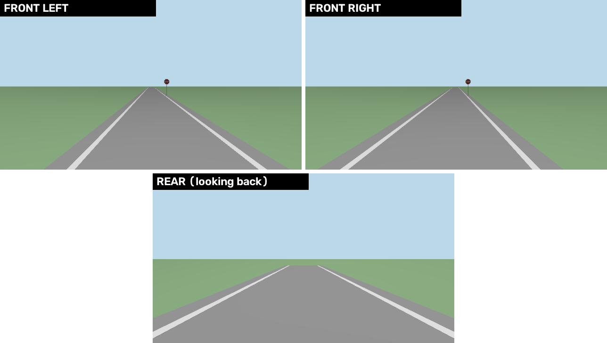
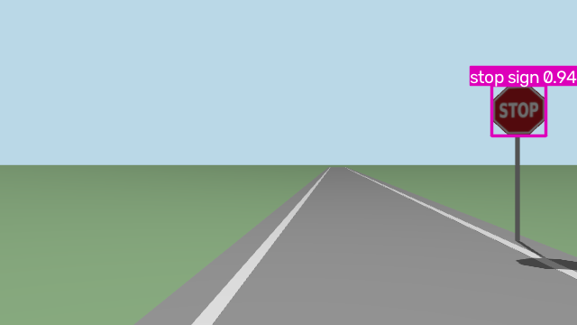
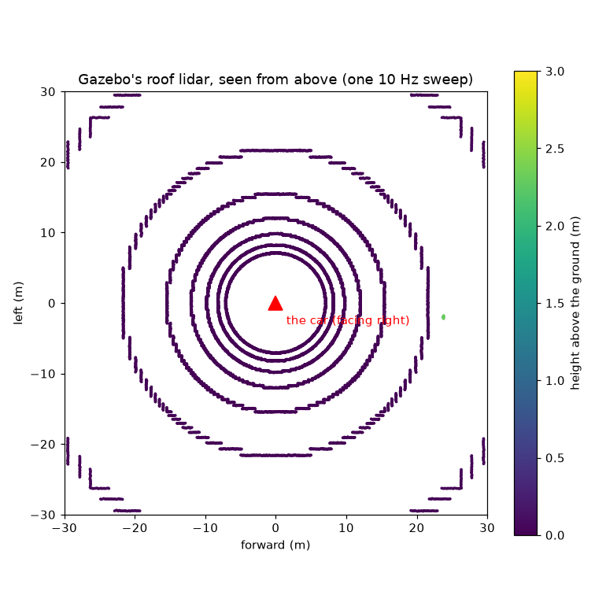

# Simulation: Gazebo, replay, and when nothing moves

Every backend takes the same `/ego/actuator_cmd`, so the drivers, mux, ego and
localization run unchanged whether the "car" is a turtle, Gazebo, or the real thing. Climb
the ladder one rung at a time.

`pixi run sim` and `pixi run turtle` stay on this computer: other terminals here see them,
other computers don't. So a simulated car never meets the real one. To share one on
purpose: `AAV_DISCOVERY=SUBNET pixi run sim`.

## The test ladder

| Rung | Runs | Proves |
|---|---|---|
| 1. Unit tests: `pixi run test` | the maths and protocols, without ROS | ego's maths, the CAN frames, the spine logic |
| 2. turtlesim: `pixi run turtle` | mux, ego, scripted driver, `ekf_local` | the command path, end to end |
| 3. Gazebo: `pixi run sim` | the whole stack, on a simulated car with an IMU and GPS; in the road world, its camera and radar too | localization and Nav2; in the road world, the car's whole graph: `pixi run sim-check` |
| 4. Replay | localization (and Nav2) on a recorded drive | config changes, against real sensor data |
| 4b. The bench: `pixi run bench` | the car's own graph: the spine bridge and CAN frames, the spine's firmware logic on a model car, pretend sensors | the car's software path, end to end, before the car: [Bench mode](bench.md) |
| 5. Car on stands | the real backend, wheels off the ground | the firmware link, signs and limits |
| 6. Car | everything, with a safety driver | the phase you're on |

## More drivers in the turtle run

**Joystick:** plug it in, start with `pixi run turtle teleop:=true`, hold the deadman
(the trigger) and steer.

**Scripted drive:** speed up, hold, slow down, on a gentle left curve:

```bash
ros2 action send_goal /scripted_drive aav_interfaces/action/ScriptedDrive \
  "{target_speed: 1.0, acceleration: 0.5, deceleration: 1.0, hold_time: 3.0, curvature: 0.2}" --feedback
```

The keyboard or joystick overrides the script at once. Let go, and the script carries on.

**E-stop:** `ros2 topic pub --once /safety/estop std_msgs/msg/Bool "{data: true}"` blocks every
driver. Publish `false` to clear it.

## Gazebo

```bash
pixi run sim                     # the empty world, with Nav2
pixi run sim world:=test_lot     # the walled test lot, with its map
pixi run sim world:=road         # the bench's road, for the car's camera and radar
```

| Argument | Default | Means |
|---|---|---|
| `world` | `empty` | `empty`, `test_lot` or `road` ([the road world](#the-road-world-the-cars-whole-graph)) |
| `nav` | `true` | start Nav2 |
| `teleop` | `false` | `true` with a joystick plugged in |
| `gui` | `true` | show the Gazebo window (on a Mac, as a second program) |
| `follow` | `true` | point the window's camera at the car |
| `rviz` | `true` | open RViz |
| `lidar` | `true` | the simulated roof lidar, in the road and test_lot worlds, read by Nav2 ([below](#the-lidar-gazebo-only)); `false` drops it |
| `radar` | `true` | the radar stand-in, in the road and test_lot worlds; `false`: the lidar alone guards Nav2 |
| `watchdog` | `true` | the sensor watchdog: stops Nav2 and the AI slot when a sensor fails ([below](#sensor-failures-on-purpose)) |
| `faults` | `false` | `true`: the front left picture goes through `gazebo_adapter` too, so it can freeze on purpose |
| `actuator_model` | `true` | the car answers like `vehicle.yaml`'s `actuators:` say ([below](#the-actuator-model)); `false`: the old instant car, to compare |

### What Gazebo simulates

Rates measured on Ben's Mac, 15 Oct, on simulated time (`ros2 topic hz -s`), with the
real-time factor at 0.98-0.99.

| Sensor | Gazebo topic | ROS topic | Rate | Noise | Worlds |
|---|---|---|---|---|---|
| IMU | `/aav/imu` | `/sensors/imu/data_raw` (then the filter: `/sensors/imu/data`) | 50 Hz | gyro 0.02 rad/s, accel 0.2 m/s² | all |
| GPS | `/aav/navsat` | `/sensors/gps/fix` | 5 Hz | 0.5 m across, 1 m up | all |
| Wheel speed | `/model/aav/odometry` | `/vehicle/odom` (speed only, like the spine's) | 50 Hz | none | all |
| Car status | (`gazebo_adapter`) | `/vehicle/status` (computer mode, armed) | 50 Hz | none | all |
| Front camera | `/aav/camera/image` | `/sensors/camera/front_left/image_raw`, `.../camera_info` | 10 Hz | none | road |
| Front right camera | `/aav/camera_right/image` | `/sensors/camera/front_right/image_raw`, `.../camera_info` | 10 Hz | none | road |
| Rear camera, looking back | `/aav/camera_rear/image` | `/sensors/camera/rear/image_raw`, `.../camera_info` | 10 Hz | none | road |
| Radar | `/aav/radar/points` (a lidar shaped like the radar) | `/sensors/radar/points` | 10 Hz | 5 cm | road |
| Lidar (roof) | `/aav/lidar/points` | `/sensors/lidar/points` | 10 Hz | 3 cm | road and test_lot; on by default, `lidar:=false` drops it |
| Where the car really is | `/model/aav/truth` | `/vehicle/gazebo/truth`, for checks only | 50 Hz | none | road |
| Steering, throttle, brake | (the actuator model) | `/vehicle/steering`, `/vehicle/throttle`, `/vehicle/brake`: command and measured | 50 Hz | none | all |
| Each wheel's speed | `/world/aav/model/aav/joint_state` | `/vehicle/wheels` (m/s, all four) | 50 Hz | none | all |
| "This is a simulation" | (`gazebo_adapter`) | `/system/source`, latched: every sensor above is SIM | once | - | all |

Each one carries the same name, type and frame as the real device's, so the software above
can't tell. `/gazebo/*` topics are Gazebo's own side of `gazebo_adapter`, not in the
contract.



Where each sensor sits (15 Oct, until Friday's tape measure): the two front cameras on top at the roof's front edge, the rear one on the tailgate looking back, the radar on the grill, the lidar on its roof tripod. All from `vehicle.yaml`. A camera can't go inside the car: Gazebo's car is a solid box, and the camera then sees its walls.

### What isn't simulated

| Thing | Why not |
|---|---|
| The right and rear cameras | only the front left camera is in the URDF's Gazebo sensors |
| The magnetometer | the EKFs don't use it |
| The battery | nothing to simulate yet |
| CAN and the spine | that's the bench's job (`pixi run bench`), not Gazebo's |
| The real actuators' numbers | the [actuator model](#the-actuator-model) has them, but they're guesses until the tests (`READ-ME-TESTS.md` 3.10-3.12, 4.1-4.5) |
| Wheel slip, slopes, the weight | the model sets the speed; no forces (option B in `READ-ME-FULL-SIMULATION.md`) |
| The spine's own logic (timeouts, e-stop) | a Python copy of its speed loop only; the spine in the loop is step 4 |
| A real radar | the stand-in is a lidar: it sees every surface, and no speeds of its own |
| Traffic, people, weather | the worlds are empty but for the road, the sign and the box |

### The actuator model

Added 15 Oct (`READ-ME-FULL-SIMULATION.md`, step 3). Gazebo used to set the speed itself
(+1.5 / -3.0 m/s²) and steer at once. Now `gazebo_adapter` puts a model of the actuators
in between, 50 times a second, on Gazebo's clock:

```text
ego's speed ──> speed loop (the spine's, in Python) ──> throttle %, brake %
                                                          │
ego's angle ───────────────────────────────────────┐      ▼
                                       ACTUATOR MODEL (actuator_model.py)
                                       throttle → push, brake → stop, drag
                                       steering: deadband → motor speed → lag → offset
                                                          │
                                                          ▼
                                       Gazebo: this speed, this angle
```

| Part | Its numbers (`vehicle.yaml`, `actuators:`) | Measured by |
|---|---|---|
| Throttle | `max_accel` 1.5 m/s², `throttle_deadband` 0, `throttle_lag` 0.1 s | tests 4.1, 4.4 |
| Coasting | `drag` 0.1 /s | test 4.2 |
| Brake | `max_brake` 3.0 m/s², `brake_lag` 0.2 s | test 4.3 |
| Steering | `steer_rate` 0.8 rad/s, `steer_lag` 0.1 s, `steer_offset` 0, `steer_deadband` 0.005 rad | tests 3.10-3.12, 4.5 |

!!! warning "Every number is a guess"
    Chosen to match Gazebo's old limits and the bench's `spine_sim`. Swap in the measured
    ones once the tests are done: no code changes.

- Gazebo's own limits (`aav.gazebo.xacro`) are now ±10 m/s², so the model limits, not Gazebo.
- `actuator_model:=false` keeps the old behaviour (in the adapter), to compare the two.
- No `/ego/actuator_cmd` for 0.2 s: the model brakes to a stop, like the spine's watchdog.
- Plot command against measured: `/vehicle/steering`, `/vehicle/throttle`, `/vehicle/brake`
  (Foxglove or PlotJuggler).
- **Check it:** `pixi run actuator-test <test> --sim` runs the car's stage 3-4 tests in
  Gazebo and prints these numbers back ([Actuator tests](actuator-tests.md)). On 15 Oct
  all but the throttle deadband came back within a few percent.
- **The IMU feels the model** (15 Oct): Gazebo's own IMU never felt the car speed up,
  brake or turn (it reads only gravity, noise and contact bumps). `gazebo_adapter` puts
  the model's forward and sideways acceleration at `imu_link` in its place, with the
  configured noise (`aav_gazebo/imu.py`). The EKFs use only the yaw rate, so nothing
  else changes.

How the simulated car connects:
- Gazebo plays the car, with Ackermann steering, an IMU and a GPS.
- `gazebo_adapter` turns those into the real drivers' topics: `/vehicle/odom`,
  `/sensors/imu/data_raw` and `/sensors/gps/fix`.
- The IMU filter, both EKFs and `navsat_transform` run with the car's own configs, on
  simulated time.
- Map (0, 0) is where the car starts, facing east.
- In the road world, the car also has its front camera and a radar stand-in.

To drive it:
- **Keyboard:** `pixi run keyboard --sim`.
- **A Nav2 goal:** in RViz, click **2D Goal Pose**, then click and drag on the map. Any
  human input overrides Nav2.

!!! tip "No GPU, or in a virtual machine?"
  Start it with `gui:=false`, and watch in RViz or Foxglove instead. The empty and
  test_lot worlds render nothing, so they run anywhere. The road world renders the camera:
  on Linux without a screen, that needs EGL (untested).

!!! tip "The car never appears?"
  If the log keeps saying `Requesting list of world names`, Gazebo's programs can't find
  each other: they use multicast, and some networks and firewalls block it. Run
  `export GZ_IP=127.0.0.1` in every terminal, then start again. On a shared computer, also
  set your own `GZ_PARTITION=<any name>`, so your simulator doesn't meet someone else's.

### Faster in Gazebo: `sim_speed:=`

The car's top speed is 1 m/s (walking pace, `ego.yaml` and `nav2.yaml`), for its first
real drives. In Gazebo, raise it for ego and Nav2 together:

```bash
pixi run sim world:=test_lot sim_speed:=3     # m/s, up to 5
```

| | |
|---|---|
| Changes | ego's cap, Nav2's controller speed and its velocity smoother, in this run only |
| The real car | never: ego refuses `sim_max_speed` unless it runs on simulated time |
| Tried, 15 Oct | a 40 m Nav2 goal in the empty world: top speed 3.18 m/s, goal reached |

### Everything in one command: `hud:=true`

```bash
pixi run sim world:=test_lot sim_speed:=3 hud:=true
```

Gazebo, RViz, Nav2 and the HUD window together. Give goals with RViz's 2D Goal Pose.

| Argument | Opens |
|---|---|
| `hud:=true` | the HUD window (`aav_hud_raylib`, the same as `pixi run hud`) |
| `foxglove:=true` | the Foxglove bridge on 127.0.0.1:8765: open Lichtblick, then `ws://localhost:8765` |
| `hud_web:=true` | the Flutter app's web server on 127.0.0.1:5000 (this was `hud:=true` before 15 Oct) |
| Tried, 15 Oct | the parking lot, sim speed 3, the HUD on: a 36 m Nav2 goal reached |

If you reopen Gazebo's window (`pixi run gz-window`), its camera follows the car again.

## The road world: the car's whole graph

At home there is no car, so Gazebo runs everything the car runs. The road world is the
bench's road, built in 3D, so the car's own camera and radar can see it.



### What's in it

| Thing | Where |
|---|---|
| One lane, 3.5 m wide; white lines 0.15 m wide; 0.5 m of tarmac outside them | east along y = 0, from x = -20 to 100 m |
| A stop sign, 0.75 m across, its centre 2 m up | 25 m east, 2 m right, facing the car |
| A 1 m box, with `obstacle:=true` | in the lane, 15-16 m east |

- It's the bench world: `aav_gazebo/test/test_worlds.py` checks the numbers against
  `aav_bench/config/bench.yaml`. It pairs with the empty map, as the bench does.
- The sign's picture is our own drawing (`tools/make_stop_sign.py`), so it has no licence
  to track. The stock YOLO model calls it "stop sign", 0.8-0.97 sure.

### The car's sensors there

| Sensor | In Gazebo | On ROS |
|---|---|---|
| Front camera | 640 x 360, 86 degrees across, 10 Hz: the bench camera's picture and lens (the 2024-25 calibration at a third of its size) | `/sensors/camera/front_left/image_raw`, `/sensors/camera/front_left/camera_info`, in `camera_left_link` |
| Radar | a lidar shaped like the TI radar: 8.4 m, 120 degrees, 61 x 3 rays, 10 Hz. `gazebo_adapter` keeps the rays that hit something, with the TI driver's fields | `/sensors/radar/points`, best effort, in `radar_link` |
| Where the car really is | Gazebo's own pose, like the bench's `/vehicle/bench/truth` | `/vehicle/gazebo/truth`, for checks only |

| Lidar (on by default) | a generic 16-beam spinning lidar: 360 degrees in 1800 steps, 15 degrees down to 15 up, 0.5-100 m, 3 cm of noise, 10 Hz | `/sensors/lidar/points`, reliable, in `lidar_link` |

The radar stand-in isn't a radar: it sees every surface (the sign's post too), and each
point's speed is the car's own, along the line of sight.

### The lidar: Gazebo only

The car has a lidar on its roof, but its model is unknown (Q22) and our code has no driver
yet. So Gazebo has a generic one, to try what a lidar would add. **It's on by default
(15 Oct)** in the road and test_lot worlds: `pixi run sim world:=road` or `world:=test_lot`.

| | |
|---|---|
| Where | `lidar_link`, in `vehicle.yaml`: on the roof tripod, 0.9 m ahead of the rear axle, 1.8 m up (Ben's placement, 15 Oct, until it's measured) |
| Why a mast | at 0.1 m above the roof, the beam 11 degrees down hit the car's own roof: 904 points a sweep at 0.5 m. At 0.4 m nothing hits the car |
| Size | 1800 x 16 points, 0.9 MB a cloud, so it's bridged **reliably**: best effort loses big messages (see [Mac](mac.md)) |
| Who reads it | Nav2, since 15 Oct (below): `lidar_scan` flattens it into a 2D scan for the local costmap and `collision_monitor` |
| Turn it off | `lidar:=false`: the simulated sensor leaves the URDF (the frame stays), and its bridge doesn't start |
| On the Mac, alone | stable: 10.0 Hz, real-time factor 0.99, Gazebo at about 80% of one core with the camera and radar too. `sim-check --lidar` passes |
| On the Mac, with YOLO too, the morning of 15 Oct | **flaky**: `sim-check --perception` failed 3 runs out of 3 with the lidar on (a stuck global EKF twice, a 2.5 s stall once). Without it, it passed (see [sim-check](#sim-check)) |
| Why it was off | anything that shows the lidar (RViz, a check) pulls 9 MB/s of reliable clouds. Fast DDS's shared memory fails on the Mac (`open_and_lock_file failed`), so they go over loopback UDP, and with YOLO running, other processes start missing messages (one lost `/clock` for 2 minutes) |
| Now | on by default again: with the Mac quiet, everything together passed twice (below). If a run stalls, check for leftover simulators first (`ps aux \| grep gz`), then try `lidar:=false` |

#### The lidar in Nav2 (15 Oct)

```text
 /sensors/lidar/points ─► lidar_scan ─► /sensors/lidar/scan ─┬─► local costmap: lidar_layer
  (0.9 MB, 10 Hz,          (aav_lidar)   (720 ranges, 3 kB)   └─► collision_monitor: stop zone
   reliable)
```

| | |
|---|---|
| What counts | points from 0.3 m above the road to 0.5 m over the roof (2.0 m): `vehicle.obstacle_heights`, from `vehicle.yaml`. The road, kerbs and overhead branches don't; nor do points on the car itself |
| The scan | 720 directions (0.5°), each the nearest point, flat from `base_link`; `inf` where nothing is, which clears the costmap |
| Its own costmap layer | `lidar_layer`, so its clearing never wipes the radar's marks |
| Switch | `navigation.launch.py lidar:=true`. `sim.launch.py` passes it where the world renders the lidar. **The car: `lidar:=false`**, as no driver publishes its lidar yet (probably a Velodyne: audit N6) |
| CPU | `lidar_scan` about 4% of one core; Nav2's two readers get 3 kB a scan instead of 0.9 MB |
| Why not the stock `pointcloud_to_laserscan` | tried first: it subscribes best effort, and on a Mac no 0.9 MB cloud ever arrives that way ([Mac](mac.md)). Ours subscribes reliably |
| Its blind spot | from 1.8 m up, the lowest beam (15° down) meets a 1 m box only 2.1 m ahead of the bumper, and the road only 4.9 m ahead. In the stop zone (bumper to 1 m ahead) it sees only what stands over about 1.3 m: a person, a car, a post. Low things close in front are the radar's |
| Proof | `pixi run sim-check --lidar-obstacle`: the radar off, a person-sized post (0.5 x 0.5 x 1.8 m) 15 m ahead. The car stood still 0.16-0.55 m before it (two runs), the stop zone fired from the lidar, the costmap marked it (100 of 100); with the post gone, it drove on to its goal |



The rings are where each beam meets the flat ground. The far rings come out slightly
polygonal: Gazebo's `gpu_lidar` renders depth in a few camera views, and at grazing
angles small depth errors become large range errors.

### The parts: the bench's argument names

| Argument | Default | Starts |
|---|---|---|
| (always, in the road world) | | `radar_clusters`, and Nav2's obstacle layer and `collision_monitor`; `lidar_scan` and the lidar layer; the sensor watchdog |
| `perception` | `false` | YOLO and `stop_sign_watcher`: twist_mux's stop-sign lock. Needs `pixi run -e ml` |
| `lane` | `false` | `true`: lane keeping (`lane_finder`, and `control_interface` on `/drivers/ai/cmd_vel`). Add `nav:=false`: Nav2 outranks it. `fake`: on a pretend lane, in any world |
| `camera_obstacles` | `false` | the detectors' boxes into Nav2's local costmap |
| `hud` | `false` | the HUD's web server, on 127.0.0.1:5000 |
| `obstacle` | `false` | the bench's 1 m box, in the lane 15 m ahead |
| `start_y`, `start_yaw` | `0.0` | m and rad: start the car this far left of the centre, and turned this far left. The EKFs still start at the origin, facing east |

```bash
pixi run -e ml sim world:=road perception:=true              # then a Nav2 goal past the sign
pixi run sim world:=road obstacle:=true                      # the radar stops Nav2 for the box
pixi run sim world:=road lane:=true nav:=false start_y:=0.3  # lane keeping alone
```

- Every node runs on Gazebo's clock.
- The camera's parts need the road world: in another world, the launch stops and says so.
- The empty and test_lot worlds render nothing, and start what they always have.

### What you see

| Window | Shows |
|---|---|
| Gazebo | the car on the road; the window's camera follows it |
| RViz (`rviz/road.rviz`) | the map and both costmaps, the plan, the car, the radar's points (magenta) and clusters, the stop zone (red), Gazebo's truth (grey arrows), the camera's picture, and YOLO's boxes with `perception:=true` |
| rqt_graph: `pixi run graph` | every node and topic, as on the bench |

### On a Mac

Ben's Mac (Apple silicon, macOS), 15 Oct, `pixi run sim world:=road gui:=false rviz:=false`:

| Question | Answer |
|---|---|
| Do the camera and lidars crash Gazebo? | no. The camera, the radar stand-in and the roof lidar all render headless, with ogre2 on Metal, with no window and no `--headless-rendering` |
| Rates (simulated time) | camera 10.0 Hz, radar 10.0 Hz, lidar 10.0 Hz, IMU 50.0 Hz, GPS 5.0 Hz, wheel speed 50.0 Hz |
| Real-time factor | 0.98-0.99 |
| `ros2 topic hz` on the camera | shows **nothing**: Jazzy's `hz` always subscribes best effort, and a 690 kB image is lost over UDP. Count it reliably instead: `ros2 topic echo --qos-reliability reliable --field header.stamp /sensors/camera/front_left/image_raw` (90 frames in 10 s) |
| `pixi run check sim`, `pixi run check road` | 0 failed |
| Gazebo's window too (`gui:=true`) | the 11 Oct runs used it; not run again on 15 Oct |

The warning `gz_frame_id ... not defined in SDF` is harmless: Gazebo copies it over, and
the frames come out right (`sim-check` tests them).

### sim-check

```bash
pixi run sim-check                                # start-up, contract, sensors, a drive
pixi run -e ml sim-check --perception --obstacle  # and the stop sign, and the box
pixi run sim-check --lane                         # and lane keeping, in a second run
pixi run sim-check --lidar-obstacle               # and the lidar alone (radar off) stops for a post
pixi run sim-check --faults                       # and sensor failures on purpose (below)
pixi run sim-check --faults --no-watchdog         # the same, a report of what happens without the watchdog
pixi run sim-check --no-lidar                     # without the simulated roof lidar (on by default)
```

It starts the road world without a window, on a private ROS domain and Gazebo partition,
on this computer only. The launch log goes to `/tmp/aav-sim-check.log`.

Ran on Ben's Mac, 15 Oct, after the topic renaming:

| Run | Result |
|---|---|
| `pixi run sim-check` | all pass: start-up, the contract (0 failures), sensors, a scripted drive of 6.3-6.5 m (plan 6.5 m), the global EKF within 0.1-0.3 m of the truth |
| `pixi run sim-check --lidar --obstacle` | all pass: the lidar at 10.0 Hz with 12654 hits; the car stood still 0.79 m before the box; with the box gone, Nav2 reached its goal 29.6 m on |
| `pixi run -e ml sim-check --perception` | all pass: YOLO saw the sign from 11.2 m, the lock went on at 18.2 m, the car stood with its bumper 4.8 m before the sign, then reached its goal at 39.9 m |
| The same, with the lidar on | failed 3 times out of 3 that morning (why: [the lidar](#the-lidar-gazebo-only)), so the lidar went off by default |
| The same, afternoon, a quiet Mac (an orphaned Gazebo and five leftover ROS daemons stopped) | **passed 2 out of 2** with the lidar, three cameras, the radar and YOLO: the sign seen from 9.6 m, the car stood 3.6 m before it, then reached its goal. So the lidar is on by default again |
| The test_lot world with its new sensors | front cameras 6.9 and 9.7 Hz, rear 7.7 Hz, lidar 9.7 Hz with 2891 hits a sweep on the walls, building and cars |
| `pixi run sim-check --lane` | ✅ 15 Oct, after the cameras moved: back to the lane's centre within 5 cm in 5 s |
| `pixi run sim-check --obstacle --lidar-obstacle` (15 Oct, the lidar into Nav2; twice) | all pass: the box 0.32-0.46 m ahead with radar and lidar; with the radar off, the lidar alone stopped the car 0.16-0.55 m before a person-sized post, the costmap 100 of 100 there; both goals reached once they were gone |
| `pixi run sim-check --faults` (15 Oct) | all 10 faults pass: the car stood still 1.7-4.1 s after each, and the watchdog (or `collision_monitor`, for the radar) said why; then let go |
| `pixi run sim-check --faults --no-watchdog` (15 Oct) | the before column [below](#what-the-car-does-before-and-after): only the radar stopped the car |

Ten runs in all, on a Mac shared with other work (load 5-17 on 16 cores). One more
`--perception` run without the lidar failed too: the car never moved, and the log doesn't
say why. So the full graph with YOLO is still a little flaky on a busy Mac.

## Sensor failures on purpose

READ-ME-FULL-SIMULATION.md step 6 (15 Oct): make a simulated sensor fail, and check the
car stops, **safely and loudly**.

### Make one fail

```bash
pixi run sim world:=road faults:=true     # faults:=true only for the camera
pixi run sim-fault gps stop               # the GPS goes quiet
pixi run sim-fault gps ok                 # mended
pixi run sim-fault clear                  # after a GPS jump: a person says the position is right
```

| Sensor | Topic it breaks | Faults |
|---|---|---|
| `gps` | `/sensors/gps/fix` | `stop`, `freeze`, `nan`, `jump` (20 m north) |
| `imu` | `/sensors/imu/data_raw` | `stop`, `freeze`, `nan` |
| `odom` | the wheels: `/vehicle/odom`, `/vehicle/wheels` | `stop`, `freeze`, `nan` |
| `radar` | `/sensors/radar/points` | `stop`, `freeze` |
| `camera` | `/sensors/camera/front_left/image_raw` (with `faults:=true`) | `stop`, `freeze` |

`freeze` sends the last good message again, with fresh stamps: it looks alive. It's a
parameter of `gazebo_adapter` (`fault.<sensor>`); the logic is `aav_gazebo/faults.py`.

### The sensor watchdog

`aav_safety`'s `sensor_watchdog` watches what Nav2 and the AI slot need. While one isn't
right, its twist_mux lock (priority 30, as the stop sign) holds them; people and tests
still drive. It says why on `/safety/sensor_watchdog/state`, on the HUD (a red banner over
the camera), on the map window (a banner across the map), in the log and on
`/diagnostics`.

| Input | Topic | Wrong when | Then |
|---|---|---|---|
| odom | `/vehicle/odom` | quiet 0.5 s; NaN; the wheels **disagree** with the IMU or the GPS for 1 s (below), **latched** until cleared | stop |
| imu | `/sensors/imu/data` | quiet 0.5 s; NaN; the same for 1 s | stop |
| gps | `/sensors/gps/fix` | no good fix for 2 s (NaN or no fix count as none); a jump between two fixes of more than 15 m/s x the time between their stamps + 5 m (for noise), **latched** until cleared | stop |
| local, global | the EKFs' `/localization/odom/*` | quiet 0.5 s; NaN | stop |
| camera | the front left picture | quiet 1 s; the same picture for 1 s **while the wheels turn** | stop (only where something reads it: perception, lane, camera obstacles) |
| radar | `/sensors/radar/points` | quiet 1 s | warn: `collision_monitor` already stops Nav2 |

It runs in Gazebo (`watchdog:=true`), on the bench (always), and on the car next to the
mux (odom, IMU, GPS, the EKFs). The checks are `aav_safety/watchdog.py` and
`wheel_check.py`, with no ROS, and their tests.

### If the watchdog itself dies

The lock is **fail-safe** (15 Oct). The watchdog sends `false` 10 times a second: a
heartbeat. twist_mux locks a lock with a timeout when it goes quiet (checked in its
source: `LockTopicHandle::isLocked`), so 1 s of silence holds Nav2 too.

```text
 sensor_watchdog --false, 10 Hz--> twist_mux sensors lock (priority 30, timeout 1 s)
       dies, hangs, never starts  -->  silence > 1 s  -->  locked: Nav2 and AI held
                                                           joystick, keyboard, tests: still drive
```

| Profile | Watchdog | Lock |
|---|---|---|
| Gazebo, `watchdog:=true` (the default) | runs | fail-safe |
| Gazebo, `watchdog:=false` | none | timeout 0 (`aav_mux` `no_sensor_lock.yaml`) |
| Bench | always runs | fail-safe |
| Car | next to the mux, wherever Nav2 runs | fail-safe |
| Turtle | none | timeout 0 |

`mux.launch.py sensor_lock:=false` picks timeout 0; every profile sets it.

### Frozen wheels

A wheel-speed driver stuck in a loop sends the same speed with fresh stamps. At a steady
speed that looks like a car at a steady speed. `wheel_check.py` cross-checks the wheels:

| Against | How | Catches |
|---|---|---|
| The IMU's acceleration | over 1.5 s: the wheels' change in speed vs the forward acceleration, added up | a frozen speed while the car speeds up or brakes |
| The IMU's gyro | over 1.5 s: the mean turn rates | a frozen turn rate while the car steers |
| The GPS | over 6 s: the speed of a line fitted to the fixes vs one fitted to where the wheels say the car went | a speed that **stays** wrong |

Any gap over its limit (0.3 m/s, 0.15 rad/s, 0.3 m/s) for 1 s is **DISAGREE**, latched
until `pixi run sim-fault clear`. Wheels frozen at a speed the car really keeps are still
right, so nothing is said until the car's speed or turn changes. A frozen IMU or GPS is
left out (its own input says FROZEN), not blamed on the wheels.

Normal driving, Gazebo (sim-check's `wheels vs IMU and GPS`): worst speed gap 0.09-0.14
m/s and turn 0.006-0.010 rad/s (6 runs), GPS 0.12-0.14 m/s (3 runs). The limits are **Gazebo's**: on
the car, read `worst_*_gap` on `/diagnostics` after a normal drive, and set them well
above.

### The global EKF and a GPS jump

`ekf_global` now refuses a GPS fix more than 10 sigma from where it thinks the car is
(`odom1_pose_rejection_threshold`, Mahalanobis distance). The first fix on the car could
be far from `start_x, start_y` (or the datum): so x and y start 100 m unsure, and the
first fix always gets in. `tools/tests/test_ekf_config.py` checks the numbers.

| 20 m jump (`gps jump`) | The global EKF, 10 s on |
|---|---|
| Before (no gate), no watchdog | 19.3 m from the truth |
| Gate, with the watchdog (the car stops) | 0.1-0.5 m (three runs) |
| Gate, no watchdog (the car drives on) | 19.4 m: driving, the filter grows unsure of its heading, and after a few seconds it takes the jump. Then it refuses the good fixes for a while (8.5 m out at the next fault) |

So the gate keeps the map position right **while the watchdog holds the car**; the
watchdog's latched JUMP stays the guard, and a person checks the position before
clearing it.

### What the car does: before and after

`pixi run sim-check --faults` (after) and `--faults --no-watchdog` (before): each fault
while Nav2 drives at about 1 m/s, in Gazebo's road world, on Ben's Mac, 15 Oct. The first
ten rows: the watchdog's first runs. The last three: added later on 15 Oct (fail-safe
lock, frozen wheels).

| Fault | Before: no watchdog | After: the watchdog |
|---|---|---|
| GPS lost (`gps stop`) | ❌ drove on: 10.6 m in 10 s, nothing said. The global EKF carried on from the wheels and IMU (1.1 m out) | ✅ stood still 3.8 s after it, 2.8 m on: "gps STALE" |
| GPS NaN (`gps nan`) | ❌ drove on 10.0 m, nothing said (navsat_transform drops NaN fixes: the same as lost) | ✅ 4.1 s, 2.8 m: "gps STALE (no fix)" |
| GPS jumps 20 m (`gps jump`) | ⚠️ stood still 2.2 s after it, but by accident (Nav2's plan jumped with the map position, 19.3 m out); nothing said | ✅ 1.7 s, 0.7 m: "gps JUMP 20.0 m in 0.20 s", held until a person clears it |
| IMU stopped (`imu stop`) | ❌ drove on 7.2 m, nothing said | ✅ 2.2 s, 1.1 m: "imu STALE" |
| IMU frozen (`imu freeze`) | ❌ drove on 8.4 m, nothing said | ✅ 2.8 s, 1.7 m: "imu FROZEN" |
| IMU NaN (`imu nan`) | ❌ drove on 7.7 m; the global EKF stayed 0.3 m from the truth | ✅ 1.8 s, 1.0 m: "imu NAN" |
| Wheels stopped (`odom stop`) | ❌ drove on 9.0 m, nothing said | ✅ 1.9 s, 0.9 m: "odom STALE" |
| Wheels NaN (`odom nan`) | ❌ drove on 6.3 m, nothing said | ✅ 1.7 s, 0.8 m: "odom NAN" |
| Camera frozen (`camera freeze`) | ❌ drove on 7.6 m; on the HUD a frozen picture looks live | ✅ 2.9 s, 4.5 m: "camera FROZEN" |
| Radar stopped (`radar stop`) | ✅ stood still 2.5 s after it: `collision_monitor`'s "invalid source" | ✅ the same, 2.5 s; the watchdog warns too |
| Wheels frozen (`odom freeze`) | ❌ drove on 10.9 m in 15 s, nothing said | ✅ 3.4-4.8 s after the wheels went wrong (Nav2 steered), 2.2-3.9 m: "odom DISAGREE (the wheels and the IMU disagree ... turn 0.28 rad/s)" (two runs) |
| Watchdog hung (`watchdog hang`: SIGSTOP) | ❌ by design: the old lock never expired, so nothing stopped Nav2 (not run) | ✅ 2.7 s, 1.4-1.5 m: twist_mux's 1 s lock timeout; drove again after SIGCONT |
| Watchdog killed (`watchdog kill`: SIGKILL, the last fault) | ❌ the same (not run) | ✅ 2.6-2.8 s, 1.2-1.5 m, then held 10 s more with Nav2 still asking (top speed 0.00 m/s) |

"Nothing said": no warning in the log, nothing on the HUD (only the HUD's GPS line
turned STALE for a lost GPS). The after column is the last of three runs: the first
passed too; the second caught a false GPS jump (two fixes delivered at once), fixed by
timing jumps with the fixes' stamps, plus 5 m for their noise.

### Still to do

| What | Why |
|---|---|
| ~~The watchdog's lock never expires~~ | done 15 Oct: fail-safe, a 1 s timeout on its heartbeat ([above](#if-the-watchdog-itself-dies)) |
| ~~Wheel odometry that freezes~~ | done 15 Oct: the wheels against the IMU and the GPS ([above](#frozen-wheels)) |
| ~~The EKF's own guard against a GPS jump~~ | done 15 Oct, partly: it holds while the watchdog stops the car ([above](#the-global-ekf-and-a-gps-jump)). A car that drives on takes the jump after a few seconds |
| ~~The map window~~ | done 15 Oct: the same banner as the HUD. Not seen on a screen yet |
| The cross check's limits on the car | Gazebo's numbers. Read `worst_*_gap` on `/diagnostics` after a normal drive. A sloping lot, the real IMU's mounting and the real GPS's noise all change them |
| A frozen wheel at a speed the car keeps | not caught until the speed or turn changes: harmless till then, but the EKF's position drifts if the car really changes speed slowly under 0.3 m/s |
| The real car's faults | the same checks with the car on stands (READ-ME-TESTS.md stage 3): pull the GPS's cable, the IMU's; stop the watchdog |

## Replay a recorded drive

On the car, record a drive: `tools/record.sh parking_lot_test` writes
`bags/<date>_parking_lot_test/`. Then re-run localization against it on any laptop:

```bash
ros2 launch aav_bringup replay.launch.py
ros2 bag play bags/<the bag> --clock --topics /vehicle/odom /sensors/imu/data_raw /sensors/gps/fix /tf_static
```

A bag from Gazebo carries simulated time. Play its own `/clock` instead of `--clock`:
`ros2 bag play bags/<the bag> --topics /clock /vehicle/odom /sensors/imu/data_raw /sensors/gps/fix /tf_static`.
`pixi run tools/ros.sh python3 tools/check_graph.py --profile replay` checks the result.

Change an EKF setting, replay, compare the path. That's how to tune localization without
the car.

`tools/replay_commands.sh bags/<the bag>` plays the recorded commands back into the mux
as `replay` (priority 40). It's open loop, so the car drifts from the original path.

## CARLA: parked

- **What it is:** a full self-driving simulator, with towns, traffic and photoreal
  cameras. It's the right tool for testing cameras.
- **Two versions:** CARLA 0.9.16 (Sept 2025) runs on Unreal Engine 4; CARLA 0.10
  (Dec 2024) on Unreal Engine 5, and it's heavier.
- **Why not now:** its built-in ROS 2 link stalls on Jazzy
  ([issue 9551](https://github.com/carla-simulator/carla/issues/9551)); the fix was closed
  without merging on 26 May 2026. It has no Mac version, and wants an NVIDIA GPU with
  8 GB or more.
- **Parked (10 Oct):** Gazebo and bench mode already drive the whole car graph: Nav2,
  the sensors and the e-stops. If perception needs realistic streets later, it can run on
  the team's NVIDIA Linux machine, once it supports Jazzy (Q31).
- **Ours:** `aav_carla` is a stub that has never run.

## When nothing moves

Work down the chain:

| # | Ask | Check |
|---|---|---|
| 1 | Is a driver publishing? | `ros2 topic hz /drivers/keyboard/cmd_vel` (or `joy`, `scripted`, `nav`) |
| 2 | Did the mux pick it? | `ros2 topic echo /control/cmd_vel`. If it's silent, look for a latched e-stop: `ros2 topic echo /safety/estop` |
| 3 | Is ego converting it? | `ros2 topic echo /ego/actuator_cmd`: it's always 50 Hz, so look at the speed |
| 4 | Is a backend listening? | `ros2 topic info /ego/actuator_cmd -v` |
| 5 | In Gazebo or replay: is everything on sim time? | a node on wall-clock time ignores sim-time messages |
| 6 | Does the graph match the contract? | `pixi run check sim` (or `road`, `replay`) |
| 7 | Is the sensor watchdog holding Nav2? | `ros2 topic echo /safety/sensor_watchdog/state`: anything but OK says which sensor and why |
