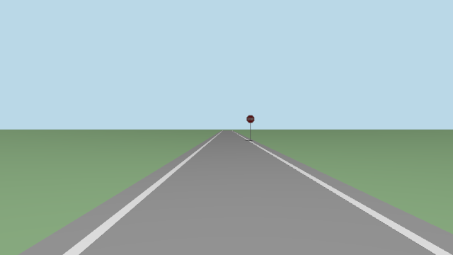

# Simulation: Gazebo, replay, and when nothing moves

Every backend takes the same `/ego/actuator_cmd`, so the drivers, mux, ego and
localization run unchanged whether the "car" is a turtle, Gazebo, or the real thing. Climb
the ladder one rung at a time.

`pixi run sim` and `pixi run turtle` stay on this computer: other terminals here see them,
other computers don't. So a simulated car never meets the real one. To share one on
purpose: `ROS_AUTOMATIC_DISCOVERY_RANGE=SUBNET pixi run sim`.

## The test ladder

| Rung | Runs | Proves |
|---|---|---|
| 1. Unit tests: `pixi run test` | the maths and protocols, without ROS | ego's maths, the CAN frames, the spine logic |
| 2. turtlesim: `pixi run turtle` | mux, ego, scripted driver, `ekf_local` | the command path, end to end |
| 3. Gazebo: `pixi run sim` | the whole stack, on a simulated car with an IMU and GPS; in the road world, its camera and radar too | localization and Nav2; in the road world, the car's whole graph: `pixi run sim-check` |
| 4. Replay | localization (and Nav2) on a recorded drive | config changes, against real sensor data |
| 4b. The bench: `pixi run bench` | the car's own graph: the spine bridge and CAN frames, the spine's firmware logic on a model car, pretend sensors | the car's software path, end to end, before the car: [Bench mode](bench.md) |
| 5. Car on stands | the real backend, wheels off the ground | the firmware link, signs and limits |
| 6. Car | everything, with a safety driver | the phase you're on |

## More drivers in the turtle run

**Joystick:** plug it in, start with `pixi run turtle teleop:=true`, hold the deadman
(the trigger) and steer.

**Scripted drive:** speed up, hold, slow down, on a gentle left curve:

```bash
ros2 action send_goal /scripted_drive aav_interfaces/action/ScriptedDrive \
  "{target_speed: 1.0, acceleration: 0.5, deceleration: 1.0, hold_time: 3.0, curvature: 0.2}" --feedback
```

The keyboard or joystick overrides the script at once. Let go, and the script carries on.

**E-stop:** `ros2 topic pub --once /safety/estop std_msgs/msg/Bool "{data: true}"` blocks every
driver. Publish `false` to clear it.

## Gazebo

```bash
pixi run sim                     # the empty world, with Nav2
pixi run sim world:=test_lot     # the walled test lot, with its map
pixi run sim world:=road         # the bench's road, for the car's camera and radar
```

| Argument | Default | Means |
|---|---|---|
| `world` | `empty` | `empty`, `test_lot` or `road` ([the road world](#the-road-world-the-cars-whole-graph)) |
| `nav` | `true` | start Nav2 |
| `teleop` | `false` | `true` with a joystick plugged in |
| `gui` | `true` | show the Gazebo window (on a Mac, as a second program) |
| `follow` | `true` | point the window's camera at the car |
| `rviz` | `true` | open RViz |
| `lidar` | `true` | the simulated roof lidar, in the road world only ([below](#the-lidar-gazebo-only)) |

### What Gazebo simulates

Rates measured on Ben's Mac, 15 Oct, on simulated time (`ros2 topic hz -s`), with the
real-time factor at 0.98-0.99.

| Sensor | Gazebo topic | ROS topic | Rate | Noise | Worlds |
|---|---|---|---|---|---|
| IMU | `/aav/imu` | `/sensors/imu/data_raw` (then the filter: `/sensors/imu/data`) | 50 Hz | gyro 0.02 rad/s, accel 0.2 m/s² | all |
| GPS | `/aav/navsat` | `/sensors/gps/fix` | 5 Hz | 0.5 m across, 1 m up | all |
| Wheel speed | `/model/aav/odometry` | `/vehicle/odom` (speed only, like the spine's) | 50 Hz | none | all |
| Car status | (`gazebo_adapter`) | `/vehicle/status` (computer mode, armed) | 50 Hz | none | all |
| Front camera | `/aav/camera/image` | `/sensors/camera/front_left/image_raw`, `.../camera_info` | 10 Hz | none | road |
| Radar | `/aav/radar/points` (a lidar shaped like the radar) | `/sensors/radar/points` | 10 Hz | 5 cm | road |
| Lidar (the car has none) | `/aav/lidar/points` | `/sensors/lidar/points` | 10 Hz | 3 cm | road, `lidar:=true` (the default) |
| Where the car really is | `/model/aav/truth` | `/vehicle/gazebo/truth`, for checks only | 50 Hz | none | road |

Each one carries the same name, type and frame as the real device's, so the software above
can't tell. `/gazebo/*` topics are Gazebo's own side of `gazebo_adapter`, not in the
contract.



### What isn't simulated

| Thing | Why not |
|---|---|
| The right and rear cameras | only the front left camera is in the URDF's Gazebo sensors |
| The magnetometer | the EKFs don't use it |
| The battery | nothing to simulate yet |
| CAN and the spine | that's the bench's job (`pixi run bench`), not Gazebo's |
| Steering feedback, motor lag, wheel slip | Gazebo's Ackermann system steers and drives exactly as told |
| A real radar | the stand-in is a lidar: it sees every surface, and no speeds of its own |
| Traffic, people, weather | the worlds are empty but for the road, the sign and the box |

How the simulated car connects:
- Gazebo plays the car, with Ackermann steering, an IMU and a GPS.
- `gazebo_adapter` turns those into the real drivers' topics: `/vehicle/odom`,
  `/sensors/imu/data_raw` and `/sensors/gps/fix`.
- The IMU filter, both EKFs and `navsat_transform` run with the car's own configs, on
  simulated time.
- Map (0, 0) is where the car starts, facing east.
- In the road world, the car also has its front camera and a radar stand-in.

To drive it:
- **Keyboard:** `pixi run keyboard --sim`.
- **A Nav2 goal:** in RViz, click **2D Goal Pose**, then click and drag on the map. Any
  human input overrides Nav2.

!!! tip "No GPU, or in a virtual machine?"
  Start it with `gui:=false`, and watch in RViz or Foxglove instead. The empty and
  test_lot worlds render nothing, so they run anywhere. The road world renders the camera:
  on Linux without a screen, that needs EGL (untested).

!!! tip "The car never appears?"
  If the log keeps saying `Requesting list of world names`, Gazebo's programs can't find
  each other: they use multicast, and some networks and firewalls block it. Run
  `export GZ_IP=127.0.0.1` in every terminal, then start again. On a shared computer, also
  set your own `GZ_PARTITION=<any name>`, so your simulator doesn't meet someone else's.

## The road world: the car's whole graph

At home there is no car, so Gazebo runs everything the car runs. The road world is the
bench's road, built in 3D, so the car's own camera and radar can see it.


### What's in it

| Thing | Where |
|---|---|
| One lane, 3.5 m wide; white lines 0.15 m wide; 0.5 m of tarmac outside them | east along y = 0, from x = -20 to 100 m |
| A stop sign, 0.75 m across, its centre 2 m up | 25 m east, 2 m right, facing the car |
| A 1 m box, with `obstacle:=true` | in the lane, 15-16 m east |

- It's the bench world: `aav_gazebo/test/test_worlds.py` checks the numbers against
  `aav_bench/config/bench.yaml`. It pairs with the empty map, as the bench does.
- The sign's picture is our own drawing (`tools/make_stop_sign.py`), so it has no licence
  to track. The stock YOLO model calls it "stop sign", 0.8-0.97 sure.

### The car's sensors there

| Sensor | In Gazebo | On ROS |
|---|---|---|
| Front camera | 640 x 360, 86 degrees across, 10 Hz: the bench camera's picture and lens (the 2024-25 calibration at a third of its size) | `/sensors/camera/front_left/image_raw`, `/sensors/camera/front_left/camera_info`, in `camera_left_link` |
| Radar | a lidar shaped like the TI radar: 8.4 m, 120 degrees, 61 x 3 rays, 10 Hz. `gazebo_adapter` keeps the rays that hit something, with the TI driver's fields | `/sensors/radar/points`, best effort, in `radar_link` |
| Where the car really is | Gazebo's own pose, like the bench's `/vehicle/bench/truth` | `/vehicle/gazebo/truth`, for checks only |

| Lidar, with `lidar:=true` (the default) | a generic 16-beam spinning lidar: 360 degrees in 1800 steps, 15 degrees down to 15 up, 0.5-100 m, 3 cm of noise, 10 Hz | `/sensors/lidar/points`, reliable, in `lidar_link` |

The radar stand-in isn't a radar: it sees every surface (the sign's post too), and each
point's speed is the car's own, along the line of sight.

### The lidar: Gazebo only

The car has a lidar on its roof, but its model is unknown (Q22) and our code has no driver
yet. So Gazebo has a generic one, to try what a lidar would add.

| | |
|---|---|
| Where | `lidar_link`, in `vehicle.yaml`: 1.2 m ahead of the rear axle, 1.9 m up (a guess: a 0.4 m mast on the roof) |
| Why a mast | at 0.1 m above the roof, the beam 11 degrees down hit the car's own roof: 904 points a sweep at 0.5 m. At 0.4 m nothing hits the car |
| Size | 1800 x 16 points, 0.9 MB a cloud, so it's bridged **reliably**: best effort loses big messages (see [Mac](mac.md)) |
| Who reads it | nobody yet but RViz. Nav2's obstacle layer could, once the car has one |
| Turn it off | `lidar:=false`: the frame and the sensor leave the URDF, and its bridge doesn't start |
| On the Mac | stable: 10.0 Hz, real-time factor 0.99, Gazebo at about 80% of one core with the camera and radar too |


The rings are where each beam meets the flat ground. The far rings come out slightly
polygonal: Gazebo's `gpu_lidar` renders depth in a few camera views, and at grazing
angles small depth errors become large range errors.

### The parts: the bench's argument names

| Argument | Default | Starts |
|---|---|---|
| (always, in the road world) | | `radar_clusters`, and Nav2's obstacle layer and `collision_monitor` |
| `perception` | `false` | YOLO and `stop_sign_watcher`: twist_mux's stop-sign lock. Needs `pixi run -e ml` |
| `lane` | `false` | `true`: lane keeping (`lane_finder`, and `control_interface` on `/drivers/ai/cmd_vel`). Add `nav:=false`: Nav2 outranks it. `fake`: on a pretend lane, in any world |
| `camera_obstacles` | `false` | the detectors' boxes into Nav2's local costmap |
| `hud` | `false` | the HUD's web server, on 127.0.0.1:5000 |
| `obstacle` | `false` | the bench's 1 m box, in the lane 15 m ahead |
| `start_y`, `start_yaw` | `0.0` | m and rad: start the car this far left of the centre, and turned this far left. The EKFs still start at the origin, facing east |

```bash
pixi run -e ml sim world:=road perception:=true              # then a Nav2 goal past the sign
pixi run sim world:=road obstacle:=true                      # the radar stops Nav2 for the box
pixi run sim world:=road lane:=true nav:=false start_y:=0.3  # lane keeping alone
```

- Every node runs on Gazebo's clock.
- The camera's parts need the road world: in another world, the launch stops and says so.
- The empty and test_lot worlds render nothing, and start what they always have.

### What you see

| Window | Shows |
|---|---|
| Gazebo | the car on the road; the window's camera follows it |
| RViz (`rviz/road.rviz`) | the map and both costmaps, the plan, the car, the radar's points (magenta) and clusters, the stop zone (red), Gazebo's truth (grey arrows), the camera's picture, and YOLO's boxes with `perception:=true` |
| rqt_graph: `pixi run graph` | every node and topic, as on the bench |

### On a Mac

Ben's Mac (Apple silicon, macOS), 15 Oct, `pixi run sim world:=road gui:=false rviz:=false`:

| Question | Answer |
|---|---|
| Do the camera and lidars crash Gazebo? | no. The camera, the radar stand-in and the roof lidar all render headless, with ogre2 on Metal, with no window and no `--headless-rendering` |
| Rates (simulated time) | camera 10.0 Hz, radar 10.0 Hz, lidar 10.0 Hz, IMU 50.0 Hz, GPS 5.0 Hz, wheel speed 50.0 Hz |
| Real-time factor | 0.98-0.99 |
| `ros2 topic hz` on the camera | shows **nothing**: Jazzy's `hz` always subscribes best effort, and a 690 kB image is lost over UDP. Count it reliably instead: `ros2 topic echo --qos-reliability reliable --field header.stamp /sensors/camera/front_left/image_raw` (90 frames in 10 s) |
| `pixi run check sim`, `pixi run check road` | 0 failed |
| Gazebo's window too (`gui:=true`) | the 11 Oct runs used it; not run again on 15 Oct |

The warning `gz_frame_id ... not defined in SDF` is harmless: Gazebo copies it over, and
the frames come out right (`sim-check` tests them).

### sim-check

```bash
pixi run sim-check                                # start-up, contract, sensors, a drive
pixi run -e ml sim-check --perception --obstacle  # and the stop sign, and the box
pixi run sim-check --lane                         # and lane keeping, in a second run
```

It starts the road world without a window, on a private ROS domain and Gazebo partition,
on this computer only. The launch log goes to `/tmp/aav-sim-check.log`.

Ran on Ben's Mac, 15 Oct, after the topic renaming:

| Run | Result |
|---|---|
| `pixi run sim-check` | all pass: start-up, the contract (0 failures), sensors, lidar, a scripted drive of 6.4 m (plan 6.5 m), the global EKF within 0.12-0.26 m of the truth (three runs) |
| `pixi run sim-check --obstacle` | all pass: the car stood still 0.74 m before the box; with the box gone, Nav2 reached its goal 29.7 m on |
| `pixi run -e ml sim-check --perception` | passed on 11 Oct: YOLO 0.94 sure at 59 px, the car stood 3.6 m before the sign, then went on. Not run again on 15 Oct |

## Replay a recorded drive

On the car, record a drive: `tools/record.sh parking_lot_test` writes
`bags/<date>_parking_lot_test/`. Then re-run localization against it on any laptop:

```bash
ros2 launch aav_bringup replay.launch.py
ros2 bag play bags/<the bag> --clock --topics /vehicle/odom /sensors/imu/data_raw /sensors/gps/fix /tf_static
```

A bag from Gazebo carries simulated time. Play its own `/clock` instead of `--clock`:
`ros2 bag play bags/<the bag> --topics /clock /vehicle/odom /sensors/imu/data_raw /sensors/gps/fix /tf_static`.
`pixi run tools/ros.sh python3 tools/check_graph.py --profile replay` checks the result.

Change an EKF setting, replay, compare the path. That's how to tune localization without
the car.

`tools/replay_commands.sh bags/<the bag>` plays the recorded commands back into the mux
as `replay` (priority 40). It's open loop, so the car drifts from the original path.

## CARLA: parked

- **What it is:** a full self-driving simulator, with towns, traffic and photoreal
  cameras. It's the right tool for testing cameras.
- **Two versions:** CARLA 0.9.16 (Sept 2025) runs on Unreal Engine 4; CARLA 0.10
  (Dec 2024) on Unreal Engine 5, and it's heavier.
- **Why not now:** its built-in ROS 2 link stalls on Jazzy
  ([issue 9551](https://github.com/carla-simulator/carla/issues/9551)); the fix was closed
  without merging on 26 May 2026. It has no Mac version, and wants an NVIDIA GPU with
  8 GB or more.
- **Parked (10 Oct):** Gazebo and bench mode already drive the whole car graph: Nav2,
  the sensors and the e-stops. If perception needs realistic streets later, it can run on
  the team's NVIDIA Linux machine, once it supports Jazzy (Q31).
- **Ours:** `aav_carla` is a stub that has never run.

## When nothing moves

Work down the chain:

| # | Ask | Check |
|---|---|---|
| 1 | Is a driver publishing? | `ros2 topic hz /drivers/keyboard/cmd_vel` (or `joy`, `scripted`, `nav`) |
| 2 | Did the mux pick it? | `ros2 topic echo /control/cmd_vel`. If it's silent, look for a latched e-stop: `ros2 topic echo /safety/estop` |
| 3 | Is ego converting it? | `ros2 topic echo /ego/actuator_cmd`: it's always 50 Hz, so look at the speed |
| 4 | Is a backend listening? | `ros2 topic info /ego/actuator_cmd -v` |
| 5 | In Gazebo or replay: is everything on sim time? | a node on wall-clock time ignores sim-time messages |
| 6 | Does the graph match the contract? | `pixi run check sim` (or `road`, `replay`) |
