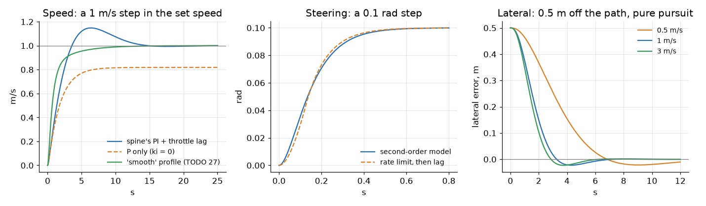
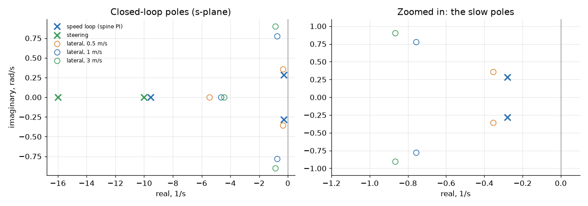
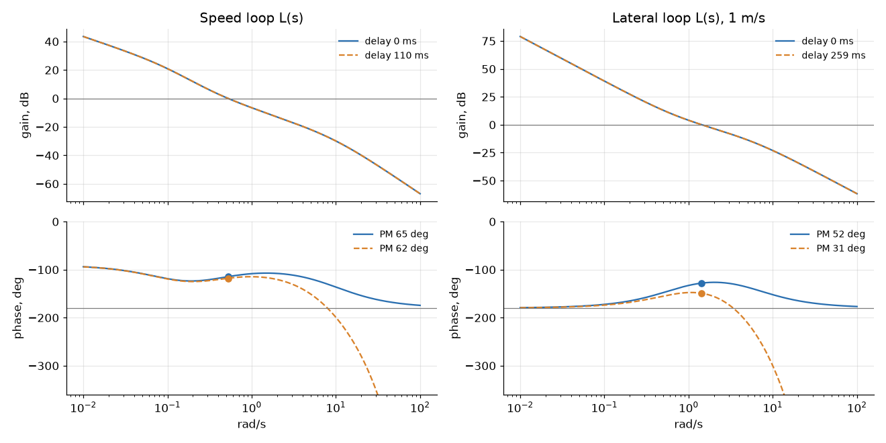

# The car as a linear model

Ben, 24 Oct: "Do we have a mathematical model for the car now for the ego? ... a matrix
control thing ... Maybe second order system". Now we do. This page writes the car the
way SYSC 3600 (Systems and Simulation) would: differential equations, Laplace, transfer
functions, state space, poles, step responses and Bode margins.

**New to this, or rusty?** Start with [Learn: state space](learn-state-space.md): the whole
process, from a free-body diagram to a simulator, one step at a time.

!!! note "The short version"
    - **Three parts:** speed (second order, with the spine's PI around it), steering
      (second order), and the path errors (state space, 3 states).
    - **Today's numbers are guesses** from `vehicle.yaml`. The car day's actuator tests
      measure each one; `pixi run vehicle-model --set throttle_lag=0.25` redoes it all.
    - **The spine's speed loop is slow:** it settles in about 13 s. Delays don't matter
      to it (62° of phase margin even in the worst case).
    - **The lateral loop is where delays matter:** 52° of phase margin with none, 45°
      with today's 84 ms, 31° with the worst case (259 ms) at 1 m/s.
    - **Gazebo's car steers 0.11 s slower than `vehicle.yaml` says** (measured: an extra lag in
      Gazebo's own steering). Worth fixing before the sim-versus-real report.
    - **Nothing here drives the car.** It is for tuning, checking, and the report.

[[works]] the maths and its 30 tests (24 Oct, Ben's Mac). [[needs-you]] the car day's
numbers.

## The picture

The whole chain, from the set speed and the path to the car:

```text
 SPEED (the spine, every 10 ms)
                     ┌──────────┐ u   ┌────────────┐ u_a ┌──────────────┐  v
 v_set ──►(+)──e────►│ PI       │────►│ throttle   │────►│ the car      │──┬──► speed
           ▲ -       │ kp+ki/s  │     │ 1/(τt s+1) │     │ K/(τv s+1)   │  │
           │         └──────────┘     └────────────┘     └──────────────┘  │
           └──────────────────── wheel speed (a delay) ◄────────────────────┘

 STEERING AND THE PATH (the controller, every 50 ms)
                     ┌──────────┐ δcmd ┌─────────────────────┐ δ  ┌────────────────┐
 path ───►(-)───────►│ pure     │─────►│ Jrk + linkage       │───►│ bicycle        │──┬─► e_y, e_θ
           ▲         │ pursuit K│      │ ωn²/(s²+2ζωn s+ωn²) │    │ θ'=vδ/L, y'=vθ │  │
           │         └──────────┘      └─────────────────────┘    └────────────────┘  │
           └──── camera, detections, the controller's cycle: e^(-sT) ◄────────────────┘
```

## The symbols

| Symbol | Means | Today | From |
|---|---|---|---|
| v | speed along the car | m/s | |
| u | throttle command, 0 to 1 | | the spine |
| u_a | the throttle actually applied | | |
| a_max | acceleration at full throttle | 1.5 m/s² | `max_accel` GUESS |
| d | drag: speed lost per second per m/s | 0.1 /s | `drag` GUESS |
| K = a_max / d | speed that full throttle would hold | 15 m/s | |
| τv = 1 / d | the car's own time constant | 10 s | |
| τt | the throttle's lag | 0.1 s | `throttle_lag` GUESS |
| kp, ki | the spine's PI gains | 0.3, 0.1 | `speed_loop.rs` |
| r | the steering motor's top speed | 0.8 rad/s | `steer_rate` GUESS |
| τm | the motor, as a lag (below) | 0.0625 s | |
| τl | the linkage's lag | 0.1 s | `steer_lag` GUESS |
| ωn, ζ | the steering's natural frequency, damping | 12.6 rad/s, 1.03 | |
| δ | the wheel angle (centre wheel), + left | rad | |
| L | wheelbase | 1.57 m | `wheelbase` TODO measure |
| e_y, e_θ | sideways and heading error from the path | m, rad | |
| ld | pure pursuit's lookahead | 1.5 to 4 m | `nav2.yaml` |
| T | a delay | s | |

## 1. Speed

### The differential equations

The throttle reaches its level with a first-order lag:

```text
τt · du_a/dt + u_a = u
```

The car speeds up in proportion to the throttle, and drag slows it in proportion to
its speed:

```text
dv/dt = a_max · u_a − d · v
```

Divide by d. It's the textbook first-order form:

```text
τv · dv/dt + v = K · u_a        τv = 1/d = 10 s,   K = a_max/d = 15 m/s
```

### Laplace and transfer functions

```text
V(s) / U_a(s) = K / (τv s + 1)                    the car
U_a(s) / U(s) = 1 / (τt s + 1)                    the throttle
P(s) = K / ((τv s + 1)(τt s + 1))                 throttle command to speed
```

Poles: s = −1/τv = **−0.1** (the car: slow) and s = −1/τt = **−10** (the throttle: fast).
Alone, the car reaches 63 % of its final speed after τv = 10 s.

### State space

```text
x = [v, u_a]

x' = A x + B u        A = [ −d    a_max ]      B = [  0   ]
                          [  0   −1/τt  ]          [ 1/τt ]
y  = C x              C = [ 1  0 ]
```

### The spine's speed loop around it

`firmware/spine/crates/spine-core/src/speed_loop.rs`, while it uses the throttle:

```text
e = v_set − v
throttle = kp·e + ki·∫e dt          C(s) = kp + ki/s = (kp s + ki)/s
```

The closed loop, T(s) = C P / (1 + C P). Leave out the fast throttle lag first: the
characteristic equation is

```text
s² + (d + a_max·kp) s + a_max·ki = 0
s² + 0.55 s + 0.15 = 0
s = −0.275 ± 0.273j          ωn = 0.39 rad/s,   ζ = 0.71
```

| Loop | Poles (1/s) | Rise (10-90 %) | Overshoot | Settles (2 %) |
|---|---|---|---|---|
| the car alone | −0.1 | 22 s | 0 | 39 s |
| spine PI, no throttle lag | −0.275 ± 0.273j | 2.7 s | 14 % | 12.9 s |
| spine PI + throttle lag | −0.28 ± 0.28j, −9.5 | 2.6 s | 15 % | 12.7 s |



**What the poles mean for the car:**

- The pair at −0.28 ± 0.28j: the car reaches a new speed in about 3 s, overshoots by
  15 %, and settles in 13 s. Slow, but smooth.
- The overshoot is more than ζ = 0.71 alone gives (about 4 %): the PI adds a zero at
  −ki/kp = −0.33, near the poles. The spine's ramped set speed hides most of it.
- The pole at −9.5 is the throttle: 30 times faster, so it hardly matters.

### Steady state: the final value theorem

| Case | Final value theorem | Result |
|---|---|---|
| a step, with the spine's PI | e = 1 / (1 + L(0)), and L(0) = ∞ (the integrator) | **0**: no error left |
| a step, P only (ki = 0) | e = 1 / (1 + kp·K) = 1 / (1 + 0.3 × 15) | 18 % short |
| a ramp of 1.5 m/s² (the spine's slew) | e = r / Kv,  Kv = lim s·L(s) = ki·K = 1.5 /s | 1.0 m/s behind while it ramps |
| a ramp of 1.0 m/s² (ego's limit) | the same | 0.67 m/s behind |
| today's open loop (no wheel speed) | v = K · (target / 3.0) | 5 × the target |

!!! warning "Two guesses disagree"
    Today's ESP32 has no wheel speed, so it runs the speed open loop: throttle =
    target / 3.0 m/s (`FULL_THROTTLE_SPEED`). The model's guesses say full throttle
    holds K = a_max / d = 15 m/s. Both can't be right: either the drag is about 0.5 /s,
    or full throttle gives more than 3 m/s. Tests 4.2 (`coast`) and 4.4
    (`throttle-map`) settle it. Until then, keep ego's 1 m/s cap.

### What the linear model leaves out

| Nonlinearity | In the spine | Effect |
|---|---|---|
| throttle 0 to 1 | `clamp01` | big errors saturate: the car speeds up at a_max at most |
| the integral 0 to 0.3 | `integral_limit` | anti-windup; holds up to 0.3 × K = 4.5 m/s on the flat |
| the brake | a P loop beyond the 0.2 m/s coast band | slowing down is a different, P-only loop: B(s) = −b_max / ((s + d)(τb s + 1)) |
| the set speed's ramp | 1.5 m/s² | steps become ramps (the table above) |
| the throttle's deadband | `throttle_deadband` | 0 today; a real one adds a dead zone at low speed |

## 2. Steering

The Jrk G2 turns the steering motor toward its target at up to r = 0.8 rad/s (a rate
limit: nonlinear). The linkage follows with a lag τl = 0.1 s.

**Linearising the rate limit.** For a step of size A, the rate limit takes A/r, and its
average delay is A/(2r). A first-order lag with that delay has

```text
τm = A / (2r) = 0.1 / (2 × 0.8) = 0.0625 s        (for A = 0.1 rad, a lane-keeping step)
```

Two lags in a row make a second-order system:

```text
G_s(s) = 1 / ((τm s + 1)(τl s + 1))
       = ωn² / (s² + 2ζωn s + ωn²)

ωn = 1 / √(τm·τl)                 = 12.6 rad/s
ζ  = (τm + τl) / (2·√(τm·τl))     = 1.03
```

| ωn | ζ | Rise | Overshoot | Settles |
|---|---|---|---|---|
| 12.6 rad/s | 1.03 (just overdamped) | 0.28 s | 0 | 0.49 s |

**What it means:** the steering is about 10 times faster than the path loop (ωn 12.6 vs
about 1 rad/s), so the path loop sees it as a small delay, τs = 2ζ/ωn = 0.16 s.

**What's a guess:** all of it. Two real lags can never overshoot (ζ ≥ 1). If the Jrk's own
position loop overshoots on the car, read the overshoot off test 3.11's step, and
`--set steer_overshoot=0.1` sets ζ from the textbook formula:

```text
overshoot = exp(−ζπ / √(1 − ζ²))        ζ = −ln(OS) / √(π² + ln²(OS))
```

**Left out:** the rate limit itself (big steps take A/r: full lock from centre takes
0.6 s), the deadband (0.005 rad), and the software's own rate limits before it (ego and
the spine: 0.6 rad/s, slower than the motor).

## 3. The path: lateral state space

### The kinematic bicycle

The same model as ego and MPPI, about the rear axle (`base_link`), the path along x:

```text
x' = v · cos θ
y' = v · sin θ
θ' = v · tan δ / L
```

### Linearised about driving straight

Small angles: sin θ ≈ θ, tan δ ≈ δ. With the steering as one lag τs:

```text
e_y' = v · e_θ
e_θ' = (v / L) · δ
δ'   = (δcmd − δ) / τs
```

```text
x = [e_y, e_θ, δ],   u = δcmd

     [ 0   v    0     ]        [  0   ]
A =  [ 0   0   v/L    ]    B = [  0   ]
     [ 0   0  −1/τs   ]        [ 1/τs ]
```

At 1 m/s, today: `A = [[0, 1, 0], [0, 0, 0.637], [0, 0, −6.15]]`, `B = [0, 0, 6.15]ᵀ`.
`lateral(v, steering_order=2)` gives the 4-state version with the second-order
steering (δ' as a state).

**Eigenvalues: 0, 0 and −1/τs = −6.15, at every speed.** The two at 0 are a double
integrator: steer, and the heading changes; the heading, and the car drifts sideways.
Left alone, nothing pulls the car back. Speed changes **B's reach** (v and v/L), not the
eigenvalues; in reverse, v < 0 flips the signs.

The test checks A against a finite-difference Jacobian of the nonlinear bicycle.

### Closing the loop: pure pursuit

Regulated Pure Pursuit steers for the curvature 2 sin α / ld toward a point ld ahead on
the path. For small errors:

```text
δcmd = −(2L / ld²) · e_y − (2L / ld) · e_θ          u = −K x
```

With no steering lag, the closed loop is

```text
s² + (2v / ld) s + 2v² / ld² = 0        ωn = √2 · v / ld,    ζ = 0.707 at every speed
```

RPP's lookahead grows with speed (ld = 1.5 s × v, from 1.5 to 4 m), so v / ld stays the
same from 1 to 2.7 m/s: **the car corrects in the same time at any of those speeds.**

| v (m/s) | ld (m) | Closed-loop poles (with the steering) | ωn, ζ |
|---|---|---|---|
| 0.5 | 1.5 | −0.35 ± 0.36j, −5.5 | 0.50, 0.71 |
| 1 | 1.5 | −0.76 ± 0.78j, −4.6 | 1.09, 0.70 |
| 2 | 3.0 | −0.76 ± 0.78j, −4.6 | 1.09, 0.70 |
| 3 | 4.0 | −0.87 ± 0.90j, −4.4 | 1.25, 0.69 |



## 4. The delays

| Delay | Value | Where it comes from |
|---|---|---|
| camera to detections | 26 ms median, 42 worst | [Camera pipeline](camera-pipeline.md), on a Mac |
| the camera's frame | 67 ms (15 fps): half on average | the picture's age when taken |
| the controller's cycle | 50 ms (20 Hz): half on average | `nav2.yaml` `controller_frequency` |
| the heartbeat | up to 100 ms | the most a command may lag before the ESP32 brakes ([HUD](hud.md#the-heartbeat), TODO 50) |
| the spine's tick | 10 ms | `esp32-umod` `TICK` |
| the wheel speed's age | 50 ms GUESS | the time between Hall pulses at low speed |

| Case | Lateral loop | Speed loop |
|---|---|---|
| none | 0 | 0 |
| typical | 26 + 33 + 25 = **84 ms** | 5 + 25 = **30 ms** |
| worst | 42 + 67 + 50 + 100 = **259 ms** | 10 + 100 = **110 ms** |

The lateral delays are lane keeping's, by camera. Nav2 following a path from the EKF has
no camera in the loop (its own delay is the EKF's), so its margins sit between "none" and
"typical". The heartbeat isn't a delay in normal driving: it is the most a command may
lag before the brakes take over, so the worst case counts all of it.

**Padé.** A delay e^(−sT) isn't a ratio of polynomials. Padé replaces it with one, so
poles still make sense:

```text
e^(−sT) ≈ (1 − sT/2 + (sT)²/12) / (1 + sT/2 + (sT)²/12)        (second order)
```

The margins below use the exact delay (it only subtracts ωT from the phase); `pade()`
is there for pole maps and for simulation.

### The margins (Bode)



**Speed loop** (the spine's PI + the throttle's lag):

| Delay | Phase margin | Gain margin | Crossover | Bandwidth |
|---|---|---|---|---|
| none | 65° | ∞ | 0.52 rad/s | 0.70 rad/s |
| typical, 30 ms | 64° | 38 dB | 0.52 rad/s | 0.71 rad/s |
| worst, 110 ms | 62° | 27 dB | 0.52 rad/s | 0.74 rad/s |

Its crossover is so low (0.52 rad/s) that 0.11 s costs only 3°.

**Lateral loop** (pure pursuit + the steering), phase margin / gain margin:

| v (m/s) | None | Typical, 84 ms | Worst, 259 ms | Extra delay it could still take |
|---|---|---|---|---|
| 0.5 | 59° / ∞ | 55° / 25 dB | 48° / 16 dB | 1.3 s |
| 1 | 52° / ∞ | 45° / 19 dB | 31° / 9 dB | 0.55 s |
| 2 | 52° / ∞ | 45° / 19 dB | 31° / 9 dB | 0.55 s |
| 3 | 50° / ∞ | 43° / 17 dB | 27° / 8 dB | 0.46 s |

**What it means:** every delay costs phase = crossover × delay. At 1 m/s the crossover
is 1.4 rad/s, so 84 ms costs 7° and the worst case 21°. 30° is the usual lower limit:
the worst case at 3 m/s (27°) is below it: the car would swing past the path
before settling. At ego's 1 m/s cap today,
there's room.

## 5. Discrete time: as the computers run it

The spine runs every 10 ms; the controllers every 50 ms. `scipy.signal.cont2discrete`
with a zero-order hold (the command is held until the next one) gives

```text
x[k+1] = Φ x[k] + Γ u[k]        Φ = e^(AT),   Γ = ∫₀ᵀ e^(Aτ) dτ · B
```

| Loop | Period | Largest \|z\| | e^(sT) of the continuous poles |
|---|---|---|---|
| speed (the spine's own update: integral first, then kp·e + I) | 10 ms | 0.99720 | 0.99720 |
| lateral at 1 m/s, the command one cycle late | 50 ms | 0.960 | 0.963 |
| lateral at 3 m/s, the command one cycle late | 50 ms | 0.954 | 0.958 |

All inside the unit circle: stable. At 10 ms the spine is effectively continuous. The
tests check the discrete model against the continuous one at every sample, and the
discrete speed loop against the spine's own code, line by line.

## 6. Gazebo's car against the model

Gazebo's car runs our actuator model (`aav_gazebo` `actuator_model.py`, the same
numbers), then Gazebo's own Ackermann plugin:

| | Speed | Steering |
|---|---|---|
| the actuator model | `vehicle.yaml`'s lags, a_max, drag | rate limit, then `steer_lag` |
| Gazebo's plugin, after it | `max_acceleration` ±10 m/s²: no extra lag to speak of | each joint turns at `steer_p_gain` × error: **one more lag, 1/10 = 0.1 s** |
| the actuator tests in Gazebo (15 Oct) | give back 1.496 m/s², 0.100 s, 0.100 /s | give back 0.817 rad/s, 0.105 s: they read the model's angle, not Gazebo's wheels |

**Measured in Gazebo (24 Oct, Ben's Mac, headless, its own domain):** `actuator-test
steer-rate --sim` drove the steps (centre → full lock → centre, each way), and a
recorder logged Gazebo's steering joints (`/joint_states`, made into the centre angle)
beside the model's angle (`/vehicle/steering`), 57 s:

| Fit: Gazebo's wheels from the model's angle | Result |
|---|---|
| no lag | 16.2 mrad rms off |
| **a first-order lag** | **0.110 s**, 0.5 mrad rms off |
| a pure delay instead | 0.110 s, 2.2 mrad rms off |

0.110 s = 1/`steer_p_gain` (0.1 s) + about 10 ms from the adapter's 50 Hz hold. So
Gazebo's wheels steer 0.11 s later than `vehicle.yaml` says. Its lateral phase margin:

| v (m/s) | The model (typical delays) | Gazebo (+0.1 s) |
|---|---|---|
| 1 | 45° | 37° |
| 3 | 43° | 34° |

Gazebo is a little harsher than the car the guesses describe: anything that works there
has margin to spare. **To make them match** (not done: it changes the simulator): raise
`steer_p_gain` to 50 (a 20 ms lag), or take 0.1 s off the steering lag the adapter uses.
Then measure Gazebo's wheel angle (its joint states) against the model's, for the
sim-versus-real report (T2.7). Speed: the 15 Oct runs match (0 to 3 m/s in 6.2 s), except
that Gazebo's car starts rolling about 0.3 s late.

## 7. Which numbers are guesses

| Number | Today | Measured by | Changes |
|---|---|---|---|
| `max_accel` | 1.5 m/s² | 4.1 `speed-up`, 4.4 `throttle-map` | K, the loop's speed |
| `drag` | 0.1 /s | 4.2 `coast` | K and τv: the slow pole |
| `throttle_lag` | 0.1 s | 4.1 `speed-up` | the fast speed pole |
| `max_brake`, `brake_lag` | 3.0 m/s², 0.2 s | 4.3 `brake` | the brake loop |
| `steer_rate` | 0.8 rad/s | 3.11 `steer-rate` | τm, ωn |
| `steer_lag` | 0.1 s | 3.11 `steer-rate` (and 4.5 `circles`) | τl, ωn, ζ |
| ζ of the steering | from the two lags | 3.11's step, if it overshoots | `steer_overshoot` |
| `wheelbase` | 1.57 m | the tape measure (M-list) | v/L in A |
| the wheel speed's age | 50 ms | the Arduino's pulse rate (H-list) | the speed loop's delay |
| delays on the Orin | the Mac's 26 ms | car day 4d, 5 | the lateral margins |

At the car, the actuator tests print the numbers; then:

```bash
pixi run vehicle-model --set throttle_lag=0.25 --set drag=0.3 --set steer_lag=0.15
```

In code, `model.with_measured(report.yaml)` takes the actuator tests' report as it is.

## What it's for

### Tuning the spine's speed loop by pole placement

Match the closed loop (no throttle lag) to the poles you want:

```text
s² + (d + a_max·kp) s + a_max·ki  =  s² + 2ζωn s + ωn²
kp = (2ζωn − d) / a_max
ki = ωn² / a_max
```

Example, `place_speed_gains(0.9, 1.0)`: kp = 1.13, ki = 0.67. Settles in 4.9 s instead
of 12.7, phase margin still 54° in the worst case. But kp = 1.13 saturates the throttle
for errors over 0.9 m/s, so it holds only with the ramped set speed. **Not changed:** the
gains wait for the measured a_max and drag (or the spine would be tuned to guesses).

### Checking the delays

The margins table is the check: before raising ego's speed cap, make sure the lateral
loop keeps 30° or more with the Orin's measured delays.

### Making Gazebo's car match the real one

Fit the car day's numbers, put them in `vehicle.yaml`, fix Gazebo's extra steering lag
(section 6), then compare the same step in both: that's the sim-versus-real report.

### After state space

| Next | What | Why it fits here |
|---|---|---|
| LQR for lane keeping | choose Q and R; `scipy.linalg.solve_continuous_are` gives K for u = −Kx | the same A and B: a better K than pure pursuit's, with a guaranteed 60° phase margin (before delays) |
| The EKF | robot_localization is a Kalman filter on a state-space model | x' = f(x, u) and its Jacobian: the same linearising as section 3 |
| Gain scheduling | K(v) | A changes with v; RPP's lookahead already does this |

## Run it

```bash
pixi run vehicle-model                  # the tables, and the three figures
pixi run vehicle-model --no-figures     # the tables only
```

| File | What |
|---|---|
| `src/ego/aav_ego/aav_ego/vehicle_model.py` | the maths: no ROS, numpy and scipy only |
| `src/ego/aav_ego/test/test_vehicle_model.py` | 27 tests: textbook cases, the Jacobian, the final value theorem, discrete vs continuous, the gains against the Rust |
| `tools/vehicle_model.py` | the tables and `docs/img/vehicle-model-*.png` |
