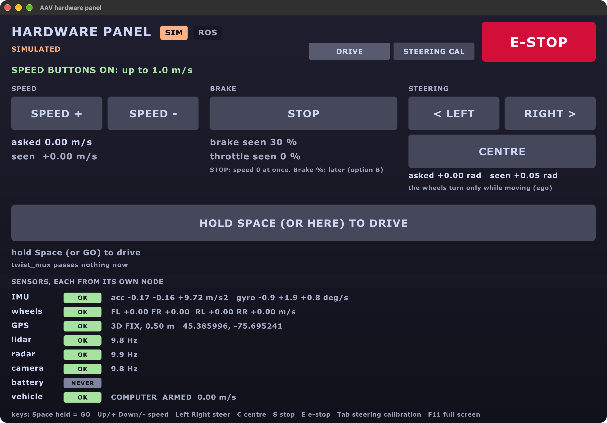
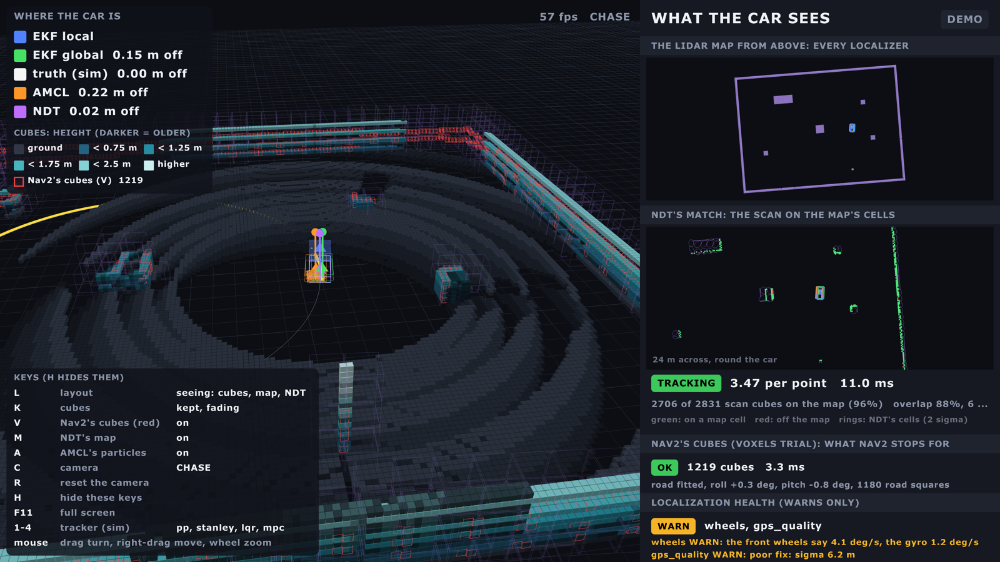
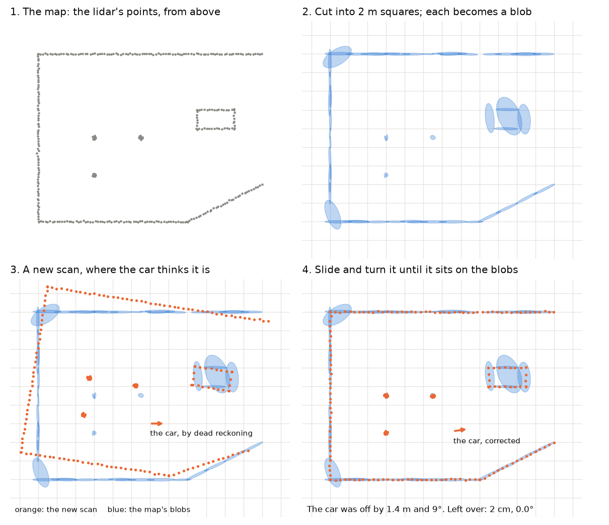
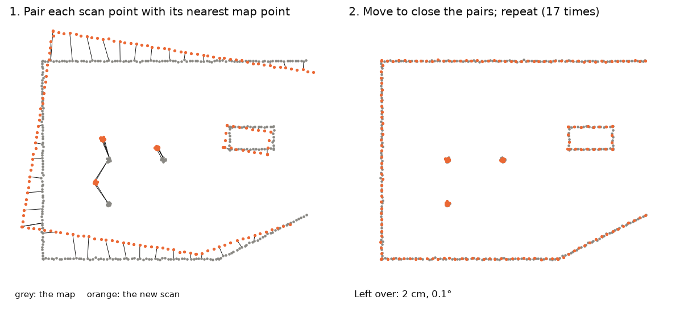
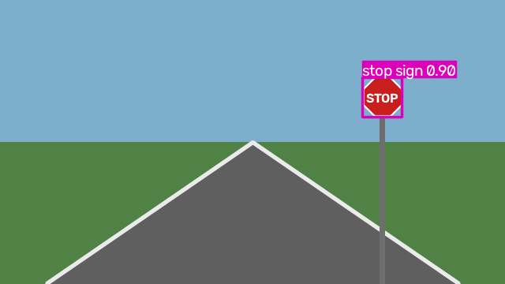
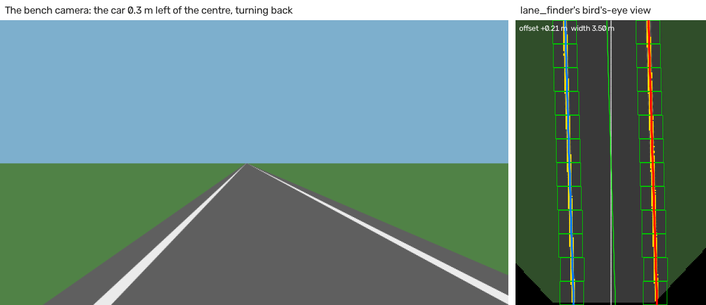
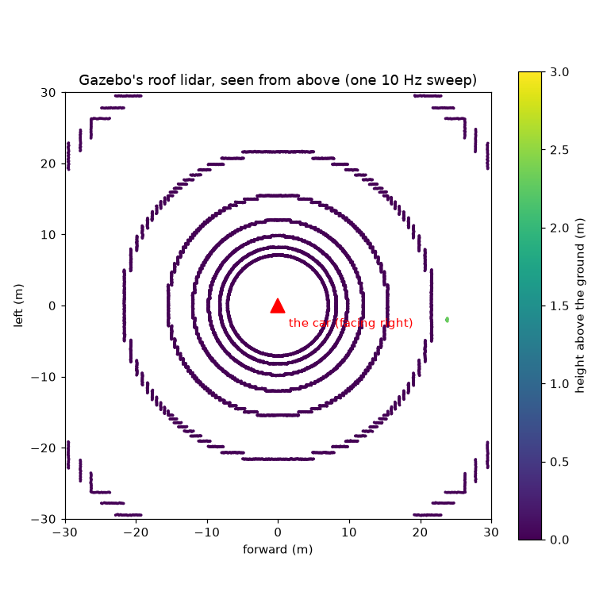
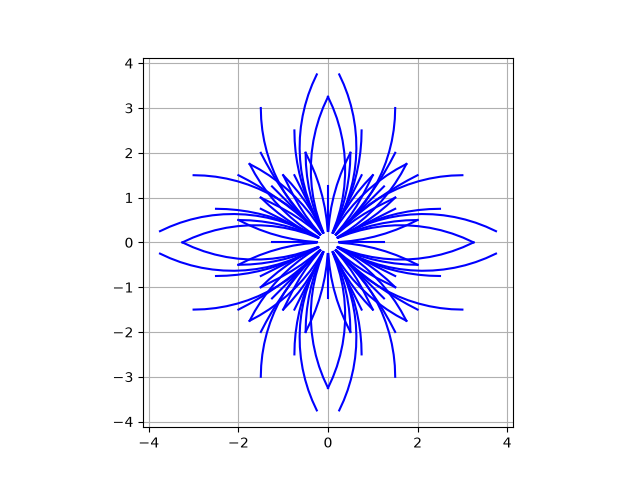
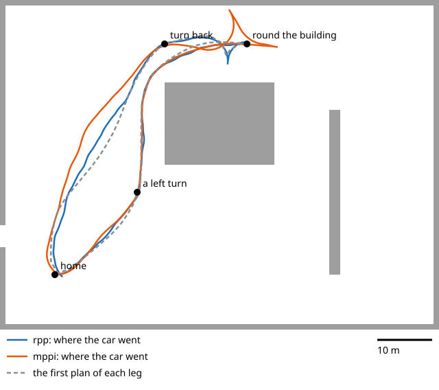

# What's new: 22 October to 1 November

Everything the last few pull requests added (#13 to #19, and the branch after), by area.
The full list of every feature, with who built it: [Features](features.md). How to switch
each trial on: [Switches](switches.md).

> **The short version**
> - **Screens:** a hardware panel with simple buttons, and a debug screen that shows what the car sees in 3D.
> - **Where am I:** the lidar's point cloud now feeds NDT (a map match) and KISS-ICP (how far it moved), beside the two EKFs.
> - **What's around:** RF-DETR (not YOLO) for objects, OpenCV for lanes, the lidar as a flat scan or as cubes.
> - **Getting there:** five planners, six path followers, reversing and the U-turn.
> - **Talking to it:** a local Qwen model with our own harness, and MCP so Claude can drive the sim.
> - Everything here has run in Gazebo; **none of it has driven the real car yet.**

```text
 sensors ──► localization ──► perception ──► navigation ──► ego ──► the car
 (lidar,     (EKFs, NDT,      (RF-DETR,      (planners,              (spine,
  GPS, IMU)   KISS-ICP)        lanes, cubes)  followers)              ESP32)
        screens: hardware panel, debug screen · language: Qwen, MCP, Claude
```

**Status:** *sim* = works in Gazebo; *built* = built and tested, not yet in a full run.

## Hardware interface: the two screens

### The hardware panel (`pixi run hw-panel`)

Every sensor's number from its own node, and very simple buttons: speed up and down,
left, right, centre, stop. The car moves only while you **hold** Space (or GO).



| What | Why | Status |
|---|---|---|
| OK / STALE / NEVER for each sensor | see at a glance what's missing | sim |
| Hold to drive, through twist_mux's slot 45 | a person always outranks it; let go and it stops | sim |
| SIM and BENCH only | not on the real car until its own test (TODO 49b) | built |

### The debug screen (`pixi run debugdemo`)

Left: the lidar as cubes in 3D, and where each localizer thinks the car is. Right: the
lidar map from above, and NDT's match. New on 1 Nov: **Nav2's cubes** in red (key V), and
**localization health**.



| Colour | Who says where the car is |
|---|---|
| blue | EKF local (wheels, IMU) |
| green | EKF global (plus GPS) |
| purple | NDT |
| orange | AMCL |
| white | Gazebo's truth (sim only) |

### The firmware behind it

| What | Who | Status |
|---|---|---|
| The spine's state machine, self-test at boot, hardware test mode | Arsh | built |
| The ESP32's Rust firmware: brakes 111-120 ms after the Orin's heartbeat stops | Ben | built (QEMU) |
| The preflight on stands (`pixi run preflight`) | Ben | sim |
| Geofence and stop hold (new twist_mux locks) | Ben | sim |

## Localization: where am I?

```text
 lidar point cloud ─┬─► NDT (on a saved map) ──────────► EKF global (map → odom)
                    └─► KISS-ICP (how far it moved) ──► EKF local  (odom → base_link)
 GPS, GPS heading ─────────────────────────────────────► EKF global
 wheels, IMU ──────────────────────────────────────────► EKF local
```

| Piece | What it does | Switch | Result in Gazebo | Status |
|---|---|---|---|---|
| **EKF local and global** | the default: wheels + IMU, then GPS | always | 0.2 m off the truth | sim |
| **NDT** (ours, Rust) | matches the lidar to a saved map | `ndt:=true` | 1-3 cm off, 2 ms a match | sim |
| **NDT into EKF global** | uses that match to correct the map position | `ndt_ekf:=true` | 17 cm → **1.6 cm**; holds with the GPS off | sim |
| **KISS-ICP** (stock, MIT) | how far the car moved, from lidar alone | `kiss_icp:=true` | 0.04 m drift per 100 m (wheels: 0.33) | sim |
| **KISS-ICP into EKF local** | its speed and turn rate into the EKF | `kiss_ekf:=true` | not a clear win yet: off by default | sim |
| **AMCL** (stock) | a particle filter on a 2D map | `amcl:=true` | lost itself: the EKF wins | built |
| **Health checks** (Betsi) | warns on gyro bias, a tilted IMU, bad GPS, wrong frames | `health:=true` | on the debug screen, in `pixi run check` | sim |

### NDT, in one picture

The map becomes blobs; a new scan slides and turns until it sits on them.



### ICP, in one picture

Each scan point pairs with its nearest map point; move to close the pairs; repeat.



## Perception: what's around?

| Piece | What it does | Result | Status |
|---|---|---|---|
| **RF-DETR Nano** (not YOLO; Apache-2.0) | finds objects and stop signs | a stop sign from 20 m (YOLO11n: 10 m), no false finds | sim |
| A second detector on a Mac (Core ML) | a second opinion over WiFi | 21 ms a picture on a MacBook | sim |
| **Lane finder** (classic OpenCV, no model) | finds the lane from the camera | 0.78 ms a picture | sim |
| Radar clustering (Rust) | radar points into objects | the same answers as the C++, bit for bit | sim |





## Navigation in 2D and 3D: the lidar for Nav2

The lidar sends about 29,000 points ten times a second. Nav2 reads them one of two ways:

| | **Flat scan** (2D, the default) | **Cubes** (3D, a trial: `voxels:=true`) |
|---|---|---|
| What | one slice: 720 distances round the car | 0.25 m cubes, measured from the road fitted to each cloud |
| Size | 720 numbers | about 1,200 cubes |
| Sees height? | no | yes: a kerb, a table edge; a leaning car doesn't see the road |
| Result in Gazebo | the default | stopped 0.44 m before a post; 4 of 4 legs; 6 ms a cloud |



## Navigation: the route and the steering

### Planners: who draws the route (`planner:=`)

| Planner | Keeps to the turning circle? | Gazebo, the lot tour | |
|---|---|---|---|
| **State Lattice** (on our own moves) | yes | every leg, **184 s** a tour (with reversing) | **the default** since 1 Nov |
| Hybrid-A* | yes | every leg, 213 s | the default when forward only |
| Lattice, 32 headings | yes | every leg, 197 s: no better | trial |
| Smac 2D | no | 2 of 4 (forward only) | trial |
| NavFn, Theta* | no | not tried | trial |

The lattice strings together short moves our car can really make, worked out from
`vehicle.yaml` (`pixi run lattice-primitives`):



### Path followers: who steers along it

29 Oct, Gazebo's lot, forward only, 3 runs each:

| Follower | Legs finished (of 12) | Note |
|---|---|---|
| Pure pursuit | **12** | ours, the simplest |
| Stanley | **12** | ours |
| MPC | **12** | ours, 6 ms worst |
| RPP (Nav2) | 10 | |
| **MPPI** (Nav2, the default) | 8 | lost the U-turn; reads the costmap, which the others don't |
| LQR | 8 | swings wide at full lock |

`tracker:=pure_pursuit` (or `stanley`, `lqr`, `mpc`) swaps them; in Gazebo, live, with
keys 1-4 on the debug screen.

### Reversing and the U-turn

On again on the car since 1 Nov, at 0.5 m/s at most, only where the lidar watches behind.
Forward only, a U-turn in a narrow lane fails about half the time; reversing, the car
makes a three-point turn (16 of 16 legs with the lattice).



## Talking to the car

```text
 you ──► talk (Qwen 3, on this computer) ──► drive server (MCP) ──► the car's actions
 Claude Code ─────────────────────────────► drive server (MCP)
 Claude Code ─────────────────────────────► read-only server (MCP): docs, contract, live graph
```

| Piece | What it does | Status |
|---|---|---|
| **Qwen 3 (4B) with our own harness** (`pixi run -e llm talk`) | plain English ("drive 10 m forward") into steps, on the laptop, no internet; asks **yes** before the car moves | sim |
| The harness (`aav_language`: `react.py`) | our own ReAct loop: reads Qwen's, Llama's, Gemma's and Mistral's tool formats | sim |
| **MCP drive server** (`aav-drive`) | lets Claude (or any MCP app) drive: distance, turn, go to a GPS point, stop, e-stop; hard limits it won't break | sim |
| **MCP read-only server** (`aav`) | lets Claude read the docs, the topic contract and the live ROS graph; never writes | built |

## Tools to find all this again

| Tool | Does |
|---|---|
| `pixi run pick` | a menu of every switch above, in plain words; it runs the command |
| [Switches](switches.md) | every switch on one page |
| [Trials](trials.md) | every result, and how it was measured |
| `pixi run check <profile>` | the running graph against the contract, then the health line |
