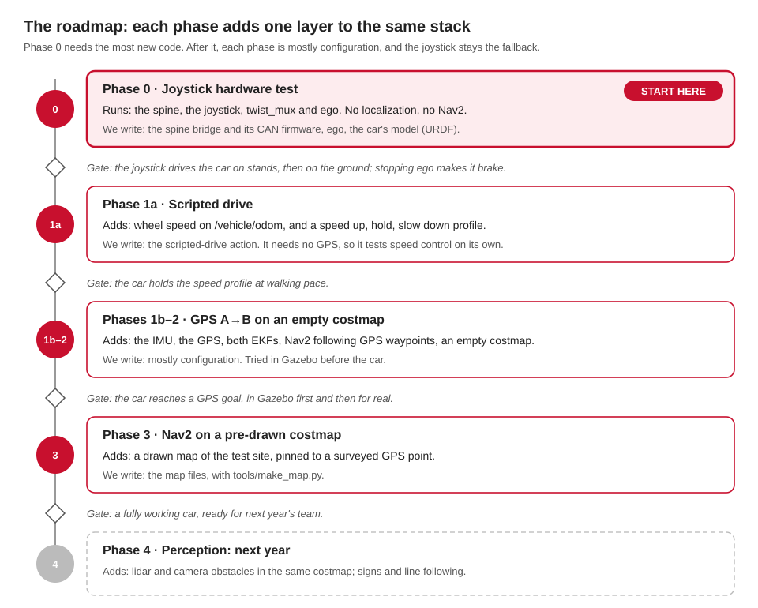

# Work: what's done, and what needs doing

Where the project stands on 10 October 2026: the plan in five phases, the next twelve
steps, what's done, and the work left in each area. Who owns each area is Q33: see
[Starting points](team.md).

## The plan

## Where we are

| Part | State |
|---|---|
| The software stack | [[works]] end to end in simulation: the turtle, Gazebo, Nav2 goals, replay. On Linux, and on a Mac since 10 Oct |
| The car | [[untested]] nothing has run on it yet. It runs the 2025-26 software on Humble, and the spine's board code is missing |
| Phase 0 on the car | waits on Jazzy on the car's computers (Q24), and on the spine (Q10–Q17) or the legacy path |

## The next twelve steps

From the design doc's next steps, in order.

| # | Step | State |
|---|---|---|
| | **Now** | |
| 1 | **Secrets:** whoever controls the accounts revokes the GitHub token and Firebase keys, and changes the WiFi password (Q34) | [[needs-you]] |
| 2 | **Backups:** image the Orin and the Pis before anything is reflashed, and list what's on them | [[needs-you]] |
| 3 | **Inventory the car:** take a tape measure and Q1–Q9, Q18, Q20 and Q22 to the car. Photograph the labels on the GPS, the IMU, the motor controller and the actuators | [[needs-you]] |
| 4 | **Team meeting:** accept or change each Proposed decision, and name an owner per area (Q33) | [[needs-you]] |
| | **Without the car** | |
| 5 | **Repo:** on GitHub (`zander1976/aav`, private), with CI running `pixi run test` on Linux and a Mac | [[untested]] CI's first run comes with the first push |
| 6 | **Jazzy everywhere:** every developer installs it, with Pixi | [[works]] on oirp-spss and Ben's Mac |
| 7 | **ego and the turtle with a real joystick:** the first end-to-end chain | [[works]] with the keyboard; the joystick is [[untested]] |
| 8 | **Scripted driver:** an action, tested in turtlesim | [[works]] |
| 9 | **CAN frame map:** finish the DBC with the firmware owner; bench-test the spine with a USB-CAN adapter and `candump` | [[untested]] the DBC is a draft; no spine board yet |
| 10 | **URDF:** from the measurements | [[untested]] it exists, with guessed numbers |
| | **On the car** | |
| 11 | **Phase 0:** CAN to the Orin and the spine, then the `car` profile on stands with localization and Nav2 off, then on the ground at walking pace | [[missing]] |
| 12 | **Phase 1:** the scripted drive on the car. GPS A→B in Gazebo first, then on the car | [[missing]] |

## Done so far

| When | What |
|---|---|
| 9 Oct, before the first commit | Surveyed all 19 of the 2025-26 team's repos; found the leaked secrets; wrote the design doc with Q1–Q34 |
| 9 Oct, evening | The workspace: our messages, the CAN map and its codec, `spine-core`, ego, both bridges, the adapters, the scripted driver, `vehicle.yaml`, the map maker. It builds on Jazzy with Pixi, and the turtle drives through the mux and ego |
| 9–10 Oct, overnight | Three audits (the firmware contract, the Jazzy port, a live run) and their fixes; the spine's safety rules (arming, timeouts, faults); the docs as web pages and a PDF; the Rust example; the network doctor; design doc revision 58 |
| 10 Oct, on Ben's Mac | Everything builds and passes on a Mac, after one macOS fix; the turtle, Gazebo, Nav2, the Rust example, the docs and the doctor all run; recording fixed for Macs; these pages |
| 10 Oct, afternoon | Perception brought in: YOLO with a stop-sign lock, radar clustering, lane keeping on `/cmd_vel/ai`; the `ml` environment (PyTorch, YOLO, Core ML); the HUD's back end on our topics; the spine's device drivers in Rust; bench mode: the whole car graph on a laptop, with the spine's firmware logic on a model car, and `pixi run bench-check` (7 of 7). Found on the way: a stop that coasted, a scripted drive that stretched, an executor that spun a CPU core, and best-effort cameras that lost every image on a Mac |

## What needs doing, by area

### Integration and the team

- Steps 1–4 above: secrets, backups, the car's inventory, the team meeting. Step 5, the repo, is done.
- One `ROS_DOMAIN_ID` for the car and every laptop.
- The car's computers on Jazzy: Pixi on today's Ubuntu 22.04 first, then the reflash to JetPack 7.2 after a backup (Q24).
- Merge the older code into `aav` folder by folder: see [The older code](older-code.md).
- A `.gitignore` for every kind of code, and a `vendor/` folder for downloaded source (proposed).

### Today's car: the legacy path

- Run `aav_legacy` on the car for the first time: wheels off the ground, e-stop in reach, low speed.
- Check the steering sign, the throttle direction, and that the car stops when the deadman is released.
- Use `/dev/serial0`, not `/dev/ttyAMA0`, on the Motor Pi: `ttyAMA0` is the Bluetooth UART on a Pi 3 or 4.
- Make `secrets.h` from `secrets.h.example`, with a new WiFi password.

### The spine and CAN

- Choose the microcontroller, the board and the owner (Q10–Q13).
- Write the board program around `spine-board`: it implements the `Board` trait (the clock, the e-stop pin, the encoder counter, CAN) for the chosen chip. The drivers and the glue are done.
- Decide: the steering on an e-stop (hold, or centre as the old firmware did); the brake after boot; a brake field for the RC gear switch. [Firmware](firmware.md) has the details.
- Tune the speed loop on the car: on the bench it lags a ramp by about a second.
- Wire CAN: a transceiver on the Orin (or a USB adapter), 120 Ω at each end (Q14, Q15).
- Calibrate the steering (Q2), the brake (Q3) and the throttle (Q4).
- Still open in the logic: the e-stop frame's counter isn't checked, and what happens when RC releases and when nobody drives.

### Ego and vehicle control

- Measure the car (Q1) and replace every guess in `vehicle.yaml`.
- Steering at standstill (Q27).
- Raise the 1.0 m/s speed cap only as the test plan allows.

### Localization and sensors

- Identify the GPS (Q18) and pick its driver: `ublox_dgnss` or `ublox`.
- Survey the test site's datum, and set the magnetic declination (0 now; about 12° W in Ottawa).
- Run the IMU on the car (Q20); convert its magnetometer to tesla, then calibrate it.
- The wheel encoder: run it on the car; its speed comes in steps of about 1.2 m/s, too coarse at walking pace.
- Fill in the USB serial numbers in `tools/udev/99-aav.rules`.

### Navigation and costmaps

- Draw the real test site (Q21) and drive it in Gazebo first.
- Nav2's lookahead (N7): its turn command flips sign about once a second.
- Restart crashed sensor drivers (N3): Nav2 gives up without TF.
- Later: the radar obstacle layer, and the collision monitor. The radar's clusters are ready on `/radar/clusters`.

### Drivers and teleop

- The first real joystick test, and the team joystick's button numbers.
- The e-stop button: pick one (not the deadman), and make `/estop` reach the mux reliably (N2).
- Joystick handover (Q28).

### Perception

- Find the 2024-25 team's trained `best.pt`, and back up the 2025-26 detector from the Orin.
- Write the lane finder: the camera's picture into `/lane_geometry`.
- Identify the cameras (Q22); fill in their udev names; set the stop-sign distance (`min_height_px`) for the real camera.
- TensorRT on the Orin, after the reflash (Q24).

### The HUD

- Keep the Flutter app or not (Q29). Its back end, `aav_hud`, is on the new topics; the app needs the small changes in [HUD](hud.md).
- Its boot scripts still use the old Humble workspace and `/home/aavui`.
- Its map database and the OSRM map data need a download step, not git.

### Simulation

- Look at the Gazebo window and RViz on a Mac, and say what they show.
- Make the bench's model car match the measured car (Q1-Q5), once it's measured.
- CARLA, once it supports Jazzy (Q31).

## Risks to keep in mind

| Risk | What we do about it |
|---|---|
| A runaway car: today's ESP32 has no command timeout | wheels off the ground and the e-stop in hand until the spine's watchdog exists |
| Leaked secrets in public repos | revoke and change them (Q34); never copy them into `aav` |
| Losing work on the Orin in the reflash | image it first |
| Jazzy and Humble on one network | move every computer together |
| A lost `/estop` message (N2) | the backends brake on it too; make it reliable |
| Plain GPS may be off by metres | identify the receiver early; RTK if it supports it |
| A wrong heading at start-up | calibrate the magnetometer on the car, or use two GPS antennas |
| Knowledge walks out each year | keep these pages, the contract and the design doc current |

## Small fixes found while writing these pages

| Item | State |
|---|---|
| `costmaps.md` said 1.5 m inflation; `nav2.yaml` has 2.0 m | fixed |
| `firmware.md` put the spine's limits in `limits.rs`; they're in `spine.rs` | fixed |
| `status.md` said the scripted driver was untested; it runs in the turtle | fixed |
| The contract credits `/battery_status` to `battery_monitor`; the node is `battery_state_publisher`, and `/battery_monitor_heartbeat` is missing | fixed |
| The static map → odom used with `gps:=false` isn't in the contract's `/tf_static` | fixed: `map_to_odom_no_gps` |
| `/radar/points` is best-effort; the contract doesn't say | fixed |
| `firmware/spine/Cargo.toml` points to a README that doesn't exist | fixed: the comment changed, and `firmware/spine/README.md` exists |
| `aav_gazebo`'s test skips at module level, which `CLAUDE.md` says not to do | fixed |
| The HUD's camera address differs: 192.168.1.101 in the old back end, .118 in the app | the back end takes it as a parameter now; the app still has its own |
| `car gps:=false` still starts the GPS driver when the machine file says `gps: true` | to do, once Ben's edits to `car.launch.py` are committed |
| Ctrl-C makes our Python nodes print an error while they shut down (Ctrl-C arrives twice) | fixed: 0 tracebacks from a full bench; the radar clustering's C++ can still crash inside Fast DDS |
| Rust builds on a Mac warn: the libraries are for macOS 14, Rust aims at macOS 11 | fixed: `MACOSX_DEPLOYMENT_TARGET=14.0` on Macs |
| `pixi run doctor` says "Network OK" on any 192.168.1.x network, like a home router | fixed: it says only "The car" check proves it |
